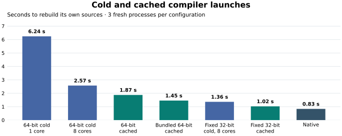

# Goose to Wasm

A [Goose](https://github.com/aardappel/goose) compiler written in Goose. It emits WebAssembly directly or native executables through C. It passes 10,697 of 10,801 conformance rows. [Compatibility tracker](docs/FEATURES.md)

## Benchmarks

**The compiler rebuilding itself.** On its own source, the balanced compiler broke one second at **0.96 s in cached Wasmtime** (−7.0% paired vs `4f98cee`, −10.0% instructions) and **0.79 s native** (1.22× paired elapsed time, 1.06× instructions, 1.04× backend time across seven pairs on CPU 7). On frozen source `9a6040a`, adding a depth-clocked inexact readback cache and far-effect memoization, zero-`LifeItem` builtin dispatch, scalar-load skipping, discovery-only error guards, unit-load-factor checker hash tables with inline `small_hashes` filtering and O(1) record-field ordering, optimizer leaf skips, prescan per-type region caching, and a single-pass / 1-byte ULEB local-reuse fast path cut cached Wasmtime rebuilds by **−4.4%** paired wall time (0.77 s → **0.74 s** paired, **0.74 s** release cached, **0.72 s** size profile, **5.73 B** instructions, −8.3%, lifetime **−6.1%**, optimize **−7.9%**, backend **−6.1%**) and **−4.3%** native (0.64 s → **0.61 s**, **5.65 B** instructions, −6.2%) — with cached Wasmtime retiring **4.8% fewer instructions** (0.952×, 7/7 pairs) than the previous `4f98cee` native compiler, running its backend faster than the previous native backend (0.992×, 7/7 pairs), and reaching **1.015×** of the new native instruction count while emitting bit-for-bit identical 5.90 MB memory64 Wasm. [Paired measurements](bench/results/2026-11-22/readback-cache-and-pipeline-fastpaths/README.md)

**Compiler downloads.** The balanced compiler is **2.82 MB** (gzip 0.84 MB) and the size profile is **2.43 MB** (gzip 0.68 MB). On frozen source `9a6040a`, the balanced profile completed a cold single-core rebuild in **2.74 s** (−0.7% paired) and a cached rebuild in **0.74 s** (−5.0% paired; size profile **0.72 s**, −7.0% paired). [Sizes and paired runs](bench/results/2026-11-22/readback-cache-and-pipeline-fastpaths/README.md#full-builds-on-a-frozen-project) · [Compact command](docs/GUIDE.md#build-and-run)


**Cold and cached self-compilation.** In a separate three-round run, the bundled 32-bit compiler took **1.36 s cold** with eight preparation threads and **1.02 s cached** on one core (edited source **1.00 s**). Native took **0.83 s**. These fresh-process timings include startup. [All launches](bench/results/2026-11-22/readback-cache-and-pipeline-fastpaths/launch.json)



**Compiler speed.** Across eleven small programs, native compiler CPU time dropped by **−12.5% for Wasm emission** (95% CI −13.3% to −11.9%) and **−8.2% for C emission** (95% CI −8.5% to −7.1%) against `f7ae491`, with all eleven workloads faster on both targets. Each compiler built each program 31 times on CPU 2. The earlier snapshot 59 measured 0.58× the C++ compiler’s time for Wasm and 0.53× for C. [Catalog and intervals](bench/results/2026-11-22/readback-cache-and-pipeline-fastpaths/catalog-summary.json) · [C++ comparison](bench/results/2026-11-11/compiler-throughput-59/README.md)


**The compiler as Wasm.** Building the compiler with the bootstrapped `fb15dbf` Goose emitter took **0.90 s** for portable Wasm and **20.05 s** through C and Clang. Checking its own sources took **0.61 s** native, **1.42 s** in Wasmtime and **1.82 s** in V8 (emitting itself took **0.86 s** native, **1.89 s** in Wasmtime and **2.30 s** in V8). These portable memory64 timings exclude engine preparation and ran on a shared host. [Three builds and three execution rounds](bench/results/2026-11-22/readback-cache-and-pipeline-fastpaths/selfhost.json)


**Example programs.** Cold builds of ten examples took **59.9–69.9 ms** for direct Wasm and **0.285–2.036 s** through C, including compilation and linking. Sorting took **111 ms** in minimal precompiled Wasmtime (**128 ms** full precompiled) and **121 ms** native. Both timings include process launch and exit. [Builds](bench/results/2026-11-22/readback-cache-and-pipeline-fastpaths/examples.json.gz) · [Process times](bench/results/2026-11-22/readback-cache-and-pipeline-fastpaths/host.json.gz)


**Mandelbrot.** On the official input, resident execution took **2.48 s** native, **2.68 s** in Wasmtime and **2.67 s** in V8. GCC C took **2.48 s** and upstream native Goose took **2.49 s**. The seven samples per engine exclude compilation, startup and instantiation and ran on a shared host. [Measurements](bench/results/2026-11-22/readback-cache-and-pipeline-fastpaths/langbench-hot.json.gz)


<details><summary>Earlier measurements</summary>

| Question | Measurements |
| --- | --- |
| What did zero-copy borrows, lifetime struct compaction and frontend/backend fast paths save? | [−8.4% Wasmtime rebuild time, −9.8% instructions and 0.77–0.80 s cached Wasmtime](bench/results/2026-11-22/zero-copy-borrows-and-frontend-fastpaths/README.md) |
| What did lifetime struct compaction, inline small scopes and optimizer/Wasm fast paths save? | [−5.6% Wasmtime rebuild time, −5.8% instructions and 0.88 s cached Wasmtime](bench/results/2026-11-22/lifetime-compaction-and-codegen-fastpaths/README.md) |
| What did identifier interning, scope skips and 6-pass Wasm prescan fusion save? | [−22.3% Wasmtime backend time, −10.2% full rebuild time and 0.95 s cached Wasmtime](bench/results/2026-11-22/frontend-interning-and-backend-fusion/README.md) |
| What did lifetime pass fusion, dynamic summary tables and zero-copy loops save? | [−22.2% Wasmtime lifetime time, −9.3% full rebuild time and 1.06 s cached Wasmtime](bench/results/2026-11-22/lifetime-pass-and-zero-copy/README.md) |
| What did Wasm emitter scratch reuse, pass fusion and codegen tightening save? | [−20.5% Wasmtime backend time, −10.6% emitted Wasm size and 1.25 s cached Wasmtime](bench/results/2026-11-22/wasm-emitter-and-codegen/README.md) |
| What did lifetime fast paths and frame dependency skipping save? | [−50.1% Wasmtime lifetime time, −26.1% full rebuild time and 1.31 s cached Wasmtime](bench/results/2026-11-22/lifetime-fast-paths/README.md) |
| What did local promotion and direct Wasm lowering save? | [2.78 MB balanced compiler, −16.5% Wasmtime rebuild instructions and −31.4% sorting runtime](bench/results/2026-11-22/wasm-local-codegen/README.md) |
| What did sharing emitter write helpers save? | [3.08 MB balanced compiler and 19.8% faster cold rebuild](bench/results/2026-11-21/shared-emitters/README.md) |
| How much work could a lifetime scheduler skip? | [Shadow test and four state-change witnesses](bench/results/2026-11-21/lifetime-scheduler/README.md) |
| What did reusing checks for globals save? | [Global capture study](bench/results/2026-11-20/lifetime-captures/README.md) |
| What changed after shortening lifetime value paths? | [Paired rebuilds and timing control](bench/results/2026-11-21/lifetime-value-paths/README.md) |
| What did indexing ordered lifetime effects save? | [Array clears, slice stores and rebuilds](bench/results/2026-11-20/ordered-effects/README.md) |
| How did the three release profiles compare on cold preparation and rebuild time? | [Packaging study at `ef702b1`](bench/results/2026-11-20/compact-releases/README.md) |
| How much faster did checking wide argument lists get? | [Wide argument study](bench/results/2026-11-20/lifetime-argument-lists/README.md) |
| Can sharing Wasm branch endings reduce compiler size? | [Compiler size and preparation experiments](bench/results/2026-11-20/lifetime-argument-lists/compiler-size.md) |
| What improved small program builds in the previous study? | [Small build study](bench/results/2026-11-20/small-build-frontend/README.md) |
| What did optimizing node traversal save in the previous study? | [Node traversal study](bench/results/2026-11-20/optimizer-node-traversal/README.md) |
| What did recording allocator events save in the previous study? | [Event and allocator study](bench/results/2026-11-20/wasm-local-events/README.md) |
| Can the Wasm allocator avoid decoding instructions the compiler just wrote? | [Recorded events on 1,539 function bodies](bench/results/2026-11-20/holder-lookups/README.md#recording-the-instructions-the-allocator-needs) |
| How far has full compiler rebuild time come on the original project? | [Cumulative full rebuilds](bench/results/2026-11-20/lifetime-argument-lists/campaign.svg) · [Experiments and remaining work](bench/results/2026-11-19/compiler-opportunities/README.md#remaining-work) · [Function lookup scaling](bench/results/2026-11-19/function-lookup/README.md#programs-with-many-functions) |
| Which compiler phases account for the Wasmtime gap? | [Phase counts and the same-Wasm engine comparison](bench/results/2026-11-19/lifetime-evaluator-frames/README.md#where-the-gap-remains) |
| What changed when Wasm copied small records with SIMD? | [Fixed record copies and cold launches](bench/results/2026-11-19/fixed-record-copies/README.md) |
| Why did skipping more calls add a full pass? | [Caller trace and binding changes](bench/results/2026-11-19/lifetime-callers/README.md#why-skipping-bodies-added-a-pass) |
| Which lifetime changes removed the fifth discovery pass? | [Store delivery, tuple reuse and paired rebuilds](bench/results/2026-11-19/lifetime-store-delivery/README.md) |
| What did removing array-header forwarding save? | [Bundled host rebuilds and launch times](bench/results/2026-11-19/bundled-publications/README.md) |
| What did the checker save by tracking reads on demand? | [Read tracking and paired compiler rebuilds](bench/results/2026-11-19/construct-read-demand/README.md) |
| What did skipping temporary expression records save? | [Expression checking, rebuilds and grouping experiments](bench/results/2026-11-19/expression-lifetimes/README.md) |
| What did skipping repeated array effects save? | [Rebuilds, array effects and validation controls](bench/results/2026-11-19/lifetime-array-effects/README.md) |
| Where can lifetime checking improve next? | [Five discovery passes, two missed errors and three experiments](bench/results/2026-11-19/lifetime-discovery/README.md) |
| What did tracking changed reads save? | [Lifetime reads and memory cost](bench/results/2026-11-19/lifetime-read-replay/README.md) |
| What improved string-heavy builds? | [8,192 literals and full compiler rebuilds](bench/results/2026-11-19/compiler-passes/README.md) |
| How much memory does a 32-bit compiler need? | [Fixed layouts and Blot2 capacity](bench/results/2026-11-18/compiler-layout-trials/README.md) · [Growing regions during compilation](bench/results/2026-11-18/compiler-region-recovery/README.md) |
| What sped up large project checks? | [Lifetime analysis](bench/results/2026-11-17/lifetime-compact-reads/README.md) · [Compiler iteration](bench/results/2026-11-17/compiler-iteration/README.md) · [Self-check pairs](bench/results/2026-11-17/compiler-and-row-performance/README.md) · [Blot2](bench/results/2026-11-17/blot2-captured-reads/README.md) |
| How much time do native builds and bootstrap take? | [Parallel C units](bench/results/2026-11-14/native-units/README.md) · [Changed-source bootstrap](bench/results/2026-11-17/local-bootstrap/README.md) |
| Which runtime and tooling costs improved? | [Native row scans](bench/results/2026-11-17/native-row-scans/README.md) · [Wasmtime preparation](bench/results/2026-11-18/compiler-iteration-tools/README.md) · [Wasm local allocation](bench/results/2026-11-17/wasm-slot-prefix/README.md) · [Varint traversal](bench/results/2026-11-17/varint-foreach/README.md) |

</details>

## How it was built

The frontend, optimizer and backends are written in Goose. A C++ reference guided the initial port. Frozen source and output contracts now check behavior. A checked-in C seed bootstraps the compiler, and `--verify` compares consecutive generated C outputs. [Compiler and bootstrap](selfhost/README.md) · [Contracts](tests/README.md) · [Guide](docs/GUIDE.md) · [Examples](examples/README.md)

With Python 3, a C compiler and Node installed, build and run the first example.

```sh
python3 scripts/bootstrap.py --verify
python3 scripts/goose_wasm.py build examples/squares.goose -o build/squares.wasm
node scripts/run_wasm.mjs build/squares.wasm
```
