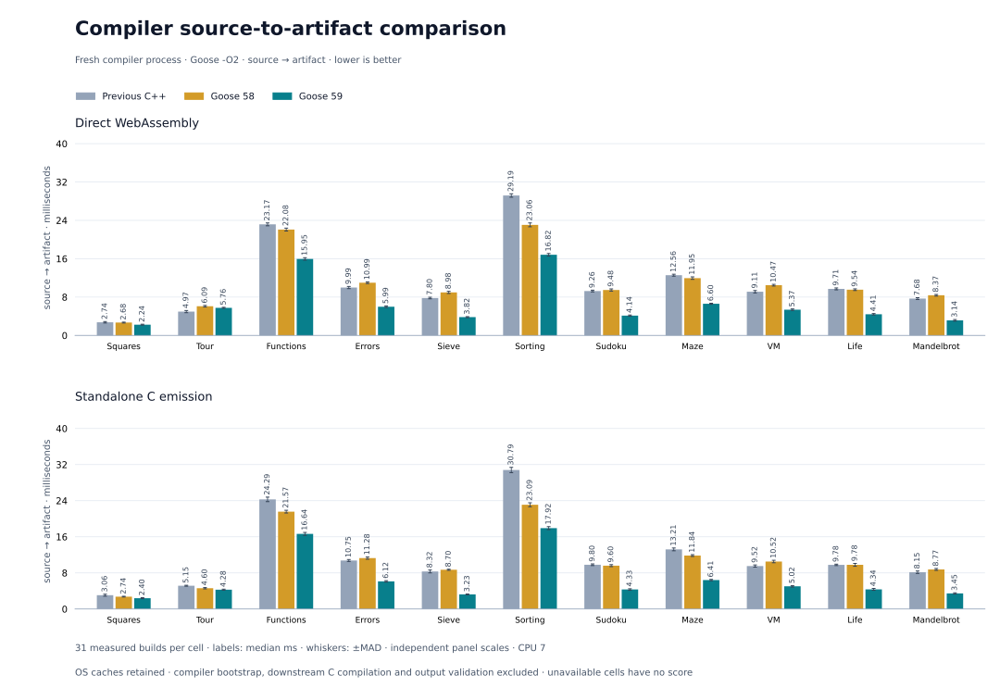
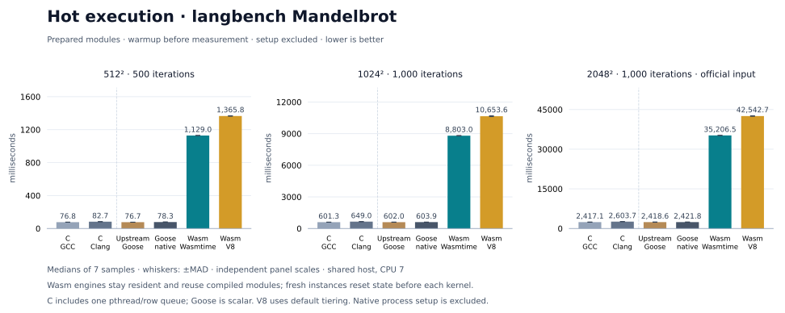
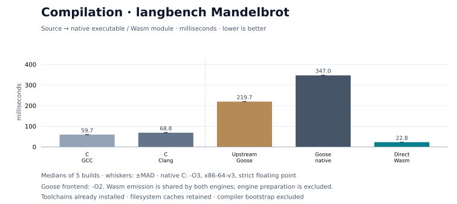

# Goose to Wasm

A [Goose](https://github.com/aardappel/goose) compiler written in Goose, producing WebAssembly directly or native executables through C. Conformance is partial: 100 of 8,055 contract rows remain open.

## Benchmarks

**Compiler speed.** With the supplied Clang 23 profile, snapshot 59 took 0.59 of the previous C++ compiler's time to emit Wasm and 0.54 to emit C: 1.70× and 1.84× faster, and 1.77× across all 22 cells. It is 1.75× faster than snapshot 58 for both targets. These are geometric means across eleven programs; Tour emitted as Wasm is the one cell still slower than C++. C emission excludes C compilation and linking. Library functions the program does not reach are no longer parsed or checked. [Method and results](bench/results/2026-11-11/compiler-throughput-59/README.md)



**Example programs.** These and the Mandelbrot measurements are from the snapshot 58 campaign ([results](bench/results/2026-11-08/compiler-throughput-58/README.md)). Across ten examples, median cold builds took 50–69 ms for direct Wasm and 253–1,924 ms for native executables. Native builds include C compilation and linking; process times include launch and exit. Wasmtime preparation is measured separately. Sorting took 177 ms with minimal AOT and 113 ms native.


**Mandelbrot.** On the official input, median computation took 2.40 s native, 2.57 s in Wasmtime and 2.50 s in V8. The native C and upstream Goose controls took 2.40 s and 2.39 s. Hot runtime measures guest computation with a resident Wasm module; compilation, startup and instantiation are outside the timer. Build times include C compilation and linking for native executables.





## Construction and contracts

The compiler implements its frontend, optimizer and backends in Goose. A checked-in C seed bootstraps it; `--verify` checks consecutive generated C outputs match. A C++ reference guided the initial port. Frozen source and output contracts now check behavior: snapshot 59 passes 7,955 of 8,055 rows, each matching snapshot 58. The 100 existing gaps remain. [Qualification](selfhost/results/2026-11-11/compiler-throughput-59/README.md)

With Python 3, a native C compiler and Node:

```sh
python3 scripts/bootstrap.py --verify
python3 scripts/goose_wasm.py build examples/squares.goose -o build/squares.wasm
node scripts/run_wasm.mjs build/squares.wasm
```

[Compiler and bootstrap](selfhost/README.md) · [Guide](docs/GUIDE.md) · [Examples](examples/README.md) · [Conformance runner](tests/conformance.py)
