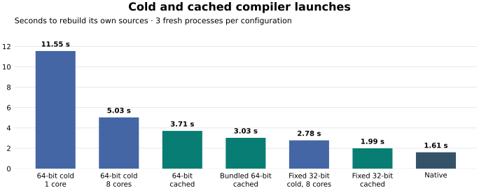
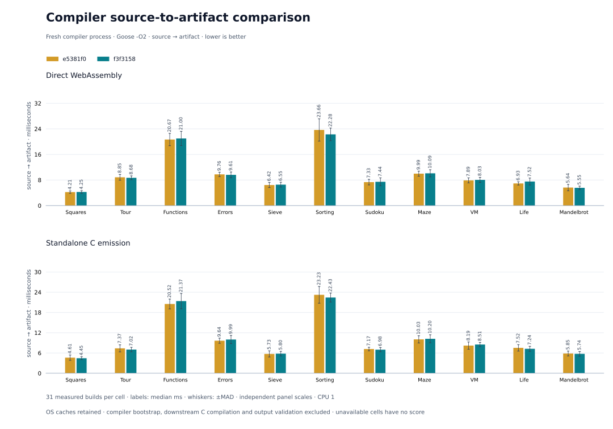

# Goose to Wasm

A [Goose](https://github.com/aardappel/goose) compiler written in Goose. It emits WebAssembly directly or native executables through C. It passes 10,697 of 10,801 conformance rows. [Compatibility tracker](docs/FEATURES.md)

## Benchmarks

**The compiler rebuilding itself.** On its own source, the balanced compiler took **1.90 s in cached Wasmtime** and **1.45 s native** (1.31× across nine pairs). The cached Wasmtime elapsed-time interval included no change on frozen input. [Paired measurements](bench/results/2026-11-21/shared-emitters/README.md)

**Compiler downloads.** Sharing emitter helpers cut the balanced compiler from 4.39 MB to **3.08 MB** (29.8% smaller). The size profile is **2.73 MB**. The balanced profile completed the frozen rebuild **19.8% faster from a cold start**. [Sizes and paired runs](bench/results/2026-11-21/shared-emitters/README.md#full-builds-on-a-frozen-project) · [Compact command](docs/GUIDE.md#build-and-run)


**Cold and cached self-compilation.** In a separate three-round run, the bundled 32-bit compiler took **2.78 s cold** with eight preparation threads and **1.99 s cached** on one core. Native took **1.61 s**. These fresh-process timings include startup. [All launches](bench/results/2026-11-21/lifetime-value-paths/launch.json)



**Compiler speed.** Across eleven programs, native compiler CPU time changed by **−2.7% for Wasm emission** and **−2.4% for C emission** against `0ae296c`. Each compiler built each program 31 times on CPU 2. Both intervals include no change. The earlier snapshot 59 measured 0.58× the C++ compiler’s time for Wasm and 0.53× for C. [Catalog and intervals](bench/results/2026-11-21/lifetime-value-paths/catalog-summary.json) · [C++ comparison](bench/results/2026-11-11/compiler-throughput-59/README.md)



**The compiler as Wasm.** Building the compiler with the pinned Goose emitter took 2.86 s for portable Wasm and 33.85 s through C and Clang. Checking its own sources took 1.08 s native, 2.63 s in Wasmtime and 3.21 s in V8. These portable memory64 timings exclude engine preparation and ran on a shared host. [Three builds and three execution rounds](bench/results/2026-11-21/lifetime-value-paths/selfhost.json)


**Example programs.** Cold builds of ten examples took 60.4–79.1 ms for direct Wasm and 0.302–2.158 s through C, including compilation and linking. Sorting took 176 ms in precompiled Wasmtime and 131 ms native. Both timings include process launch and exit. [Builds](bench/results/2026-11-21/lifetime-value-paths/examples.json.gz) · [Process times](bench/results/2026-11-21/lifetime-value-paths/host.json.gz)


**Mandelbrot.** On the official input, resident execution took 2.68 s native, 3.02 s in Wasmtime and 2.66 s in V8. GCC C took 2.69 s and upstream native Goose took 2.68 s. The seven samples per engine exclude compilation, startup and instantiation and ran on a shared host. [Measurements](bench/results/2026-11-21/lifetime-value-paths/langbench-hot.json.gz)


<details><summary>Earlier measurements</summary>

| Question | Measurements |
| --- | --- |
| What did reusing checks for globals save? | [Global capture study](bench/results/2026-11-20/lifetime-captures/README.md) |
| What changed after shortening lifetime value paths? | [Paired rebuilds and timing control](bench/results/2026-11-21/lifetime-value-paths/README.md) |
| What did indexing ordered lifetime effects save? | [Array clears, slice stores and rebuilds](bench/results/2026-11-20/ordered-effects/README.md) |
| How did the three release profiles compare on cold preparation and rebuild time? | [Packaging study at `ef702b1`](bench/results/2026-11-20/compact-releases/README.md) |
| How much faster did checking wide argument lists get? | [Wide argument study](bench/results/2026-11-20/lifetime-argument-lists/README.md) |
| Can sharing Wasm branch endings reduce compiler size? | [Compiler size and preparation experiments](bench/results/2026-11-20/lifetime-argument-lists/compiler-size.md) |
| What improved small program builds in the previous study? | [Small build study](bench/results/2026-11-20/small-build-frontend/README.md) |
| What did optimizing node traversal save in the previous study? | [Node traversal study](bench/results/2026-11-20/optimizer-node-traversal/README.md) |
| What did recording allocator events save in the previous study? | [Event and allocator study](bench/results/2026-11-20/wasm-local-events/README.md) |
| Can the Wasm allocator avoid decoding instructions the compiler just wrote? | [Recorded events on 1,539 function bodies](bench/results/2026-11-20/holder-lookups/README.md#recording-the-instructions-the-allocator-needs) |
| How far has full compiler rebuild time come on the original project? | [Cumulative full rebuilds](bench/results/2026-11-20/lifetime-argument-lists/campaign.svg) · [Experiments and remaining work](bench/results/2026-11-19/compiler-opportunities/README.md#remaining-work) · [Function lookup scaling](bench/results/2026-11-19/function-lookup/README.md#programs-with-many-functions) |
| Which compiler phases account for the Wasmtime gap? | [Phase counts and the same-Wasm engine comparison](bench/results/2026-11-19/lifetime-evaluator-frames/README.md#where-the-gap-remains) |
| What changed when Wasm copied small records with SIMD? | [Fixed record copies and cold launches](bench/results/2026-11-19/fixed-record-copies/README.md) |
| Why did skipping more calls add a full pass? | [Caller trace and binding changes](bench/results/2026-11-19/lifetime-callers/README.md#why-skipping-bodies-added-a-pass) |
| Which lifetime changes removed the fifth discovery pass? | [Store delivery, tuple reuse and paired rebuilds](bench/results/2026-11-19/lifetime-store-delivery/README.md) |
| What did removing array-header forwarding save? | [Bundled host rebuilds and launch times](bench/results/2026-11-19/bundled-publications/README.md) |
| What did the checker save by tracking reads on demand? | [Read tracking and paired compiler rebuilds](bench/results/2026-11-19/construct-read-demand/README.md) |
| What did skipping temporary expression records save? | [Expression checking, rebuilds and grouping experiments](bench/results/2026-11-19/expression-lifetimes/README.md) |
| What did skipping repeated array effects save? | [Rebuilds, array effects and validation controls](bench/results/2026-11-19/lifetime-array-effects/README.md) |
| Where can lifetime checking improve next? | [Five discovery passes, two missed errors and three experiments](bench/results/2026-11-19/lifetime-discovery/README.md) |
| What did tracking changed reads save? | [Lifetime reads and memory cost](bench/results/2026-11-19/lifetime-read-replay/README.md) |
| What improved string-heavy builds? | [8,192 literals and full compiler rebuilds](bench/results/2026-11-19/compiler-passes/README.md) |
| How much memory does a 32-bit compiler need? | [Fixed layouts and Blot2 capacity](bench/results/2026-11-18/compiler-layout-trials/README.md) · [Growing regions during compilation](bench/results/2026-11-18/compiler-region-recovery/README.md) |
| What sped up large project checks? | [Lifetime analysis](bench/results/2026-11-17/lifetime-compact-reads/README.md) · [Compiler iteration](bench/results/2026-11-17/compiler-iteration/README.md) · [Self-check pairs](bench/results/2026-11-17/compiler-and-row-performance/README.md) · [Blot2](bench/results/2026-11-17/blot2-captured-reads/README.md) |
| How much time do native builds and bootstrap take? | [Parallel C units](bench/results/2026-11-14/native-units/README.md) · [Changed-source bootstrap](bench/results/2026-11-17/local-bootstrap/README.md) |
| Which runtime and tooling costs improved? | [Native row scans](bench/results/2026-11-17/native-row-scans/README.md) · [Wasmtime preparation](bench/results/2026-11-18/compiler-iteration-tools/README.md) · [Wasm local allocation](bench/results/2026-11-17/wasm-slot-prefix/README.md) · [Varint traversal](bench/results/2026-11-17/varint-foreach/README.md) |

</details>

## How it was built

The frontend, optimizer and backends are written in Goose. A C++ reference guided the initial port. Frozen source and output contracts now check behavior. A checked-in C seed bootstraps the compiler, and `--verify` compares consecutive generated C outputs. [Compiler and bootstrap](selfhost/README.md) · [Contracts](tests/README.md) · [Guide](docs/GUIDE.md) · [Examples](examples/README.md)

With Python 3, a C compiler and Node installed, build and run the first example.

```sh
python3 scripts/bootstrap.py --verify
python3 scripts/goose_wasm.py build examples/squares.goose -o build/squares.wasm
node scripts/run_wasm.mjs build/squares.wasm
```
