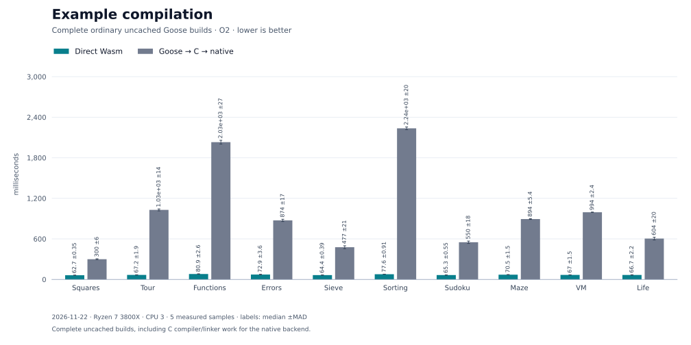

# Goose to Wasm

A [Goose](https://github.com/aardappel/goose) compiler written in Goose, producing WebAssembly directly or native executables through C. Conformance is partial: 104 of 10,793 contract rows remain open. The features of upstream Goose since those contracts were pinned are [tracked separately](docs/FEATURES.md).

## Benchmarks

**Compiler speed.** On 2026-11-14, snapshot 63 took 1.04 of snapshot 61's time to emit Wasm and 1.06 to emit C (1.03 and 1.05 in a replicate), and 0.78 of snapshot 62's. Snapshot 62 had been frozen without a speed campaign and took 1.36× snapshot 61's time: every compile filled a 6 MB lifetime table, and every native compile scanned its C byte by byte for the names that decide each function's linkage across units. Snapshot 63 sizes that table to the program and finds the names with `find_pair`, with byte-identical output; most of the rest is features added since snapshot 61. These are geometric means across eleven programs; C emission excludes C compilation and linking. [Method and results](bench/results/2026-11-14/compiler-throughput-63/README.md) Snapshot 59, the last campaign that also timed the earlier C++ compiler, took 0.58 of its time for Wasm and 0.53 for C. [Snapshot 59](bench/results/2026-11-11/compiler-throughput-59/README.md)


**Large programs.** On 2026-11-13, checking a 450-module, 120,000-line compiler took 0.37–0.43 of the previous build's CPU time (11 s instead of 30 s on a quiet machine), and the compiler took 0.56–0.66 to check itself. Both produced identical output. Type checking now uses indexed scope, effect and return-root lookups, and the lifetime analysis skips effects it has already recorded. [Method and results](bench/results/2026-11-13/large-program-checking/README.md) On 2026-11-14 the lifetime analysis stopped copying a set at every join and began sharing equal lists. Its state and all output are unchanged. The compiler checks itself in about the same time (0.98, inside the noise of a loaded machine) with 5% less memory. Given a `main`, the 450-module compiler's analysis now runs 31,000 call contexts, up from about 1,650, before it runs out of space. [Method and results](bench/results/2026-11-14/lifetime-set-sharing/README.md) Later that day exported functions became lifetime roots, so that compiler, whose only entry is an export, is analyzed from it. Nine more changes to how the analysis makes and keeps its sets, each with identical output and analysis state, reach 20,000 call contexts 5–7 times sooner and fit 1.9 times as many alternatives; small programs compile in the same time. It still does not finish: the first discovery pass stops at 93,000 call contexts, after 884 s, when its alternatives fill their 2 GiB region. [Method and results](bench/results/2026-11-14/blot2-lifetimes/README.md) On 2026-11-15 eight more changes stopped the analysis repeating work that changes nothing: an effect offered up the chain of calls stops where a frame has already passed the same sets on, a summary is not replayed twice into one activation, loads and read-backs are remembered while their inputs stand, and frames, cells and temporaries are found by hash. State and output are again identical. The compiler checks itself in 7.0 s instead of 24.7 s, and that first pass reaches its 93,000 call contexts in 102 s instead of 605 s on the same machine. It stops there all the same, and a count of what it had entered shows how far from done it is: 2,854 of the program's 27,923 reached functions. It analyzes a function once for every set of concrete argument roots, where upstream does so once per class of them, and recursive tree walkers multiply the difference. [Method and results](bench/results/2026-11-15/lifetime-walks-and-memos/README.md) Later that day the analysis began doing the same: once a program has made 4,096 call contexts, a call of a top-level function is checked by the classes of its arguments, one context per key, and its effects are mapped onto each call's own roots. Programs below that count are analyzed as before, with identical state on all 4,355 conformance sources and on the compiler itself. The 450-module compiler's first pass now ends, after 50,725 call contexts and 247 s on a 4-core cloud machine, where plain upstream Goose was stopped at 1,500 s without a result. It ends with 2,348 errors, nearly all stores that a call lands in storage its value does not outlive, and most of them are this path being less exact than the one for small programs, so that compiler is not checked yet. [Method and results](bench/results/2026-11-15/class-keyed-frames/README.md) On 2026-11-16 that path began keeping what is stored through each class of arguments apart, and reading it through another class only where a call says the two may be the same storage. With every call checked by classes, the compiler now checks itself without a false error (58 before) and 14 conformance sources that should pass are rejected (23 before); 33 that should fail still pass, so small programs stay on the exact path, unchanged in state. Where a call maps what an argument's storage holds, it now also filters by the types involved. The 450-module compiler's first pass ends with 1,992 errors after 283 s and 7.4 GiB with the bootstrapped compiler, holding 68.3 M alternatives where it held 57.8 M: it is not faster and that compiler is still not checked. The refused stores go back to 43 statements, and most to one pattern: a reference read out of a parameter and passed on is treated as possibly the caller's other parameters themselves, where upstream only asks that question of a store's destination. [Method and results](bench/results/2026-11-16/class-stores-per-pair/README.md)

**Native builds.** On 2026-11-14, the compiler's own 40.7 MB of generated C built in 16.1 s as 16 parallel C units instead of 97.9 s as one, with Clang `-O2` on 8 cores; the split-built compiler executes 2.4% more instructions, so release bootstraps stay one unit. Once the runtime object is cached, the ten examples' C compiles 4–37% faster with GCC. The published example campaign below uses `--no-cache`, whose builds are unchanged. [Method and results](bench/results/2026-11-14/native-units/README.md)

**Example programs.** These and the Mandelbrot measurements are from the snapshot 58 campaign ([results](bench/results/2026-11-08/compiler-throughput-58/README.md)). Across ten examples, median cold builds took 50–69 ms for direct Wasm and 253–1,924 ms for native executables. Native builds include C compilation and linking; process times include launch and exit. Wasmtime preparation is measured separately. Sorting took 177 ms with minimal AOT and 113 ms native.




**Mandelbrot.** On the official input, median computation took 2.40 s native, 2.57 s in Wasmtime and 2.50 s in V8. The native C and upstream Goose controls took 2.40 s and 2.39 s. Hot runtime measures guest computation with a resident Wasm module; compilation, startup and instantiation are outside the timer. Build times include C compilation and linking for native executables.


## Construction and contracts

The compiler implements its frontend, optimizer and backends in Goose. A checked-in C seed bootstraps it; `--verify` checks consecutive generated C outputs match. A C++ reference guided the initial port. Frozen source and output contracts now check behavior: snapshot 59 passes 7,955 of 8,055 rows, each matching snapshot 58. The 100 existing gaps remain. [Qualification](selfhost/results/2026-11-11/compiler-throughput-59/README.md) The current sources add root structs, `defer` and `const if`, and pass 8,296 of 8,390 rows, also when native C builds as parallel units. [Qualification](selfhost/results/2026-11-14/upstream-features/README.md) · [Since](selfhost/results/2026-11-14/named-constants/summary.json) With `slice_pool`'s span tree for native C and stdlib aborts that report the program's line, they pass 8,320 of 8,414. [Qualification](selfhost/results/2026-11-14/pool-externs-abort-sites/README.md) With root structs on direct Wasm, they pass 8,352 of 8,444. [Qualification](selfhost/results/2026-11-14/wasm-root-structs/README.md) Snapshot 62 freezes these sources with a retrained profile, and fixes native range loops, whose index counted from the range's first value instead of 0; 8,356 of 8,448 rows pass. [Snapshot 62](selfhost/results/2026-11-14/snapshot-62/README.md) Running about 700 programs from the earlier C++ compiler's tests through plain upstream found further disagreements. Nine are fixed, among them an assignable variable-size enum, effectful defaults evaluated once on direct Wasm, native C that did not compile for `varint` grow arrays, and false lifetime and region rejections; 8,453 of 8,545 rows pass. [Differences](docs/FEATURES.md#differences-found-by-the-upstream-differential-run) Native C now builds an exit's value behind its destination, so an exit that is itself cancelled leaves the destination as the spec and upstream give it; 8,457 of 8,549 rows pass. [Qualification](selfhost/results/2026-11-14/abandoned-destinations/README.md) The programs from the C++ compiler's tests are now contracts of their own, and the tests that checked only that compiler's internals are removed. 560 programs add 2,240 rows with upstream's output as expected; 77 are excluded, each with its reason. Three new differences are recorded as gaps; 10,685 of 10,789 rows pass. [Harvest](selfhost/results/2026-11-14/harvested-contracts/README.md) Snapshot 63 freezes these compiler sources with a retrained profile and the two speed fixes above. [Snapshot 63](selfhost/results/2026-11-14/snapshot-63/README.md) The lifetime pass now analyzes an exported function that nothing in the program calls, which it had accepted unchecked; 10,689 of 10,793 rows pass. [Difference](docs/FEATURES.md#differences-found-by-the-upstream-differential-run)

With Python 3, a native C compiler and Node:

```sh
python3 scripts/bootstrap.py --verify
python3 scripts/goose_wasm.py build examples/squares.goose -o build/squares.wasm
node scripts/run_wasm.mjs build/squares.wasm
```

[Compiler and bootstrap](selfhost/README.md) · [Guide](docs/GUIDE.md) · [Examples](examples/README.md) · [Conformance runner](tests/conformance.py)
