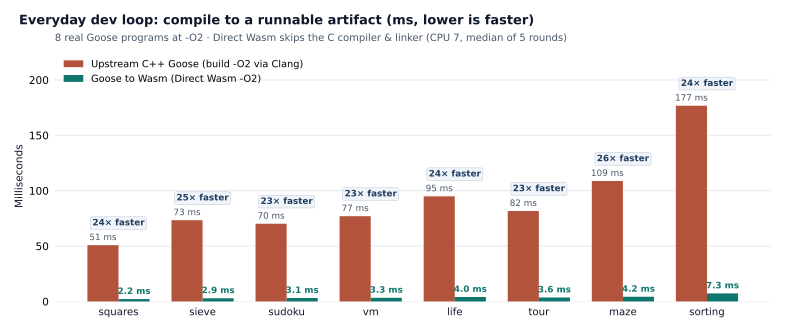
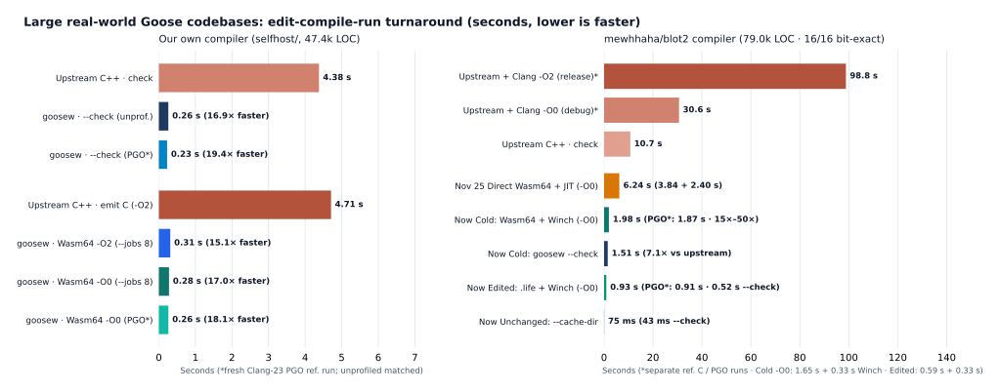

# Goose to Wasm

**A fast, self-hosted [Goose](https://github.com/aardappel/goose) compiler built for rapid edit-compile-run development.**

Compile Goose directly to **WebAssembly in milliseconds** — with no C compiler in your dev loop — and compile the exact same code to **native binaries or C libraries** when you ship.

- **Latest release:** [`v2026.4-5`](https://github.com/mewhhaha/goose-to-wasm/releases/tag/v2026.4-5) (tracks upstream Goose `v2026.4`, installs binary **`goosew`** + `stdlib`, `stdlib-web`, and `host/web`)
- **Live browser showcase:** **[Play all 9 official Goose graphics examples in WebAssembly](https://mewhhaha.github.io/goose-to-wasm/)** — Mini Minecraft, Mini Doom (Freedoom E1M1), 3D Physics Boxes, Immediate-Mode UI, Spinning 3D Cube, Ray Tracer, Image Filters, Game of Life, and Maze Solver compiled with `goosew --stdlib stdlib-web --target wasm-direct` (WebGL2 + Web Audio + WebAssembly JSPI)
- **Upstream-only language scope:** Strictly follows upstream [Goose](https://github.com/aardappel/goose) development as the language reference — this compiler will not diverge into its own dialect or add independent language extensions
- **Everyday builds:** **23×–26× faster** than upstream C++ Goose (`2–7 ms` vs `51–177 ms` at `-O2`)
- **Multi-core throughput:** Up to **2.32M LOC/s** end-to-end wall time (**2.59M LOC/s** compile stages; **2.36M / 2.65M LOC/s** with PGO) compiling multi-file Goose directly to Wasm (`--jobs auto` hits **2.01M–2.15M LOC/s** wall, **1.35M LOC/s** emitting Native C; 100% SHA-256 bit-identical across thread counts with **-36% to -57%** lower peak RSS)
- **Large projects:** **15×–19× faster** self-compilation (`0.28–0.31 s` unprofiled / `0.26–0.28 s` PGO Wasm64 and `0.23–0.26 s` `--check` on our 47.4k-LOC compiler, down from `4.38–4.71 s` upstream), and **15×–111× faster** edit-compile-run turnaround on [`mewhhaha/blot2`](https://github.com/mewhhaha/blot2) (**`1.98 s`** unprofiled / **`1.87 s`** PGO cold `-O0` Wasm64 + Winch `--fast-jit` + run, and **`0.89–0.98 s` sub-second** edited-file rebuilds via `--cache-dir` lifetime certificates + Winch `--fast-jit`, vs `30.6 s` Clang `-O0` / `98.8 s` Clang `-O2`, with `-62%` smaller `8.34 MiB` `.wasm`, **`71 ms`** warm `.cwasm` runs, and **`43–75 ms`** unchanged `--cache-dir` rebuilds)
- **Compatibility:** `10,799 / 10,801` conformance rows (`99.98%` — **6,022 / 6,022** native / **100%** of upstream C++ Goose tests, 2 documented frozen wasm32 contract gaps; `4,773 / 4,779` memory64) · [Feature & compatibility tracker](docs/FEATURES.md)

---

## Quick Start

### Option 1: Download a prebuilt release (`v2026.4-5`)

Grab a bundle from [Releases](https://github.com/mewhhaha/goose-to-wasm/releases/tag/v2026.4-5):

- **Linux x64 (`goosew` + `stdlib` + `stdlib-web` + `host/web`):** `goose-to-wasm-v2026.4-5-linux-x64.tar.gz`
- **macOS Apple Silicon (`goosew` + `stdlib` + `stdlib-web` + `host/web`):** `goose-to-wasm-v2026.4-5-macos-arm64.tar.gz`
- **macOS Intel (`goosew` + `stdlib` + `stdlib-web` + `host/web`):** `goose-to-wasm-v2026.4-5-macos-x64.tar.gz`
- **Windows x64 (standalone `goosew.exe` + `stdlib` + `stdlib-web` + `host/web`):** `goose-to-wasm-v2026.4-5-windows-x64.zip`
- **Portable WebAssembly compiler (Wasm64 `goosew.wasm` + `stdlib` + `stdlib-web` + `host/web`):** `goose-to-wasm-v2026.4-5-wasm.tar.gz` (or standalone `goosew-v2026.4-5-wasm64.wasm`)

```sh
# Linux / macOS
tar -xzf goose-to-wasm-v2026.4-5-linux-x64.tar.gz
export PATH="$PWD/goose-to-wasm-v2026.4-5-linux-x64/bin:$PATH"
goosew --version
# goose-to-wasm v2026.4-5 (Goose v2026.4)
```

```powershell
# Windows (PowerShell)
Expand-Archive goose-to-wasm-v2026.4-5-windows-x64.zip -DestinationPath .
$env:PATH = "$PWD\goose-to-wasm-v2026.4-5-windows-x64\bin;$env:PATH"
goosew --version
```

```sh
# Portable Wasm64 compiler (runs anywhere Wasmtime runs)
python3 scripts/run_wasmtime.py goosew-v2026.4-5-wasm64.wasm -- --version
```

> **Binary name (`goosew`):** The compiler binary is named `goosew` so it does not collide with the upstream C++ `goose` compiler (or other `goose` CLIs) on your `PATH`. If you want to invoke it as `goose`, rename or symlink it (e.g. `ln -s "$(command -v goosew)" ~/.local/bin/goose`).

### Option 2: Build from source (~29 s)

Requires Python 3 and a C compiler (`clang` default, or `gcc`), plus Node, Wasmtime, or [`host/wtime`](host/wtime/README.md) to run `.wasm` output.

```sh
python3 scripts/bootstrap.py --verify
export PATH="$PWD/build/bin:$PATH"
```

### Everyday commands

```sh
# 1. Fast type & lifetime check (supports --error-format=json & --color)
goosew --check examples/sorting.goose

# 2. Instant dev compile & run via Direct Wasm (2–7 ms, no C toolchain)
goosew examples/squares.goose -O2 -o squares.wasm
node scripts/run_wasm.mjs squares.wasm
# sum=140

# 3. Ship a native binary (via C)
goosew examples/squares.goose --target c -O2 --run

# 4. Embed in a C/C++/Rust host (exports + C header, no -rdynamic/-ldl)
goosew --emit-runtime goose_runtime.c
goosew app.goose --header app.h -O2 -o app.c
```

See the [full CLI & build guide](docs/GUIDE.md) for `--shared`, `--wasm-memory64`, `--library`, `--reachable-program`, `--stack-reserve`, `--error-format`, `--color`, and Binaryen compaction.

---

## Benchmarks

### 1. Everyday dev loop (2–7 ms vs 51–177 ms)

Skipping the C compiler and linker turns `-O2` builds on everyday Goose programs into single-digit milliseconds:



### 2. Speeding up real large codebases

On larger Goose projects, combining `--check`, `--cache-dir` (with incremental lifetime certificates), and Direct Wasm (`--wasm-memory64` + `goose-wasmtime --fast-jit` Winch baseline or cached `.cwasm`) replaces half-minute to minute-and-a-half C rebuilds with **under 2 seconds cold — and under 1 second on edited-file rebuilds**:



- **Example 1 — This compiler ([`selfhost/`](selfhost/README.md), 47.4k LOC):**
  `goosew --check selfhost/main.goose` finishes in **`0.26 s`** unprofiled (**`0.23 s`** PGO, **16.9×–19.4× faster** than upstream's `4.38 s`), and emitting Direct Wasm64 takes **`0.28 s`** (`-O0`, unprofiled `--jobs 8`; **`0.26 s`** with fresh Clang-23 PGO, **17.0×–18.1× faster** than upstream's `4.71 s` C emit) / **`0.31 s`** (`-O2`, **`0.28 s`** PGO). Even running **as portable WebAssembly** inside Wasmtime, it checks itself in **`1.11–1.39 s`** and self-compiles bit-identically in **`1.78 s`**.
- **Example 2 — [`mewhhaha/blot2`](https://github.com/mewhhaha/blot2) (79.0k-LOC compiler written in Goose):**
  Blot2 uses 57 native `env.blot_*` POSIX/fd/directory/atomic/copy host functions and builds as a library entry point (`blot_goose_main`). With compacted Direct Wasm64 (`8.34 MiB` at `-O0`, `12.79 MiB` at `-O2` — **-60% to -62% smaller** than Nov 25), [`goose-wasmtime --fast-jit`](host/rust/README.md) (Wasmtime 50.0.1 **Winch** baseline with automatic Cranelift fallback, or safe-Rust [`goose-wtime`](host/wtime/README.md)), and `--cache-dir` lifetime certificates, it compiles and runs **byte-identically** to native `blotc-goose` (**16/16** compiling idiomatic `.blot` benchmarks match SHA-256) in **`1.98 s`** cold matched unprofiled (**`1.65 s`** Wasm64 `-O0` emit + **`0.33 s`** Winch `--fast-jit` + run; **`1.87 s`** with fresh Clang-23 PGO: **`1.54 s`** emit + **`0.33 s`** JIT+run, down from `6.24 s` on Nov 25) vs **`30.6 s`** (`-O0` C) / **`98.8 s`** (`-O2` C). On edited-file rebuilds with a warm `--cache-dir`, the `66.6 KiB` `.life` certificate cuts edit → compile → Winch JIT → run to **`0.93–0.98 s`** unprofiled (**`0.89–0.95 s`** PGO; **`0.50–0.52 s`** for edited `--check`). At `-O2`, cold edit → compile → Winch `--fast-jit` → run takes **`2.45 s`** unprofiled (**`2.11 s`** PGO, down from `9.11 s`), safe-Rust `goose-wtime --execution register` takes **`1.83 s`** (`376 MiB` RSS; `1.88 s` / `260 MiB` at `-O0`), warm `.cwasm` runs compile `.blot` programs in **`71–135 ms`**, and unchanged `--cache-dir` rebuilds finish in **`43 ms`** (`--check`) / **`74–75 ms`** (`-O0` Wasm64):

  ```sh
  # Compile Blot2 directly to Wasm64 (1.65 s cold / 0.59 s edited .life hit / 74 ms unchanged)
  goosew compiler-goose/src/main.goose --stdlib blot-stdlib \
    --target wasm-direct --wasm-memory64 --wasm-max-pages 65536 \
    --library --reachable-program --expansion-node-limit 1000000 \
    --cache-dir build/goose-cache -O0 -o blot2.wasm

  # Run via goose-wasmtime (0.33 s cold Winch --fast-jit + run; 71–135 ms warm .cwasm runs)
  host/rust/target/release/goose-wasmtime --fast-jit blot2.wasm \
    --entry blot_goose_main --cache blot2.cwasm -- \
    build-project benchmarks/idiomatic/fibonacci.blot fib.wasm \
    --std-root std --prelude std/prelude.blot
  ```

### 3. Multi-core compiler throughput (up to 2.32M LOC/s wall / 2.59M LOC/s compile)

`goosew` packs its AST into exact cache-line structures (`32 B Token`, `64 B Node`) and parallelizes multi-file source I/O & parsing, body typechecking, pure-function lifetimes, IR optimization, Direct Wasm emission, and Native C emission across cores (`--jobs auto` default, `-j N` to override) while guaranteeing **100% SHA-256 bit-identical output** across all thread counts (`--jobs 1..16`) and exact **24 imports** in the portable Wasm64 compiler:


- **Procedural Goose → Direct Wasm `-O0` (Ryzen 7 7800X3D, matched unprofiled Clang 23 `-O2`):** compiles **98,749 LOC** across 18 files in **`49.2 ms`** (`--jobs auto`: **`2.01M LOC/s`** wall / **`2.35M LOC/s`** compile stages; **`44.5 ms`** / **`2.22M LOC/s`** wall with PGO; **`76.1 ms`** / **`1.30M LOC/s`** at full `-O2`; **`60.4 ms`** / **`1.63M LOC/s`** on a single 98.6k-LOC file), and sustains **`2.15M LOC/s`** wall at `--jobs auto` (`114.5 ms`) up to **`2.32M LOC/s`** wall / **`2.59M LOC/s`** compile at `--jobs 12` (`106.1 ms`, **6.89× faster** than `v2026.4-3`; **`2.36M / 2.65M LOC/s`** with PGO) on **246,765 LOC** across 34 files — while cutting peak RSS by **-36% to -55%**.
- **Native C emission (`--target c`, `--jobs auto`):** compiles **98.7k–246.8k LOC** to C in **`73.4–187.5 ms`** (**`1.32M–1.35M LOC/s`** wall / **`1.62M–1.69M LOC/s`** compile, **4.7×–4.9× faster** than `v2026.4-3`), cuts `selfhost` C emit **`4.03 s → 0.55 s`** (**7.3×**), and cuts `blot2` C backend emission **`1,722 → 251 ms`** (**6.9×**).
- **Real large codebases → Direct Wasm64 vs `v2026.4-3` (matched unprofiled `--jobs auto`, 100% SHA-256 bit-identical):** `selfhost` (47.4k LOC) drops **`4.39 s → 0.58 s`** (`-O0`, **7.5×**; **`0.45 s` / 8.2×** with PGO) and **`4.36 s → 0.59 s`** (`-O2`, **7.4×**; **`0.48 s` / 7.9×** with PGO) with **-45% to -50%** lower peak RSS; `blot2` (79.0k LOC) drops **`3.58 s → 2.54 s`** (`-O0`, **6.4× faster** Wasm backend; **`2.26 s`** PGO) and **`4.32 s → 2.73 s`** (`-O2`, **7.0× faster** optimizer, **4.9× faster** backend; **`2.38 s`** PGO).

### 4. Production runtime speed

Fast dev builds do not trade away runtime speed. Native `-O2` binaries match or edge out upstream C++ Goose (all bit-exact), and Direct Wasm modules run near-native in Wasmtime or ahead-of-time via [`wtime-aot`](https://github.com/mewhhaha/wtime) (`--backend x64` zero-LLVM static binaries compile in **`4.7–16.4 ms`** and beat native `-O2` on `life`, `sieve`, and `maze`; `--backend rust` `#![forbid(unsafe_code)]` beats native `-O2` on `life` and `mandelbrot`):


*Pinned methodology, scripts, and raw JSON: [Four-levers optimization campaign — 1.87–1.98 s cold / 0.89–0.98 s edited Blot2 turnaround & Winch `--fast-jit` (2026-11-27)](bench/results/2026-11-27/four-levers-campaign/README.md) · [Lifetime optimization campaign — 2.17–2.36 s Blot2 turnaround & 0.24–0.26 s selfhost (2026-11-27)](bench/results/2026-11-27/lifetime-campaign/README.md) · [Blot2 `98f277f2` turnaround campaign — -57% Wasm64 & `--cache-dir` (2026-11-27)](bench/results/2026-11-27/blot2-turnaround/README.md) · [Multi-core compiler throughput campaign (2026-11-26)](bench/results/2026-11-26/compiler-throughput/README.md) · [Production runtime with `wtime-aot` (`v0.1.5`)](bench/results/2026-11-25/runtime-with-wtime/README.md) · [Release `v2026.4-5` chart provenance](bench/results/2026-11-25/release-v2026.4-5/README.md) · [Baseline `v2026.4-4` full suite](bench/results/2026-11-25/release-v2026.4-4/README.md).*

---

## Choosing a Target

| | Direct Wasm (`--target wasm-direct`, default) | Native C (`--target c` / `--backend native`) |
|---|---|---|
| **Best for** | Instant edit-run dev loops, large-project fast iteration, browser/sandboxed embedders | Production binaries, servers, maximum single-thread speed, C-host libraries |
| **Build time (examples)** | **2–7 ms** (no C compiler needed) | `135–440 ms` (cached runtime + Clang/GCC) |
| **Build time (32k LOC)** | **0.57 s** | **`0.62 s`** C emit + parallel C compile |
| **Runtime** | Near-native in Wasmtime (`host/rust`) or safe-Rust `wtime` (`host/wtime`), or Node/browsers | Matches or edges out upstream C++ Goose `-O2` |
| **Features** | Core language, root structs, `reusable[]` slice pools, `defer`, `const if`, `env.*` host imports, memory32 & memory64 | Everything in Direct Wasm plus threads, stdlib `slice_pool` C externs, `--header`, `--shared` |

---

## Foreign C Functions as Wasm Host Imports

Goose `extern fn` declarations lower directly to standard WebAssembly imports in module **`"env"`** (`(import "env" "<name>" (func ...))`), so C-backed projects like [`mewhhaha/blot2`](https://github.com/mewhhaha/blot2) can run in Wasm without changing Goose source:

```goose
extern fn host_add(a: i64, b: i64) -> i64;
export fn compute(x: i64) -> i64 { return host_add(x, 7) * 3; }
fn main() {}
```

```js
const noop = () => {};
const { instance } = await WebAssembly.instantiate(wasmBytes, {
  goose: new Proxy({}, { get: () => noop }),
  env: { host_add: (a, b) => a + b },
});
console.log(instance.exports.compute(5n)); // 36n
```

Supported Wasm ABI types: numerics (`i8`–`i64`, `u8`–`u64`, `f32`, `f64`), `bool`, slices (`T[:]`), and references (`T&` / `const T&`, including growable `u8[>..]&` via `goose.reserve`). Aggregates can be passed by `const T&`, `T[:]`, or out-reference `T&`.

---

## Diagnostics

Diagnostics include source snippets, `^~~~` carets, `--error-format=text|json`, `--color=auto|always|never`, generic/stdlib instantiation backtraces, opening-delimiter & prior-declaration notes, consolidated missing `match` variants and struct fields, typo suggestions, and lifetime call stacks:

```text
app.goose:3:19: error: no overload matches this call's argument types and count: `add(i64, const u8[:])`
   3 | fn main() { print(add(1, "oops")); }
     |                   ^~~
  note: candidate `fn add(a: f64, b: f64) -> f64` at app.goose:2:4 (argument 2 `b`: got `const u8[:]`, expected `f64`)
  note: candidate `fn add(a: i64, b: i64) -> i64` at app.goose:1:4 (argument 2 `b`: got `const u8[:]`, expected `i64`)
```

---

## Compatibility & Documentation

Releases are versioned **`v<goose-version>-<n>`** (currently **`v2026.4-5`**), strictly following upstream [Goose](https://github.com/aardappel/goose) (`aardappel/goose`) as the sole language reference. The intention of this repository is purely to track upstream Goose development as a fast alternative compiler — it will not go off on its own or fork the language (`10,797 / 10,801` conformance rows passing, 0 unexpected failures — `6,022 / 6,022` native / **100%** of pinned upstream Goose tests).

- [Guide & CLI options](docs/GUIDE.md) — flags, targets, incremental `--cache-dir`, compaction, and host options
- [Native Rust Wasmtime host](host/rust/README.md) — fast parallel Winch baseline (`--fast-jit`) & Cranelift JIT, `.cwasm` caching, `--entry`, and Blot2 `env.blot_*` support
- [Safe-Rust `wtime` host](host/wtime/README.md) — `#![forbid(unsafe_code)]` runner for Direct Goose Wasm32/Wasm64 and Blot2
- [Web host & drop-in browser stdlib](host/web/README.md) — zero-dependency ESM browser runtime (`MemoryFS`/`LocalStorageFS`/`OPFS`, WebGL2 `gfx`, Canvas 2D `ui`, 3D `physics`, Web Audio, Web Worker) + drop-in [`stdlib-web/`](stdlib-web/README.md)
- [Compatibility tracker](docs/FEATURES.md) — feature-by-feature status vs upstream Goose & Blot2
- [Self-hosted compiler & bootstrap](selfhost/README.md) — architecture, Snapshot 74 seed & fixed-point verification
- [Conformance & qualification](tests/README.md) — test suites and qualification gates
- [Examples](examples/README.md) — runnable Goose sample programs
- [Contributing](CONTRIBUTING.md) · [Code of Conduct](CODE_OF_CONDUCT.md) · [Security policy](SECURITY.md) — local verification, PR workflow, and approval-gated CI

<details><summary>Benchmark & evidence archive</summary>

All dated compiler, runtime, Wasmtime, `wtime`, native C codegen, and Blot2 studies live under [`bench/results/`](bench/results/):

- [Four-levers optimization campaign — 1.87–1.98 s cold / 0.89–0.98 s edited Blot2 turnaround, `-62%` Wasm64 & Winch `--fast-jit` (2026-11-27)](bench/results/2026-11-27/four-levers-campaign/README.md)
- [Lifetime optimization campaign — 2.17–2.36 s Blot2 turnaround, 1.56–1.75 s emit & 0.24–0.26 s selfhost (2026-11-27)](bench/results/2026-11-27/lifetime-campaign/README.md)
- [Blot2 `98f277f2` turnaround campaign — 2.63–2.79 s total (`--fast-jit`, -57% Wasm64, parallel lifetimes & `--cache-dir`) (2026-11-27)](bench/results/2026-11-27/blot2-turnaround/README.md)
- [Multi-core compiler throughput campaign — 2.32M LOC/s wall, 2.59M LOC/s compile, 6.9× C backend & 7.5×–8.2× selfhost (2026-11-26)](bench/results/2026-11-26/compiler-throughput/README.md)
- [Production runtime speed with `wtime-aot` `v0.1.5` (`x64` & safe Rust) (2026-11-25)](bench/results/2026-11-25/runtime-with-wtime/README.md)
- [Release `v2026.4-5` qualification & chart provenance (2026-11-25)](bench/results/2026-11-25/release-v2026.4-5/README.md)
- [Blot2 HEAD `98f277f2` Direct Wasm64 + fast `goose-wasmtime` & `goose-wtime` turnaround (2026-11-25)](bench/results/2026-11-25/blot2-head-98f277f2/README.md)
- [Release `v2026.4-4` head-to-head vs `v2026.4-3` & upstream C++ Goose (2026-11-25)](bench/results/2026-11-25/release-v2026.4-4/README.md)
- [Direct Wasm64 codegen speedups & preserved rejected experiments (2026-11-25)](bench/results/2026-11-25/wasm64-codegen/README.md)
- [Direct Wasm64 Blot2 (`cb1e9e15`) on pure-Rust `wtime` — 18/18 bit-exact (2026-11-25)](bench/results/2026-11-25/blot2-wtime-wasm64/README.md)
- [Release `v2026.4-3` head-to-head vs `v2026.4-2` & upstream C++ Goose (2026-11-25)](bench/results/2026-11-25/release-v2026.4-3/README.md)
- [Blot2 lifetime checker algorithmic redesign — 7 rounds & ablations (2026-11-25)](bench/results/2026-11-25/blot2-lifetime-algo/README.md)
- [Release `v2026.4-2` head-to-head vs `v2026.4-1` & upstream C++ Goose (2026-11-24)](bench/results/2026-11-24/release-v2026.4-2/README.md)
- [Release `v2026.4-1` head-to-head vs upstream C++ Goose (2026-11-24)](bench/results/2026-11-24/release-v2026.4-1/README.md)
- [Blot2 class-keyed lifetime checker speedups (2026-11-24)](bench/results/2026-11-24/blot2-lifetime-speed/README.md)
- [Blot2 `l.alts` compaction & default-2 GiB `6ad5fbb` native build (2026-11-24)](bench/results/2026-11-24/blot2-alts-compaction-and-6ad5fbb/README.md)
- [C-host library interface & native Blot2 `cb1e9e15` build (2026-11-24)](bench/results/2026-11-24/blot2-chost-and-native-build/README.md)
- [Wasm compaction, dead mark elimination & `wtime-aot` evaluation (2026-11-23)](bench/results/2026-11-23/wasm-peephole-wtime-aot-and-refresh/README.md)
- [Native C codegen gap closed vs upstream C++ Goose (2026-11-23)](bench/results/2026-11-23/native-c-codegen-gap/README.md)

</details>
