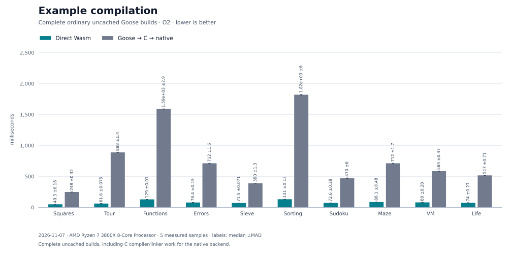
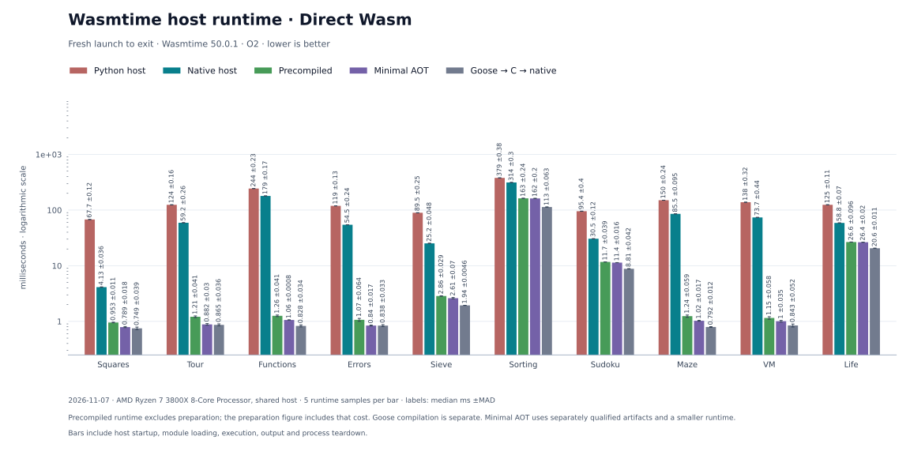
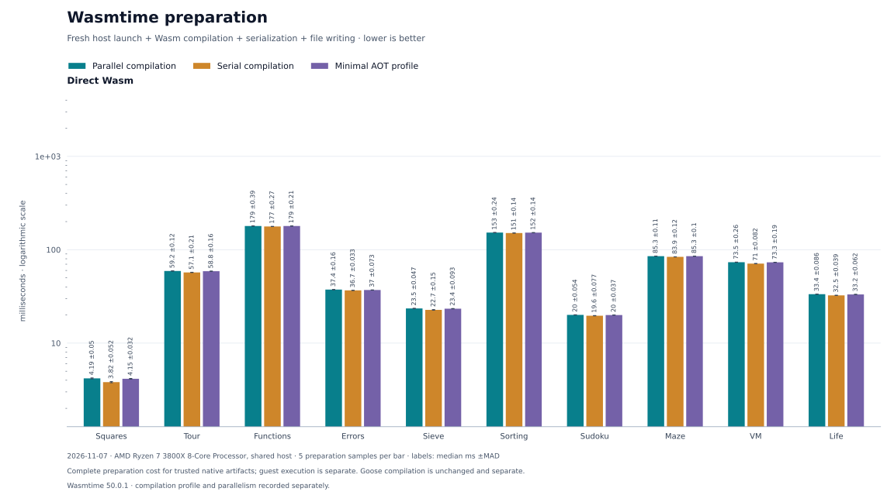

# Goose to Wasm

A [Goose](https://github.com/aardappel/goose) compiler written entirely in Goose. It emits WebAssembly directly and uses native C as a portable bootstrap backend. **Conformance is partial: 114 of 7,235 contract rows fail.**

## Benchmarks

**2026-11-07 · AMD Ryzen 7 3800X pinned to CPU 7 · lower is better.** Five-sample medians for ten examples using snapshot 49. Cold direct Wasm builds took 49.2–130.6 ms; native C builds took 247.6–1810.7 ms. [Results and method](bench/results/2026-11-07/value-and-receiver-contracts/README.md)



Runtime measures process launch through exit, including startup and output. The panels compare compilation on launch, full precompiled Wasmtime, and minimal AOT. Preparation is measured separately.





Sorting took 162.3 ms with minimal AOT and 113.7 ms natively. Both targets use this compiler. These fresh process measurements do not establish a runtime speedup against separately collected prior snapshots.

## Construction and contracts

The compiler implements loading, parsing, checking, specialization, optimization and code generation in Goose. Bootstrap builds a frozen C seed with a native C compiler, then uses it to build the compiler. Snapshot 49 passed C-only fixed-point verification; its final two generated C outputs match.

With Python 3, a native C compiler and Node for Wasm execution:

```sh
python3 scripts/bootstrap.py --verify
python3 scripts/goose_wasm.py build examples/squares.goose -o build/squares.wasm
node scripts/run_wasm.mjs build/squares.wasm
```

Multiassignment evaluates the right-hand side once into a hidden tuple, then performs ordinary assignments in sequence; fixed reference results are snapshotted before writes. The native backend admits a bounded self-relative Row array that constructs directly in its receiving region and tracks exact committed bounds. Admission is narrow: arbitrary inter-row links, copied or escaping roots, and partial or nonlocal construction exits remain refused. Snapshot 49 passed 7,121 of 7,235 frozen source and output contracts; 114 failed. Against snapshot 48, 4 of 7,121 shared checks improved and none regressed. All 114 new source-authored checks passed. The curated Wasm corpus passed 3,010/3,010 checks each in Wasmtime and V8; all 1,134 curated native controls also passed. The remaining failures are 6 accepted invalid programs and 108 runtime contracts rejected during Goose compilation. Every runtime check that reached execution passed. No C++ oracle was executed. [Qualification](selfhost/results/2026-11-07/value-and-receiver-contracts/summary.json)

[Compiler and bootstrap](selfhost/README.md) · [Guide](docs/GUIDE.md) · [Examples](examples/README.md) · [Conformance runner](tests/conformance.py)
