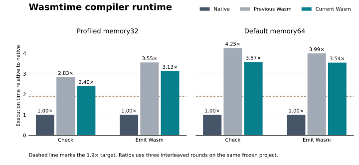
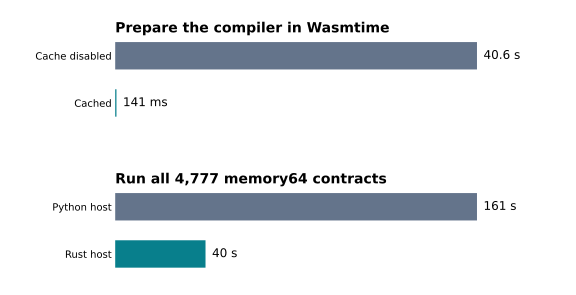

# Goose to Wasm

A [Goose](https://github.com/aardappel/goose) compiler written in Goose. It emits WebAssembly directly or native executables through C. It passes 10,693 of 10,797 conformance rows. [Compatibility tracker](docs/FEATURES.md)

## Benchmarks

**Compiler speed.** On 2026-11-18, compiler `90e086f` used 1.002× as much CPU time as `065aff3` to emit Wasm and 0.997× as much to emit C. These are geometric means of medians across eleven programs, with 31 measurements per cell on a shared host. The chart shows wall time. C emission excludes C compilation and linking. In a separate 2026-11-11 campaign, snapshot 59 took 0.58× the earlier C++ compiler's time for Wasm and 0.53× for C. [Current measurements](bench/results/2026-11-18/compiler-iteration-tools/README.md) · [Snapshot 59](bench/results/2026-11-11/compiler-throughput-59/README.md)


**Large programs.** In a separate earlier run on 2026-11-17 the compiler's self-check went from 11.5 s to 3.9 s of CPU time and from 503 to 306 MiB peak memory in an interleaved run. A later run of five pairs compiling frozen compiler sources reduced CPU time from 11.55 s to 8.64 s for Wasm and from 7.64 s to 6.69 s for C, with identical artifacts. Self-check was flat under that run's shared load. Seven later pairs of development builds reduced self-check CPU time from 3.131 s to 3.054 s. A separate change reduced Blot2's first pass from 298–308 s to 122–124 s of CPU time. That pass ends with 38 lifetime diagnostics. [Self-check](bench/results/2026-11-17/lifetime-compact-reads/README.md) · [Compiler iteration](bench/results/2026-11-17/compiler-iteration/README.md) · [Latest self-check pairs](bench/results/2026-11-17/compiler-and-row-performance/README.md) · [Blot2](bench/results/2026-11-17/blot2-captured-reads/README.md)

**Native builds.** Sixteen parallel C units built the compiler in 16.1 s instead of 97.9 s with Clang `-O2` on eight cores. The resulting compiler executes 2.4% more instructions. Release bootstraps use one unit. [Method and results](bench/results/2026-11-14/native-units/README.md)

**Bootstrap iteration.** A warm verified bootstrap of the frozen compiler sources fell from 52.05 s to 5.80 s wall time across three paired repetitions, with native executables already cached. The generated C and compiler executable were identical. The build used Clang 23.1.5 with `-O2` and one C unit. With native executables cached, the opt-in `--reuse-toolchain` path reduced a changed-source build from 36.19 s to 8.42 s across three pairs while producing the same C and result and verifying the live fixed point. [Measurements](bench/results/2026-11-17/compiler-iteration/README.md) · [Changed-source builds](bench/results/2026-11-17/local-bootstrap/README.md)

**The compiler as Wasm.** Building fixed-point compiler sources `90e086f` took a median of 4.28 s for direct Wasm and 50.62 s for native through C and Clang, including compilation and linking across eight C units on five CPUs, over three builds. Median self-check times were 2.95 s native, 10.61 s in Wasmtime and 11.19 s in V8. Self-compilation took 4.62 s, 14.57 s and 18.91 s respectively. Both engines reuse a prepared memory64 module and time execution after instantiation. The native control uses this compiler's C backend. [Method and results](bench/results/2026-11-18/compiler-iteration-tools/README.md)


**Example programs.** On a shared host, median cold builds for ten examples took 83.9–105.2 ms for direct Wasm and 0.381–2.853 s for native executables, including C compilation and linking. Full process times include launch and exit. Sorting took 301 ms with minimal Wasmtime AOT and 205 ms native in the host comparison. [Method and results](bench/results/2026-11-18/compiler-iteration-tools/README.md)


**Mandelbrot.** A resident run on the official input took a median 3.29 s native, 3.58 s in Wasmtime and 3.55 s in V8. GCC C and upstream Goose native controls took 3.45 s and 3.21 s. The seven-sample hot runtime excludes compilation, startup and instantiation. [Method and results](bench/results/2026-11-18/wasm-lowering/README.md)


**Native rows.** Stable scans and counted literal pushes reduced append time from 238.683 ms to 0.363 ms and traversal from 600.395 ms to 0.076 ms for 8,008 rows across seven pairs. [Measurements](bench/results/2026-11-17/native-row-scans/README.md)

**Closing the gap to native.** On the same frozen compiler project, the earlier `065aff3` backend reduced Wasmtime checking from 2.83× to 2.40× native time and emission from 3.55× to 3.13× with profiled memory32. Default memory64 improved from 4.25× to 3.57× for checking and from 3.99× to 3.54× for emission. In a separate memory32 CPU profile, lifetime analysis accounted for 80% of the extra sampled CPU time during checking and 54% during emission. [Measurements and CPU profile](bench/results/2026-11-18/wasm-lowering/README.md#where-the-gap-remains)



**Compiler iteration.** Reusing Wasmtime's compiled module cut preparation from 40.6 s to 141 ms. The Rust host ran all 4,777 memory64 contracts in 40 s against Python's 161 s, with identical outcomes. On a frozen project, indexing local slots reduced Wasmtime emission from 13.70 s to 13.45 s across four pairs. An eight-read replay cache cut Wasmtime self-check instructions by 1.00%, but checking took 9.95 s versus 9.85 s and peak memory rose from 472 to 516 MiB. The released compiler keeps the per-read check. [Measurements](bench/results/2026-11-18/compiler-iteration-tools/README.md) · [Replay experiment](bench/results/2026-11-18/lifetime-read-groups/README.md)



**Wasm local allocation.** Replaying optimized self-compilation bodies fell from 543 ms to 491 ms with identical local tables and instruction bytes. An overlapping-span stress case fell from 241 ms to 31 ms. [Measurements](bench/results/2026-11-17/wasm-slot-prefix/README.md)

**Varint traversal.** A checksum loop over 8,008 mixed-width values fell from 161.61 ms to 0.129 ms in resident Wasmtime with 32-bit memory. The compiler advances a bounded cursor for proven top-level loops on immutable incoming slices. [Method and results](bench/results/2026-11-17/varint-foreach/README.md)

## How it was built

The frontend, optimizer and backends are written in Goose. A C++ reference guided the initial port. Frozen source and output contracts now check behavior. A checked-in C seed bootstraps the compiler, and `--verify` compares consecutive generated C outputs. [Compiler and bootstrap](selfhost/README.md) · [Contracts](tests/README.md) · [Guide](docs/GUIDE.md) · [Examples](examples/README.md)

With Python 3, a C compiler and Node installed, build and run the first example.

```sh
python3 scripts/bootstrap.py --verify
python3 scripts/goose_wasm.py build examples/squares.goose -o build/squares.wasm
node scripts/run_wasm.mjs build/squares.wasm
```
