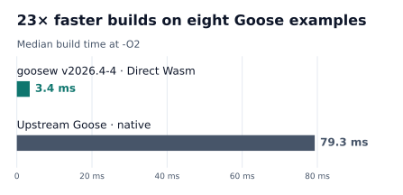
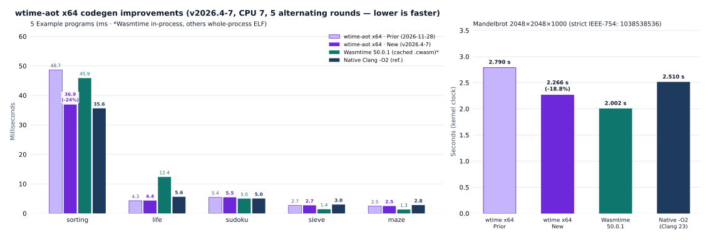
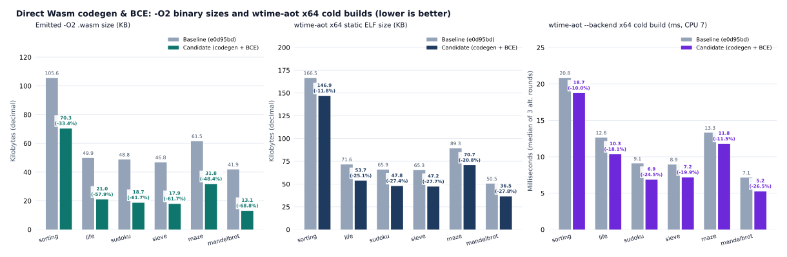

# Goose to Wasm

**A fast, self-hosted [Goose](https://github.com/aardappel/goose) compiler built for rapid edit-compile-run development.**

Compile Goose directly to **WebAssembly in milliseconds** — with no C compiler in your dev loop — and compile the exact same code to **native binaries or C libraries** when you ship.

**[Latest release: `v2026.4-7`](https://github.com/mewhhaha/goose-to-wasm/releases/tag/v2026.4-7)** (tracks upstream Goose `v2026.4`) · **[Play all 9 official Goose examples in your browser](https://mewhhaha.github.io/goose-to-wasm/)** (WebGL2 + Web Audio + JSPI) · **[Compatibility tracker](docs/FEATURES.md)**



<details><summary>Summary numbers (text table)</summary>

| Metric | `goosew` (`v2026.4-7`) | Upstream C++ Goose |
|---|---|---|
| **Everyday `-O2` dev builds** | **`2–7 ms`** (Direct Wasm) | `51–177 ms` (**23×–26× slower**) |
| **Multi-core throughput (`--jobs`)** | **`2.01–2.32M LOC/s`** wall (bit-identical across threads) | Single-threaded |
| **Self-compilation (`selfhost/`, 47.4k–57.5k LOC)** | **`0.26–0.28 s`** (`0.23–0.26 s` PGO) · `0.67 s` PGO Wasm64 | `4.38–4.71 s` (**17×–19× slower**) |
| **Blot2 turnaround (`79.0k LOC`, edit → O2 x64 run)** | **`0.76–0.86 s`** unprof. · **`0.74–0.84 s`** PGO\* (`.life` + `--inc-cache`) | `30.6 s` Clang `-O0` · `98.8 s` `-O2` |
| **Zero-Clang AOT (`wtime-aot x64`)** | **`5.7–19.3 ms`** builds · beats Clang `-O2` on **4/6** kernels (`sorting` `-24%`, `mandelbrot` `-19%`) | Requires Clang + linker |
| **Upstream conformance** | **`10,790 / 10,801`** (`0` unexpected · `6` post-pin upstream deltas) | Sole language reference (no dialect fork) |

</details>

---

## Quick Start

### Option 1: Download a prebuilt release (`v2026.4-7`)

Every archive from [Releases](https://github.com/mewhhaha/goose-to-wasm/releases/tag/v2026.4-7) includes `goosew`, `stdlib`, `stdlib-web`, and `host/web`:

| Platform | Archive |
|---|---|
| Linux x64 | `goose-to-wasm-v2026.4-7-linux-x64.tar.gz` |
| macOS Apple Silicon | `goose-to-wasm-v2026.4-7-macos-arm64.tar.gz` |
| macOS Intel | `goose-to-wasm-v2026.4-7-macos-x64.tar.gz` |
| Windows x64 | `goose-to-wasm-v2026.4-7-windows-x64.zip` |
| Portable Wasm64 | `goose-to-wasm-v2026.4-7-wasm.tar.gz` · `goosew-v2026.4-7-wasm64.wasm` |

```sh
# Linux / macOS
tar -xzf goose-to-wasm-v2026.4-7-linux-x64.tar.gz
export PATH="$PWD/goose-to-wasm-v2026.4-7-linux-x64/bin:$PATH"
goosew --version
# goose-to-wasm v2026.4-7 (Goose v2026.4)
```

```powershell
# Windows (PowerShell)
Expand-Archive goose-to-wasm-v2026.4-7-windows-x64.zip -DestinationPath .
$env:PATH = "$PWD\goose-to-wasm-v2026.4-7-windows-x64\bin;$env:PATH"
goosew --version
```

```sh
# Portable Wasm64 compiler (runs anywhere Wasmtime runs)
python3 scripts/run_wasmtime.py goosew-v2026.4-7-wasm64.wasm -- --version
```

> **Binary name (`goosew`):** Named `goosew` so it does not collide with upstream C++ `goose` on your `PATH`. Symlink or rename it if you prefer `goose`.

### Option 2: Build from source (~41 s)

Requires Python 3 and a C compiler (`clang` default, or `gcc`), plus Node, Wasmtime, or [`host/wtime`](host/wtime/README.md) to run `.wasm` output.

```sh
python3 scripts/bootstrap.py --verify
export PATH="$PWD/build/bin:$PATH"
```

### Everyday commands

```sh
# 0. Built-in Goose language & CLI cheatsheet (for humans and coding agents)
goosew guide                  # or `goosew guide --cheatsheet`, `goosew guide --list`, `goosew guide <topic>`

# 1. Fast type & lifetime check (--error-format=json & --color supported)
goosew --check examples/sorting.goose

# 2. Instant dev compile & run via Direct Wasm (2–7 ms, no C toolchain)
goosew examples/squares.goose -O2 -o squares.wasm --run
# or pick a runner explicitly: --runner auto|wasmtime|winch|wtime-aot|wtime-aot-fast|wtime|node

# 3. Ship a zero-Clang static x64/AArch64 binary via wtime-aot (5–19 ms AOT build)
goosew examples/squares.goose --target aot-x64 -O2 -o squares --run
goosew examples/squares.goose --target aot-aarch64 --wasm-memory64 -O2 -o squares-arm64

# 4. Ship a native binary (via C)
goosew examples/squares.goose --target c -O2 --run

# 5. Embed in a C/C++/Rust host (exports + C header, no -rdynamic/-ldl)
goosew --emit-runtime goose_runtime.c
goosew app.goose --header app.h -O2 -o app.c
```

See [docs/GUIDE.md](docs/GUIDE.md) for `--cache-dir`, `--jobs`, `--wasm-memory64`, `--library`, `--shared`, `--stack-reserve`, and Binaryen compaction.

---

## Benchmarks

### 1. Everyday dev loop

Skipping the C compiler and linker turns `-O2` builds on everyday Goose programs into single-digit milliseconds (`2–7 ms` vs `51–177 ms` upstream):


### 2. Large real-world codebases

Combining `--jobs`, `--cache-dir` (whole-build + `.life` lifetime certificates), compacted Direct Wasm64 (`8.08 MiB`), and [`goose-wtime-aot --inc-cache`](host/wtime-aot/README.md) (per-function incremental O2 x64 AOT — automatically wired when passing `--cache-dir --runner wtime-aot --run`) turns half-minute to minute-and-a-half C rebuilds into **sub-second edit → native x64 execution** (`0.74–0.86 s` on 79.0k-LOC Blot2, beating Winch `--fast-jit` by `100–165 ms` while running full O2 native machine code):


| Codebase & scenario (`--jobs 8`, Ryzen 7 7800X3D) | Unprofiled | Fresh PGO\* | vs Upstream C++ |
|---|---:|---:|---|
| **`selfhost/`** (`47.4k LOC`) — `--check` / `-O0` Wasm64 | **`0.26 / 0.28 s`** | **`0.23 / 0.26 s`** | **16.9×–19.4×** vs `4.38–4.71 s` |
| **`selfhost/`** (`57.5k LOC`, `v2026.4-7`) — `-O2` Wasm64 (`6.31 MiB`) | **`0.74 s`** | **`0.67 s`** | `1.32 s` standalone x64 self-compile |
| **`blot2`** (`79.0k LOC`) — edited `compile.goose` → **O2 x64 run** (`--inc-cache`) | **`0.758 s`** (`538 + 219 ms`) | **`0.742 s`** (`522 + 219 ms`) | **40×–133×** vs `30.6 / 98.8 s` |
| **`blot2`** (`79.0k LOC`) — edited `check.goose` (932 KB) → **O2 x64 run** | **`0.785 s`** (`549 + 236 ms`) | **`0.759 s`** (`523 + 236 ms`) | **39×–130×** vs `30.6 / 98.8 s` |
| **`blot2`** (`79.0k LOC`) — edited `--cache-dir` + Winch `--fast-jit` | **`0.902 s`** (`538 + 363 ms`) | **`0.886 s`** (`522 + 363 ms`) | **34×–112×** vs `30.6 / 98.8 s` |
| **`blot2`** (`79.0k LOC`) — `--check` (edited `.life` hit) | **`0.48–0.49 s`** (`101 ms` life) | **`0.47 s`** | **22×** vs `10.73 s` |
| **`blot2`** (`79.0k LOC`) — warm unchanged (`wtime-aot --cache` / CPU 7) | **`167–239 ms`** (8c) / **`92–100 ms`** (1c) | — | **Bit-exact SHA-256** across engines |

Blot2 emits **`8.08 MiB`** at `-O0` (`1.65 s` / `1.59 s` PGO\* cold) and **`12.45 MiB`** at `-O2`; `goose-wtime-aot --inc-cache` recompiles a 1-function edit across 7,961 functions in **`60–81 ms`** (`3.7–117 KB` `.delta`).

```sh
# Compile Blot2 directly to Wasm64 (1.59–1.65 s cold · 0.52–0.55 s edited .life hit)
goosew compiler-goose/src/main.goose --stdlib blot-stdlib \
  --target wasm-direct --wasm-memory64 --wasm-max-pages 65536 \
  --library --reachable-program --expansion-node-limit 1000000 \
  --cache-dir build/goose-cache -O0 -o blot2.wasm

# Run O2 native x64 incrementally via goose-wtime-aot (60 ms compile + 153 ms run = 219 ms)
host/wtime-aot/target/release/goose-wtime-aot --inc-cache build/wtime-inc blot2.wasm \
  --entry blot_goose_main -- \
  build-project benchmarks/idiomatic/fibonacci.blot fib.wasm \
  --std-root std --prelude std/prelude.blot
```

### 3. Multi-core compiler throughput

`goosew` packs its AST into cache-line structures (`32 B Token`, `64 B Node`) and parallelizes I/O, parsing, typechecking, pure lifetimes, optimization, and Wasm/C emission (`--jobs auto` default) with **100% SHA-256 bit-identical output** across thread counts (`--jobs 1..16`):


| Workload (Ryzen 7 7800X3D, matched unprofiled Clang 23 `-O2`) | Wall Time | Throughput | Peak RSS |
|---|---:|---:|---|
| Procedural multi-file → Direct Wasm `-O0` (`98.7k` / `246.8k LOC`) | **`49.2 / 106.1 ms`** | **`2.01–2.32M LOC/s`** (`2.59M` compile) | **-36% to -55%** vs `v2026.4-3` |
| Procedural multi-file → Native C (`98.7k` / `246.8k LOC`, `--jobs auto`) | **`73.4 / 187.5 ms`** | **`1.32–1.35M LOC/s`** (**4.7×–4.9×**) | **-45% to -50%** on `selfhost` |
| `selfhost` (`47.4k`) & `blot2` (`79.0k`) Wasm64 vs `v2026.4-3` | `0.58 s` / `2.54 s` | **7.5×** (`selfhost`) · **6.4×** Wasm backend | Up to **-57%** lower peak RSS |

### 4. Production runtime speed

Fast dev builds do not trade away production speed. Native `-O2` binaries match or edge out upstream C++ Goose (all bit-exact), and Direct Wasm runs near-native in Wasmtime or ahead-of-time via [`wtime-aot`](https://github.com/mewhhaha/wtime) (`5.7–19.3 ms` zero-LLVM `x64` builds beating native Clang `-O2` on **4 of 6** benchmarks — `life`, `sieve`, `maze`, and strict IEEE-754 `mandelbrot` at `2.266 s` vs `2.510 s` — while cutting `sorting` by **`-24.1%`** to `36.9 ms`, 20% faster than Wasmtime and within 3.6% of Clang `-O2`, in the [2026-11-28 `v2026.4-7` report](bench/results/2026-11-28/blot2-subsecond-and-wtime-aot/README.md)):





*\*Separate fresh Clang-23 PGO reference runs are labeled explicitly. Full methodology, pinned SHAs, raw JSON, and preserved rejected experiments live in the [2026-11-28 sub-second Blot2 & `wtime-aot` report](bench/results/2026-11-28/blot2-subsecond-and-wtime-aot/README.md), [2026-11-28 `wtime-aot` & codegen report](bench/results/2026-11-28/wtime-aot-and-codegen/README.md), [2026-11-27 four-levers report](bench/results/2026-11-27/four-levers-campaign/README.md), [compiler throughput study](bench/results/2026-11-26/compiler-throughput/README.md), and the [archive](#benchmark--evidence-archive) below.*

---

## Choosing a Target

| | Direct Wasm (`--target wasm-direct`, default) | Native AOT (`--target aot-x64` / `aot-aarch64`) | Native C (`--target c` / `--backend native`) |
|---|---|---|---|
| **Best for** | Instant edit-run dev loops, large-project iteration, browsers/sandboxes | Zero-Clang static Linux `x64`/`aarch64` binaries & hosted Wasm64 AOT (`goose-wtime-aot`) | Production binaries, servers, maximum single-thread speed, C libraries |
| **Build time (examples)** | **2–7 ms** (no C compiler needed) | **5–19 ms** (`wtime-aot`, zero LLVM/Clang) | `135–440 ms` (cached runtime + Clang/GCC) |
| **Build time (57.5k LOC)** | **0.63 s** (`selfhost` `-O2` Wasm64) | **2.1 s** (`x64`) / **1.5 s** (`aarch64` cross) | **`0.62 s`** C emit + parallel C compile |
| **Runtime** | Near-native in Wasmtime (`host/rust`), `goose-wtime-aot` (`host/wtime-aot`), safe-Rust `wtime` (`host/wtime`), or browsers | Zero-`libc` static ELF (`1.12 s` standalone self-compile; beats Clang `-O2` on `life`, `sieve`, `maze`) | Matches or edges out upstream C++ Goose `-O2` |
| **Features** | Core language, root structs, `reusable[]` slice pools, `defer`, `const if`, `env.*` imports, memory32 & memory64 | Standalone Wasm32/Wasm64 + Goose OS/JSON imports (`--allow-files`), plus 84-import Blot2 via `host/wtime-aot` | Everything in Direct Wasm plus threads, stdlib `slice_pool` C externs, `--header`, `--shared` |

---

## Foreign C Functions as Wasm Host Imports

Goose `extern fn` declarations lower directly to standard WebAssembly imports in module **`"env"`** (`(import "env" "<name>" (func ...))`), so C-backed projects like [`mewhhaha/blot2`](https://github.com/mewhhaha/blot2) run in Wasm without changing Goose source:

```goose
extern fn host_add(a: i64, b: i64) -> i64;
export fn compute(x: i64) -> i64 { return host_add(x, 7) * 3; }
fn main() {}
```

```js
const noop = () => {};
const { instance } = await WebAssembly.instantiate(wasmBytes, {
  goose: new Proxy({}, { get: () => noop }),
  env: { host_add: (a, b) => a + b },
});
console.log(instance.exports.compute(5n)); // 36n
```

Supported Wasm ABI types: numerics (`i8`–`i64`, `u8`–`u64`, `f32`, `f64`), `bool`, slices (`T[:]`), and references (`T&` / `const T&`, including growable `u8[>..]&` via `goose.reserve`). Aggregates can be passed by `const T&`, `T[:]`, or out-reference `T&`.

---

## Diagnostics

Diagnostics include source snippets, `^~~~` carets, `--error-format=text|json`, `--color=auto|always|never`, generic/stdlib instantiation backtraces, consolidated missing `match` variants and struct fields, typo suggestions, and lifetime call stacks:

```text
app.goose:3:19: error: no overload matches this call's argument types and count: `add(i64, const u8[:])`
   3 | fn main() { print(add(1, "oops")); }
     |                   ^~~
  note: candidate `fn add(a: f64, b: f64) -> f64` at app.goose:2:4 (argument 2 `b`: got `const u8[:]`, expected `f64`)
  note: candidate `fn add(a: i64, b: i64) -> i64` at app.goose:1:4 (argument 2 `b`: got `const u8[:]`, expected `i64`)
```

---

## Compatibility & Documentation

Releases are versioned **`v<goose-version>-<n>`** (currently **`v2026.4-7`**) and strictly track upstream [Goose](https://github.com/aardappel/goose) as the sole language reference (`10,790 / 10,801` conformance rows passing, `0` unexpected failures — all `6` post-pin upstream language/stdlib deltas documented in `tests/conformance/known-gaps.json`).

| Topic | Documentation |
|---|---|
| CLI flags, `--cache-dir`, targets & compaction | [docs/GUIDE.md](docs/GUIDE.md) |
| Native Rust Wasmtime host (Winch `--fast-jit`, `.cwasm`, Blot2 imports) | [host/rust/README.md](host/rust/README.md) |
| Native `wtime-aot` host (zero-LLVM x64 AOT, `--fast`, `--cache`, `--inc-cache`, Blot2 imports) | [host/wtime-aot/README.md](host/wtime-aot/README.md) |
| Safe-Rust `wtime` host (`#![forbid(unsafe_code)]`, Wasm32/Wasm64) | [host/wtime/README.md](host/wtime/README.md) |
| Browser runtime & drop-in `stdlib-web` (WebGL2, Audio, JSPI) | [host/web/README.md](host/web/README.md) · [stdlib-web/README.md](stdlib-web/README.md) |
| Upstream Goose & Blot2 compatibility tracker | [docs/FEATURES.md](docs/FEATURES.md) |
| Self-hosted compiler, Snapshot 76 seed & bootstrap | [selfhost/README.md](selfhost/README.md) |
| Conformance, qualification & runnable examples | [tests/README.md](tests/README.md) · [examples/README.md](examples/README.md) |
| Contributing, Code of Conduct & Security | [CONTRIBUTING.md](CONTRIBUTING.md) · [CODE_OF_CONDUCT.md](CODE_OF_CONDUCT.md) · [SECURITY.md](SECURITY.md) |

### Benchmark & evidence archive

<details><summary>All dated compiler, runtime, and Blot2 studies under <code>bench/results/</code></summary>

- [Sub-second Blot2 turnaround & `wtime-aot x64` codegen (`v2026.4-7`) — `0.74–0.86 s` edited Blot2 → O2 native x64 run (`.life` + `--inc-cache`), `-24.1%` `sorting` & `-18.8%` `mandelbrot` (2026-11-28)](bench/results/2026-11-28/blot2-subsecond-and-wtime-aot/README.md)
- [`wtime-aot` integration & Direct Wasm codegen / BCE — `-33%` to `-69%` smaller `-O2` `.wasm`, `-10%` to `-27%` faster AOT builds, `-6%` `sudoku` & `-2.7%` standalone Wasm64 self-compile (2026-11-28)](bench/results/2026-11-28/wtime-aot-and-codegen/README.md)

- [Four-levers optimization campaign — 1.87–1.98 s cold / 0.89–0.98 s edited Blot2 turnaround, `-62%` Wasm64 & Winch `--fast-jit` (2026-11-27)](bench/results/2026-11-27/four-levers-campaign/README.md)
- [Lifetime optimization campaign — 2.17–2.36 s Blot2 turnaround, 1.56–1.75 s emit & 0.24–0.26 s selfhost (2026-11-27)](bench/results/2026-11-27/lifetime-campaign/README.md)
- [Blot2 `98f277f2` turnaround campaign — 2.63–2.79 s total (`--fast-jit`, -57% Wasm64, parallel lifetimes & `--cache-dir`) (2026-11-27)](bench/results/2026-11-27/blot2-turnaround/README.md)
- [Multi-core compiler throughput campaign — 2.32M LOC/s wall, 2.59M LOC/s compile, 6.9× C backend & 7.5×–8.2× selfhost (2026-11-26)](bench/results/2026-11-26/compiler-throughput/README.md)
- [Production runtime speed with `wtime-aot` `v0.1.5` (`x64` & safe Rust) (2026-11-25)](bench/results/2026-11-25/runtime-with-wtime/README.md)
- [Release `v2026.4-5` qualification & chart provenance (2026-11-25)](bench/results/2026-11-25/release-v2026.4-5/README.md)
- [Blot2 HEAD `98f277f2` Direct Wasm64 + fast `goose-wasmtime` & `goose-wtime` turnaround (2026-11-25)](bench/results/2026-11-25/blot2-head-98f277f2/README.md)
- [Release `v2026.4-4` head-to-head vs `v2026.4-3` & upstream C++ Goose (2026-11-25)](bench/results/2026-11-25/release-v2026.4-4/README.md)
- [Direct Wasm64 codegen speedups & preserved rejected experiments (2026-11-25)](bench/results/2026-11-25/wasm64-codegen/README.md)
- [Direct Wasm64 Blot2 (`cb1e9e15`) on pure-Rust `wtime` — 18/18 bit-exact (2026-11-25)](bench/results/2026-11-25/blot2-wtime-wasm64/README.md)
- [Release `v2026.4-3` head-to-head vs `v2026.4-2` & upstream C++ Goose (2026-11-25)](bench/results/2026-11-25/release-v2026.4-3/README.md)
- [Blot2 lifetime checker algorithmic redesign — 7 rounds & ablations (2026-11-25)](bench/results/2026-11-25/blot2-lifetime-algo/README.md)
- [Release `v2026.4-2` head-to-head vs `v2026.4-1` & upstream C++ Goose (2026-11-24)](bench/results/2026-11-24/release-v2026.4-2/README.md)
- [Release `v2026.4-1` head-to-head vs upstream C++ Goose (2026-11-24)](bench/results/2026-11-24/release-v2026.4-1/README.md)
- [Blot2 class-keyed lifetime checker speedups (2026-11-24)](bench/results/2026-11-24/blot2-lifetime-speed/README.md)
- [Blot2 `l.alts` compaction & default-2 GiB `6ad5fbb` native build (2026-11-24)](bench/results/2026-11-24/blot2-alts-compaction-and-6ad5fbb/README.md)
- [C-host library interface & native Blot2 `cb1e9e15` build (2026-11-24)](bench/results/2026-11-24/blot2-chost-and-native-build/README.md)
- [Wasm compaction, dead mark elimination & `wtime-aot` evaluation (2026-11-23)](bench/results/2026-11-23/wasm-peephole-wtime-aot-and-refresh/README.md)
- [Native C codegen gap closed vs upstream C++ Goose (2026-11-23)](bench/results/2026-11-23/native-c-codegen-gap/README.md)

</details>
