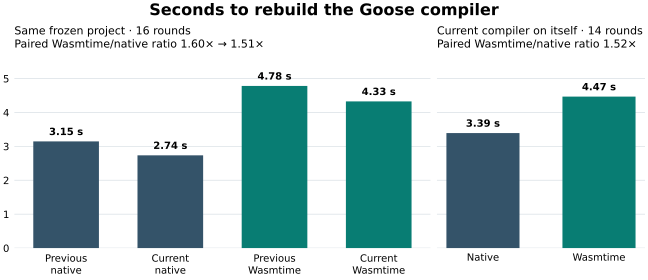
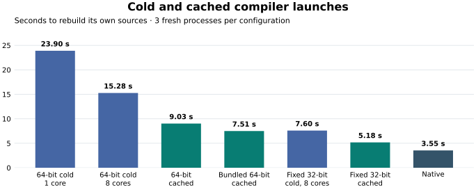

# Goose to Wasm

A [Goose](https://github.com/aardappel/goose) compiler written in Goose. It emits WebAssembly directly or native executables through C. It passes 10,693 of 10,797 conformance rows. [Compatibility tracker](docs/FEATURES.md)

## Benchmarks

**The compiler rebuilding itself.** Across 14 paired rounds, the bundled 32-bit compiler rebuilt its own sources in a median **4.47 s** in Wasmtime and **3.39 s** native, with a median same-round ratio of **1.52× native time**. On a frozen project, Wasmtime rebuild time fell by **20.1%** over 16 paired rounds. The median same-round Wasmtime/native ratio went from **1.60× to 1.51×**. The checker skipped 1,003,113 read records on that build. [Paired rebuilds](bench/results/2026-11-19/construct-read-demand/README.md)



**Cold and cached self-compilation.** With an empty Wasmtime cache, the memory64 compiler took a median **23.90 s** on one core and **15.28 s** on eight cores. The bundled memory32 compiler took **7.60 s** cold with eight cores and **5.18 s** cached on one core, versus **3.55 s** native. Each median covers three fresh processes. Cold runs compile the module and cached runs load precompiled code. [Launch and edit times](bench/results/2026-11-19/construct-read-demand/README.md#cold-and-cached-self-compilation) · [Gdev status](bench/results/2026-11-18/compiler-request-latency/README.md#compiling-gdev)



**Compiler speed.** Across eleven programs, compiler `fc34386` used 6.4% less CPU time than `6e503fb` to emit Wasm and 4.9% less to emit C. These are geometric means of medians over 31 measurements per cell. The chart shows wall time. In the earlier snapshot 59 comparison, Wasm emission took 0.58× the C++ compiler’s time and C emission took 0.53×. [Measurements](bench/results/2026-11-19/construct-read-demand/catalog-summary.json) · [Snapshot 59](bench/results/2026-11-11/compiler-throughput-59/README.md)


**The compiler as Wasm.** Using a pinned Goose emitter, building compiler `fc34386` on the shared host took 4.33 s for direct Wasm and 177.93 s through C and Clang. Across three runs on those same sources, the resulting compiler took 3.77 s native, 10.43 s in Wasmtime and 10.07 s in V8 to check itself. Emitting its Wasm module took 6.00 s, 17.49 s and 17.71 s respectively. C builds used CPUs 0, 2, 4 and 6. Wasm builds and execution used CPU 3. Both Wasm engines used prepared, default memory64 modules and timed execution after instantiation. [Measurements](bench/results/2026-11-19/construct-read-demand/selfhost.json)


**Example programs.** On the shared host pinned to CPU 1, cold builds for the ten examples took 83.7–116.1 ms for direct Wasm and 0.402–2.975 s through C, including compilation and linking. Sorting took 408 ms with minimal Wasmtime AOT and 260 ms native, including process launch and exit. [Builds](bench/results/2026-11-19/construct-read-demand/examples.json.gz) · [Process times](bench/results/2026-11-19/construct-read-demand/host.json.gz)


**Mandelbrot.** On the shared host pinned to CPU 1, a resident run on the official input took a median 5.47 s native, 6.32 s in Wasmtime and 4.78 s in V8. GCC C and upstream Goose native controls took 5.78 s and 5.69 s. The seven-sample runtime excludes compilation, startup and instantiation. [Measurements](bench/results/2026-11-19/construct-read-demand/langbench-hot.json.gz)


<details><summary>Earlier measurements</summary>

| Question | Measurements |
| --- | --- |
| What did skipping temporary expression records save? | [Expression checking, rebuilds and grouping experiments](bench/results/2026-11-19/expression-lifetimes/README.md) |
| What did skipping repeated array effects save? | [Rebuilds, array effects and validation controls](bench/results/2026-11-19/lifetime-array-effects/README.md) |
| What did tracking changed reads save? | [Lifetime reads and memory cost](bench/results/2026-11-19/lifetime-read-replay/README.md) |
| What improved string-heavy builds? | [8,192 literals and full compiler rebuilds](bench/results/2026-11-19/compiler-passes/README.md) |
| How much memory does a 32-bit compiler need? | [Fixed layouts and Blot2 capacity](bench/results/2026-11-18/compiler-layout-trials/README.md) · [Growing regions during compilation](bench/results/2026-11-18/compiler-region-recovery/README.md) |
| What sped up large project checks? | [Lifetime analysis](bench/results/2026-11-17/lifetime-compact-reads/README.md) · [Compiler iteration](bench/results/2026-11-17/compiler-iteration/README.md) · [Self-check pairs](bench/results/2026-11-17/compiler-and-row-performance/README.md) · [Blot2](bench/results/2026-11-17/blot2-captured-reads/README.md) |
| How much time do native builds and bootstrap take? | [Parallel C units](bench/results/2026-11-14/native-units/README.md) · [Changed-source bootstrap](bench/results/2026-11-17/local-bootstrap/README.md) |
| Which runtime and tooling costs improved? | [Native row scans](bench/results/2026-11-17/native-row-scans/README.md) · [Wasmtime preparation](bench/results/2026-11-18/compiler-iteration-tools/README.md) · [Wasm local allocation](bench/results/2026-11-17/wasm-slot-prefix/README.md) · [Varint traversal](bench/results/2026-11-17/varint-foreach/README.md) |

</details>

## How it was built

The frontend, optimizer and backends are written in Goose. A C++ reference guided the initial port. Frozen source and output contracts now check behavior. A checked-in C seed bootstraps the compiler, and `--verify` compares consecutive generated C outputs. [Compiler and bootstrap](selfhost/README.md) · [Contracts](tests/README.md) · [Guide](docs/GUIDE.md) · [Examples](examples/README.md)

With Python 3, a C compiler and Node installed, build and run the first example.

```sh
python3 scripts/bootstrap.py --verify
python3 scripts/goose_wasm.py build examples/squares.goose -o build/squares.wasm
node scripts/run_wasm.mjs build/squares.wasm
```
