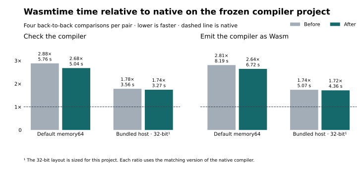
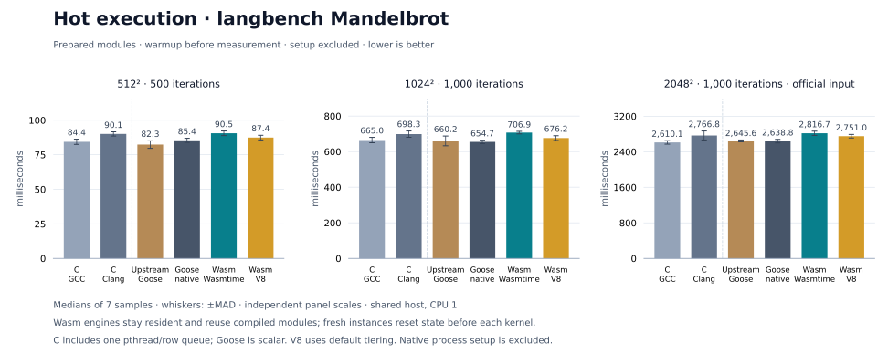

# Goose to Wasm

A [Goose](https://github.com/aardappel/goose) compiler written in Goose. It emits WebAssembly directly or native executables through C. It passes 10,693 of 10,797 conformance rows. [Compatibility tracker](docs/FEATURES.md)

## Benchmarks

**The compiler in Wasmtime.** On the frozen compiler project, default Wasmtime checking fell from **5.76 to 5.04 s** of CPU time and Wasm emission from **8.19 to 6.72 s**. The new compiler took **2.68× and 2.64× native time**. With the bundled host and a project-sized 32-bit layout, those ratios were **1.74× and 1.72×**. The emitted compiler shrank from 17.32 MB to 8.82 MB. Medians cover four paired comparisons on a shared host. [Measurements](bench/results/2026-11-18/compiler-array-views/README.md)



**Sizing memory32 from three examples.** An experimental layout cut frozen compiler check time from **5.19 to 3.81 s** and emission from **6.98 to 5.26 s** in the general Wasmtime host. It exhausted the token region parsing the 450-module Blot2 project. One 32-bit layout sized from both projects handled both. [Trials and capacity measurements](bench/results/2026-11-18/compiler-layout-trials/README.md)


**Compiler speed.** Across eleven programs, compiler `4e9b78e` used 0.974× the CPU time of `ac55de2` to emit Wasm and 0.984× to emit C. These are geometric means of medians over 31 measurements per cell. The chart shows wall time. In the earlier snapshot 59 comparison, Wasm emission took 0.58× the C++ compiler’s time and C emission took 0.53×. [Measurements](bench/results/2026-11-18/compiler-array-views/catalog-summary.json) · [Snapshot 59](bench/results/2026-11-11/compiler-throughput-59/README.md)


**Large programs.** In a separate earlier run on 2026-11-17 the compiler's self-check went from 11.5 s to 3.9 s of CPU time and from 503 to 306 MiB peak memory in an interleaved run. A later run of five pairs compiling frozen compiler sources reduced CPU time from 11.55 s to 8.64 s for Wasm and from 7.64 s to 6.69 s for C, with identical artifacts. Self-check was flat under that run's shared load. Seven later pairs of development builds reduced self-check CPU time from 3.131 s to 3.054 s. A separate change reduced Blot2's first pass from 298–308 s to 122–124 s of CPU time. That pass ends with 38 lifetime diagnostics. [Self-check](bench/results/2026-11-17/lifetime-compact-reads/README.md) · [Compiler iteration](bench/results/2026-11-17/compiler-iteration/README.md) · [Latest self-check pairs](bench/results/2026-11-17/compiler-and-row-performance/README.md) · [Blot2](bench/results/2026-11-17/blot2-captured-reads/README.md)

**Native builds.** Sixteen parallel C units built the compiler in 16.1 s instead of 97.9 s with Clang `-O2` on eight cores. The resulting compiler executes 2.4% more instructions. Release bootstraps use one unit. [Method and results](bench/results/2026-11-14/native-units/README.md)

**Bootstrap iteration.** A warm verified bootstrap of the frozen compiler sources fell from 52.05 s to 5.80 s wall time across three paired repetitions, with native executables already cached. The generated C and compiler executable were identical. The build used Clang 23.1.5 with `-O2` and one C unit. With native executables cached, the opt-in `--reuse-toolchain` path reduced a changed-source build from 36.19 s to 8.42 s across three pairs while producing the same C and result and verifying the live fixed point. [Measurements](bench/results/2026-11-17/compiler-iteration/README.md) · [Changed-source builds](bench/results/2026-11-17/local-bootstrap/README.md)

**The compiler as Wasm.** Building compiler `4e9b78e` on its own sources on the shared host took 3.57 s for direct Wasm and 49.89 s through C and Clang. Across three runs, self-check took 2.15 s native, 5.80 s in Wasmtime and 6.38 s in V8. Emitting the compiler took 2.94 s, 7.51 s and 8.47 s respectively. Builds used CPUs 0, 2, 3, 4 and 6 for C and CPU 3 for Wasm; execution used CPU 3. Both Wasm engines used prepared, default memory64 modules and timed execution after instantiation. [Measurements](bench/results/2026-11-18/compiler-array-views/selfhost.json)


**Example programs.** On the shared host pinned to CPU 1, cold builds for the ten examples took 77.0–160.5 ms for direct Wasm and 0.609–4.196 s through C, including compilation and linking. Sorting took 184 ms with minimal Wasmtime AOT and 138 ms native, including process launch and exit. [Builds](bench/results/2026-11-18/compiler-array-views/examples.json) · [Process times](bench/results/2026-11-18/compiler-array-views/host.json)


**Mandelbrot.** On the shared host pinned to CPU 1, a resident run on the official input took a median 2.50 s native, 2.71 s in Wasmtime and 2.62 s in V8. GCC C and upstream Goose native controls took 2.51 s and 2.50 s. The seven-sample runtime excludes compilation, startup and instantiation. [Measurements](bench/results/2026-11-18/compiler-array-views/langbench-hot.json)




**Native rows.** Stable scans and counted literal pushes reduced append time from 238.683 ms to 0.363 ms and traversal from 600.395 ms to 0.076 ms for 8,008 rows across seven pairs. [Measurements](bench/results/2026-11-17/native-row-scans/README.md)

In separate tooling measurements, caching Wasmtime preparation cut 40.6 s to 141 ms, and the Rust host ran 4,777 memory64 contracts in 40 s versus 161 s under Python. [Tooling measurements](bench/results/2026-11-18/compiler-iteration-tools/README.md)


**Wasm local allocation.** Replaying optimized self-compilation bodies fell from 543 ms to 491 ms with identical local tables and instruction bytes. An overlapping-span stress case fell from 241 ms to 31 ms. [Measurements](bench/results/2026-11-17/wasm-slot-prefix/README.md)

**Varint traversal.** A checksum loop over 8,008 mixed-width values fell from 161.61 ms to 0.129 ms in resident Wasmtime with 32-bit memory. The compiler advances a bounded cursor for proven top-level loops on immutable incoming slices. [Method and results](bench/results/2026-11-17/varint-foreach/README.md)

## How it was built

The frontend, optimizer and backends are written in Goose. A C++ reference guided the initial port. Frozen source and output contracts now check behavior. A checked-in C seed bootstraps the compiler, and `--verify` compares consecutive generated C outputs. [Compiler and bootstrap](selfhost/README.md) · [Contracts](tests/README.md) · [Guide](docs/GUIDE.md) · [Examples](examples/README.md)

With Python 3, a C compiler and Node installed, build and run the first example.

```sh
python3 scripts/bootstrap.py --verify
python3 scripts/goose_wasm.py build examples/squares.goose -o build/squares.wasm
node scripts/run_wasm.mjs build/squares.wasm
```
