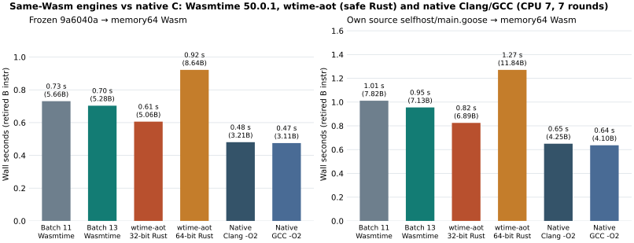
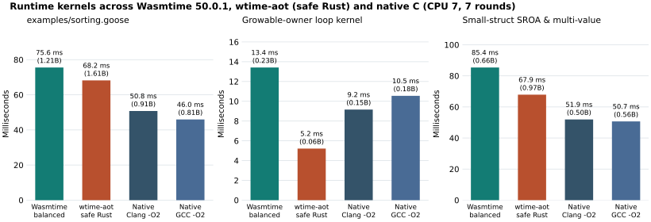
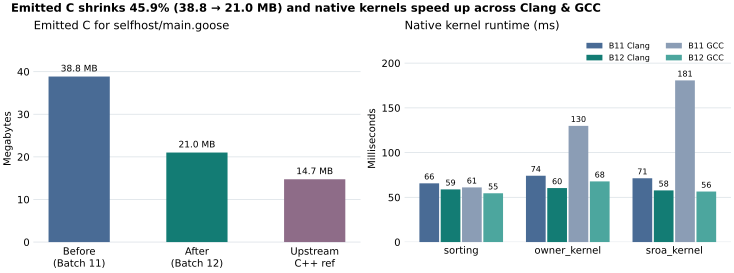
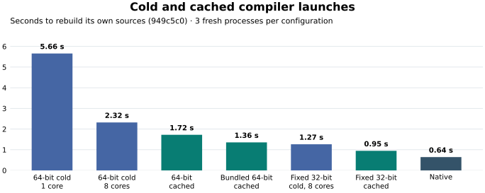

# Goose to Wasm

A [Goose](https://github.com/aardappel/goose) compiler written in Goose. It emits WebAssembly directly or native executables through C. It passes 10,697 of 10,801 conformance rows. [Compatibility tracker](docs/FEATURES.md)

## Benchmarks

**Wasm compaction, dead mark elimination, cold abort outlining & `wtime-aot` (Batch 13).** Adding stack-based `local.set; local.get` → `local.tee` / single-use folding in `wb_reuse_locals` (`selfhost/wasm.goose`), tightening `cg_may_region` and adding `cg_may_print` + zero-acquisition dead-mark stripping (`global.get 3 / set 3` **−97.4% / −95.5%**, `global.get 0 / set 0` **−92.9% / −85.6%**), and outlining **21,449** cold abort sites shrank `direct.wasm` **3.50 MB → 2.91 MB** (**−16.9%**), the balanced release **2.85 MB → 2.48 MB** (**−13.0%**, gzip **0.73 MB**, `.cwasm` **−11.0%** to **4.97 MB**), the size profile **2.46 MB → 2.26 MB** (**−8.2%**, gzip **0.64 MB**), and portable memory64 `compiler.wasm` **4.76 MB → 4.04 MB** (**−15.1%**). Across 7 alternating rounds on CPU 7, cached Wasmtime 50.0.1 sped up on **7/7 rounds** for both frozen `9a6040a` (**0.731 s → 0.703 s** balanced, **0.961×**, cold **2.54 s**; `size` **0.692 s**, **0.947×**) and own source `selfhost/main.goose` (**1.011 s → 0.955 s** balanced, **0.942×**, **−8.8%** instructions: 7.82 B → **7.13 B**; `size` **0.930 s**, **0.920×**). Compiling the exact same Batch 13 32-bit Wasm module ahead-of-time with read-only [`wtime-aot`](https://github.com/mewhhaha/wtime) (`6ed7ed3c`, safe Rust, `rustc 1.97.1`, `--target-cpu native`) reached **0.606 s** on frozen `9a6040a` (**0.861×** of cached Wasmtime balanced, 7/7 rounds), **0.825 s** on own source (**0.864×** of Wasmtime, 7/7 rounds; native Clang **0.650 s**, native GCC **0.637 s**), **68.2 ms** on `examples/sorting.goose` (Wasmtime **75.6 ms**, Clang **50.8 ms**, GCC **46.0 ms**), and **5.22 ms** on `owner_kernel` (**2.57× faster** than Wasmtime **13.4 ms** and **1.76×–2.02× faster** than native Clang **9.16 ms** / GCC **10.55 ms** via AVX2). [Wasm compaction, `wtime-aot` & reader refresh](bench/results/2026-11-23/wasm-peephole-wtime-aot-and-refresh/README.md) · [Compact command](docs/GUIDE.md#build-and-run)






**Native C codegen gap closed (Batch 12).** Reworking the native C runtime (`native/storage.h`) and C emitter (`selfhost/codegen_c.goose`) — adding typed `#pragma pack(push,1)` structs and `GArray` typedefs, publication/activation/watermark elision, recursive-only `g_stack_check()`, `nonnull` direct indexing/member paths, stack-canary-free `g_push_slot_nn`, 8-byte `offsetof` array header loads, and live-AST `GClosure *g_env` elision — closed **86% (Clang)** and **93% (GCC)** of the self-compilation gap to plain upstream C++ Goose C output (`build/native/goose --standalone -O2`). Across 7 alternating rounds on CPU 7 compiling `selfhost/main.goose`, **Clang `-O2`** cut retired instructions by **−45.6%** (**7.55 B → 4.11 B**, 7/7 rounds; **0.785×** paired wall time, **1.288 s → 0.922 s** vs upstream Clang ref **0.862 s** / **3.45 B**) and **GCC `-O2`** cut instructions by **−68.7%** (**12.66 B → 3.96 B**, 7/7 rounds; **0.432×** paired wall time, **2.016 s → 0.919 s**, **2.32× faster**, within **1.021×** paired wall time of upstream GCC ref **0.841 s** / **3.32 B**). Emitted C shrank **−45.9%** (**38.85 MB → 21.01 MB**, lines **1.53M → 704k**), cutting 4-core native Clang self-host build time from **20.05 s → 9.72 s** (**2.06× faster**) and accelerating native runtime kernels by **1.10×–1.25×** (Clang) and **1.14×–3.22×** (GCC). [Native C codegen gap](bench/results/2026-11-23/native-c-codegen-gap/README.md)




**Head-to-head vs upstream C++ Goose.** Upstream C++ Goose (`763e6ad9994e`) checks and builds `selfhost/main.goose` natively (emitting byte-identical Wasm). Across five alternating rounds on CPU 7 compiling `selfhost/main.goose`, plain upstream C++ Goose took **4.62 s** (`42.15 B` instr) for `check` and **4.93 s** (`43.97 B` instr) to emit C. Batch 13 Goose-to-Wasm emitted byte-identical C in **1.48 s** in cached Wasmtime (**3.32× faster**), **1.49 s** in `wtime-aot` 32-bit (**3.30× faster**), **0.893 s** in native GCC `-O2` (**5.52× faster**), and **0.848 s** in native Clang `-O2` (**5.81× faster**); emitting portable memory64 Wasm (`4.04 MB`) took **0.955 s** in cached Wasmtime (**5.16× faster** than upstream C++ emit C, **4.84× faster** than `check`), **0.825 s** in `wtime-aot` 32-bit (**5.97× faster**), and **0.637 s** in native GCC `-O2` (**7.74× faster**). [Head-to-head measurements](bench/results/2026-11-23/wasm-peephole-wtime-aot-and-refresh/README.md#head-to-head-vs-upstream-c-goose-selfhostmaingoose-cpu-7-5-alternating-rounds)


**Cold and cached self-compilation.** In a separate three-round run on `949c5c0`, the bundled 32-bit compiler took **1.27 s cold** with eight preparation threads and **0.95 s cached** on one core (edited source **0.95 s**). Bundled 64-bit cached took **1.36 s** (64-bit cached **1.72 s**, 64-bit cold 8 cores **2.32 s**, 1 core **5.66 s**), and native took **0.64 s** (edited source **0.65 s**). These fresh-process timings include startup. [All launches](bench/results/2026-11-23/wasm-peephole-wtime-aot-and-refresh/launch.json)



**Compiler speed.** Across eleven small programs, native compiler CPU time dropped by **−11.7% for Wasm emission** (95% CI −12.2% to −11.1%) and **−16.3% for C emission** (95% CI −16.8% to −15.8%) from `fb15dbf` to `949c5c0`, with all eleven workloads faster on both targets (up to −17.4% Wasm on `functions`, −28.5% C on `sorting`). Each compiler built each program 31 times on CPU 2. The earlier snapshot 59 measured 0.58× the C++ compiler’s time for Wasm and 0.53× for C. [Catalog and intervals](bench/results/2026-11-23/wasm-peephole-wtime-aot-and-refresh/catalog-summary.json) · [C++ comparison](bench/results/2026-11-11/compiler-throughput-59/README.md)


**The compiler as Wasm.** Building the compiler with the bootstrapped `949c5c0` Goose emitter took **0.65 s** for portable Wasm and **9.72 s** through C and Clang (`--jobs 4`, down from 20.05 s at `fb15dbf`). Checking its own sources took **0.46 s** native, **1.27 s** in Wasmtime and **1.69 s** in V8 (emitting itself took **0.65 s** native, **1.72 s** in Wasmtime and **2.09 s** in V8). These portable memory64 timings exclude engine preparation and ran on a shared host. [Three builds and three execution rounds](bench/results/2026-11-23/wasm-peephole-wtime-aot-and-refresh/selfhost.json)


**Example programs.** Cold builds of ten examples took **58.0–66.8 ms** for direct Wasm and **0.277–1.309 s** through C and GCC, including compilation and linking. Sorting took **75.5 ms** in minimal precompiled Wasmtime (**76.2 ms** full precompiled) and **46.1 ms** native; sudoku took **6.5 ms** minimal precompiled (**6.7 ms** full precompiled) and **4.6 ms** native. Both timings include process launch and exit. [Builds](bench/results/2026-11-23/wasm-peephole-wtime-aot-and-refresh/examples.json.gz) · [Process times](bench/results/2026-11-23/wasm-peephole-wtime-aot-and-refresh/host.json.gz)


**Mandelbrot.** On the official input, resident execution took **2.47 s** native, **2.63 s** in Wasmtime and **2.64 s** in V8. GCC C took **2.45 s**, Clang C took **2.62 s** and upstream native Goose took **2.45 s** (cold builds: **3.7 ms** direct Wasm, **297.4 ms** Goose native, **57.8 ms** GCC C, **66.6 ms** Clang C, **197.8 ms** upstream Goose). The seven samples per engine exclude compilation, startup and instantiation and ran on a shared host. [Measurements](bench/results/2026-11-23/wasm-peephole-wtime-aot-and-refresh/langbench-hot.json.gz) · [Builds](bench/results/2026-11-23/wasm-peephole-wtime-aot-and-refresh/langbench-build.json)


<details><summary>Earlier measurements</summary>

| Question | Measurements |
| --- | --- |
| What did small-struct SROA and Wasm multi-value returns save? | [−59.3% Wasmtime small-struct kernel runtime (2.46× faster, 0.77 B instr), −1.4% to −3.8% cached self-compile](bench/results/2026-11-23/wasm-sroa-multivalue/README.md) |
| What did loop-invariant Wasm array header hoisting save? | [−20.9% Wasmtime growable-owner loop runtime, −19.3% instructions and 0.731 s cached size profile](bench/results/2026-11-23/wasm-loop-header-hoisting/README.md) |
| What did expanded BCE and direct Wasm/C indexing save? | [−24.6% Wasmtime and −51.4% native sorting runtime, −4.1% direct.wasm and 0.73 s cached size profile](bench/results/2026-11-23/bce-and-direct-indexing/README.md) |
| How did the first upstream-compatible head-to-head self-compile compare? | [Upstream C++ Goose 5.26 s vs Wasmtime 1.09 s (4.87×) and native 0.90 s (5.86×) at `98a6711`](bench/results/2026-11-22/upstream-goose-selfcompile/README.md) |
| What did inexact readback/far-effect caches and pipeline fast paths save? | [−4.4% Wasmtime rebuild time, −8.3% instructions and 0.72–0.74 s cached Wasmtime](bench/results/2026-11-22/readback-cache-and-pipeline-fastpaths/README.md) |
| What did zero-copy borrows, lifetime struct compaction and frontend/backend fast paths save? | [−8.4% Wasmtime rebuild time, −9.8% instructions and 0.77–0.80 s cached Wasmtime](bench/results/2026-11-22/zero-copy-borrows-and-frontend-fastpaths/README.md) |
| What did lifetime struct compaction, inline small scopes and optimizer/Wasm fast paths save? | [−5.6% Wasmtime rebuild time, −5.8% instructions and 0.88 s cached Wasmtime](bench/results/2026-11-22/lifetime-compaction-and-codegen-fastpaths/README.md) |
| What did identifier interning, scope skips and 6-pass Wasm prescan fusion save? | [−22.3% Wasmtime backend time, −10.2% full rebuild time and 0.95 s cached Wasmtime](bench/results/2026-11-22/frontend-interning-and-backend-fusion/README.md) |
| What did lifetime pass fusion, dynamic summary tables and zero-copy loops save? | [−22.2% Wasmtime lifetime time, −9.3% full rebuild time and 1.06 s cached Wasmtime](bench/results/2026-11-22/lifetime-pass-and-zero-copy/README.md) |
| What did Wasm emitter scratch reuse, pass fusion and codegen tightening save? | [−20.5% Wasmtime backend time, −10.6% emitted Wasm size and 1.25 s cached Wasmtime](bench/results/2026-11-22/wasm-emitter-and-codegen/README.md) |
| What did lifetime fast paths and frame dependency skipping save? | [−50.1% Wasmtime lifetime time, −26.1% full rebuild time and 1.31 s cached Wasmtime](bench/results/2026-11-22/lifetime-fast-paths/README.md) |
| What did local promotion and direct Wasm lowering save? | [2.78 MB balanced compiler, −16.5% Wasmtime rebuild instructions and −31.4% sorting runtime](bench/results/2026-11-22/wasm-local-codegen/README.md) |
| What did sharing emitter write helpers save? | [3.08 MB balanced compiler and 19.8% faster cold rebuild](bench/results/2026-11-21/shared-emitters/README.md) |
| How much work could a lifetime scheduler skip? | [Shadow test and four state-change witnesses](bench/results/2026-11-21/lifetime-scheduler/README.md) |
| What did reusing checks for globals save? | [Global capture study](bench/results/2026-11-20/lifetime-captures/README.md) |
| What changed after shortening lifetime value paths? | [Paired rebuilds and timing control](bench/results/2026-11-21/lifetime-value-paths/README.md) |
| What did indexing ordered lifetime effects save? | [Array clears, slice stores and rebuilds](bench/results/2026-11-20/ordered-effects/README.md) |
| How did the three release profiles compare on cold preparation and rebuild time? | [Packaging study at `ef702b1`](bench/results/2026-11-20/compact-releases/README.md) |
| How much faster did checking wide argument lists get? | [Wide argument study](bench/results/2026-11-20/lifetime-argument-lists/README.md) |
| Can sharing Wasm branch endings reduce compiler size? | [Compiler size and preparation experiments](bench/results/2026-11-20/lifetime-argument-lists/compiler-size.md) |
| What improved small program builds in the previous study? | [Small build study](bench/results/2026-11-20/small-build-frontend/README.md) |
| What did optimizing node traversal save in the previous study? | [Node traversal study](bench/results/2026-11-20/optimizer-node-traversal/README.md) |
| What did recording allocator events save in the previous study? | [Event and allocator study](bench/results/2026-11-20/wasm-local-events/README.md) |
| Can the Wasm allocator avoid decoding instructions the compiler just wrote? | [Recorded events on 1,539 function bodies](bench/results/2026-11-20/holder-lookups/README.md#recording-the-instructions-the-allocator-needs) |
| How far has full compiler rebuild time come on the original project? | [Cumulative full rebuilds](bench/results/2026-11-20/lifetime-argument-lists/campaign.svg) · [Experiments and remaining work](bench/results/2026-11-19/compiler-opportunities/README.md#remaining-work) · [Function lookup scaling](bench/results/2026-11-19/function-lookup/README.md#programs-with-many-functions) |
| Which compiler phases account for the Wasmtime gap? | [Phase counts and the same-Wasm engine comparison](bench/results/2026-11-19/lifetime-evaluator-frames/README.md#where-the-gap-remains) |
| What changed when Wasm copied small records with SIMD? | [Fixed record copies and cold launches](bench/results/2026-11-19/fixed-record-copies/README.md) |
| Why did skipping more calls add a full pass? | [Caller trace and binding changes](bench/results/2026-11-19/lifetime-callers/README.md#why-skipping-bodies-added-a-pass) |
| Which lifetime changes removed the fifth discovery pass? | [Store delivery, tuple reuse and paired rebuilds](bench/results/2026-11-19/lifetime-store-delivery/README.md) |
| What did removing array-header forwarding save? | [Bundled host rebuilds and launch times](bench/results/2026-11-19/bundled-publications/README.md) |
| What did the checker save by tracking reads on demand? | [Read tracking and paired compiler rebuilds](bench/results/2026-11-19/construct-read-demand/README.md) |
| What did skipping temporary expression records save? | [Expression checking, rebuilds and grouping experiments](bench/results/2026-11-19/expression-lifetimes/README.md) |
| What did skipping repeated array effects save? | [Rebuilds, array effects and validation controls](bench/results/2026-11-19/lifetime-array-effects/README.md) |
| Where can lifetime checking improve next? | [Five discovery passes, two missed errors and three experiments](bench/results/2026-11-19/lifetime-discovery/README.md) |
| What did tracking changed reads save? | [Lifetime reads and memory cost](bench/results/2026-11-19/lifetime-read-replay/README.md) |
| What improved string-heavy builds? | [8,192 literals and full compiler rebuilds](bench/results/2026-11-19/compiler-passes/README.md) |
| How much memory does a 32-bit compiler need? | [Fixed layouts and Blot2 capacity](bench/results/2026-11-18/compiler-layout-trials/README.md) · [Growing regions during compilation](bench/results/2026-11-18/compiler-region-recovery/README.md) |
| What sped up large project checks? | [Lifetime analysis](bench/results/2026-11-17/lifetime-compact-reads/README.md) · [Compiler iteration](bench/results/2026-11-17/compiler-iteration/README.md) · [Self-check pairs](bench/results/2026-11-17/compiler-and-row-performance/README.md) · [Blot2](bench/results/2026-11-17/blot2-captured-reads/README.md) |
| How much time do native builds and bootstrap take? | [Parallel C units](bench/results/2026-11-14/native-units/README.md) · [Changed-source bootstrap](bench/results/2026-11-17/local-bootstrap/README.md) |
| Which runtime and tooling costs improved? | [Native row scans](bench/results/2026-11-17/native-row-scans/README.md) · [Wasmtime preparation](bench/results/2026-11-18/compiler-iteration-tools/README.md) · [Wasm local allocation](bench/results/2026-11-17/wasm-slot-prefix/README.md) · [Varint traversal](bench/results/2026-11-17/varint-foreach/README.md) |

</details>

## How it was built

The frontend, optimizer and backends are written in Goose. A C++ reference guided the initial port. Frozen source and output contracts now check behavior. A checked-in C seed bootstraps the compiler, and `--verify` compares consecutive generated C outputs. [Compiler and bootstrap](selfhost/README.md) · [Contracts](tests/README.md) · [Guide](docs/GUIDE.md) · [Examples](examples/README.md)

With Python 3, a C compiler and Node installed, build and run the first example.

```sh
python3 scripts/bootstrap.py --verify
python3 scripts/goose_wasm.py build examples/squares.goose -o build/squares.wasm
node scripts/run_wasm.mjs build/squares.wasm
```
