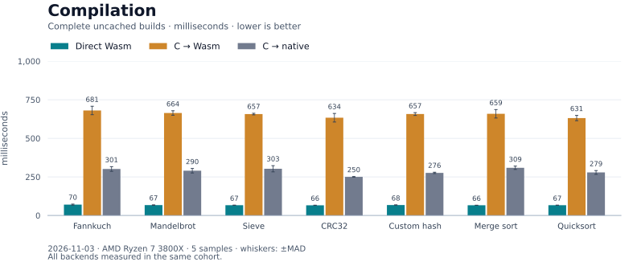
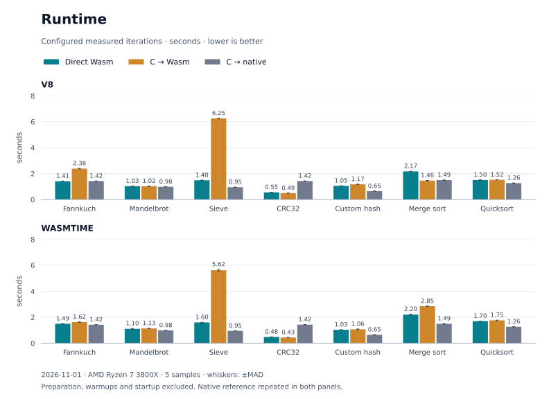
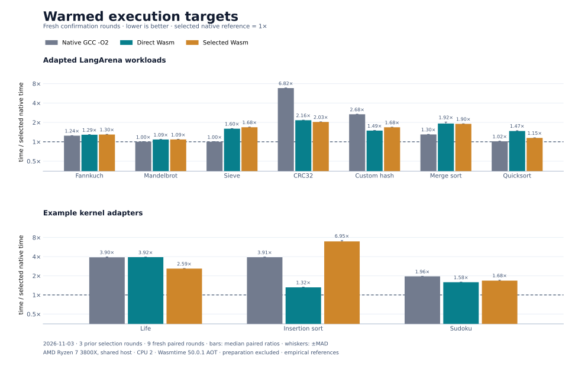
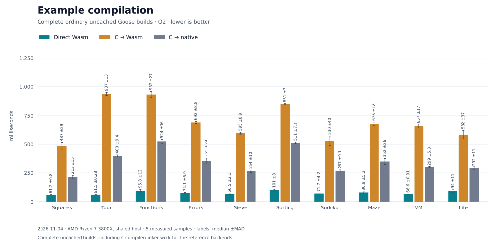
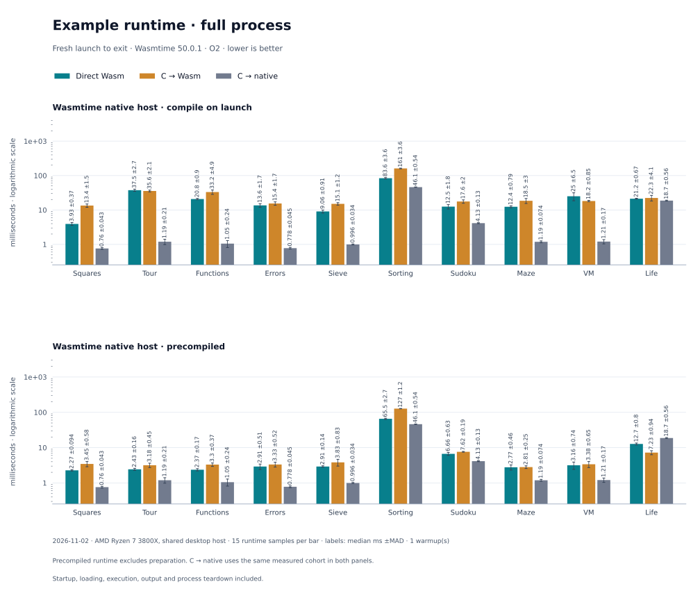

# Goose to Wasm

Compile [Goose](https://github.com/aardappel/goose) directly to WebAssembly for V8 and Wasmtime. The backend reuses Goose’s frontend and emits Wasm binaries without generating C or invoking LLVM. It supports a [defined subset](docs/TARGET.md) of Goose; unsupported programs fail to compile.

[Setup and guide](docs/GUIDE.md#quick-start-direct-compilation) · [Examples](examples/README.md) · [Next hills](docs/PERFORMANCE_PLAN.md)

## Benchmarks

**2026-11-04 · AMD Ryzen 7 3800X · lower is better.** Medians from five samples per cell, using seven adapted LangArena workloads. Six replace growable storage with bounded arrays; each backend compiles the same adapted source. These are not results for the full 50-task suite. Direct Wasm uses memory32; C-to-Wasm uses memory64.

Complete uncached builds include Python driver startup. Direct builds took 65.6–74.8 ms versus 638.2–676.6 ms for C-to-Wasm on these inputs.

Seconds per configured measured iteration count, excluding preparation, warmups, and startup. Runtime varies by workload and engine.

[Full results and raw samples](bench/results/2026-11-04/leaf-and-loads/README.md) · [Benchmark method](bench/langarena/README.md)

### Runtime targets

Pilot-selected Wasm and native references show attainable results for these workloads on this machine; they are not universal ceilings.

[Results and method](docs/RUNTIME_TARGETS.md)

### Example programs

All ten examples use the same constant inputs across backends and check their output. Runtime measures fresh process launch to exit, including startup, engine work and output; the LangArena charts above measure warmed computational regions. Cold native-host runs disable the compilation cache; precompiled runs exclude preparation.

The lifecycle chart separates fresh processes from a resident worker that creates a fresh instance per request.

[Method and results](bench/examples.md) · [Host comparison, preparation costs and qualification](bench/wasmtime-host.md)

Native C uses generic GCC `-O2`; [separate tuned controls](docs/NATIVE_PERFORMANCE.md) and the [Wasm audit](docs/WASM_AUDIT.md) show the remaining opportunities.

## How it was built

The direct backend is developed against Goose’s C backend as an oracle. Differential tests compile the same programs through direct Wasm, C-to-Wasm, and native C, then compare output, exit status, diagnostics, and independently calculated answers. Both Wasm paths run on V8 and Wasmtime. The [guide](docs/GUIDE.md#correctness-qualification) covers the tests and their limits.
