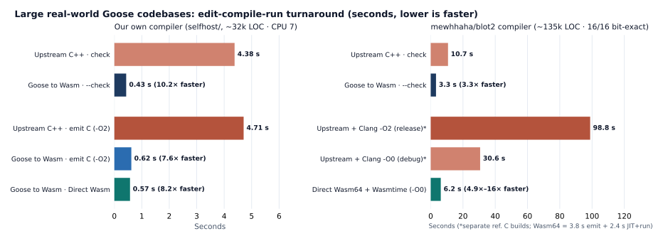
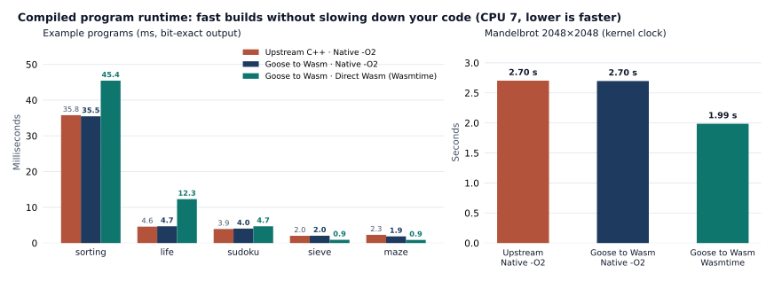

# Goose to Wasm

**A fast, self-hosted [Goose](https://github.com/aardappel/goose) compiler built for rapid edit-compile-run development.**

Compile Goose directly to **WebAssembly in milliseconds** — with no C compiler in your dev loop — and compile the exact same code to **native binaries or C libraries** when you ship.

- **Latest release:** [`v2026.4-5`](https://github.com/mewhhaha/goose-to-wasm/releases/tag/v2026.4-5) (tracks upstream Goose `v2026.4`)
- **Everyday builds:** **23×–26× faster** than upstream C++ Goose (`2–7 ms` vs `51–177 ms` at `-O2`)
- **Large projects:** **8×–10× faster** checks and builds on our own ~32k-LOC compiler, and **5×–16× faster** edit-compile-run turnaround on [`mewhhaha/blot2`](https://github.com/mewhhaha/blot2) (`6.2 s` vs `31–99 s`)
- **Compatibility:** `10,799 / 10,801` conformance rows (`99.98%` — **6,022 / 6,022** native / **100%** of upstream C++ Goose tests, 2 documented frozen wasm32 contract gaps; `4,773 / 4,779` memory64) · [Feature & compatibility tracker](docs/FEATURES.md)

---

## Quick Start

### Option 1: Download a prebuilt release (`v2026.4-5`)

Grab a bundle from [Releases](https://github.com/mewhhaha/goose-to-wasm/releases/tag/v2026.4-5):

- **Linux x64 (native PGO compiler + stdlib):** `goose-to-wasm-v2026.4-5-linux-x64.tar.gz`
- **Portable WebAssembly (macOS / Windows / Linux via Node or Wasmtime):** `goose-to-wasm-v2026.4-5-wasm.tar.gz`

```sh
tar -xzf goose-to-wasm-v2026.4-5-linux-x64.tar.gz
export PATH="$PWD/goose-to-wasm-v2026.4-5-linux-x64/bin:$PATH"
goose --version
# goose-to-wasm v2026.4-5 (Goose v2026.4)
```

### Option 2: Build from source (~29 s)

Requires Python 3 and a C compiler (`clang` default, or `gcc`), plus Node, Wasmtime, or [`host/wtime`](host/wtime/README.md) to run `.wasm` output.

```sh
python3 scripts/bootstrap.py --verify
export PATH="$PWD/build/bin:$PATH"
```

### Everyday commands

```sh
# 1. Fast type & lifetime check (supports --error-format=json & --color)
goose --check examples/sorting.goose

# 2. Instant dev compile & run via Direct Wasm (2–7 ms, no C toolchain)
goose examples/squares.goose -O2 -o squares.wasm
node scripts/run_wasm.mjs squares.wasm
# sum=140

# 3. Ship a native binary (via C)
goose examples/squares.goose --target c -O2 --run

# 4. Embed in a C/C++/Rust host (exports + C header, no -rdynamic/-ldl)
goose --emit-runtime goose_runtime.c
goose app.goose --header app.h -O2 -o app.c
```

See the [full CLI & build guide](docs/GUIDE.md) for `--shared`, `--wasm-memory64`, `--library`, `--reachable-program`, `--stack-reserve`, `--error-format`, `--color`, and Binaryen compaction.

---

## Benchmarks

### 1. Everyday dev loop (2–7 ms vs 51–177 ms)

Skipping the C compiler and linker turns `-O2` builds on everyday Goose programs into single-digit milliseconds:


### 2. Speeding up real large codebases

On larger Goose projects, combining `--check` and Direct Wasm (`--wasm-memory64` + cached Wasmtime execution) replaces half-minute to minute-and-a-half C rebuilds with a few seconds:



- **Example 1 — This compiler ([`selfhost/`](selfhost/README.md), ~32k LOC):**
  `goose --check selfhost/main.goose` finishes in **`0.43 s`** (**10.2× faster** than upstream's `4.38 s`), and emitting `-O2` Direct Wasm64 takes **`0.57 s`** (**8.2× faster** than upstream's `4.71 s` C emit). Even running **as portable WebAssembly** inside Wasmtime, it checks itself in **`1.11–1.39 s`** and self-compiles bit-identically in **`1.78 s`**.
- **Example 2 — [`mewhhaha/blot2`](https://github.com/mewhhaha/blot2) (~135k-LOC compiler written in Goose):**
  Blot2 uses 57 native `env.blot_*` POSIX/fd/directory/atomic/copy host functions and builds as a library entry point (`blot_goose_main`). With Direct Wasm64 and [`goose-wasmtime`](host/rust/README.md) (or safe-Rust [`goose-wtime`](host/wtime/README.md)), it compiles and runs **byte-identically** to native `blotc-goose` (**16/16** compiling idiomatic `.blot` benchmarks match SHA-256) in **`6.2 s`** total (`3.8 s` Wasm64 `-O0` emit + `2.4 s` parallel JIT + run) vs **`30.6 s`** (`-O0` C) / **`98.8 s`** (`-O2` C) — and warm cached `.cwasm` runs compile `.blot` programs in **`142–213 ms`**:

  ```sh
  # Compile Blot2 directly to Wasm64 (~3.8 s at -O0, ~4.6 s at -O2)
  goose compiler-goose/src/main.goose --stdlib blot-stdlib \
    --target wasm-direct --wasm-memory64 --wasm-max-pages 65536 \
    --library --reachable-program --expansion-node-limit 1000000 -O0 -o blot2.wasm

  # Run via goose-wasmtime (~2.4 s first run, ~0.15 s cached .cwasm runs)
  host/rust/target/release/goose-wasmtime blot2.wasm \
    --entry blot_goose_main --cache blot2.cwasm -- \
    build-project benchmarks/idiomatic/fibonacci.blot fib.wasm \
    --std-root std --prelude std/prelude.blot
  ```

### 3. Production runtime speed

Fast dev builds do not trade away runtime speed. Native `-O2` binaries match or edge out upstream C++ Goose (all bit-exact), and Direct Wasm modules run near-native in Wasmtime:



*Pinned CPU-7 methodology, scripts, and raw JSON: [Release `v2026.4-5` chart provenance](bench/results/2026-11-25/release-v2026.4-5/README.md) · [Baseline `v2026.4-4` full suite](bench/results/2026-11-25/release-v2026.4-4/README.md) · [Blot2 HEAD `98f277f2` turnaround study](bench/results/2026-11-25/blot2-head-98f277f2/README.md).*

---

## Choosing a Target

| | Direct Wasm (`--target wasm-direct`, default) | Native C (`--target c` / `--backend native`) |
|---|---|---|
| **Best for** | Instant edit-run dev loops, large-project fast iteration, browser/sandboxed embedders | Production binaries, servers, maximum single-thread speed, C-host libraries |
| **Build time (examples)** | **2–7 ms** (no C compiler needed) | `135–440 ms` (cached runtime + Clang/GCC) |
| **Build time (32k LOC)** | **0.57 s** | **`0.62 s`** C emit + parallel C compile |
| **Runtime** | Near-native in Wasmtime (`host/rust`) or safe-Rust `wtime` (`host/wtime`), or Node/browsers | Matches or edges out upstream C++ Goose `-O2` |
| **Features** | Core language, root structs, `reusable[]` slice pools, `defer`, `const if`, `env.*` host imports, memory32 & memory64 | Everything in Direct Wasm plus threads, stdlib `slice_pool` C externs, `--header`, `--shared` |

---

## Foreign C Functions as Wasm Host Imports

Goose `extern fn` declarations lower directly to standard WebAssembly imports in module **`"env"`** (`(import "env" "<name>" (func ...))`), so C-backed projects like [`mewhhaha/blot2`](https://github.com/mewhhaha/blot2) can run in Wasm without changing Goose source:

```goose
extern fn host_add(a: i64, b: i64) -> i64;
export fn compute(x: i64) -> i64 { return host_add(x, 7) * 3; }
fn main() {}
```

```js
const noop = () => {};
const { instance } = await WebAssembly.instantiate(wasmBytes, {
  goose: new Proxy({}, { get: () => noop }),
  env: { host_add: (a, b) => a + b },
});
console.log(instance.exports.compute(5n)); // 36n
```

Supported Wasm ABI types: numerics (`i8`–`i64`, `u8`–`u64`, `f32`, `f64`), `bool`, slices (`T[:]`), and references (`T&` / `const T&`, including growable `u8[>..]&` via `goose.reserve`). Aggregates can be passed by `const T&`, `T[:]`, or out-reference `T&`.

---

## Diagnostics

Diagnostics include source snippets, `^~~~` carets, `--error-format=text|json`, `--color=auto|always|never`, generic/stdlib instantiation backtraces, opening-delimiter & prior-declaration notes, consolidated missing `match` variants and struct fields, typo suggestions, and lifetime call stacks:

```text
app.goose:3:19: error: no overload matches this call's argument types and count: `add(i64, const u8[:])`
   3 | fn main() { print(add(1, "oops")); }
     |                   ^~~
  note: candidate `fn add(a: f64, b: f64) -> f64` at app.goose:2:4 (argument 2 `b`: got `const u8[:]`, expected `f64`)
  note: candidate `fn add(a: i64, b: i64) -> i64` at app.goose:1:4 (argument 2 `b`: got `const u8[:]`, expected `i64`)
```

---

## Compatibility & Documentation

Releases are versioned **`v<goose-version>-<n>`** (currently **`v2026.4-5`**), tracking plain upstream C++ Goose (`aardappel/goose`) as the language reference (`10,709 / 10,801` conformance rows passing, `99.15%`).

- [Guide & CLI options](docs/GUIDE.md) — flags, targets, compaction, and host options
- [Native Rust Wasmtime host](host/rust/README.md) — fast parallel Cranelift JIT, `.cwasm` caching, `--entry`, and Blot2 `env.blot_*` support
- [Safe-Rust `wtime` host](host/wtime/README.md) — `#![forbid(unsafe_code)]` runner for Direct Goose Wasm32/Wasm64 and Blot2
- [Compatibility tracker](docs/FEATURES.md) — feature-by-feature status vs upstream Goose & Blot2
- [Self-hosted compiler & bootstrap](selfhost/README.md) — architecture, Snapshot 64 seed & fixed-point verification
- [Conformance & qualification](tests/README.md) — test suites and qualification gates
- [Examples](examples/README.md) — runnable Goose sample programs

<details><summary>Benchmark & evidence archive</summary>

All dated compiler, runtime, Wasmtime, `wtime`, native C codegen, and Blot2 studies live under [`bench/results/`](bench/results/):

- [Release `v2026.4-5` qualification & chart provenance (2026-11-25)](bench/results/2026-11-25/release-v2026.4-5/README.md)
- [Blot2 HEAD `98f277f2` Direct Wasm64 + fast `goose-wasmtime` & `goose-wtime` turnaround (2026-11-25)](bench/results/2026-11-25/blot2-head-98f277f2/README.md)
- [Release `v2026.4-4` head-to-head vs `v2026.4-3` & upstream C++ Goose (2026-11-25)](bench/results/2026-11-25/release-v2026.4-4/README.md)
- [Direct Wasm64 codegen speedups & preserved rejected experiments (2026-11-25)](bench/results/2026-11-25/wasm64-codegen/README.md)
- [Direct Wasm64 Blot2 (`cb1e9e15`) on pure-Rust `wtime` — 18/18 bit-exact (2026-11-25)](bench/results/2026-11-25/blot2-wtime-wasm64/README.md)
- [Release `v2026.4-3` head-to-head vs `v2026.4-2` & upstream C++ Goose (2026-11-25)](bench/results/2026-11-25/release-v2026.4-3/README.md)
- [Blot2 lifetime checker algorithmic redesign — 7 rounds & ablations (2026-11-25)](bench/results/2026-11-25/blot2-lifetime-algo/README.md)
- [Release `v2026.4-2` head-to-head vs `v2026.4-1` & upstream C++ Goose (2026-11-24)](bench/results/2026-11-24/release-v2026.4-2/README.md)
- [Release `v2026.4-1` head-to-head vs upstream C++ Goose (2026-11-24)](bench/results/2026-11-24/release-v2026.4-1/README.md)
- [Blot2 class-keyed lifetime checker speedups (2026-11-24)](bench/results/2026-11-24/blot2-lifetime-speed/README.md)
- [Blot2 `l.alts` compaction & default-2 GiB `6ad5fbb` native build (2026-11-24)](bench/results/2026-11-24/blot2-alts-compaction-and-6ad5fbb/README.md)
- [C-host library interface & native Blot2 `cb1e9e15` build (2026-11-24)](bench/results/2026-11-24/blot2-chost-and-native-build/README.md)
- [Wasm compaction, dead mark elimination & `wtime-aot` evaluation (2026-11-23)](bench/results/2026-11-23/wasm-peephole-wtime-aot-and-refresh/README.md)
- [Native C codegen gap closed vs upstream C++ Goose (2026-11-23)](bench/results/2026-11-23/native-c-codegen-gap/README.md)

</details>
