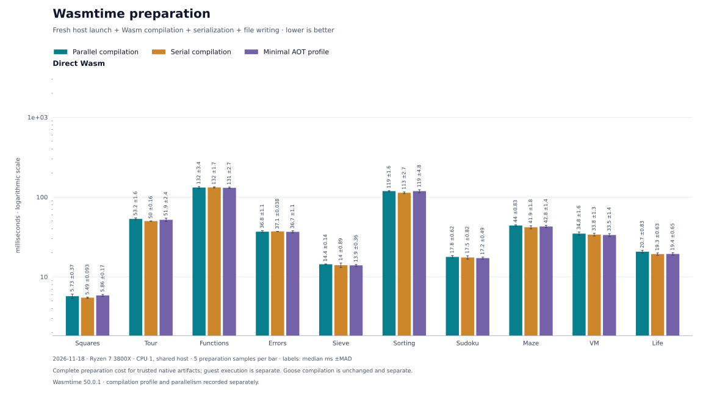

# Goose to Wasm

A [Goose](https://github.com/aardappel/goose) compiler written in Goose. It emits WebAssembly directly or native executables through C. It passes 10,693 of 10,797 conformance rows. [Compatibility tracker](docs/FEATURES.md)

## Benchmarks

**The compiler rebuilding itself.** On its own sources, the bundled 32-bit Wasm compiler took **4.56 s** in Wasmtime versus **2.90 s** native, or **1.57× native time** across seven fresh-process pairs. On a frozen compiler project, Wasmtime retired **3.9% fewer instructions**. Compiling 8,192 distinct strings fell from **867 to 105 ms** in Wasmtime and from **405 to 36 ms** natively, with identical output. [Full rebuilds and literal benchmarks](bench/results/2026-11-19/compiler-passes/README.md)


**Cold and cached self-compilation.** With an empty Wasmtime cache, the default memory64 compiler took **22.20 s** on one core and **14.89 s** with eight cores for preparation. The bundled fixed memory32 compiler took **11.77 s** uncached and **8.84 s** cached, versus **6.41 s** native. These three-run medians include process startup and overlapped other benchmarks on the shared host. [Edited builds and phase times](bench/results/2026-11-19/compiler-passes/README.md#cold-and-cached-self-compilation) · [Gdev status](bench/results/2026-11-18/compiler-request-latency/README.md#compiling-gdev)


**Compiler speed.** Across eleven programs, compiler `34ddff8` used 2.8% less CPU time than `3084b81` to emit Wasm and 3.0% less to emit C. These are geometric means of medians over 31 measurements per cell. The chart shows wall time. In the earlier snapshot 59 comparison, Wasm emission took 0.58× the C++ compiler’s time and C emission took 0.53×. [Measurements](bench/results/2026-11-19/lifetime-read-replay/catalog-summary.json) · [Snapshot 59](bench/results/2026-11-11/compiler-throughput-59/README.md)


**The compiler as Wasm.** Building compiler `34ddff8` on its own sources on the shared host took 2.45 s for direct Wasm and 41.94 s through C and Clang. Across three runs, self-check took 3.35 s native, 8.88 s in Wasmtime and 8.68 s in V8. Emitting the compiler took 3.14 s, 8.42 s and 10.51 s respectively. C builds used CPUs 0, 2, 3, 4 and 6. Wasm builds and execution used CPU 3. Both Wasm engines used prepared, default memory64 modules and timed execution after instantiation. [Measurements](bench/results/2026-11-19/lifetime-read-replay/selfhost.json)


**Example programs.** On the shared host pinned to CPU 1, cold builds for the ten examples took 63.4–80.6 ms for direct Wasm and 0.297–2.119 s through C, including compilation and linking. Sorting took 159 ms with minimal Wasmtime AOT and 122 ms native, including process launch and exit. [Builds](bench/results/2026-11-19/lifetime-read-replay/examples.json.gz) · [Process times](bench/results/2026-11-19/lifetime-read-replay/host.json.gz)




**Mandelbrot.** On the shared host pinned to CPU 1, a resident run on the official input took a median 2.50 s native, 2.72 s in Wasmtime and 2.69 s in V8. GCC C and upstream Goose native controls took 2.73 s and 2.55 s. The seven-sample runtime excludes compilation, startup and instantiation. [Measurements](bench/results/2026-11-19/lifetime-read-replay/langbench-hot.json.gz)


<details><summary>Earlier measurements</summary>

| Question | Measurements |
| --- | --- |
| How much memory does a 32-bit compiler need? | [Fixed layouts and Blot2 capacity](bench/results/2026-11-18/compiler-layout-trials/README.md) · [Growing regions during compilation](bench/results/2026-11-18/compiler-region-recovery/README.md) |
| What sped up large project checks? | [Lifetime analysis](bench/results/2026-11-17/lifetime-compact-reads/README.md) · [Compiler iteration](bench/results/2026-11-17/compiler-iteration/README.md) · [Self-check pairs](bench/results/2026-11-17/compiler-and-row-performance/README.md) · [Blot2](bench/results/2026-11-17/blot2-captured-reads/README.md) |
| How much time do native builds and bootstrap take? | [Parallel C units](bench/results/2026-11-14/native-units/README.md) · [Changed-source bootstrap](bench/results/2026-11-17/local-bootstrap/README.md) |
| Which runtime and tooling costs improved? | [Native row scans](bench/results/2026-11-17/native-row-scans/README.md) · [Wasmtime preparation](bench/results/2026-11-18/compiler-iteration-tools/README.md) · [Wasm local allocation](bench/results/2026-11-17/wasm-slot-prefix/README.md) · [Varint traversal](bench/results/2026-11-17/varint-foreach/README.md) |

</details>

## How it was built

The frontend, optimizer and backends are written in Goose. A C++ reference guided the initial port. Frozen source and output contracts now check behavior. A checked-in C seed bootstraps the compiler, and `--verify` compares consecutive generated C outputs. [Compiler and bootstrap](selfhost/README.md) · [Contracts](tests/README.md) · [Guide](docs/GUIDE.md) · [Examples](examples/README.md)

With Python 3, a C compiler and Node installed, build and run the first example.

```sh
python3 scripts/bootstrap.py --verify
python3 scripts/goose_wasm.py build examples/squares.goose -o build/squares.wasm
node scripts/run_wasm.mjs build/squares.wasm
```
