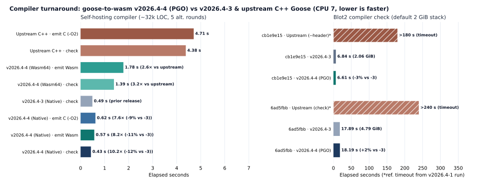
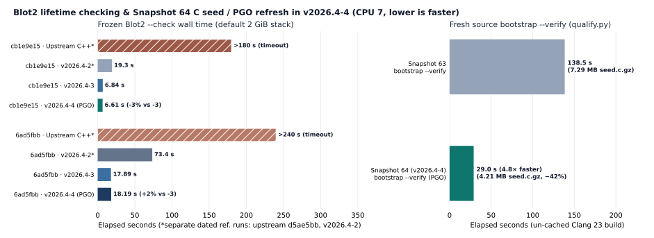
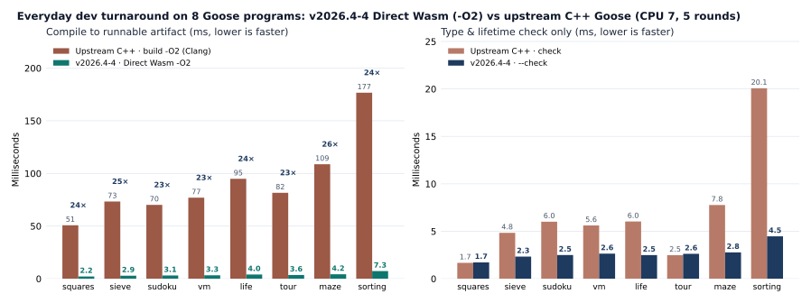
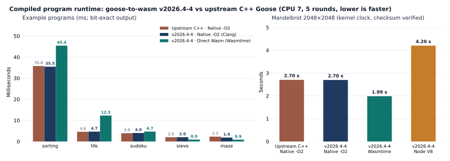

# Goose to Wasm

**A fast, self-hosted [Goose](https://github.com/aardappel/goose) compiler built for rapid edit-compile-run development.**

Goose to Wasm compiles Goose directly to **WebAssembly** in milliseconds — with no C compiler in your inner loop — and compiles the same code to **native binaries or C libraries** when you are ready to ship.

- **Version:** [`v2026.4-4`](https://github.com/mewhhaha/goose-to-wasm/releases/tag/v2026.4-4) (targets upstream Goose `v2026.4`, revision `4`)
- **Compatibility:** `10,709 / 10,801` conformance rows (`99.15%`, 92 recorded gaps; `4,773 / 4,779` memory64) · [Feature & compatibility tracker](docs/FEATURES.md)
- **Turnaround vs upstream C++ Goose:** **10.2× faster** `--check` on the ~32k-LOC self-hosting codebase (`0.43 s` vs `4.38 s`, **−12.2%** vs `v2026.4-3` via Snapshot 64 Clang 23 PGO), **7.6×–8.2× faster** `-O2` C and Wasm64 emission (`0.57–0.62 s` vs `4.71 s`), **23×–26× faster** `-O2` builds to runnable WebAssembly (`2.2–7.3 ms` vs `51–177 ms`), **`6.6 s` / `18.2 s`** lifetime checks on frozen Blot2 compiler snapshots (where upstream times out past `180–240 s`), **`29.0 s`** fresh verified source bootstrap (**4.8× faster** than Snapshot 63), and native `-O2` binaries matching or beating upstream C++ Goose (`sorting` `35.5 ms` vs `35.8 ms`, `mandelbrot` `2.70 s` vs `2.70 s`).
- **Direct Wasm64 Blot2 on Wasmtime & `wtime`:** Compiles Blot2 (`cb1e9e15`) directly to a `44.3 MB` Wasm64 module in **`8.64 s`** (`--library --reachable-program --wasm-memory64 -O2`) and runs **18/18** idiomatic `.blot` benchmarks bit-exact against native `blotc-goose` on both Wasmtime and the thin safe-Rust [`host/wtime`](host/wtime/README.md) host.
- **Agent- & human-friendly diagnostics:** Source-line snippets with `^~~~` carets, `--error-format=text|json`, `--color=auto|always|never` (`NO_COLOR`/`CLICOLOR_FORCE`), generic/stdlib instantiation backtraces, opening-delimiter & prior-declaration notes, consolidated missing `match` variants & struct fields, overload candidate signatures with `file:line`, Damerau-Levenshtein `"did you mean ...?"` suggestions, and lifetime call stacks.

---

## Quick Start

### Option 1: Download a prebuilt release (`v2026.4-4`)

Grab the prebuilt bundle from [Releases](https://github.com/mewhhaha/goose-to-wasm/releases/tag/v2026.4-4):

- **Linux x64 (native PGO compiler + stdlib):** `goose-to-wasm-v2026.4-4-linux-x64.tar.gz`
- **Portable WebAssembly (macOS / Windows / Linux via Node or Wasmtime):** `goose-to-wasm-v2026.4-4-wasm.tar.gz`

```sh
tar -xzf goose-to-wasm-v2026.4-4-linux-x64.tar.gz
export PATH="$PWD/goose-to-wasm-v2026.4-4-linux-x64/bin:$PATH"
goose --version
# goose-to-wasm v2026.4-4 (Goose v2026.4)
```

### Option 2: Build from source (~29 s with Snapshot 64 + Clang 23 PGO)

Requires Python 3 and a C compiler (`clang` default, or `gcc`), plus Node, Wasmtime, or `host/wtime` to run `.wasm` output.

```sh
python3 scripts/bootstrap.py --verify
export PATH="$PWD/build/bin:$PATH"
```

### Everyday development workflow

```sh
# 1. Fast type & lifetime check (no codegen; supports --error-format=json & --color)
goose --check examples/sorting.goose

# 2. Instant dev compile to WebAssembly (no C compiler needed, 2–7 ms)
goose examples/squares.goose -O2 -o squares.wasm
node scripts/run_wasm.mjs squares.wasm
# sum=140

# 3. Compile & run as a native executable (via C)
goose examples/squares.goose --target c -O2 --run
# or with parallel C units & cached runtime:
python3 scripts/goose_wasm.py build examples/squares.goose --backend native -O2 -o squares
./squares

# 4. Embed Goose in a C/C++/Rust host (exports + C header, no -rdynamic/-ldl)
goose --emit-runtime goose_runtime.c
goose app.goose --header app.h -O2 -o app.c
```

See the [full CLI & build guide](docs/GUIDE.md) for `--shared`, `--wasm-memory64`, `--library`, `--reachable-program`, `--stack-reserve`, `--error-format`, `--color`, and optional Wasmtime / [`wtime`](host/wtime/README.md) hosts & Binaryen compaction (`scripts/goose_wasm.py compact`).

---

## Benchmarks vs Upstream C++ Goose

All measurements below compare qualified **`goose-to-wasm v2026.4-4`** (`40409f9a…`, Snapshot 64 + Clang 23 PGO) against **`v2026.4-3`** (`209831db…`) and plain upstream C++ Goose (`d5ae5bb`, `GOOSE_CC=clang`, pre-warmed `GOOSE_HOME` runtime cache) across 5 alternating rounds pinned to CPU 7 (`clang 23.1.5`, `wasmtime 50.0.1`, `node v26.5.0`). [Full methodology, scripts, and raw JSON](bench/results/2026-11-25/release-v2026.4-4/README.md)

### 1. Large-project compile, check & bootstrap speed

On the compiler's own ~32k-LOC codebase (`selfhost/main.goose`), `v2026.4-4` checks in **`0.43 s`** (**10.2× faster** than upstream C++ Goose's `4.38 s` and **−12.2%** vs `v2026.4-3`'s `0.49 s`), emits portable `-O2` Wasm64 in **`0.57 s`** (**8.2× faster** than upstream's `4.71 s` C emit, **−11.1%** vs `v2026.4-3`), and emits `-O2` C in **`0.62 s`** (**7.6× faster** than upstream, **−9.1%** vs `v2026.4-3`). Running **as portable WebAssembly** inside Wasmtime, it checks in **`1.39 s`** (`1.11 s` with `--wasm-bundled-host`, **3.9× faster**) and self-compiles bit-identical Wasm64 (`5.38 MB`, **−3.9%** smaller) in **`1.78 s`** (**2.6× faster**).

On the frozen Blot2 compiler snapshots inside the default 2 GiB stack reserve, `v2026.4-4` checks `cb1e9e15` in **`6.61 s` / `2.06 GiB` RSS** (`−3.4%` vs `v2026.4-3`) and `6ad5fbb` in **`18.19 s` / `4.79 GiB` RSS** (where plain upstream C++ Goose timed out past `180 s` / `240 s` in separate dated reference runs), and compiles `cb1e9e15` directly to Wasm64 (`44.3 MB`) in **`8.64 s`**. Refreshing the checked-in C seed and Clang 23 PGO profile (Snapshot 64) shrank `bootstrap/seed.c.gz` by **−42.2%** (`7.29 → 4.21 MB`) and cut fresh `scripts/bootstrap.py --verify` time **4.8×** (`138.5 s → 29.0 s`).





### 2. Everyday edit-compile turnaround (8 real programs)

Because Direct Wasm skips the C compiler and linker completely, compiling real Goose programs (`squares`, `sieve`, `sudoku`, `vm`, `life`, `tour`, `maze`, `sorting`) to optimized `-O2` runnable WebAssembly takes **`2.2–7.3 ms`** — **23×–26× faster** than upstream `goose build -O2` (`51–177 ms`). Type and lifetime checking alone takes **`1.7–4.5 ms`** vs `1.7–20.1 ms` upstream (up to **4.5× faster** on `sorting`).



### 3. Runtime performance of compiled programs

Fast compilation does not trade away production speed. Native `-O2` executables emitted by `v2026.4-4` match or edge out upstream C++ Goose (`sorting` **`35.47 ms`** vs `35.77 ms`, `maze` **`1.86 ms`** vs `2.29 ms`, `sieve` `2.05 ms` vs `2.03 ms`, `mandelbrot` **`2.698 s`** vs `2.703 s`, all bit-exact). Direct Wasm modules run near-native in Wasmtime (`45.44 ms` on `sorting`, **`1.986 s`** on `mandelbrot`, **`0.90 ms`** on `sieve`, **`0.86 ms`** on `maze`).



---

## Foreign C Functions as Wasm Host Imports

Yes — Goose `extern fn` declarations (both plain `extern fn` and `extern "lib" { ... }`) lower directly to standard WebAssembly host imports in module **`"env"`** (`(import "env" "<name>" (func ...))`):

```goose
// demo.goose
extern fn host_add(a: i64, b: i64) -> i64;
extern "libdemo" { fn host_mul(a: i64, b: i64) -> i64; }

export fn compute(x: i64) -> i64 { return host_mul(host_add(x, 7), 3); }
fn main() {}
```

Compile with `goose demo.goose -O2 -o demo.wasm` and supply `env.<name>` from any Wasm host (Node/browser JS, Wasmtime, [`host/wtime`](host/wtime/README.md), or a custom embedder):

```js
const noop = () => {};
const { instance } = await WebAssembly.instantiate(wasmBytes, {
  goose: new Proxy({}, { get: () => noop }), // or wire goose.write / goose.abort
  env: {
    host_add: (a, b) => a + b,
    host_mul: (a, b) => a * b,
  },
});
console.log(instance.exports.compute(5n)); // 36n
```

- **Supported Wasm host-import ABI:** numeric types (`i8`–`i64`, `u8`–`u64`, `f32`, `f64`), `bool`, slices (`T[:]`, passed as packed `i64` in wasm32 or `(i64, i64)` in memory64), and references (`T&` / `const T&`, passed as linear-memory offsets, including growable `u8[>..]&` buffers via the exported `goose.reserve`). Returns accept numeric types, `bool`, or `void`.
- **When passing aggregates:** pass `const T&`, `T[:]`, or an out-reference `T&` across Wasm host imports (or compile with `--target native` for full native C ABI linking). If an `extern fn` signature falls outside the Wasm ABI, the compiler tells you the exact parameter/return type and suggested rewrite.
- **Full-scale proof:** Frozen Blot2 (`cb1e9e15`, 56 `env.blot_*` POSIX/fd/dir/args/clock/atomic imports) compiles directly with `--library --reachable-program --wasm-memory64 -O2` and compiles **18/18** `.blot` benchmarks byte-identically on both Wasmtime and the safe-Rust [`host/wtime`](host/wtime/README.md) runner.

---

## Solid Diagnostics

Compiler diagnostics are designed so both humans and coding agents can diagnose and fix errors in a single turn — with `--error-format=text|json` and `--color=auto|always|never` (`NO_COLOR`/`CLICOLOR_FORCE`):

```text
app.goose:3:19: error: no overload matches this call's argument types and count: `add(i64, const u8[:])`
   3 | fn main() { print(add(1, "oops")); }
     |                   ^~~
  note: candidate `fn add(a: f64, b: f64) -> f64` at app.goose:2:4 (argument 2 `b`: got `const u8[:]`, expected `f64`)
  note: candidate `fn add(a: i64, b: i64) -> i64` at app.goose:1:4 (argument 2 `b`: got `const u8[:]`, expected `i64`)
```

- **Instantiation backtraces:** Errors inside generic functions, generic nominal types, or stdlib templates include `note: while instantiating \`name\` called from file:line:col` chains.
- **Actionable precision:** Opening-delimiter locations for unclosed blocks/parens/brackets, prior-declaration sites for duplicate symbols, consolidated missing `match` variants and struct literal fields, `var` hints on immutable `let` reassignment, return-type conversion hints, and full lifetime call stacks with invalidated variable locations.

---

## Choosing a Target

| | Direct Wasm (`--target wasm-direct`, default) | Native C (`--target c` / `--backend native`) |
|---|---|---|
| **Best for** | Instant edit-run dev loops, browser/sandboxed tools, custom Wasm host embedders | Maximum runtime speed, CLI tools, servers, C-host libraries |
| **Build time (examples)** | **2–7 ms** (zero C toolchain required) | `135–440 ms` (cached runtime + Clang/GCC) |
| **Build time (32k LOC)** | **0.57 s** | **`0.62 s`** C emit + parallel C compile |
| **Runtime speed** | Near-native in Wasmtime / `wtime-aot`; runs anywhere with Node, `wtime`, or a browser | Matches or edges out upstream C++ Goose `-O2` |
| **Features** | Full core language, root structs, `reusable[]` slice pools, `defer`, `const if`, `env.*` host imports, memory32 & memory64 | Everything in Direct Wasm plus threads, stdlib `slice_pool` C externs, `--header`, `--shared` |

---

## Compatibility & Versioning

Releases are versioned as **`v<goose-version>-<n>`** (currently **`v2026.4-4`**) so you can see which upstream Goose release is tracked while we ship incremental compiler, diagnostic, and performance updates (`-1`, `-2`, `-3`, `-4`, ...).

- **Reference:** Plain upstream C++ Goose (`aardappel/goose`) is the language reference.
- **What works:** Core Goose language, generics, root structs, `reusable[]` slice pools (native & Direct Wasm), `defer`, `const if`, lifetime checking, stdlib (`std`, `os`, `json`, `math`, `binary`, `base64`, `vec`, `mat`, `quat`, `ascii`, `slice_pool` native, threads native), Wasm `env.*` host imports, and the C-host `--header` / `--shared` / `--emit-runtime` interface (used end-to-end to build the Blot2 compiler natively and as Direct Wasm64).
- **Known differences:** `92` recorded gaps on the `10,801`-row conformance suite (`99.15%` passing; mostly native GUI/audio/physics packages, `format`/`lsp` CLI subcommands, and a small number of edge cases) plus intentional rejections of two upstream false-accept lifetime bugs. See [docs/FEATURES.md](docs/FEATURES.md) for the complete table.

## Documentation

- [Guide & CLI options](docs/GUIDE.md) — building, running, compacting Wasm, optional Wasmtime host
- [Safe-Rust `wtime` host](host/wtime/README.md) — running Direct Goose Wasm32/Wasm64 and Blot2 Wasm64 on `wtime`
- [Compatibility tracker](docs/FEATURES.md) — feature-by-feature status vs upstream Goose & Blot2 compatibility
- [Self-hosted compiler & bootstrap](selfhost/README.md) — architecture, Snapshot 64 seed & fixed-point verification
- [Conformance & qualification](tests/README.md) — how changes are tested and qualified
- [Examples](examples/README.md) — runnable Goose sample programs

<details><summary>Historical benchmark archive</summary>

All dated compiler, runtime, Wasmtime, `wtime`, `wtime-aot`, native C codegen, and Blot2 studies live under [`bench/results/`](bench/results/):

- [Release `v2026.4-4` head-to-head vs `v2026.4-3` & upstream C++ Goose (2026-11-25)](bench/results/2026-11-25/release-v2026.4-4/README.md)
- [Direct Wasm64 codegen speedups & preserved rejected experiments (2026-11-25)](bench/results/2026-11-25/wasm64-codegen/README.md)
- [Direct Wasm64 Blot2 (`cb1e9e15`) on pure-Rust `wtime` — 18/18 bit-exact (2026-11-25)](bench/results/2026-11-25/blot2-wtime-wasm64/README.md)
- [Release `v2026.4-3` head-to-head vs `v2026.4-2` & upstream C++ Goose (2026-11-25)](bench/results/2026-11-25/release-v2026.4-3/README.md)
- [Blot2 lifetime checker algorithmic redesign — 7 rounds & ablations (2026-11-25)](bench/results/2026-11-25/blot2-lifetime-algo/README.md)
- [Release `v2026.4-2` head-to-head vs `v2026.4-1` & upstream C++ Goose (2026-11-24)](bench/results/2026-11-24/release-v2026.4-2/README.md)
- [Release `v2026.4-1` head-to-head vs upstream C++ Goose (2026-11-24)](bench/results/2026-11-24/release-v2026.4-1/README.md)
- [Blot2 class-keyed lifetime checker speedups — 3.6× `cb1e9e15`, 2.7× `6ad5fbb` (2026-11-24)](bench/results/2026-11-24/blot2-lifetime-speed/README.md)
- [Blot2 `l.alts` compaction & default-2 GiB `6ad5fbb` native build (2026-11-24)](bench/results/2026-11-24/blot2-alts-compaction-and-6ad5fbb/README.md)
- [C-host library interface & native Blot2 `cb1e9e15` build (2026-11-24)](bench/results/2026-11-24/blot2-chost-and-native-build/README.md)
- [Wasm compaction, dead mark elimination & `wtime-aot` safe Rust evaluation (2026-11-23)](bench/results/2026-11-23/wasm-peephole-wtime-aot-and-refresh/README.md)
- [Native C codegen gap closed vs upstream C++ Goose (2026-11-23)](bench/results/2026-11-23/native-c-codegen-gap/README.md)

</details>
