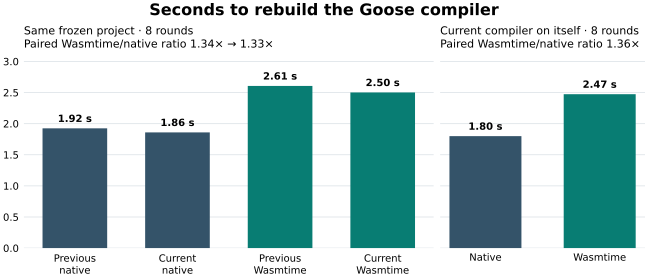
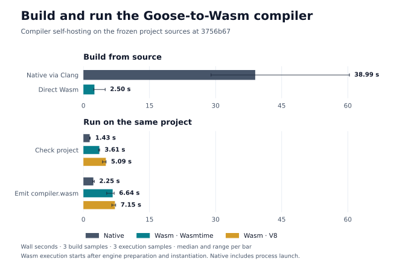
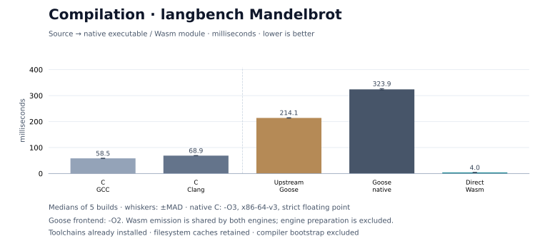

# Goose to Wasm

A [Goose](https://github.com/aardappel/goose) compiler written in Goose. It emits WebAssembly directly or native executables through C. It passes 10,697 of 10,801 conformance rows. [Compatibility tracker](docs/FEATURES.md)

## Benchmarks

**The compiler rebuilding itself.** Eight paired rounds measured **2.47 s in cached Wasmtime** and **1.80 s native** on the current project, or **1.36× native time**. On the same frozen sources, this release cut Wasmtime elapsed time by **4.0%** and instructions by **5.5%**. [Full rebuild measurements](bench/results/2026-11-19/compiler-opportunities/README.md#rebuilding-the-compiler)



**Cold and cached self-compilation.** The bundled 32-bit compiler took **3.14 s cold** with eight compilation threads and **2.33 s cached** on one core. Native took **1.69 s**. Each of the three fresh processes per configuration rebuilt the whole project. [Measurement details](bench/results/2026-11-19/compiler-opportunities/README.md#cold-and-cached-self-compilation)


**Compiler speed.** Across eleven programs, compiler `b6c2f10` used 3.0% more CPU time than `f3f3158` to emit Wasm and 3.8% more to emit C. These are geometric means of medians over 31 measurements per cell. The chart shows wall time. In the earlier snapshot 59 comparison, Wasm emission took 0.58× the C++ compiler’s time and C emission took 0.53×. [Measurements](bench/results/2026-11-19/compiler-opportunities/catalog-summary.json) · [Snapshot 59](bench/results/2026-11-11/compiler-throughput-59/README.md)


**The compiler as Wasm.** Using a pinned Goose emitter, building compiler `b6c2f10` on the shared host took 2.28 s for direct Wasm and 28.20 s through C and Clang. Across three runs on those same sources, the resulting compiler took 1.08 s native, 2.66 s in Wasmtime and 3.26 s in V8 to check itself. Emitting its Wasm module took 1.64 s, 3.98 s and 4.70 s respectively. C builds used CPUs 0, 2, 4 and 6. Wasm builds and execution used CPU 3. Both Wasm engines used prepared, default memory64 modules and timed execution after instantiation. [Measurements](bench/results/2026-11-19/compiler-opportunities/selfhost.json)



**Example programs.** On the shared host pinned to CPU 1, cold builds for the ten examples took 69.1–83.3 ms for direct Wasm and 0.315–2.306 s through C, including compilation and linking. Sorting took 164 ms with minimal Wasmtime AOT and 124 ms native, including process launch and exit. [Builds](bench/results/2026-11-19/compiler-opportunities/examples.json.gz) · [Process times](bench/results/2026-11-19/compiler-opportunities/host.json.gz)


**Mandelbrot.** On the shared host pinned to CPU 1, a resident run on the official input took a median 2.46 s native, 2.64 s in Wasmtime and 2.57 s in V8. GCC C and upstream Goose native controls took 2.47 s and 2.47 s. The seven-sample runtime excludes compilation, startup and instantiation. [Measurements](bench/results/2026-11-19/compiler-opportunities/langbench-hot.json.gz)




<details><summary>Earlier measurements</summary>

| Question | Measurements |
| --- | --- |
| How do the four optimization batches compare on the original project? | [Cumulative full rebuilds](bench/results/2026-11-19/compiler-opportunities/campaign.svg) · [Experiments and remaining work](bench/results/2026-11-19/compiler-opportunities/README.md#remaining-work) · [Function lookup scaling](bench/results/2026-11-19/function-lookup/README.md#programs-with-many-functions) |
| Which compiler phases account for the Wasmtime gap? | [Phase counts and the same-Wasm engine comparison](bench/results/2026-11-19/lifetime-evaluator-frames/README.md#where-the-gap-remains) |
| What changed when Wasm copied small records with SIMD? | [Fixed record copies and cold launches](bench/results/2026-11-19/fixed-record-copies/README.md) |
| Why did skipping more calls add a full pass? | [Caller trace and binding changes](bench/results/2026-11-19/lifetime-callers/README.md#why-skipping-bodies-added-a-pass) |
| Which lifetime changes removed the fifth discovery pass? | [Store delivery, tuple reuse and paired rebuilds](bench/results/2026-11-19/lifetime-store-delivery/README.md) |
| What did removing array-header forwarding save? | [Bundled host rebuilds and launch times](bench/results/2026-11-19/bundled-publications/README.md) |
| What did the checker save by tracking reads on demand? | [Read tracking and paired compiler rebuilds](bench/results/2026-11-19/construct-read-demand/README.md) |
| What did skipping temporary expression records save? | [Expression checking, rebuilds and grouping experiments](bench/results/2026-11-19/expression-lifetimes/README.md) |
| What did skipping repeated array effects save? | [Rebuilds, array effects and validation controls](bench/results/2026-11-19/lifetime-array-effects/README.md) |
| Where can lifetime checking improve next? | [Five discovery passes, two missed errors and three experiments](bench/results/2026-11-19/lifetime-discovery/README.md) |
| What did tracking changed reads save? | [Lifetime reads and memory cost](bench/results/2026-11-19/lifetime-read-replay/README.md) |
| What improved string-heavy builds? | [8,192 literals and full compiler rebuilds](bench/results/2026-11-19/compiler-passes/README.md) |
| How much memory does a 32-bit compiler need? | [Fixed layouts and Blot2 capacity](bench/results/2026-11-18/compiler-layout-trials/README.md) · [Growing regions during compilation](bench/results/2026-11-18/compiler-region-recovery/README.md) |
| What sped up large project checks? | [Lifetime analysis](bench/results/2026-11-17/lifetime-compact-reads/README.md) · [Compiler iteration](bench/results/2026-11-17/compiler-iteration/README.md) · [Self-check pairs](bench/results/2026-11-17/compiler-and-row-performance/README.md) · [Blot2](bench/results/2026-11-17/blot2-captured-reads/README.md) |
| How much time do native builds and bootstrap take? | [Parallel C units](bench/results/2026-11-14/native-units/README.md) · [Changed-source bootstrap](bench/results/2026-11-17/local-bootstrap/README.md) |
| Which runtime and tooling costs improved? | [Native row scans](bench/results/2026-11-17/native-row-scans/README.md) · [Wasmtime preparation](bench/results/2026-11-18/compiler-iteration-tools/README.md) · [Wasm local allocation](bench/results/2026-11-17/wasm-slot-prefix/README.md) · [Varint traversal](bench/results/2026-11-17/varint-foreach/README.md) |

</details>

## How it was built

The frontend, optimizer and backends are written in Goose. A C++ reference guided the initial port. Frozen source and output contracts now check behavior. A checked-in C seed bootstraps the compiler, and `--verify` compares consecutive generated C outputs. [Compiler and bootstrap](selfhost/README.md) · [Contracts](tests/README.md) · [Guide](docs/GUIDE.md) · [Examples](examples/README.md)

With Python 3, a C compiler and Node installed, build and run the first example.

```sh
python3 scripts/bootstrap.py --verify
python3 scripts/goose_wasm.py build examples/squares.goose -o build/squares.wasm
node scripts/run_wasm.mjs build/squares.wasm
```
