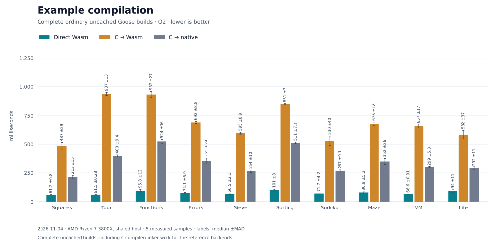
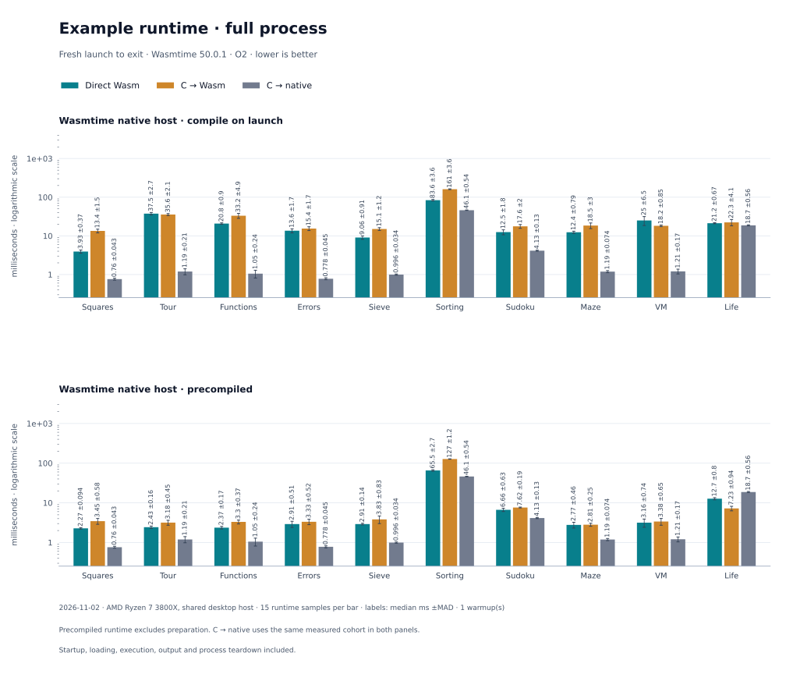
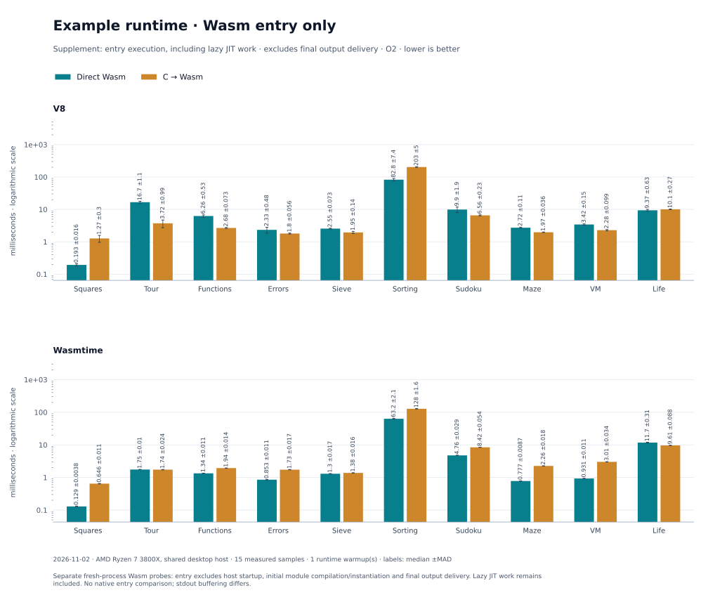

# Example benchmarks

Ten [example programs](../examples/README.md) compare direct Wasm, C-to-Wasm and native C at O2. These are fresh-process timings, distinct from the warmed computational regions in the [LangArena benchmarks](langarena/README.md).







[2026-11-01 results and raw samples](results/2026-11-01/example-benchmarks/README.md) · [Latest report pointer](results/examples-latest.json)

In this constant-input snapshot, direct builds took 63–95 ms versus 515–939 ms for C-to-Wasm. Runtime gaps remain: sorting took 4.040 s direct versus 0.239 s C-to-Wasm on V8, and 4.335 s versus 0.246 s on Wasmtime, measured from process launch to exit.

Sorting's insertion-sort pass uses **20,000 values**. Its header and catalog incorrectly say 2,000; the measured source is preserved in the [input snapshot](results/2026-11-01/example-benchmarks/inputs.tar.gz).

## Method

Each backend/example cell has five complete `--no-cache` Python-driver builds. Each runtime configuration has one untimed fresh-process warmup and 15 fresh-process samples. All output is checked against the golden files, and every unique artifact is qualified. Phases run sequentially, with shuffled order (seed 761204). Values are median milliseconds and median absolute deviation (MAD).

The headline runtime measures launch to exit, including startup, Wasm compilation and instantiation, initialization, computation, output delivery and teardown. It uses the ordinary runners without `--timing-json`. A separately shuffled set of 15 fresh-process Wasm probes measures compilation/instantiation and entry. Each fresh instance calls `_start` once; entry includes Goose initialization, output callbacks and any lazy JIT work, but excludes final host output concatenation and delivery. Native stdout is unbuffered, so there is no native entry comparison.

Inputs remain constant and ordinary constant folding is allowed. Direct Wasm uses memory32; C-to-Wasm uses memory64. OS page and installed Emscripten library caches remain warm. The retained run uses an AMD Ryzen 7 3800X shared desktop, Node 24.22.1 / V8 13.6.233.17-node.58, Wasmtime 50.0.1, Emscripten 6.0.13 and GCC 16.2.1.

## Reproduce

With the [toolchain installed](../docs/GUIDE.md#quick-start-direct-compilation), including the oracle SDK, run from the repository root:

```sh
python bench/examples.py --machine-label 'your machine'
python bench/example_charts.py REPORT
```

Replace `REPORT` with the generated report path. Chart generation requires Matplotlib. For a correctness-only smoke run:

```sh
python bench/examples.py squares tour --smoke --compile-samples 1 --samples 2 --warmups 0
```
