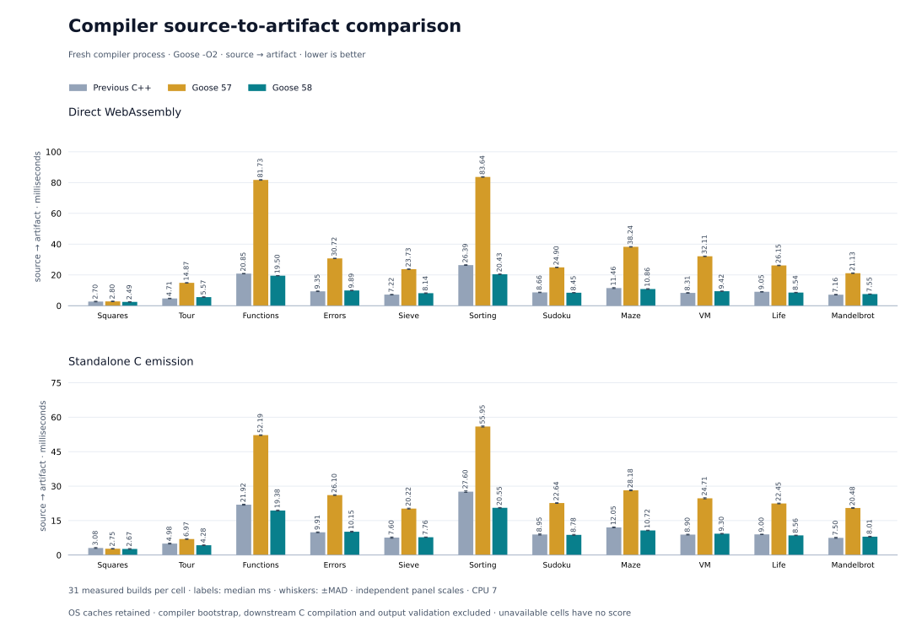
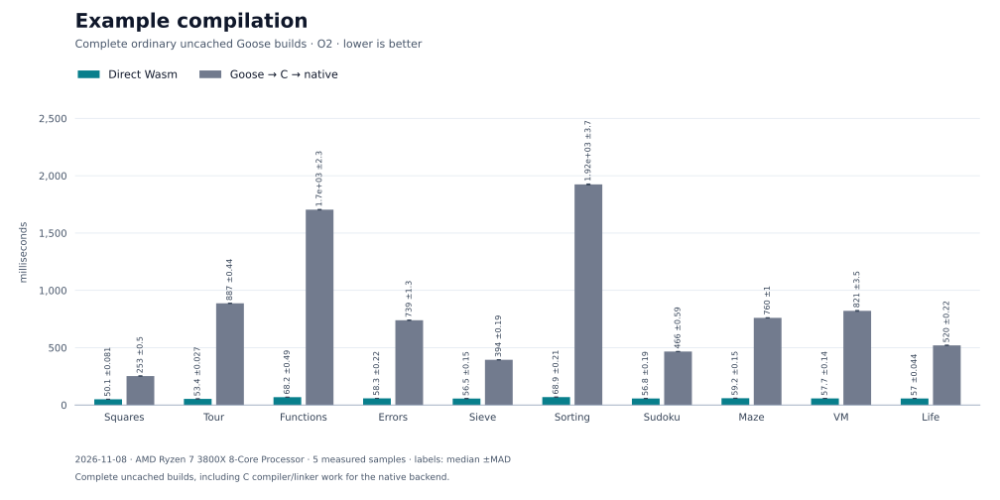
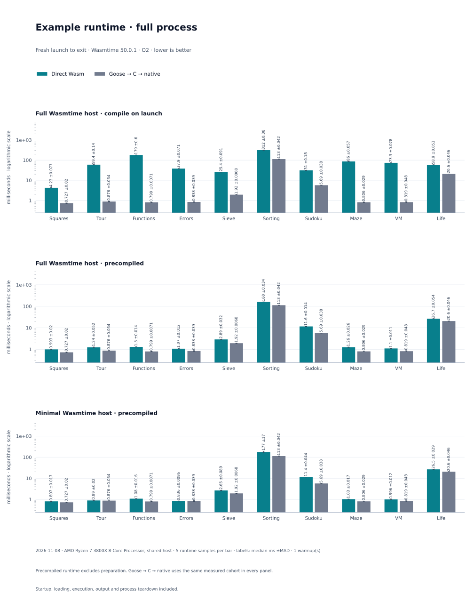
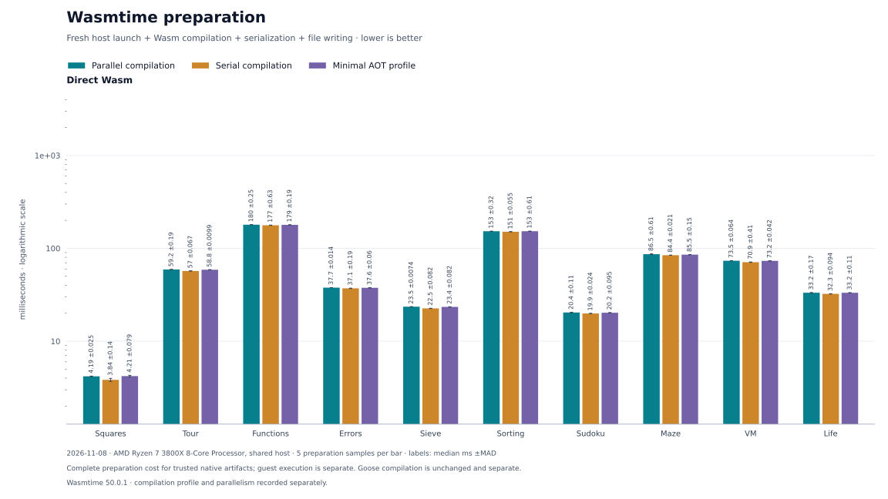
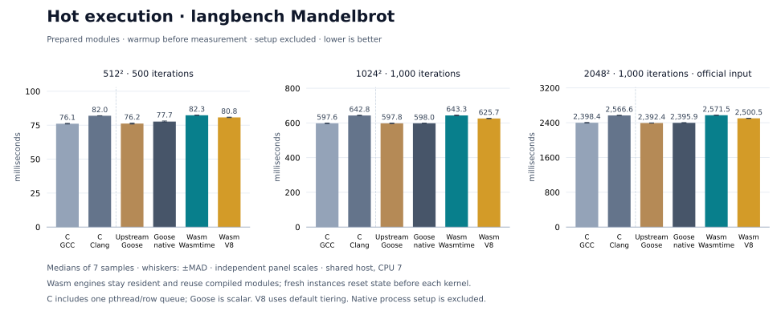
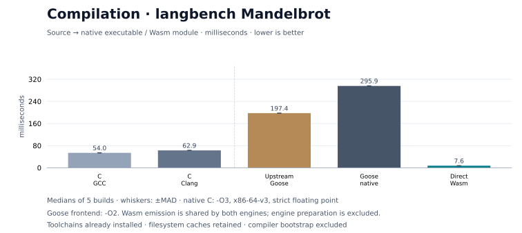

# Compiler throughput · 2026-11-08

Snapshot 58 uses the public C-only bootstrap compiler, built with Goose `-O2` and the supplied Clang 23 `-O2` IR profile. Its executable SHA-256 is `9a0450a452f6dcc0c6ad698fdeb9af6be599c7e8ffdb2437364a6f360145489d`; generated C SHA-256 is `191a6b540a7c59ccdd0de5ac32199eea958bb19121cd98a1bfe269c13fc2aea6`. The profile is conditional on an exact identity match; [bootstrap and qualification](../../../../selfhost/results/2026-11-08/compiler-throughput-58/README.md) records the conditions and limits.

## Compiler

Across eleven programs, snapshot 58 / C++ geometric mean time ratios were 0.99819 for Wasm and 0.93447 for C. Wasm was at parity within noise; C emission took 6.55% less time. Snapshot 57 / C++ ratios were 2.93419 and 2.15797. Snapshot 58 was 2.94× faster for Wasm and 2.31× faster for C than snapshot 57. Across all 22 cells its time ratio to C++ was 0.96581.

Each cell has 31 samples after one warmup, in shuffled balanced rounds with fresh compiler processes and retained OS caches. The timer ends at Wasm or C emission; downstream C compilation and output validation followed the timed campaign. The previous C++ compiler is a benchmark competitor; its source identity matched its pin. This shared machine cannot resolve the small Wasm difference. [Raw compiler report](compiler-comparison.json) records toolchains, source and binary identities, workloads, per-cell samples and validation.

## Examples

Ten examples each have five fresh builds and five process samples. Median builds ranged from 50.1–68.9 ms for direct Wasm and 252.6–1,924.3 ms for native executables. Native builds include GCC 16 `-O2` C compilation and linking. Process times include launch and exit. Sorting took 176.8 ms using minimal Wasmtime AOT and 112.6 ms native; the preparation chart measures host launch, compilation, serialization and writing separately, with five samples. [Build report](examples.json) · [Host report](host.json) · [Metrics](metrics.json)

## Mandelbrot

The official single-thread input computes 2,048 × 2,048 pixels with up to 1,000 iterations per pixel. Seven-sample median guest computation was 2.39591 s for this compiler's native output, 2.57155 s in Wasmtime and 2.50052 s in V8. Controls were 2.39840 s for GCC C, 2.56664 s for Clang C and 2.39241 s for upstream Goose native. The checksum was 1,038,538,536. Small and medium inputs are in [metrics](metrics.json).

The hot timer excludes compilation, startup and instantiation; the Wasm module is resident and each instance is fresh. Build times use five fresh builds, with C compilation and linking included for native executables. The cold report's single runtime sample is an artifact preflight, not the published runtime measurement. C controls use `-O3 -march=x86-64-v3` with fast math disabled and floating-point contraction off. The C reference uses one thread and a row queue; Goose uses a scalar port. [Build and preflight report](compilation-reference.json) · [Hot report](langbench-hot.json)

These measurements were collected in the same campaign. Earlier dated runtime measurements were collected separately and are not matched comparisons. The raw reports record engine versions, exact commands, flags, source hashes, host and samples.
