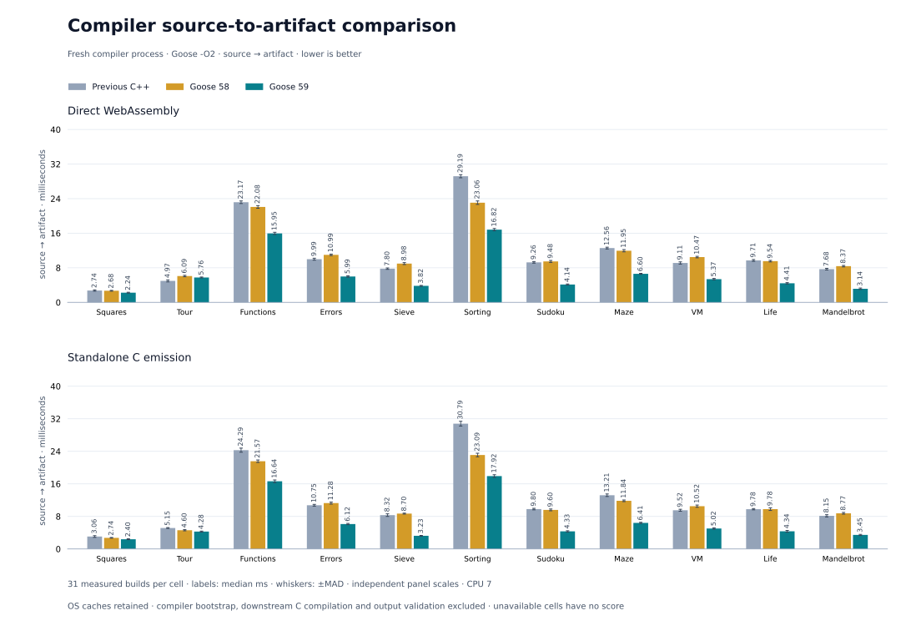

# Compiler throughput · 2026-11-11

Snapshot 59 uses the public C-only bootstrap compiler, built with Goose `-O2` and a Clang 23 `-O2` IR profile retrained for its C. Its executable SHA-256 is `1306814006e915f95776d93f0a4daf9036fc449014438c06063a73c25517d73e`; generated C SHA-256 is `2e881d5667f95457427c1904bdac9d8586922082b810ff1b7b7b0ca37417d4c3`. [Bootstrap and qualification](../../../../selfhost/results/2026-11-11/compiler-throughput-59/README.md)

## Compiler

Across eleven programs, snapshot 59 / C++ geometric mean time ratios were 0.57894 for Wasm and 0.53225 for C: 1.73× faster for Wasm and 1.88× faster for C. Across all 22 cells the ratio was 0.55510 (1.80× faster). Against snapshot 58 in the same campaign, snapshot 59 was 1.74× faster for Wasm and 1.76× faster for C. Snapshot 58 / C++ was 1.01003 for Wasm and 0.93912 for C, consistent with its published parity.

Twenty-one of the 22 cells beat C++. Tour emitted as Wasm remains slower: 5.34 ms against 4.71 ms. Its print formatting lowers to generated Goose functions, which are checked and emitted like user code.

Each cell has 31 samples after one warmup, in shuffled balanced rounds with fresh compiler processes and retained OS caches, on CPU 7. The timer ends at Wasm or C emission; downstream C compilation and output validation followed the timed campaign, and all 66 cells qualified. A replicate campaign on CPU 5 with shuffle seed 590059 gave 0.57675 for Wasm, 0.53565 for C and 0.55582 overall. Other workloads ran on this shared machine during both campaigns, so absolute times are higher than in quiet runs; the ratios come from interleaved rounds. [Raw compiler report](compiler-comparison.json) · [Both runs](metrics.json)

## What changed

- **Library code on demand.** Modules resolved through `--stdlib` are libraries. Their top-level function bodies are skipped by the lexer, parsed when the checker first reaches them, and their signatures are prepared on first lookup. Unreached library functions are no longer checked as diagnostic roots. Mandelbrot's node table shrinks from 7,480 to 1,514 nodes. User sources are still checked in full.
- **Lexer.** Whitespace, comments and identifiers scan in tight loops, and punctuation dispatches on its first byte. `--tokens` output is byte-identical to snapshot 58 for 5,193 source files, including invalid ones.
- **Fewer storage regions.** Every growable array owns a 2 GB data-stack region, and a region's first page costs roughly 7 µs. The checker's work tables are now released before lifetime analysis, whose tables reuse the same regions. Driver paths share one table. A compile reserves 55 regions instead of 84. The runtime reads the main thread's stack bounds before any region is mapped, which keeps glibc's `/proc/self/maps` parse short.
- **Wasm emission memos.** Per-statement region scans are memoized per node, and the owner, byte-record and record-image predicates per type. These change no output byte.
- **Externs under `--as-needed`.** Emitted C that looks up an `extern` without a library retries glibc's `libm` when the default namespace lacks the symbol. Linkers that default to `--as-needed`, as on Ubuntu, drop `-lm` when no call reaches it directly; `fabs` and `fmod` then failed at run time.

## Rejected experiments

- An owner-indexed symbol list for `cg_prepare_function` measured 0.995 for Wasm and 1.010 for C on the three largest programs (25 samples); it was removed.
- Reserving a region on first growth was not built: only 19 of 84 regions never grow.
- Batching region reservations was not built. A microbenchmark of 84 regions put mmap at 0.9 µs, mprotect at 2.7 µs, madvise at 1.0 µs and the first touch at 7.3 µs per region; batching removes only the mmap.
- Skipping the lifetime analysis's confirming pass needs read tracking across its tables; not attempted.

## Examples and Mandelbrot

Example and Mandelbrot measurements in the top-level README remain the dated [snapshot 58 campaign](../../2026-11-08/compiler-throughput-58/README.md). Snapshot 59 emits Mandelbrot Wasm that differs from snapshot 58's by one index byte, and native C without unused type helpers. A same-day example run under the concurrent load above was not comparable with that separately collected campaign and is not published.
