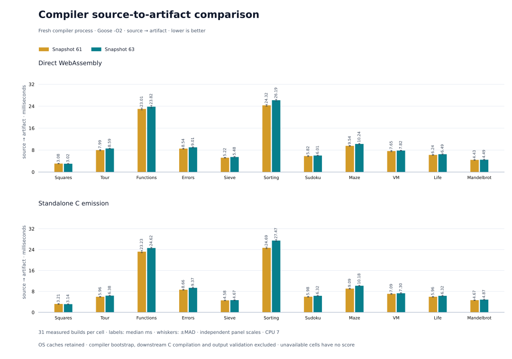

# Compiler throughput · 2026-11-14

Snapshot 62 was frozen without a speed campaign. Measured afterwards, it took 1.36× snapshot 61's time to compile the eleven benchmark programs. Most of that was a fixed cost added to every compile. Snapshot 63 removes the two largest causes and takes 1.04–1.05× snapshot 61's time, 0.78× snapshot 62's. The remainder comes from features and large-program work added since snapshot 61, measured commit by commit below.

| Snapshot | Sources | Seed C | Executable (with profile) |
| --- | --- | --- | --- |
| 61 | `f9d260c` | `f65aba52…` | `2505585544a1bb3dcf70204071d8c4388160e09b6775fe858d25a8efeb63c4fe` |
| 62 | `8cec9bc` | `d1f489fb…` | `2d2c4a3d677f47d1c512b39a8266c1c305c73cd3f1e219915cda3ee794fe5cbd` |
| 63 | `29cc778` | `28f1af08…` | `10ade9d54abd059038d05cb76d1f81f9c89b9254c2f3529794995e298518ab56` |

All three were built with Clang 23 `-O2` and their own profile, trained with snapshot 58's protocol. [Snapshot 63 bootstrap](../../../../selfhost/results/2026-11-14/snapshot-63/README.md)

## Results

Geometric means across the eleven programs, candidate time / parent time:

| Run | CPU · seed | Wasm | C | All 22 cells |
| --- | --- | ---: | ---: | ---: |
| 63 / 61, primary | 7 · 630063 | 1.041 | 1.057 | 1.049 |
| 63 / 61, replicate | 5 · 630064 | 1.027 | 1.047 | 1.037 |
| 63 / 62 | 7 · 630065 | 0.783 | 0.781 | 0.782 |
| 62 / 61, before the fixes | 7 · 620062 | 1.350 | 1.361 | 1.355 |

All 44 cells qualified in every run. Only squares, the smallest program, compiles faster on snapshot 63 than on 61 in both runs, by 2–3%. The slowest cells relative to 61 are C emission for maze (1.10–1.12×) and sorting (1.09–1.11×), and Wasm emission for sorting (1.07–1.08×). [Primary report](compiler-comparison.json) · [All runs](metrics.json)

Each cell has 31 samples after one warmup. They were taken in shuffled, balanced rounds with fresh compiler processes and OS caches retained. The timer stops when the compiler has written the Wasm or the C; C compilation and output validation ran after the timed rounds. Other workloads ran on this 8-core / 16-thread Ryzen 7 3800X throughout, at load 3–4. Absolute times therefore differ between runs, and the ratios come from interleaved rounds.

The compiler checking its own sources (335,506 nodes) took the same time on snapshots 62 and 63 within noise. That is five interleaved rounds of `--check` on CPU 7: medians of 33.2 s and 33.9 s CPU, with paired ratios from 1.00 to 1.03 and one outlier at 1.20.

## What changed

- **The lifetime offer table is sized to the program.** Commit `eb0c15d` added a direct-mapped table of recent lifetime discovery offers: 65,536 entries of 96 bytes, about 6 MB, filled on every compile. For a small program that fill cost more than the whole check. An empty `fn main() {}` took 3.2 ms to `--check` on snapshot 62 against 1.6 ms on snapshot 61, with 907 page faults against 128.
  - The table now starts with about one slot per eight nodes, a power of four from 256 to 65,536, and grows fourfold as offers are recorded. A hit compares every field, so the size changes no result.
  - The compiler's own sources still start at 65,536.
- **Native unit names are found with `find_pair`.** Since parallel native units (`eae7e9a`), every native compile scanned the emitted functions and globals one byte at a time for `g_fn` names. A function's linkage depends on which units name it, and the scan ran whether or not the C is ever split; for a 200-line program it cost about 1 ms.
  - The scan now uses std's `find_pair` to jump to each `g` with an `n` three bytes on. The checks after it are unchanged, so the emitted C is byte-identical.

## Where snapshot 62's time went

Each commit between the two snapshots was built from its own sources with the checked-in seed: `bootstrap.py --jobs 8`, with no profile. Each was timed with its own standard library. Timings are medians of child CPU time over 31 or 81 shuffled rounds on CPU 7, at load 9–14; noise is about ±0.1–0.2 ms. Cells are check / Wasm / C, in ms added by the commit. [Raw data and timer](attribution/)

| Commit | sorting (s61: 9.9 / 18.4 / 19.6) | functions (9.0 / 17.3 / 18.7) | tour (4.6 / 6.5 / 5.0) | empty (1.8 / 2.1 / 2.1) |
| --- | --- | --- | --- | --- |
| `eb0c15d` indexed checker and offer table | +1.66 / +1.44 / +1.55 | +1.51 / +1.20 / +1.44 | +1.39 / +1.40 / +1.50 | +1.78 / +1.80 / +1.85 |
| `eae7e9a` parallel native units | +0.07 / +0.01 / +1.23 | +0.03 / +0.06 / +1.03 | +0.01 / +0.02 / +0.08 | −0.01 / +0.03 / +0.03 |
| `8694f1f` lifetime list sharing | +0.46 / +0.55 / +0.58 | +0.32 / +0.46 / +0.45 | +0.27 / +0.33 / +0.30 | +0.02 / +0.08 / +0.07 |
| `bdff21f` stdlib aborts at the program's call | +0.13 / +0.43 / −0.70 | +0.02 / +0.27 / −0.37 | −0.05 / −0.01 / +0.07 | +0.03 / −0.04 / +0.01 |
| `a07c124` `defer` | +0.08 / +0.15 / +0.25 | +0.07 / +0.04 / +0.29 | +0.03 / +0.05 / +0.04 | +0.01 / +0.01 / −0.05 |
| `267e24f` native root structs | +0.02 / +0.10 / +0.21 | +0.02 / +0.25 / +0.22 | +0.06 / +0.11 / −0.02 | +0.07 / 0.00 / +0.02 |
| The other 15 commits | −0.28 / −0.13 / −0.43 | −0.12 / −0.02 / −0.52 | 0.00 / −0.18 / −0.24 | −0.08 / −0.03 / 0.00 |
| **Snapshot 61 to 62** | **+2.15 / +2.55 / +2.70** | **+1.85 / +2.27 / +2.54** | **+1.71 / +1.71 / +1.73** | **+1.82 / +1.84 / +1.92** |

With both fixes, built the same way, sorting took 9.62 / 18.72 / 19.56 ms against snapshot 61's 9.13 / 17.87 / 18.92, and the empty program 1.77 / 1.97 / 2.23 against 1.73 / 1.99 / 2.15.

## Still open

These are the costs a sampling profile attributed to snapshot 62's remaining slowdown. None is fixed in snapshot 63.

- **Lifetime list sharing (`8694f1f`), about 0.3–0.5 ms.** It hash-conses lists, keeps set and atom tables of 1,024 slots at least, and records spans per node. This pays off on the 450-module blot2 compiler and costs about 10% of the lifetime pass on small programs. It could start on demand above some set size.
- **The capture and global read summaries, about 0.2 ms.** `life_reads_captures` and `life_reads_global` walk the call graph below each function, cached per function and not per shared callee. One reverse-reachability pass over the call graph would do.
- **Located standard library calls (`bdff21f`), about 0.3–0.4 ms on Wasm.** `mark_located_functions` walks every function body to find functions used as values, and `opt_clone` looks up a location for every cloned node.
- **Scope name lookups, about 0.1–0.2 ms.** The shared name table rehashes a token's text on every lookup.

## Rejected

- **Skipping unit numbering when the C will not be split.** The driver splits only C of 2 MiB or more, but the conformance suite and `bootstrap.py --jobs` build small programs as units too. Leaving the placeholders blank would also change the C of every small program.
- **Recording `g_fn` names while emitting.** Function bodies are built in their own buffers and copied into the output, so recorded positions would need adjusting at each copy. The faster scan reads only the candidates and keeps the existing checks.

## Earlier run

A snapshot 61 / 60 campaign on 2026-11-13 was not published until now. Snapshot 61 took 1.017 of snapshot 60's time across all cells (CPU 7, seed 610061), and 1.010 in a replicate (CPU 5, seed 610062). Its reports are in `/var/tmp/goose-perf/campaigns61` on the measuring host, not in this repository.
