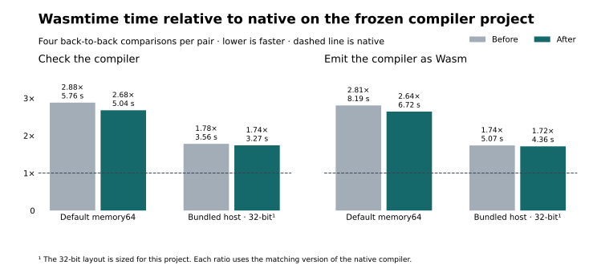

# Sharing array code and speeding up lifetime checks

On the frozen compiler project, default Wasmtime self-check fell **5.76 → 5.04 s** and emission fell **8.19 → 6.72 s**. Those medians are **2.68× and 2.64× native time**. The compiler itself shrank **17.37 → 8.87 MB**. [Paired samples](adjacent.json) · [Module sizes](prep.json)

| Compiler | Check CPU, before → after (s) | Emit CPU, before → after (s) | After / native, check / emit |
| --- | ---: | ---: | ---: |
| Native | 2.00 → 1.88 | 2.92 → 2.54 | 1.00× / 1.00× |
| Default Wasmtime, memory64 | 5.76 → 5.04 | 8.19 → 6.72 | 2.68× / 2.64× |
| Bundled host, project-sized memory32 | 3.56 → 3.27 | 5.07 → 4.36 | 1.74× / 1.72× |

Four paired rounds used CPU 7 of a shared Ryzen 7 3800X. Each older binary ran beside its successor in alternating order. Wasmtime 50.0.1 prepared the modules before timing and ran each invocation in a fresh instance. Native used Clang 23.1.5 at `-O2`. The 32-bit layout was sized for this project. All 24 emissions matched the native output for their compiler version. The frozen source was identical, and its output shrank from 17,322,012 to 8,821,388 bytes with the new backend. [Ranges and counters](summary.json) · [Memory32 layout](regions.txt)

## What made the difference

- The lifetime checker caches what an exact read from a single local container can refer to. The cache key includes the current contents and the frame's parameter revision. Recomputing 114,857 cache hits found the same result every time. This change alone cut check instructions by 7.6% in Wasmtime and 7.9% in native. [Lifetime measurements and state checks](lifetime/README.md)
- A reference parameter can stay in its incoming Wasm local if the function never uses the address of that parameter's own slot. Captures and rebinding keep their storage. In isolation this reduced default Wasmtime from 52.41 to 49.23 billion check instructions. [Reference parameter measurements](reference-parameters/README.md)
- Length reads share the encoded-array decoder. Programs that repeatedly mutate arrays can also share one routine that updates the encoded length. Ordinary arrays keep their short inline update and the encoded path passes the original diagnostic line. On unchanged compiler sources the length-read change reduced the module from 17.37 to 14.21 MB and sharing updates reduced it to 8.98 MB. [Update screens, check](backend-update-check.json) · [Emission](backend-update-emit.json) · [Read-only trial](tools/length.patch) · [Combined array trial](tools/mutations.patch)

Cold compilation of the released compiler module in Wasmtime took **22.56 → 9.50 s CPU**. The serialized compiled module shrank from 50.1 to 23.9 MB. Each of four alternating pairs used one CPU, a fresh engine, the hosted Cranelift configuration and disabled compilation caching. This is separate from the prepared execution figures above. [Preparation samples](prep.json) · [Runner](tools/prepare.py)

## Same-source controls

The following comparison rebuilds each compiler source with both backends. Within each source version the emitted bytes agree across the two executing modules. Changing the executing compiler source also changes what it does during emission, including how much Wasm it writes. Counts are retired machine instructions in two reverse-order rounds on CPU 5. [Modules, hashes and samples](decomposition.json)

| Compiler running under default Wasmtime | Check instructions | Emit instructions |
| --- | ---: | ---: |
| Previous compiler and previous backend | 52.41 B | 77.44 B |
| Previous compiler built by new backend | 48.53 B | 71.68 B |
| New compiler built by previous backend | 48.44 B | 67.84 B |
| New compiler and new backend | 45.04 B | 63.04 B |

Hoisting array views by hand in three read-only lifetime loops saved under 1% of check instructions. Splitting every indexed view into separate pointer and length locals increased check instructions. Two ordinary-branch layouts moved the instruction count by less than 1% in either direction. These experiments stayed separate from the released changes. [Hoisted loops](loop-slices.json) · [Loop patch](tools/loop-slices.patch) · [Index screen](reference-parameters/scalar-index-screen.json) · [View branches](backend-check.json) · [Branch patch](tools/branch.patch) · [Inverted branch](tools/invert.patch)

## Remaining cost

| Candidate running the same project | Check instructions | Emit instructions |
| --- | ---: | ---: |
| General host, memory64 | 45.04 B | 63.05 B |
| Bundled host, memory64 | 37.21 B | 52.83 B |
| General host, calibrated memory32 | 34.70 B | 49.69 B |
| Bundled host, calibrated memory32 | 29.82 B | 43.22 B |

With default memory64, lifetime checking accounted for 77% of excess checking samples and 49% of excess emission samples over native. The largest named differences were `life_replay` in checking and `life_replay` in emission. [Width and host controls](widths.json) · [Profile](profile.json) · [Per-function counts](profile-summary.json)

## Verification and reproduction

The C bootstrap reached a fixed point. Default and memory64 conformance matched all recorded gaps, as did both bundled-host runs. Of 10,057 output comparisons, 450 differed. Each was an optimized Wasm module. All changed modules validated and kept their import and export interfaces. Native C, diagnostics and check results matched. The custom-host tests cover all six encoded length modes and the two-byte to one-byte ULEB transition. [Qualification](qualification.json) · [Changed-module audit](equivalence-audit.json) · [Bundled-host runs](bundled-conformance.json) · [Encoded length fixture](encoded-update-fixture.json) · [Host tests](../../../../tests/test_owner_view_host.py)

Use compiler `4e9b78e`, baseline `ac55de2` and frozen project `90e086f`. Build each with the flags in the [self-host build record](selfhost.json). Prepare the four layouts with the [module script](../compiler-record-access/tools/modules.sh). Run the [comparison harness](../compiler-record-access/tools/compare.py) with `--cpu 7 --rounds 4` and the expected native emission for each compiler version. The [chart script](../compiler-replay-and-captures/tools/chart.py) takes this evidence directory as its argument. [Prior paired comparison](../compiler-copy-costs/README.md)
