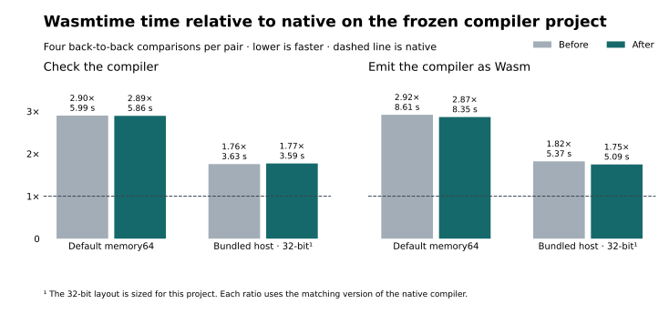

# Compiler runtime after indexing calls and lifetime parameters

On the frozen compiler project, default Wasmtime used **5.86 s** of CPU time to check and **8.35 s** to emit. That is **2.89× / 2.87× native**. The project-sized memory32 build with the bundled host ran at **1.77× / 1.75× native**. [Four paired rounds](adjacent.json)

| Compiler | Check CPU, before → after (s) | Emit CPU, before → after (s) | After / native, check / emit |
| --- | ---: | ---: | ---: |
| Native | 2.06 → 2.02 | 2.95 → 2.91 | 1.00× / 1.00× |
| Default Wasmtime, memory64 | 5.99 → 5.86 | 8.61 → 8.35 | 2.89× / 2.87× |
| Bundled host, calibrated memory32 | 3.63 → 3.59 | 5.37 → 5.09 | 1.77× / 1.75× |

Default Wasmtime retired **1.5% fewer instructions checking** and **4.4% fewer emitting**. Each older binary ran beside its successor on CPU 7, with order reversed in alternate rounds. These 48 runs started after qualification, the copy probes, the memory-width controls and the reader benchmarks finished. CPU time includes each invocation and its fresh Wasm instance. Wasmtime prepared the modules before timing. All 24 emissions matched the same 17,322,012-byte reference. [Ranges, counters and individual pair changes](summary.json)

## What changed

- Checking copied **10.09 → 8.51 GB** through Wasm `memory.copy`. Lifetime checking now visits a frame's parameters directly and reads the fields it uses from roots, cells and frames. In the previous compiler, Wasmtime copied a 565-byte frame 365,377 times to read two fields. Native Clang loaded the fields directly. The new parameter link adds eight bytes to each cell. That increased copies at one remaining snapshot in `life_eval_body` by 11.5 MB. [Measured copies and machine code](copies/README.md)
- Emission copied **16.26 → 13.55 GB**. The region planner for the 1,542-function program used to visit 35,348,808 call edges. It now visits 34,386, including building the per-caller index. The component walk and bound calculation retain call order. Isolating this change reduced emission instructions by 3.4% in the first screen. [Edge counts](region-counts.json) · [Source screens](source-screens.json) · [Combined screen](combined-screen.json)
- Lifetime replay itself copied 305 MB in both compilers. Four local replay changes each saved under 1% of check instructions. A separate symbol index removed a 13.86-million-entry function scan, while emission instructions fell only 0.98% and CPU time moved in opposite directions across two pairs. Inlining record copies up to 80 and 192 bytes also increased the instruction count. The release uses the original copy lowering. [Replay and lookup experiments](screens/README.md) · [Copy lowering screens](inline-copy-screens.json) · [192-byte trial](tools/lowering-large.patch) · [Record literal trial](tools/lowering-literal.patch)

## The remaining gap

Two additional runs per configuration used the same candidate and frozen project. Each produced the same module. A smaller address width and the bundled host contract independently reduced retired machine instructions. Both 32-bit modules used the same region layout measured on this workload. A custom host can edit array headers. The default build checks their representation at runtime. The bundled contract lets the compiler omit that check for eligible arrays. [Width and host controls](widths.json) · [Region sizes](regions.txt) · [Host contract](../../../../docs/TARGET.md)

| Candidate configuration | Check instructions | Emit instructions |
| --- | ---: | ---: |
| General host, memory64 | 52.41 B | 77.44 B |
| Bundled host, memory64 | 42.92 B | 63.87 B |
| General host, calibrated memory32 | 39.59 B | 60.62 B |
| Bundled host, calibrated memory32 | 33.44 B | 50.93 B |

At default memory64, lifetime analysis accounted for **81% of excess checking samples** and **57% of excess emission samples** over native. Lifetime replay had the largest named difference in checking. Wasm local-slot allocation had the largest in emission. A next experiment is to reuse a checked array header within a loop until an alias write or a call that can edit memory invalidates it. Measure the default memory64 build against the bundled-host control. The calibrated memory32 numbers apply to this project. [Two sampled runs per host and workload](profile.json) · [Per-function differences](profile-summary.json)

## Verification and reproduction

Compiler `ac55de2` and previous compiler `4e7e1b3` ran project `90e086f`. Wasmtime 50.0.1 ran on a shared Ryzen 7 3800X. Native used Clang 23.1.5, eight C units and `-O2`. Bootstrap reproduced its generated C. The default suite reproduced 104 recorded gaps in 10,797 cases and memory64 reproduced eight in 4,777. All 10,057 output comparisons and 11,603 lifetime fingerprints matched. Across 256 generated graphs, both planners agreed on bounds, components and diagnostic order before and after edges were appended. [Qualification](qualification.json) · [Lifetime fingerprints](lifetime-verification.json) · [512 graph runs](region-verification.json) · [Graph fixture](tools/region_check.py)

Use `bench/selfhost_comparison.py build` for both compiler revisions. The [build and source record](selfhost.json) contains the candidate flags. Use the [module preparation script](../compiler-record-access/tools/modules.sh) for the four layouts and the [comparison harness](../compiler-record-access/tools/compare.py) on the frozen project. Supply native before and after, default Wasmtime before and after, then bundled memory32 before and after, with `--rounds 4 --cpu 7` and `--expected LABEL=expected.wasm` for each. The [chart renderer](../compiler-replay-and-captures/tools/chart.py) accepts this evidence directory. [Previous paired study](../compiler-replay-and-captures/README.md)
