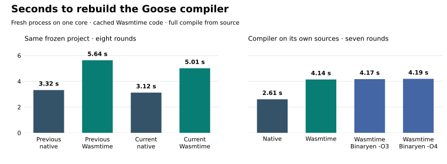
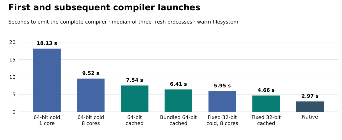

# Closing the native self-compilation gap

On the same frozen Goose compiler sources, the Wasmtime rebuild fell from **5.636 s to 5.014 s**, and native fell from **3.323 s to 3.123 s**. The Wasmtime/native ratio moved from **1.70× to 1.61×**. All 32 rebuilds emitted the same 8,873,765-byte portable memory64 module. [Paired samples and artifact hashes](frozen.json)



| Frozen project, eight alternating rounds | Previous compiler | Current compiler |
| --- | ---: | ---: |
| Native Goose, Clang -O2 | 3.323 s | 3.123 s |
| Bundled 32-bit Wasmtime compiler | 5.636 s | 5.014 s |
| Native instructions retired | 25.47 billion | 23.41 billion |
| Wasmtime instructions retired | 43.78 billion | 37.27 billion |

Both native and Wasmtime started a fresh process on CPU 7 of a shared Ryzen 7 3800X, with warm filesystem pages. Wasmtime 50.0.1 loaded the compiled compiler from disk. Each process parsed, checked and optimized the project and wrote its entire output. The native compilers used eight C translation units and Clang 23.1.5 at `-O2`. The old compiler was `4e9b78e`, the current compiler was `4a9d35e`, and the input to every row above was `4e9b78e`. Wall times varied with system load. The paired instruction counts fell by 14.9% in Wasmtime and 8.1% in native. [Requests and counters](frozen.json) · [Eight additional rounds on the current compiler sources](own.json)

## Rebuilding the current compiler

Across seven rounds on `4a9d35e`’s own sources, native took **2.609 s** and the fixed 32-bit Wasmtime compiler took **4.145 s**. That leaves **1.54 s** between them. All four configurations emitted the same 8,882,272-byte memory64 compiler. A separate eight-round comparison under heavier host load measured 3.173 s native and 5.013 s in Wasmtime, a similar ratio of 1.58×. [Seven-round comparison](deployment.json) · [Independent eight-round comparison](own.json)

| Compiler used for the build | Bytes | Median rebuild | Instructions retired |
| --- | ---: | ---: | ---: |
| Native | 7,071,104 | 2.609 s | 23.35 billion |
| Direct Wasm | 7,446,418 | 4.145 s | 37.14 billion |
| Direct Wasm processed by Binaryen -O3 | 4,341,603 | 4.171 s | 36.51 billion |
| Direct Wasm processed by Binaryen -O4 | 4,394,095 | 4.193 s | 36.51 billion |

Binaryen 133 made the compiler smaller. Its extra pass took 178 s at `-O3` and 133 s at `-O4` on the shared machine. On the earlier source revision, `-O3` won six paired rebuilds against direct Wasm. The seven final rounds did not reproduce a wall-time advantage. All three Wasm compilers reproduced the same fixed-memory compiler and agreed on four holder-mutation diagnostics and successes. Enabling Wasmtime compiler inlining on the `-O3` module gave 4.092 s, compared with 4.093 s at the standard setting and 4.101 s at Cranelift’s size-and-speed setting in six further rounds. [Optimizer commands and correctness controls](deployment-checks.json) · [Engine comparison](engine.json)

## What removed work

Two lines in the lifetime checker made 5.43 million of the 5.68 million type-containment queries during the original self-check. At the hot lookup, generated native code read the fields it needed directly. Wasmtime copied a 25-byte record before comparing those fields. The new checker skips repeated walks through one or two storage roots when their live contents and killed fields still match. A diagnostic build recomputed every answer it reused and found 122,154 hits in 143,901 queries, with zero disagreements. [Sampled machine instructions and counters](pair-lookup.json) · [Original CPU samples](sampling.json.gz)

The Wasm backend also emits fewer checks when a module's initial and maximum memory are equal. It still checks the activation-stack boundary. With all pages committed at instantiation it can eliminate per-call memory-growth checks, and it can omit an overflow comparison when the frame size provably fits. This optimization applies to fixed-size modules at either memory width. The fast benchmark uses a 32-bit compiler with 65,535 pages, a bundled host, and region weights trained on squares, sorting and tour. A project with different memory needs can exhaust that layout. [Profile](training.profile) · [Capacity measurements](../compiler-layout-trials/README.md)

## Cold start and the remaining gap

With the default memory64 compiler and one core, an empty Wasmtime cache added about 10.6 s of engine preparation. Loading the prepared fixed memory32 compiler and instantiating it took **5 ms**. Both cases ran the entire compiler in a fresh process. A one-line edit took **4.318 s** with the prepared fixed module and **2.669 s** native. Both produced the same edited module, independently checked against a fresh native reference. [Three-round launch and edit samples](launch.json)



| Phase on the current compiler project | Native | Fixed 32-bit Wasmtime | Extra time |
| --- | ---: | ---: | ---: |
| Parse | 0.055 s | 0.096 s | 0.041 s |
| Type-check, excluding lifetime analysis | 0.232 s | 0.392 s | 0.160 s |
| Lifetime analysis | 1.598 s | 2.516 s | 0.918 s |
| Optimize | 0.146 s | 0.255 s | 0.109 s |
| Emit Wasm | 0.593 s | 0.939 s | 0.346 s |

The phase clocks come from three separate instrumented builds. Lifetime analysis accounted for **0.92 s** of the **1.58 s** difference between their end-to-end medians. The backend accounted for another **0.35 s**. In three additional CPU profiles, `life_replay`, which applies a called function’s lifetime effects to its caller, was the largest named cost in both full builds. It accounted for 5.7% of the Wasmtime samples and 5.5% of native. Removing duplicated work across callers remains a candidate for a larger change. [Phase clocks](launch.json) · [Samples on the current compiler](current-sampling.json.gz)

Two further samples of the full Wasm build traced 453 of 4,247 samples into Wasmtime’s bulk-copy helper and 132 into bulk fill while executing outside named guest functions. Looking one guest caller further up the stack showed copies spread across the checker, optimizer and backend. The most frequent individual return address accounted for 17 of 4,249 samples in that separate probe. Stack attribution uses the nearest mapped guest address found on a sampled stack and is approximate. [Bulk-operation and guest-caller samples](bulk-samples.json.gz)

## Other experiments

- Moving the liveness check ahead of alias filtering raised the full-build count from 43.78 billion instructions to 299.45 billion. Checking less often at the caller was more effective than making each type lookup cheaper.
- A 64-entry holder table took 41.03 billion instructions by itself. Increasing it to 256 entries took 40.78 billion and quadrupled the table. Tracking more root dependencies found no additional hits on this input.
- Three experiments reusing callee work saved at most 0.2% of instructions. Extra local simplification, more aggressive direct calls and narrower backend operations each saved under 1% on top of the combined change. Trial wall times came from a busy shared host, so the table above uses a separate eight-round comparison. [Raw screens, including rejected trials](screens.json.gz) · [Compiler and engine identities](screen-pins.json) · [Patches, profiles and probe scripts](screens.tar.gz)

Lowering all bulk copies and fills to Wasm loops with Binaryen raised rebuild time from **4.009 s to 12.547 s** and retired instructions from 36.51 billion to 145.57 billion over four rounds. The generated compiler output remained identical. [Bulk-memory comparison](bulk-loops.json)

Reading the fields of seven sampled checker and emitter records by reference saved another 0.36 billion instructions. Wasmtime moved from 4.093 s to 4.063 s in five pairs, then from 4.329 s to 4.411 s in the seven-pair confirmation with reversed starting order. The matching native control took 2.612 s with the original reads and 2.614 s with the references. The released source keeps the original reads. [First five pairs](source-reads.json) · [Seven-pair confirmation](source-reads-repeat.json) · [Native control](source-reads-native.json)

## Qualification

The compiler reproduced its fixed-memory Wasm executable byte for byte and reached the native C bootstrap fixed point. All 10,057 previous/current output comparisons matched. The default conformance suite had 104 known gaps across 10,797 rows, and memory64 had eight known gaps across 4,777 rows. There were zero unexpected failures, all 54 native checks passed and all 88 unit tests passed. [Verification](verification.json)

The lifetime checker's logical state matched across 4,357 corpus sources, including all 11,567 fingerprint lines. Additional controls covered nested holder mutation and field kills against upstream Goose, and covered recursion, growth and exhaustion at both memory widths. Running the fixed-memory contract subsets at each width produced the same eight known gaps. The additional fixed-memory subsets and instrumented lifetime probes used `bcc3b4a`. Final qualification includes the conservative overflow guard and its regression suites at `4a9d35e`. [Controls and qualification receipts](verification.json)

## Reproduce

Build the Rust host, bootstrap a compiler, and freeze the sources. The examples below assume the repository root, CPU 7, Clang 23, a Python environment with the benchmark dependencies, and permission to read Linux hardware counters. Use the same target revision for the compiler and workload to measure self-compilation.

```sh
cargo build --manifest-path host/rust/Cargo.toml --release --locked --bin goose-wasmtime
python3 scripts/bootstrap.py --verify
root="$PWD"
d="$root/bench/results/2026-11-18/compiler-frame-cost"
s="$root/build/reproduce-self-4a9d35e"
.venv/bin/python bench/selfhost_comparison.py build "$s" --commit 4a9d35e \
  --emitter "$root/build/bin/goose" --cc clang-23 --jobs 8 --rounds 1 --build-cpus 0,2,3,4,6 --cpu 3
(
  cd "$s/source"
  ulimit -s 262144
  "$s/build-1/compiler-native" selfhost/main.goose --stdlib stdlib \
    --target wasm-direct -O2 --wasm-bundled-host --wasm-initial-pages 65535 \
    --wasm-max-pages 65535 --wasm-region-profile "$d/training.profile" -o "$s/fixed.wasm"
)
.venv/bin/python "$d/measure.py" "$s" "$s/timing" \
  native="$s/build-1/compiler-native" wasm="$s/fixed.wasm" --rounds 8
.venv/bin/python bench/results/2026-11-18/compiler-request-latency/launch.py \
  . "$s" "$s/launch" --layout-profile "$d/training.profile" --fixed-bundled32
```

To repeat the before/after experiment, prepare a second stage at `4e9b78e`, build its [previous bundled32 compiler](../compiler-request-latency/README.md#reproduce), and pass its stage as the workload to `measure.py` with all four compiler paths. The script verifies every output against the frozen stage's native emission before recording it.
