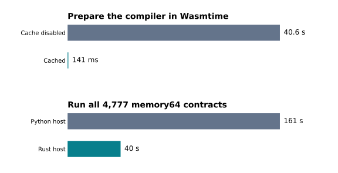

# Faster compiler iteration · 2026-11-18

A prepared compiler module reloaded in **141 ms**. The Rust host completed the full memory64 suite in **40 s**. Both benchmarks used Wasmtime 50.0.1.

| Measured work | Before | After | Evidence |
| --- | ---: | ---: | --- |
| Prepare the 24.5 MB compiler module in a fresh Wasmtime process | 40.61 s cache disabled | 141 ms median for two cache hits | [Four launches](preparation.json) |
| Run all 4,777 memory64 contracts on six workers | 160.89 s Python | 40.17 s Rust | [Contract and output comparison](host-parity.json) |
| Emit Wasm from a frozen compiler project in resident Wasmtime | 13.70 s | 13.45 s | [Four alternating pairs](slots-repeat.json) |
| Emit from the same project with the native compiler | 4.05 s | 3.94 s | [Same trial](slots-repeat.json) |

## Compiler execution

The optimizer now indexes the first free local slot for each function in one pass. The previous compiler scanned all symbols for every function. Wasmtime emission instructions fell from **120.53 billion to 116.88 billion** (3.03%). Native instructions fell from 40.84 billion to 40.41 billion (1.06%). Every old and new emission reproduced the same module. The benchmark uses compiler versions `065aff3` and `90e086f` on the frozen `065aff3` project, CPU 7 and Clang 23.1.5 eight-unit native builds. Each Wasmtime sample starts a fresh instance of a prepared memory64 module.

The first three pairs ran during qualification. Wasmtime emission took 16.08 s before and 19.67 s after. Check instructions changed by less than 0.01% on both engines. Four emission pairs after qualification reproduced the instruction decrease and gave the wall medians above. Shared host load varied in both runs. [First three pairs](slots-shared.json) · [Four later pairs](slots-repeat.json) · [Paired runner](tools/slots.py)

The README’s self-hosting chart measures the new compiler on its own `90e086f` sources. Median self-check took 2.95 s native, 10.61 s in Wasmtime and 11.19 s in V8. Self-compilation took 4.62 s, 14.57 s and 18.91 s. Both Wasm engines reproduced the input module. Across eleven smaller programs, compiler CPU time was within 0.3% of the previous version for each target. The ten example charts use fresh cold builds, process runs and preparation samples. All 30 Mandelbrot builds reproduced the executable and runtime fingerprints from the published hot run. [Self-hosting](measurements.json) · [Compiler catalog](compiler-comparison.json) · [Examples](examples.json) · [Wasmtime hosts](host.json) · [Mandelbrot builds](langbench-build.json) · [Artifact comparison](langbench-artifacts.json) · [Resident timings](../wasm-lowering/langbench-hot.json) · [Pins](pins.json)

## Lifetime replay

The frozen compiler visited **10,535,264 entries** during a self-check. Existing stamps skipped **7,159,123** (68.0%). **680,227** visits (6.46%) added or changed a recorded effect. Native and Wasmtime agreed on every count during checking and emission, reproduced the control module, and rejected the held-out escaping reference with the same diagnostic. Runs of at least eight already-stamped reads accounted for 58.55% of all visits. A follow-up tested whether those groups could be reused on the frozen compiler. [Counts and reproduction](REPLAY.md) · [Eight-read trials](../lifetime-read-groups/README.md)

## Qualification and environment

- The Rust/Python comparison used the same 1,764 shared pinned inputs. All 4,777 outcomes matched, including parse and compile diagnostics, exit codes and both output streams from 4,086 guest executions. Both hosts reproduced the eight known memory64 gaps. The runner selects a built release Rust host for memory64 and otherwise uses Python. [Host comparison](host-parity.json) · [Comparator](tools/host_parity.py)
- A dedicated empty Wasmtime cache took 37.97 s to populate. The next two processes loaded the same module in 154 ms and 127 ms. A fourth process with caching disabled took 40.61 s. Each process then passed a full self-check. Cold lifecycle and example benchmarks retain their preparation measurements. [Launches](preparation.json)
- The sort fixture gets 30 s after an earlier 15 s timeout and a successful 13.8 s retry. It took 9.83 s at `-O0` in the default suite and 12.18 s in the split-unit suite. The runner gives a timed-out, file-independent row one retry after its workers drain, using its existing artifact, input and timeout. A first qualification with immediate retries exhausted the limit twice on the slice-pool model under CPU contention. The revised runner passed the full matrix. [First qualification](qualify.log) · [Isolated executions](delayed-retry.json) · [Regression test](../../../../tests/test_conformance_runner.py)
- Full qualification took 182.6 s, reproduced the bootstrap fixed point and matched all **10,057** baseline compiler outputs. The default, split-native and memory64 matrices reproduced their 104, 96 and 8 recorded gaps. All 81 unit tests passed, with the memory64 self-compilation test (75.7 s) and the native split-unit comparison (23.3 s) the longest. [Qualification](qualification.json) · [Unit timings](unit-tests.log) · [Bootstrap](bootstrap.json)
- Preflight checks both frozen module widths, input hashes, Wasmtime, report rounds and an actual hosted call with hardware counters. The record-loop smoke also executed both fixture modules. A deliberately flat report and a mismatched module were each rejected before compiler preparation. [Entry-point checks](preflight.json)
- The read-only inventory found **189.4 GiB** under `build/`, including 6.09 GiB of rebuildable caches. In one old cold/warm qualification pair, 6,369 distinct warm inodes held 0.99 GiB of byte-identical generated intermediates. That figure is logical size. Hard links and filesystem sharing affect reclaimable space. The inventory kept every file. [Directory inventory](inventory.json)

To repeat the optimizer trial, build a self-hosting comparison stage for each pinned revision with `bench/selfhost_comparison.py build`, then run `tools/slots.py BASELINE_STAGE CANDIDATE_STAGE REPORT --cpu 7 --mode emit --rounds 4` with the repository Python environment. The baseline stage supplies the common source tree. For preparation, run the same tool in fresh processes with `--preparation-only`, an isolated `--cache-config FILE`, and once with `--cold-preparation`. The [self-hosting recipe](../../../README.md) describes the build and benchmark tools.
