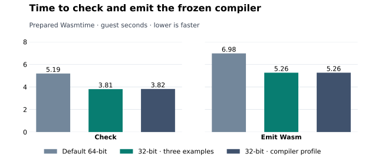

# Testing three compiler runtime optimizations

Sizing 32-bit memory from three small Goose examples cut Wasmtime execution from **5.19 to 3.81 seconds** for checking the frozen compiler and **6.98 to 5.26 seconds** for emitting it. With the bundled host, that layout took **1.68× and 1.69× native CPU time** in a separate four-round comparison. The compiler on main retains its current defaults. [Guest times](memory/validation-root.json) · [Paired native and bundled-host times](memory/bundled-pairs.json)

## How far three examples transfer

We measured peak usage per region while compiling squares, sorting and tour. Giving each region its highest observed weight ran out of room in the lifetime checker. Taking the square root of each peak before assigning space let less active regions keep more room. We selected that rule after seeing the first frozen self-check fail. Only the three examples supplied weights. [Training and policy](memory/summary.json) · [Example-trained profile](memory/training-root.profile)

| Workload | Equal 32-bit regions | Three examples, peak weights | Three examples, square-root weights |
| --- | --- | --- | --- |
| Emit seven other Goose examples | 7/7 | 7/7 | 7/7 |
| Emit a 16,383-function tree and an 8,191-function tree returning references | 0/2 | 2/2 | 2/2 |
| Check and emit the frozen compiler | Region exhausted | Region exhausted | Both matched native |
| Parse the frozen 450-module Blot2 project | Region exhausted | Region exhausted | Region exhausted |

All successful emissions matched native bytes. Blot2 used **409 MB** for tokens and **430 MB** for syntax nodes. The example-trained layout gave tokens **123 MB**. One 32-bit compiler sized from both large projects checked and emitted the frozen compiler and parsed Blot2. This establishes that both fit in a single layout. Predicting their needs from a new program remains open. [Capacity diagnosis](memory/diagnosis.json) · [Jointly trained control](memory/two-project-fit.json)

The chart uses elapsed guest execution after preparation and instantiation on CPU 3. A new 32-bit general-host compiler ran beside the released native and default Wasmtime compilers on CPU 7. It took **1.94× native CPU time** to check and **2.05×** to emit. The bundled-host comparison used CPU 4. Each run used four alternating rounds, Wasmtime 50.0.1 and the same frozen source. The timers and hosts are identified with each comparison. [General-host samples](array/combined.json) · [Bundled-host samples](memory/bundled-pairs.json)

## Array access and lifetime replay

| Trial on default memory64 | Change in check / emit instructions | Result |
| --- | --- | --- |
| Reuse a slice of the active frame table and refresh it when the table grows | −2.60% / −1.86% | CPU fell from 5.25 to 5.10 s for checking and 7.00 to 6.75 s for emission in two alternating pairs. |
| Take array views while scanning consecutive recorded reads, and reuse fixed-size scratch views during Wasm local allocation | −1.35% / −1.20% combined | Neither the separate nor combined trials consistently lowered CPU time. |
| Skip an already-processed lifetime summary when its read and effect stamps still match | −0.57% / −0.41% | Three pairs measured check CPU at 5.07 → 5.02 s and emit CPU at 6.74 → 6.80 s. |

The frame-table change also ran inside the example-trained general-host memory32 compiler. It reduced instructions again, but checking took **3.99 → 4.02 s** and emission **5.60 → 5.73 s** CPU. All timed emissions matched the native 8,821,388-byte output. The frame and replay changes also reproduced the released Wasm compiler's output on ten examples and its diagnostics on two rejected inputs. Extending persistent slices to the leaf and read tables triggered the compiler's lifetime checks. These patches remain experimental. [Frame pairs](array/frames-pairs.json) · [Read and allocator trials](array/screen.json) · [Combined memory32 pairs](array/combined.json) · [Fixture results](array/fixture-results.json)

The callee summary stayed unchanged in **112,902 of 116,003** repeat discovery calls. In **87,622** of those repeats, the caller supplied a different destination. During validation, two recursive caller/callee pairs with unchanged summaries added **13 effects**. The guarded shortcut skipped 112,565 individual stamp checks with zero discrepancies in the shadow run and matched all seven lifetime fingerprints. [Per-phase evidence](replay/evidence.json) · [Every caller/callee pair](replay/frame-pairs.json.gz) · [Replay times](replay/paired.json)

Plain upstream Goose `ee261a4` and the released Wasm backend agreed on the isolated frame growth and write-through fixture. Upstream reported the same 33 diagnostics on the full baseline and frame-variant sources after normalizing line numbers. [Fixture](array/frame-view.goose) · [Upstream and rejection controls](array/frame-controls.json)

## Reproduce

Use compiler source `4e9b78e` and frozen input `90e086f`. Build a stage for each with the [self-host harness](../../../../bench/selfhost_comparison.py) and prepare the four reference compiler modules with the [layout script](../compiler-record-access/tools/modules.sh). The recorded stage layout, tool versions and build flags are in the [released compiler evidence](../compiler-array-views/selfhost.json).

- Run `bash memory/run.sh REPO COMPILER_STAGE PROJECT_STAGE CONTROLS OUTPUT` with the repository's Rust Wasmtime host built. This collects training peaks, validates the layouts, measures them and checks the jointly trained profile.
- Apply the [frame](array/frames.patch), [read-scan](array/runs.patch) or [allocator](array/spans.patch) patch to separate compiler source copies. Compile each with the released native compiler using `selfhost/main.goose --stdlib stdlib --target wasm-direct -O2 --wasm-memory64 --wasm-max-pages 262144`. Apply both the read-scan and allocator patches for the combined screen. The [comparison runner](../compiler-record-access/tools/compare.py) takes the frozen project stage and verifies each emission against the native reference. For the combined memory32 run, repeat three-example training on the frame variant. [Frame-variant training identities](array/frames-training.json)
- The [replay reproduction archive](replay/reproduction.tar.gz) contains the timing, trace and fingerprint scripts. Extract it and run `bash reproduce.sh EMPTY_STAGE COMPILER_STAGE PROJECT_STAGE` from the repository root using the script's extracted path. The [candidate patch](replay/replay.patch) applies to the same compiler source.
