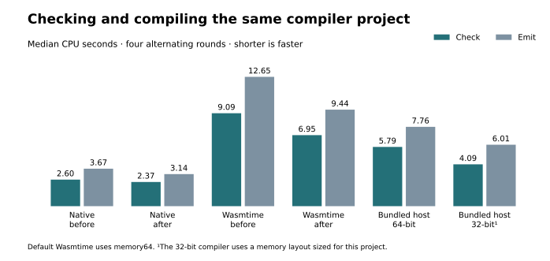

# Closing the compiler’s Wasmtime execution gap

On the same frozen project, the default memory64 compiler used **9.09 → 6.95 s** of Wasmtime CPU to check and **12.65 → 9.44 s** to emit Wasm. Native also got faster. The new default takes **2.93× native time to check** and **3.01× to emit**. A compiler built specifically for the bundled hosts takes **2.45× / 2.47× native** in memory64 and **1.73× / 1.92×** with a project-sized memory32 layout. [Paired samples](confirmation.json)



| Compiler running the frozen project | Check CPU, s | Emit CPU, s | Check, billion x86 instructions | Emit, billion x86 instructions |
| --- | ---: | ---: | ---: | ---: |
| Native, before | 2.60 | 3.67 | 25.26 | 40.19 |
| Native, after | 2.37 | 3.14 | 21.31 | 32.46 |
| Wasmtime memory64, before | 9.09 | 12.65 | 74.05 | 115.60 |
| Wasmtime memory64, after | 6.95 | 9.44 | 58.67 | 88.26 |
| Wasmtime memory64, bundled host | 5.79 | 7.76 | 47.64 | 72.06 |
| Wasmtime project-sized memory32, before | 7.21 | 10.24 | 59.79 | 95.80 |
| Wasmtime project-sized memory32, after | 4.98 | 7.17 | 43.96 | 68.69 |
| Wasmtime project-sized memory32, bundled host | 4.09 | 6.01 | 37.04 | 57.77 |

Each median uses four rounds on CPU 7 of a shared Ryzen 7 3800X. Each round ran all eight configurations on both tasks, reversing the order on alternate rounds. Wasmtime 50.0.1 reused prepared modules with fresh instances. CPU counts the hosted invocation, and Wasm wall time in the raw data covers guest entry only. Native includes launch. The controls use Clang 23.1.5 at `-O2` with eight C units. Shared load varied, particularly during the first round. Every timed emission matched the native output of its own compiler version. The output target was always default memory64, including when the compiler itself ran with memory32. [Hardware counters, wall and CPU times](confirmation.json) · [Compiler builds and calibration](build.json)

## Where the work went

- **Wasm array access.** An ordinary array control starts with its data pointer and length. The backend now loads them together. When the program can see other array formats, it checks the mode and can share one decoder across access sites. An instrumented check of the frozen project evaluated 819,521,938 such views, all in ordinary storage. The release still handles other modes and preserves the source line on errors. [Dynamic mode counts](mode-distribution.json) · [76 custom-host cases](custom-host.json)
- **Closed programs.** If the complete program rules out encoded controls, the backend can read ordinary control words directly. Public exports, library builds, unsafe reference casts and variable image layouts keep the general representation. The optional `--wasm-bundled-host` switch also accepts recognized imports with the signatures and behavior supplied by our hosts. An unknown import still takes the general path. A project-sized memory32 compiler needs a separate calibration. [Host contract](../../../../docs/TARGET.md) · [Positive and negative tests](ordinary-fixtures.json)
- **Lifetime checking.** A root now lists just its own invalidated fields. The checker reuses a holder’s traversal for that field list and visits the live cells whose types can hold references. A checked record reference supplies the two fields needed by read replay. On the original backend, the lifetime changes alone reduced self-check from 74.09 to 63.35 billion instructions in separate screens. [Lifetime experiments](lifetime-screens.json) · [Four reference-binding pairs](reference-pairs.json)
- **Wasm emission.** The local-slot allocator now records only control flow, non-parameter locals and the first instruction. It copies consecutive untouched bytes together. It preserves the order of live ranges and continues to parse each instruction’s operands. All four archived allocator workloads produced byte-identical output, including overlapping live ranges and small functions. [Replays](allocator-replay.json) · [Captured inputs and reproduction](../../2026-11-17/wasm-slot-prefix/README.md)

An inline array fast path reduced frozen self-check instructions from 74.06 to 65.91 billion but grew the compiler module to 24.71 MB. Sharing the image decoder took 68.12 billion instructions in the isolated screen and reduced the module to 17.32 MB. The final general compiler uses the shared decoder where the module has multiple indexing sites. Each screening module compiled the original project, and experiments involving the new backend were also tested against its changed output. [Screening runs](screening.json) · [Bundled-host screen](width-screen.json) · [Width controls](ordinary-widths.json)

## Correctness

The C bootstrap reached a fixed point. The default suite retained its recorded 104 gaps in 10,797 cases. Memory64 retained eight in 4,777. All 54 native checks passed. The lifetime checker matched 11,596 fingerprints across 4,357 inputs, the frozen project's pass boundaries, and a shadow scan of eligible cells. In isolation, the checker and allocator matched the old compiler on all 10,057 output comparisons. With the backend changes, 390 Wasm outputs changed. All 390 validated and retained their import and export interfaces. Native C, diagnostics and check results matched. [Qualification](qualification.json) · [Lifetime state](lifetime-state.json) · [Changed-module audit](equivalence-audit.json)

## Reproduce

Use release `d0fce25`, baseline `2e42394` and frozen workload `90e086f`. Build the two older stages as in the [previous measurements](../known-read-replay/README.md#reproduction). Build the new compiler with `scripts/bootstrap.py --verify`. The commands below assume the three stages use the same configuration as the recorded eight-unit Clang builds. The running compiler’s optional bundled-host flag is independent of its output target.

```sh
e=bench/results/2026-11-18/compiler-record-access
.venv/bin/python bench/selfhost_comparison.py build build/candidate --commit d0fce25 \
  --emitter build/bin/goose --rounds 1 --jobs 8 --cc clang-23 --build-cpus 0,1,2,3,4,5,6 --cpu 7
bash "$e/tools/modules.sh" build/candidate build/released build/views
.venv/bin/python "$e/tools/compare.py" build/released build/views/pairs.json \
  native-before=build/direct-read/build-1/compiler-native wasm-before=build/direct-read/build-1/compiler.wasm \
  wasm-after=build/views/general64.wasm native-after=build/candidate/build-1/compiler-native \
  bundled64=build/views/bundled64.wasm bundled32=build/views/bundled32.wasm general32=build/views/general32.wasm \
  --expected wasm-after=build/views/expected.wasm --expected native-after=build/views/expected.wasm \
  --expected bundled64=build/views/expected.wasm --expected bundled32=build/views/expected.wasm \
  --expected general32=build/views/expected.wasm --rounds 4 --cpu 7
```

To include the previous project-sized memory32 control from the published run, add `prior32=PATH/TO/profiled32.wasm` to the cases using [the earlier calibration](../compiler-runtime-gap/README.md#reproduce). Run the [interface audit](tools/audit.py) on the qualification’s equivalence directory. The [chart renderer](tools/chart.py) reads the published four-round report.
