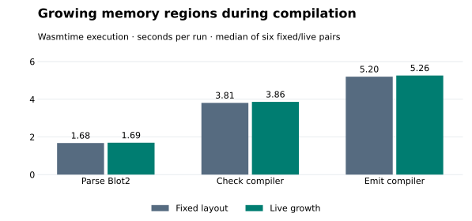
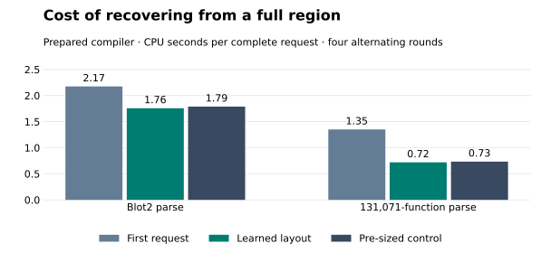

# Recovering space in the 32-bit compiler

Growing memory regions as needed let the compiler parse all 450 frozen Blot2 modules in one pass. The original layout, sized from three small examples, exhausted its token region. We tested three ways to handle a workload that outgrows a region.

## Grow regions during execution

| Workload | Fixed layout | Live growth | Difference in first run | Difference in rerun |
| --- | ---: | ---: | ---: | ---: |
| Parse Blot2 | 1.676 s | 1.692 s | +1.3% | +0.7% |
| Check the compiler project | 3.808 s | 3.860 s | +5.2% | +1.8% |
| Emit the compiler as Wasm | 5.198 s | 5.260 s | +0.7% | +0.6% |

Times are medians across six fixed/live pairs on CPU 2. Percentages compare the two layout medians within each set of three alternating pairs. The second set rebuilt the compiler from the published scripts and reproduced the module hash, every fixture outcome and all allocation counts. The timer covers guest `_start` and its synchronous host calls in Python Wasmtime 50.0.1 with Cranelift's speed setting. [First run](live/summary.json) · [Fresh rebuild and rerun](live/rerun-summary.json)

The Blot2 fixed control was sized from Blot2 alone. The compiler check and emission controls used the original three-example layout. Against another fixed layout trained on both projects, live Blot2 parsing cost 1.9% and 1.5% in the two runs. All emission runs reproduced the native compiler's 8,821,388-byte output. [Compiler pairs](live/pairs.json) · [Blot2-only pairs](live/blot-only-pairs.json) · [Compiler rerun](live/rerun-pairs.json) · [Blot2-only rerun](live/rerun-blot-only-pairs.json)



The guest gives each region a stable descriptor and initially claims 64 KiB. It extends into unused contiguous address space when an allocation needs more room. Blot2 made 65 extensions. Three regions whose preferred addresses were taken got new addresses before their first use. No live array moved. In a separate program, a reference and a slice continued to read the original data through five expansions and eight reuses of a temporary region. [Blot2 trace](live/striped-blot.ndjson) · [Reference and slice trace](live/alias-alias.ndjson)

The first prototype matched 55 of 59 focused cases. Three sparse array or enum cases needed space before publishing an element at a distant address. A fourth converted a 65,532-byte array to an encoding with an eight-byte length field. Accounting for the new end before publishing the result brought agreement to **59/59**, including two expected traps with matching diagnostics. The corrected prototype also parsed a dense 131,071-function input that exhausted the original layout. [First prototype and failures](live/first-prototype.json) · [Corrected fixture outcomes](live/fixtures.json)

This is an experimental allocator for the Python host and memory32 with region statistics disabled. The placement policy uses weights from squares, sorting and tour, and we adjusted placement after observing the frozen projects. Once acquired, a region keeps its address for the lifetime of the instance. Two already assigned regions can still leave too little contiguous space. In the first run, the callback time measured inside the host was 33 ms for compiler checking, against a 213 ms median difference overall. The remaining time includes guest work, callback dispatch and run-to-run variation.

To reproduce live growth, unpack the [scripts and two regression inputs](live/reproduction.tar.gz) into a scratch directory. From the repository root, run the extracted `repro/run.sh` with the stage paths in its README. It builds from compiler `4e9b78e`, checks the compiler sources at `90e086f`, and extracts the Python host at `c131e7c`. The frozen Blot2 archive's SHA-256 starts with `09b5189c`. The script also runs the two fixed controls, focused fixtures and paired timings.

## Retry on a full region

A second approach keeps the original fixed-region allocator. On a failed reservation the guest exposes the limit address and byte request in two globals. The host reads the region cursors, discards that instance, and changes the boundary table before starting a fresh one. The Wasmtime engine and compiled module are reused. Known demand gets space first. The region that failed and other regions at least half full get up to four times their observed demand, within the same 65,535-page budget.

| Frozen input | First request | Attempts | Reuse successful layout | Pre-sized control |
| --- | ---: | ---: | ---: | ---: |
| Parse Blot2 | 2.17 s | 2 | 1.76 s | 1.79 s |
| Parse the 131,071-function tree | 1.35 s | 3 | 0.72 s | 0.73 s |

These are median CPU seconds for the entire prepared request, including failed attempts, on CPU 7 in four alternating rounds. The pre-sized control uses the layout trained on Blot2 and compiler self-emission. From the original three-example layout, compiler self-check and emission completed on the first attempt in every round. With and without the recovery mechanism those CPU medians were 4.02 / 3.98 s for checking and 5.72 / 5.86 s for emission. Descheduling and other jobs affected these timings. [All attempts and outputs](paired.json)



Seven further example emissions and both generated tree emissions matched native bytes. A held-out escaping reference produced the original diagnostic in one attempt. Starting with the raw training weights also recovered a lifetime-summary allocation in region 53 during self-check. A separate CLI run learned Blot2's layout on the first invocation and reused it for Blot2, the compact tree and compiler self-check. Synthetic controls covered a request beyond the total budget, an unrelated trap, and invalid saved boundaries. [Frozen controls](controls.json) · [Lifetime-summary recovery](raw-check.json) · [CLI checks](cli-checks.json) · [Small boundary tests](policy_checks.py)

## Estimate demand before execution

We also tried estimating the sizes of the token and syntax-node regions from the input. The byte-based estimate parsed Blot2 on its first attempt, taking 1.85 s including engine setup and sizing. It counted 465 source files, including all 450 files that the compiler actually read. On an equal-byte pair of generated files, that policy handled the padded file and exhausted its token region on the denser 131,071-function file. Those two files are each 5,969,222 bytes.

Sampling syntax density brought agreement with native from **12/14** on the original layout and **13/14** on byte estimates to **14/14**. The dense-tree failure informed the sampling rule. On Blot2, sampling added about 276 ms to sizing and the median request took 2.13 s. The estimate uses the token and node indices of this particular compiler build. These three-round measurements on CPU 4 use a separate Python host process and a cached module. [Training and project measurements](estimate/evidence.json) · [Equal-byte controls](estimate/shape.json)

## Try the retry-based compiler

The launcher checks or parses a frozen project, or writes a direct memory64 Wasm artifact to standard output with `--mode emit`. On failure it returns the compiler's diagnostics. Each attempt writes to a private temporary file. Only a failure reported by the reserve operation triggers a retry, up to eight attempts. An optional layout cache stores successful bounds atomically under the compiler module's SHA-256. Every invocation starts with a fresh Wasm instance.

From the repository root, set `COMPILER_STAGE` to a [self-host build stage](../compiler-array-views/README.md#verification-and-reproduction) for `4e9b78e`. It must contain `source/` and `build-1/compiler-native`. Build the [Rust Wasmtime host](../../../../bench/wasmtime-host.md) once. The three-example starting profile is in the repository.

```sh
trial=bench/results/2026-11-18/compiler-region-recovery
stage=build/region-recovery-demo
.venv/bin/python "$trial/build_probe.py" . "$COMPILER_STAGE" \
  bench/results/2026-11-18/compiler-layout-trials/memory/training-root.profile "$stage"
.venv/bin/python "$trial/compile.py" "$stage/adapter.wasm" examples/squares.goose \
  --stdlib stdlib --mode check --layout-cache "$stage/layouts" --verbose
```

To reproduce the paired benchmarks, use the frozen project stage for `90e086f` and a memory stage prepared by the [previous experiment](../compiler-layout-trials/README.md#reproduce). Run the [estimate script](estimate/run.sh) with the repository, compiler stage, frozen project stage, memory stage and a fresh output path. It generates the compact and padded inputs. Copy those two source files into the recovery stage, then run `measure.py REPO COMPILER_STAGE PROJECT_STAGE MEMORY_STAGE STAGE --datasets blot-parse compact self-check self-emit --name paired`. Run `policy_checks.py REPO` for the boundary controls. [Qualified bootstrap, native and Wasm contracts, unit tests and 10,057 unchanged compiler outputs](host-qualification.json)
