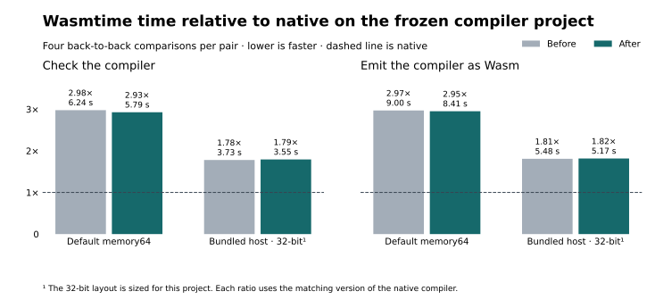

# Lifetime replay, capture validation and Wasm local allocation

Default Wasmtime used **6.24 → 5.79 s** of CPU time to check and **9.00 → 8.41 s** to emit in four back-to-back comparisons. The new compiler took **2.93× / 2.95× native** on these tasks. With the bundled host and a project-sized 32-bit layout it took **1.79× / 1.82×**. These comparisons use the same frozen compiler sources. [Matched pairs](adjacent.json)

| Compiler | Check CPU, s | Emit CPU, s | Check / native | Emit / native |
| --- | ---: | ---: | ---: | ---: |
| Native, before | 2.10 | 3.03 | 1.00× | 1.00× |
| Native, after | 1.98 | 2.85 | 1.00× | 1.00× |
| Default Wasmtime, before | 6.24 | 9.00 | 2.98× | 2.97× |
| Default Wasmtime, after | 5.79 | 8.41 | 2.93× | 2.95× |
| Bundled host memory32, before | 3.73 | 5.48 | 1.78× | 1.81× |
| Bundled host memory32, after | 3.55 | 5.17 | 1.79× | 1.82× |

The table and chart use four rounds with each older binary immediately beside its successor and reversed on alternate rounds. These 48 runs began after the example, catalog, profile and conformance jobs ended. [Back-to-back samples](adjacent.json)

The broader run included both bundled-host memory widths. It measured default Wasmtime at 3.16× / 2.93× native and bundled memory64 at 2.55× / 2.38× native. Default Wasmtime self-check in that run went from 7.33 to 7.39 s, while emission fell from 10.55 to 9.40 s. The baseline check alone ranged from 6.51 to 9.94 s as host load changed. Across the broader run, default Wasmtime retired 9.3% fewer instructions for checking and 8.2% fewer for emission. [Broader comparison](confirmation.json) · [Ranges and retired instructions](summary.json)

In the separate broader comparison, each of four rounds ran all eight configurations on both tasks, reversing the order on alternate rounds. Wasmtime 50.0.1 used prepared modules and fresh instances. CPU measures the invocation on CPU 7 of a shared Ryzen 7 3800X. The native executables used Clang 23.1.5 at `-O2` with eight C units. The Wasm compilers emitted the same memory64 output regardless of their own memory width. All 56 timed emissions across the two runs matched the same 17,322,012-byte module. Memory32 used a layout calibrated on this project. [Source and toolchain](build.json) · [Memory32 layout](regions.txt) · [Previous comparison](../compiler-record-access/README.md)

## Changes measured separately

- Capture validation examined **372,540 cells instead of 8,568,715** and collected the same 42 inputs. Each frame now indexes the globals and captured bindings that can contain references, in the original order. Before types freeze, it retains every candidate. The checker also defers scanning argument depths until it needs to create a frame. Only 2,835 of 168,090 calls created one in this run. [Counts](capture-counts.json) · [Isolated Wasmtime screens](capture-screen.json)
- A frozen self-check visited 9.17 million summary entries. Repeated offers of the same place were common even though no leaf ID repeated within a replay. The checker reuses the previous place’s reach, reuses the caller’s lookup, and stops propagation once no recursive frame owns a relevant place. It reads the calling frame’s stable stamp fields once per replay. In isolation, retired instructions fell from 58.67 to 56.06 billion checking and 88.26 to 85.64 billion emitting. Wasmtime emission CPU time rose in that isolated run under shared load. [Probe and shadow counts](replay/review.json) · [Wasmtime pairs](replay/wasmtime-pairs.json) · [Native pairs](replay/native-pairs.json)
- The local allocator now walks Wasm instructions once to find live ranges, remembers offsets for local accesses, and rewrites single-byte indexes in place. Replaying the optimized compiler’s functions retired 16% fewer instructions on native, 20% fewer on memory32 and 21% fewer on memory64. Across all four archived inputs each target retired fewer instructions. Elapsed times on smaller inputs varied. [Counters](allocator-counters.json) · [Replays and boundary fixtures](allocator-replay.json) · [Full emission screens](allocator-screens.json)

Skipping an entire group of reads based on an inherited stamp saved 3.92 million entry visits but increased check instructions from 58.68 to 59.14 billion. Caching each place set’s owner frame saved 2.6% of instructions in a separate screen but increased median CPU time. Both experiments were discarded. [Group screen](replay/first-screens.json) · [Owner cache](owner-cache-screen.json) · [Owner-cache patch](tools/owner-cache.patch)

A 32-slot table captured more repeated places on self-check but saved only another 0.68% of check instructions and 0.45% of emission instructions. Across 4,357 conformance sources, 67.1% of direct offers reused a place somewhere in the replay and 63.5% reused the previous place. The release keeps one entry. [Follow-up pairs](replay/tables/review.json) · [Corpus counts](replay/corpus-summary.json)

## Verification and remaining cost

The C bootstrap reached a fixed point. The default suite reproduced its 104 recorded gaps in 10,797 cases and memory64 its eight in 4,777 cases. All 10,057 output comparisons matched the previous compiler. The lifetime checker matched 11,603 fingerprints across 4,358 source inputs, including the frozen compiler. The early class-keyed fixture also matched at a threshold of 64 frames. [Qualification](qualification.json) · [Lifetime state and output](lifetime-verification.json) · [Allocator edge cases](tools/allocator_controls.py)

The new post-change profile attributes **81%** of the excess checking samples and **55%** of excess emission samples to lifetime analysis. Lifetime replay remains the largest named difference in each. The next experiment is to count bytes copied while reconstructing and passing read effects and compare the generated loads against the native version. [Post-change profile](profile.json) · [Counts by function](profile-summary.json)

## Reproduction

Use compiler `4e7e1b3`, baseline `d0fce25` and frozen workload `90e086f`. Build each compiler using `bench/selfhost_comparison.py build` and the flags in [the build record](build.json), then use [the module preparation script](../compiler-record-access/tools/modules.sh) on each stage and the same frozen workload. The [comparison harness](../compiler-record-access/tools/compare.py) accepts both native executables and each stage’s `general64.wasm`, `bundled64.wasm` and `bundled32.wasm`. Set `--expected LABEL=expected.wasm` for each case and use `--rounds 4 --cpu 7`. For the back-to-back comparison supply native before and after, default Wasmtime before and after, then bundled memory32 before and after. The [chart renderer](tools/chart.py) reads `adjacent.json`. The [replay probe](replay/probe.sh) builds the instrumented compiler from the frozen sources.
