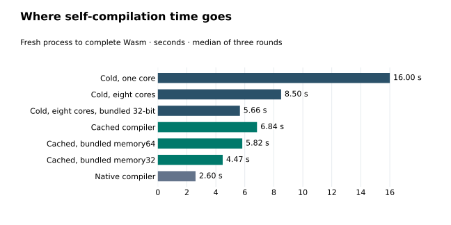
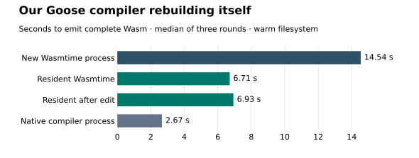

# Cold and hot builds with our Goose compiler

Caching Wasmtime's compiled module brought a fresh-process self-build from **16.00 s to 6.84 s**. Using the bundled host's compiler imports and a 32-bit memory layout brought it to **4.47 s**, versus **2.60 s** for the native compiler. Both emitted the same 8,873,765-byte module.



## First build and subsequent launches

| Compiler configuration | Full rebuild | Wasmtime preparation and instantiation |
| --- | ---: | ---: |
| Default memory64, one core, empty cache | 16.00 s | 9.18 s |
| Default memory64, eight cores, empty cache | 8.50 s | 1.57 s |
| Default memory64, one core, populated cache | 6.84 s | 5 ms |
| Bundled-host memory64, one core, populated cache | 5.82 s | 5 ms |
| Bundled-host memory32, eight cores, empty cache | 5.66 s | 1.18 s |
| Bundled-host memory32, one core, populated cache | 4.47 s | 5 ms |
| Native compiler, one core | 2.60 s | — |

Each time is the median of three full builds on warm filesystem pages. The Rust host started a fresh process for every build. Its on-disk cache held only the compiled compiler module. The eight-core configuration lets Cranelift compile functions in parallel. The Goose compiler itself still runs on one thread. Preparing the 32-bit compiler's cache ahead of time took 1.29 s once on eight cores. The 32-bit layout uses weights from three small example programs and can exhaust a region on other projects. [Per-request wall and engine times, pins and output hashes](launch.json) · [Layout limits](../compiler-layout-trials/README.md)

To pay the engine compilation cost once, run the local Rust host with the same cache file at setup and on later invocations. Use the compiler module for the layout you intend to run. The cache file changes when the module changes.

```sh
host=host/rust/target/release/goose-wasmtime
cache=build/compiler.cwasm
"$host" "$COMPILER_WASM" --cache "$cache" -- --version
"$host" "$COMPILER_WASM" --cache "$cache" -- selfhost/main.goose --stdlib stdlib \
  --target wasm-direct -O2 --wasm-memory64 --wasm-max-pages 262144 -o build/compiler-output.wasm
```

## What remains between 4.47 s and native

| Compiler phase | Cached bundled memory32 | Native |
| --- | ---: | ---: |
| Parse | 0.097 s | 0.053 s |
| Type-check, excluding lifetime analysis | 0.393 s | 0.216 s |
| Lifetime analysis | 2.794 s | 1.638 s |
| Optimize | 0.256 s | 0.137 s |
| Emit Wasm | 0.977 s | 0.555 s |

Three separate instrumented runs put **1.16 s** of excess time in lifetime analysis and **0.42 s** in Wasm emission. Each cell is a median measured by the compiler. Type-checking excludes its nested lifetime timer. For full builds, the first experiment to try is computing a callee's lifetime effects once for equivalent inputs while still applying them to each caller's destination. Earlier traces show callers can add effects even when the callee's summary stays the same. Compare the entire effect set, diagnostics and emitted bytes before timing that change. [Phase samples](launch.json) · [Earlier replay measurements](../compiler-layout-trials/README.md#array-access-and-lifetime-replay)

A retained compiler could do less work after edits. Changing one line of help text took **4.54 s** today and produced **zero changed function bodies out of 3,114**. Changing the default expansion limit changed **one body**. Making the help text longer changed **568 bodies**, along with the global and data sections. Both compilers rebuilt all three variants from source and agreed byte for byte. These counts measure the opportunity for reuse. A retained implementation would still need to invalidate affected callers, constants and embedded addresses and compare its output with fresh builds. [Edits, changed body indices and output hashes](edit-deltas.json)

On this workload, matching native means saving about **1.87 s** from a full rebuild. For a two-second *edited* rebuild, the phase clocks suggest a concrete budget. If the other phases stay at today's cost, roughly **0.25 s** remains for lifetime checking and cache validation. This is an estimate for a future implementation.

## Resident Wasmtime reference

The native build of our compiler emitted its own Wasm in **2.67 s**. Running the same compiler in Wasmtime took **14.54 s** in a fresh process and **6.71 s** with the engine and compiled module already resident. Hot compilation after changing one line of compiler source took **6.93 s**.



| End-to-end wall time | Unchanged source | One-line edit |
| --- | ---: | ---: |
| Native compiler, new process | 2.67 s | 2.59 s |
| Wasmtime, new process and empty compilation cache | 14.54 s | — |
| Wasmtime, same process and prepared module | 6.71 s | 6.93 s |

The input and compiler are both revision `4e9b78e`. Each row uses three observations on CPU 7 with warm filesystem pages. Cold Wasmtime includes starting the Python host, compiling the memory64 compiler module with Cranelift on one CPU, and writing the complete result. Each hot request starts a fresh guest instance and recompiles from source. The edit changes the compiler's command-line help text. Every unchanged build reproduced the original 8,873,765-byte compiler module. Every edited build matched a fresh native compile of the edited sources and differed from the original. Validation ran outside the timer. [Samples, source and artifact hashes](self-emit.json)

## Compiling Gdev

Gdev is written in Blot. To time it with our toolchain, we first need a working Blot compiler built from its Goose sources. We tried Blot `cb1e9e15`, the release that built Gdev `0e0d772`. All probes below used the Goose standard library selected by Blot's release build. The Blot sources came from a Git archive.

- **Reachable entry point.** Our native compiler rejected the exported Blot entry point and its dependencies with 33 lifetime diagnostics. Of these, 32 concern references written to longer-lived storage. The first occurs in `check/package_core.goose` at line 728. [Reachable diagnostics](blot-reachable.txt)
- **Whole library.** Native-C and direct-Wasm emission both stopped at the same 25 type-checking diagnostics, including 16 uses of `index_of` on slices. Neither produced a compiler. Blot exports its entry point for a C host. Using `--library` exercises additional functions beyond those in the reachable check. [Library diagnostics](blot-library.txt)
- **Our compiler inside Wasmtime.** The default memory64 compiler exhausted a region during whole-library emission. The experimental memory32 retry policy recovered enough space to reach the same 25 diagnostics. In the separate reachable check, it hit the eight-attempt limit. These failures precede Gdev compilation. [Commands, stdlib hashes and outcomes](blot-builds.json)

The 1.69 s experimental memory32 result measures parsing an earlier frozen Blot compiler. Gdev compilation and Wasm emission are separate workloads. [Parse benchmark](../compiler-region-recovery/README.md)

## Reproduce

From the repository root, build a frozen compiler stage at `4e9b78e` with the [self-host harness](../compiler-array-views/README.md#verification-and-reproduction). Supply that stage and a fresh output directory to the benchmark. It checks the frozen sources and module hashes before accepting timings.

```sh
.venv/bin/python bench/results/2026-11-18/compiler-request-latency/self_emit.py \
  . "$COMPILER_STAGE" build/self-emit-cold-hot
```

For the fresh-process comparison, build `host/rust/target/release/goose-wasmtime` and repeat the measurement below. The script builds both bundled compiler variants, primes the disk caches with `--version`, alternates case order, records phase clocks separately, and checks the edited build against the earlier native reference. The edits script uses the same compiled modules and writes its own results under the trial directory.

```sh
trial=bench/results/2026-11-18/compiler-request-latency
out=build/compiler-launch-comparison
.venv/bin/python "$trial/launch.py" . "$COMPILER_STAGE" "$out"
.venv/bin/python "$trial/edits.py" . "$COMPILER_STAGE" "$out"
```

For the Blot probe, archive `compiler-goose/src` from Blot commit `cb1e9e15`, then from inside that directory run the native compiler on `main.goose` with `--stdlib "$BLOT_GOOSE_STDLIB" --reachable-program --expansion-node-limit 1000000 --check`. The recorded stdlib file hashes identify Blot's selected upstream precision build. The full-library runs add `--library` and select an output target in place of `--check`.
