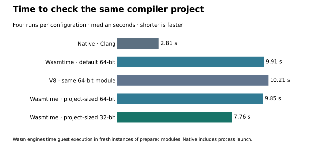

# Why the Wasm compiler takes longer to check itself

Checking the same compiler project took **2.81 s native, 9.91 s in Wasmtime and 10.21 s in V8**. The default Wasmtime run executed **74.05 billion host machine instructions** against **25.26 billion native**. Lifetime analysis accounted for 83% of the extra sampled CPU time. In one of its loops, changing how Goose accesses a record removed 0.40 billion instructions from a full check on the same Wasmtime engine. [Engine controls](controls.json) · [CPU samples](profile.json) · [Paired experiment](adjacent.json)



## What changes with the engine and memory width?

| Compiler running the self-check | Median wall seconds | Median retired x86 instructions, billions |
| --- | ---: | ---: |
| Native, Clang -O2 | 2.81 | 25.26 |
| Wasmtime, default memory64 | 9.91 | 74.05 |
| V8, identical memory64 module | 10.21 | — |
| Wasmtime, project-sized memory64 | 9.85 | 74.05 |
| Wasmtime, project-sized memory32 | 7.76 | 59.79 |

Both engines prepared the module before measurement. The Wasm timer starts at guest entry after instantiation. Instantiating the default module in Wasmtime took 0.73–2.41 ms across these four checks. The native timer covers the compiler process, including launch. The instruction counter covers the hosted invocation or native process. V8 contributed timing only. [Every run and artifact](controls.json)

Switching from project-sized memory64 to memory32 in Wasmtime cut wall time by 21% and instructions by 19%. Both builds used the same region high-water marks measured during this project's self-emission. Those sizes may be insufficient for other workloads. Only the compiler's own memory width changed. Its output target stayed memory64. Wasmtime can use virtual-memory reservations to eliminate some bounds checks for 32-bit memories. Our compiler also changes its pointer and slice representation with memory width, so the experiment measures their combined effect. [Region sizes](regions.txt) · [Wasmtime memory reservations](https://docs.wasmtime.dev/api/wasmtime/struct.Config.html#method.memory_reservation)

## Where the CPU time goes

| Work on the frozen project | Wasmtime samples in compiled Wasm | Lifetime analysis share of extra samples vs native | Largest individual function difference |
| --- | ---: | ---: | --- |
| Check | 96% | 83% | Lifetime read replay, +428 samples |
| Emit Wasm | 95% | 56% | Wasm local-slot allocation, +736 samples |

Two runs per host and mode sampled the executing thread every 2 ms of user CPU time, reversing host order in the second round. For checking, lifetime functions accounted for 7,363 of 8,709 Wasmtime samples and 2,172 of 2,467 native samples. Subtracting the native counts gives 5,191 lifetime samples out of 6,242 extra samples. For emission the corresponding fraction is 5,453 out of 9,806. Unmapped samples stay in the total. The profile locates time spent executing instructions. It takes disassembly and an experiment to attribute those instructions to a particular code-generation decision. [Function counts](profile.json) · [Earlier four-pair hardware counters](../known-read-replay/confirmation.json)

## What the machine executes

The lifetime checker walks a list of read records. On each iteration it reads two fields of the same 32-byte record, at offsets 8 and 24. On the ordinary array-storage path with a valid index, we counted from the first field load through the second, after calculating the first address.

| Code for the same two reads | x86 instructions on this path |
| --- | ---: |
| Native Clang, original Goose | 2 |
| Wasmtime memory64, original Goose | 45 |
| Wasmtime memory64, one checked reference | 8 |

Clang keeps the record address and emits two loads. The direct Wasm output repeats array storage selection and index checking for the second access. The resulting Wasmtime machine code includes ten instructions guarding linear-memory accesses, nine stack accesses and four instructions packing or extracting the slice. A separate instruction-pointer profile placed 19 of 327 samples in this function on the counted path. [Native and Wasmtime disassembly](replay-reads.json) · [Instruction-pointer samples](offsets.json)

The experiment bound the indexed record to a reference and read both fields through it. With the same engine, backend and memory width, the second read could use the address already checked for the first.

```goose
let item: const LifeReadEntry& = l.summary_reads[entry];
let leaf = item.leaf as i64;
read = item.next as i64;
```

Across four alternating pairs, this one edit reduced whole-check instruction counts in every pair. The medians went from **74.047 to 73.646 billion**, a **0.54% reduction**. Wall-time medians were 9.565 and 9.475 s, with each variant faster in two pairs. Both emitted the identical compiler artifact. The edit is included as a diagnostic patch. The next backend experiment is to reuse a checked record address for adjacent field reads wherever aliasing and intervening operations permit it, preserving bounds traps and measuring both checking and emission. [Patch](tools/adjacent.patch) · [Eight-instruction disassembly](reference-reads.json) · [Paired measurements](adjacent.json)

## Reproduce

The compiler source is `2e42394` and the frozen input project is `90e086f`. Clang 23.1.5 built the native compiler at `-O2` from eight C units. Wasmtime 50.0.1 used Cranelift's speed configuration. Node 24.22.1 used V8 13.6.233.17 with eager optimizing compilation. Runs used CPU 7 on a shared Ryzen 7 3800X, except the supplemental instruction-pointer profile on CPU 5. Four self-check rounds reversed the configuration order on alternating rounds. Default memory64's first wall time was 16.80 s and the other three were 9.10–9.93 s. All four instruction counts were within 0.02% of one another. Every configuration separately emitted the expected 24,508,740-byte compiler module. [Sources, binaries, tools and individual measurements](controls.json)

From the repository root, build the two frozen stages with the pinned emitter as in the [stage build instructions](../known-read-replay/README.md#reproduction). The commands below require Linux x86-64 user-mode performance counters, GNU binutils, Node and the repository's Python environment. Use a new scratch directory for each build.

```sh
e=bench/results/2026-11-18/compiler-runtime-gap
c=build/direct-read
w=build/released
s=build/runtime-gap
bash "$e/tools/build.sh" "$c" "$w" "$s"
.venv/bin/python "$e/tools/controls.py" "$c" "$w" "$s"
.venv/bin/python "$e/tools/controls.py" "$c" "$w" "$s" --reference-only
.venv/bin/python "$e/tools/profile.py" "$c" "$w" "$s/named.wasm" "$s/profile.json"
.venv/bin/python "$e/tools/profile.py" "$c" "$w" "$s/named.wasm" "$s/offsets.json" --pc-check --cpu 5 --rounds 1
python3 "$e/tools/replay_reads.py" "$c/build-1/compiler-native" "$s/compiler.cwasm"
python3 "$e/tools/reference_reads.py" "$s/reference.cwasm"
.venv/bin/python "$e/tools/chart.py"
```

The profiler verifies that stripping the appended name section leaves the released module byte-for-byte intact. The disassembly tools use function-relative offsets for the published binaries. The chart reads the checked-in four-round measurements.
