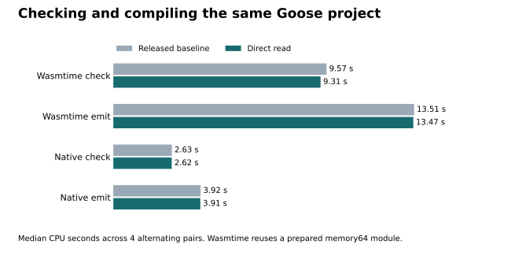

# Reusing lifetime reads during compiler self-check

On the same frozen project, reusing a previously checked read changed Wasmtime self-check CPU time from **9.57 to 9.31 s** and Wasm emission from **13.51 to 13.47 s**. Native checking went from **2.63 to 2.62 s** and emission from **3.92 to 3.91 s**. These are medians from four alternating pairs after qualification. Wasmtime’s self-check went from 3.64× to 3.55× native CPU time. Its emission stayed near 3.45×. [Every sample](confirmation.json)



| Work on the frozen project | CPU seconds, before → after | Guest or process wall seconds, before → after | Instructions, change |
| --- | ---: | ---: | ---: |
| Wasmtime self-check | 9.57 → 9.31 | 9.71 → 9.44 | -1.73% |
| Wasmtime Wasm emission | 13.51 → 13.47 | 13.70 → 13.68 | -1.11% |
| Native self-check | 2.63 → 2.62 | 2.67 → 2.67 | -0.90% |
| Native Wasm emission | 3.92 → 3.91 | 3.99 → 3.97 | -0.57% |

The previous checker built an effect record and repeated its type test each time it replayed a compact lifetime read. The new checker uses the stored leaf, its key and its affected storage directly. It takes that path only in discovery on an unmapped call with frozen types. A read inside a place expression is still suppressed, and recursive propagation still determines whether a read can be marked as sent. Validation and class-mapped replay use their existing paths. The [earlier CPU profile](../lifetime-read-misses/README.md) put the entire construct, dispatch and stamp step at 202 ms per self-check on the released compiler.

## Measurement

Both compilers checked and emitted the sources at `90e086f` on CPU 7 of a shared Ryzen 7 3800X. The candidate source is `2e42394`. The same verified emitter built both native compilers with eight C units and Clang 23.1.5 at `-O2`, and both memory64 modules with direct `-O2` code generation. Wasmtime 50.0.1 reused a prepared module and started a fresh instance per invocation. CPU includes instantiation and surrounding host work. Wasmtime wall time covers guest entry, and native wall time covers the compiler process. Each of the 16 timed emissions, across both compiler versions and hosts in the final trial, reproduced the same 24,508,740-byte module.

Two screening pairs ran during other work. A second shared run overlapped qualifications and produced a 41.68 s baseline Wasmtime self-check. Timing collection was stopped mid-round there. The four pairs in the table ran after qualification, with no other project benchmark running. The machine remained shared throughout. [Screening](screen.json) · [Interrupted shared run](shared.json)

## Build and program execution

The current compiler was also built and run on its own `2e42394` sources. Each of three builds produced the same compiler artifacts within the series. Native, Wasmtime and V8 each checked the project and reproduced the compiler module. The independent 11-program comparison validates emitted program output. Both compilers emitted identical C and Wasm for every program in that comparison. [Own-source builds and runs](selfhost.json) · [Compiler catalog](compiler-comparison.json) · [Catalog CPU ratios and artifact checks](catalog-summary.json)

Ten examples ran with fresh compile and process timings. All 30 Mandelbrot builds matched the artifacts behind the published resident runtime chart and used the same engines. That chart retains its original seven-sample execution measurement. [Examples](examples.json) · [Wasmtime hosts](host.json) · [Mandelbrot builds](langbench-build.json) · [Resident artifact checks](langbench-artifacts.json)

## Correctness

The two checkers agreed on **11,596 lifetime-state fingerprints across 4,357 sources**, all seven pass boundaries of the frozen compiler self-check, the 96-exit fixture with the class-frame threshold reduced to 64, and the diagnostic for a stored reference escaping its lifetime. The verified bootstrap reached a fixed point. The qualification suite compared 10,057 compiler outputs without a difference and reproduced the known conformance gaps. A separate test-fixture change creates the worktree’s scratch directory before allocating temporary files. [Fingerprint and output checks](state.json) · [Qualification](qualification.json)

## Reproduction

Build the released and candidate compiler stages with the [self-host comparison tool](../../../selfhost_comparison.py) and the same emitter. Run the [paired benchmark](../lifetime-read-groups/tools/confirm.py) on both stages. The first stage supplies the input project for every sample.

```sh
.venv/bin/python bench/selfhost_comparison.py build build/released --commit 90e086f --emitter build/bin/goose --rounds 1 --cc clang-23 --jobs 8 --build-cpus 0,2,3,5,6 --cpu 7
.venv/bin/python bench/selfhost_comparison.py build build/direct-read --commit 2e42394 --emitter build/bin/goose --rounds 1 --cc clang-23 --jobs 8 --build-cpus 0,2,3,5,6 --cpu 7
.venv/bin/python bench/results/2026-11-18/lifetime-read-groups/tools/confirm.py build/released build/direct-read build/direct-read-comparison.json --rounds 4 --cpu 7
```

For byte-for-byte rebuilds, supply the emitter with SHA-256 `659a76c4c8064ae0989fb66600ae161b680a17c81b935e51fae9fcd4f905c2c0`, recorded in the [own-source build manifest](selfhost.json). The dated receipts include source, compiler, engine, workload and artifact identities. Regenerate the [comparison chart](chart.py) with the repository Python environment.
