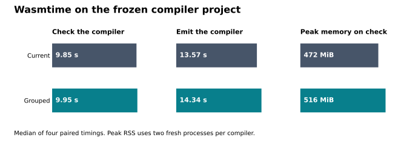
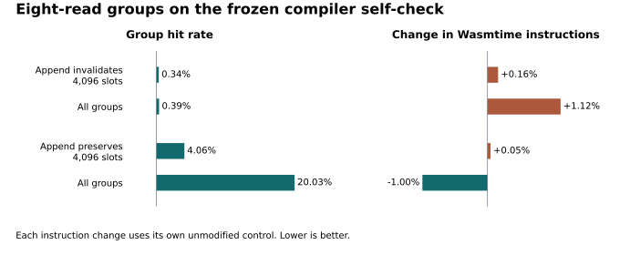

# Checking lifetime reads eight at a time

The current checker was faster and used less memory. In a four-pair confirmation, the most reusable eight-read cache took **9.95 s versus 9.85 s** to check the compiler in Wasmtime and **14.34 s versus 13.57 s** to emit it. Peak Wasmtime RSS rose from **472 to 516 MiB**. The four variants are preserved here as experiments.

Each experimental checker groups up to eight consecutive compact reads during discovery. The released checker already skips individual reads that have been offered to the active frame chain, and skips all reads of a summary on a whole-chain hit. The experiment targeted the reads left between those two cases. [Prior visit counts](../compiler-iteration-tools/REPLAY.md)

## What can be reused

| Cache | When a previous group becomes stale | Lookups | Hits | Reads skipped in groups |
| --- | --- | ---: | ---: | ---: |
| 4,096 slots | A read is appended or changed | 1,037,998 | 3,560 (0.34%) | 28,480 |
| All certified groups | A read is appended or changed | 1,037,998 | 4,051 (0.39%) | 32,408 |
| 4,096 slots | An existing leaf changes | 1,037,998 | 42,127 (4.06%) | 337,016 |
| All certified groups | An existing leaf changes | 1,038,037 | 207,892 (20.03%) | 1,663,136 |

The earlier 58.55% figure counted individual visits within long runs of stamped reads on a different frozen project. A group hit here requires eight ordered reads previously certified together in the same destination chain and recursion epoch. The final version can also reuse that certificate across later appends. It still missed 719,695 lookups for lack of a matching entry and 110,450 because the source frame's recorded leaf version changed. It retained 421,435 certificates in 1,048,576 slots. The native and V8 counting probes agreed on all ten counters for the 4,096-slot append-invalidated version. [Operation counts](counts.json)

### Whole-project measurements

| Trial | Wasmtime check, before → after | Wasmtime emit, before → after | Instruction change, check / emit |
| --- | ---: | ---: | ---: |
| 4,096 slots, invalidate on append | 8.77 → 9.32 s | 13.14 → 13.36 s | +0.16% / +0.11% |
| All groups, invalidate on append | 9.58 → 11.07 s | 16.19 → 15.38 s | +1.12% / +0.73% |
| 4,096 slots, preserve on append | 13.64 → 15.63 s | 16.65 → 17.26 s | +0.05% / +0.04% |
| All groups, preserve on append | 14.04 → 15.59 s | 16.26 → 17.51 s | -1.00% / -0.64% |

The version that preserved all groups across appends was the only one to reduce instructions for both workloads. In the independent confirmation on CPU 7, Wasmtime self-check CPU time rose from 9.77 s to 9.87 s and emission CPU time rose from 13.46 s to 14.21 s. These CPU clocks cover the hosted invocation including instantiation. The wall-time bars measure guest execution after instantiation. On the self-check its process used 43.8 MiB more peak RSS in Wasmtime and 38.5 MiB more as a native compiler. Each RSS observation ran in a fresh Linux process with the same frozen input. [Four paired rounds](confirmation.json) · [Peak memory](memory.json)

## Method

The workload is the frozen compiler source at `90e086f`. The control uses the same compiler sources and binary as the previous README comparison. Every experimental compiler starts from `bfc0aa5`, whose compiler sources are identical to `90e086f`, and is built by the same verified emitter. Native uses eight C units with Clang 23.1.5 at `-O2`. Wasmtime 50.0.1 reuses a prepared memory64 module and times the guest entry point in a fresh instance. The hardware counters include the surrounding invocation. Each of the four trials makes three paired runs of both self-check and emission, alternating compiler order. Trials ran on a shared workstation. Compare each candidate with the native and Wasmtime controls in its own trial. [Per-run timings, instructions and pins](samples.json)

The compact read list only grows at its end. Each certificate records the last member and the destination chain, including the recursion epoch. A hit checks the next intervening effect before following the last member's live successor. The first two versions invalidate a frame's groups when any read is appended or changes. The other two invalidate only when an existing leaf identity changes. Class-mapped calls and validation keep the released replay path. Individual reads on a group miss follow the original order.

## Correctness

All four variants matched the control's diagnostics, exit status and **11,596 lifetime-state fingerprints across 4,357 corpus sources**. Each reproduced all seven self-check fingerprints through validation, rejected the held-out escaping reference with the same diagnostic, and emitted the same frozen Wasm module in native and Wasmtime. The first variant also matched all 10,057 standard compiler-output comparisons and the 96-exit fixture with the class-frame threshold reduced to 64. [State comparison and probe identities](state.json) · [Negative case](negative.json)

## Reproduction

From the temporary checkout, apply the patches with `patch -p1 < PATCH`. Apply [the group patch](tools/group-eight.patch) to a temporary checkout of `bfc0aa5`. For the all-groups table, also apply [the retention patch](tools/retain-groups.patch). For the leaf-change versions, apply the final patch for the [bounded](tools/leaf-version-bounded.patch) or [retained](tools/leaf-version-retained.patch) table. Commit each temporary variant so the build harness can archive it. Use the same emitter for all builds.

Build stages with `bench/selfhost_comparison.py build STAGE --commit REV --emitter EMITTER --cc clang-23 --rounds 1 --build-cpus 0,2,3,5,6 --cpu 7 --jobs 8`. Use `90e086f` for the control. The [paired runner](../compiler-iteration-tools/tools/slots.py) accepts `BASELINE_STAGE CANDIDATE_STAGE OUTPUT --cpu N --rounds 3`. Apply [the counting instrumentation](tools/count_groups.py) only to a separate diagnostic build. Execute that compiler on the same control stage's frozen project with `selfhost/main.goose --stdlib stdlib --check`. For the state comparison, use the [logical fingerprint helper](../../2026-11-17/lifetime-compact-reads/tools/logicalfp.py) and [ordered exit extension](../lifetime-exit-index/tools/exitfp.py) on separate source copies of both compilers.

For the confirmation, run [the CPU-timed wrapper](tools/confirm.py) with the paired runner’s arguments and `--rounds 4`. Run [the peak-memory comparison](tools/memory.py) with the same two stages, an output file and `--cpu N`.
