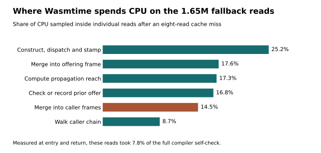

# Where the individual lifetime reads spend CPU

The eight-read cache fell back to 1,652,615 individual reads while checking the compiler. In six Wasmtime self-checks, merging into caller frames took **96 ms per check**, or **14.5% of the CPU inside those reads**. The largest share was constructing, dispatching and stamping reads at **166 ms (25.2%)**. [Sampled times](summary.json)



| CPU inside individual reads, mean ms per self-check | Eight-read experiment | Released checker |
| --- | ---: | ---: |
| Construct, dispatch and stamp | 166 | 202 |
| Compute how far the read propagates | 114 | 147 |
| Check or record that this read was already offered | 111 | 139 |
| Walk the caller chain | 57 | 68 |
| Merge into the offering frame | 116 | 112 |
| Merge into caller frames | 96 | 95 |
| **Total** | **661** | **763** |

The grouped and released columns cover different numbers of reads. The grouped column begins after both group and leaf checks have missed. The released column covers the comparable compact discovery path for eligible chains with at least eight reads in the source frame. It ran 2,088,538 individual reads. Group cache bookkeeping is outside both columns. In the separate end-to-end comparison, the released checker was faster. [Paired CPU samples](phases.json) · [End-to-end measurements](../lifetime-read-groups/README.md)

## What the merges did

| Exact events during the scoped reads | Eight-read experiment | Released checker |
| --- | ---: | ---: |
| Compact offers that stopped at the offering frame’s sent check | 808,503 | 1,227,997 |
| Merges into caller frames | 1,034,779 | 1,075,015 |
| New caller entries | 250,209 | 250,209 |
| Existing caller entries | 784,570 | 824,806 |
| Existing entries that needed a set union | 8,117 | 8,115 |
| Existing entries whose sets actually changed | 635 | 635 |

About 39 ms of the grouped caller-merge cost went to finding the entry and checking the walk state, 39 ms to inserting a new entry, 13 ms to testing an existing entry, and 4 ms to joining sets and recording the result. An unchanged set can still require updating propagation bookkeeping. Native and Wasmtime produced identical counts for each checker. All six Wasm probes emitted the same 24,508,740-byte compiler as the unmodified control. [Counts and artifact hashes](verification.json)

The follow-up passed the known read directly through discovery replay and measured the whole compiler on the same frozen project. [Implementation and paired results](../known-read-replay/README.md)

## Measurement and reproduction

The frozen project and released checker use `90e086f`. The grouped checker uses the retained, leaf-versioned variant `71f4565` from the [eight-read experiment](../lifetime-read-groups/README.md#reproduction). The probe clones four functions into scratch builds to isolate the selected calls from other users of the same functions. It leaves the group lookup and the surrounding replay loop outside the sampled region. On the released path the source loads node and value before the call boundary. The grouped path evaluates those arguments inside it. [Instrumentation](tools/instrument.py)

Wasmtime 50.0.1 ran prepared memory64 modules on CPU 7 of a shared Ryzen 7 3800X. Each check used a fresh instance. A Linux thread CPU timer sampled one byte in guest memory during lifetime analysis. Six pairs alternated checker order and rotated the interval through 1.0, 1.3 and 1.7 ms. Each run’s bin counts were converted to milliseconds using its own lifetime CPU window and total delivered samples, then averaged. Estimates include instrumentation and signal handling. Event counts came from separate builds. [Sampler](tools/sampler.c) · [Host](tools/profile.py) · [Raw counts](counts.json)

Four more pairs sampled only entry and return for each read. The experiment’s fallback calls averaged **684 ms (7.8% of the full self-check CPU)**, ranging from 666 to 718 ms, compared with 661 ms using detailed markers. The released checker’s selected calls averaged **764 ms (8.7%)**, compared with 763 ms using detailed markers. These scopes exclude Wasmtime compilation. The detailed and boundary-only estimates put the whole grouped fallback path within 0.2 percentage points of the same share of self-check CPU. [Boundary-only control](outer.json)

From the repository root, set `FROZEN` to the released build stage from `bench/selfhost_comparison.py build` and `GROUPED` to the reconstructed grouped build stage from the earlier experiment. Each stage supplies a frozen source directory and build manifest. Use the emitter recorded in the released manifest. The commands below use a fresh output directory and a Linux host with Clang 23 and the project’s Wasmtime Python environment.

```bash
repo=$PWD
tools=$repo/bench/results/2026-11-18/lifetime-read-misses/tools
stage=$repo/build/read-misses-repro
mkdir "$stage"
cc -O2 -shared -fPIC "$tools/sampler.c" -o "$stage/sampler.so" -lrt
for label in grouped released; do
    src=$FROZEN/source
    if [[ $label == grouped ]]; then src=$GROUPED/source; fi
    for mode in counts phases outer; do
        bash "$tools/build.sh" "$src" "$mode" "$stage/$label-$mode" "$FROZEN/emitter"
        (cd "$FROZEN/source" && "$repo/.venv/bin/python" "$repo/scripts/run_wasmtime.py" \
            "$stage/$label-$mode/probe.wasm" -- selfhost/main.goose --stdlib stdlib \
            --target wasm-direct -O2 --wasm-memory64 --wasm-max-pages 262144 \
            -o "$stage/$label-$mode/emitted.wasm")
    done
    (cd "$FROZEN/source" && ulimit -s 262144 && "$stage/$label-counts/probe-native" \
        selfhost/main.goose --stdlib stdlib --check) > "$stage/$label-counts/native.out"
done
"$repo/.venv/bin/python" "$tools/profile.py" "$stage" "$FROZEN" --mode counts --rounds 1 --cpu 5
"$repo/.venv/bin/python" "$tools/profile.py" "$stage" "$FROZEN" --mode phases --rounds 6 --cpu 7
"$repo/.venv/bin/python" "$tools/profile.py" "$stage" "$FROZEN" --mode outer --rounds 4 --cpu 7
"$repo/.venv/bin/python" "$tools/verify.py" "$stage" "$FROZEN" "$GROUPED"
"$repo/.venv/bin/python" "$tools/summarize.py" "$stage"
```

[Chart and summary generator](tools/summarize.py)
