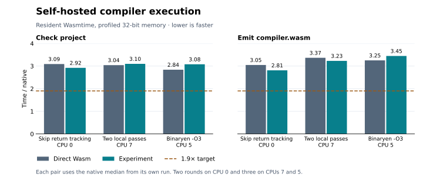

# Bringing self-hosted execution below 2× native

The compiler at `ba9dece` runs on the frozen compiler project at `f89ecf3`. The native control uses this compiler's C backend and Clang 23.1.5 at `-O2`. Wasmtime 50.0.1 runs a prepared memory32 module with region sizes profiled on this project. Each Wasm timer covers the guest entry point in a fresh instance. The README's main self-hosting chart uses memory64 and a different project snapshot. [Baseline and build recipe](../lifetime-exit-index/README.md)

| Workload | Native | Wasmtime | Wasmtime/native | Time at 1.9× native | Wasm time to remove |
| --- | ---: | ---: | ---: | ---: | ---: |
| Check | 3.48 s | 10.86 s | 3.12× | 6.62 s | 39% |
| Emit Wasm | 4.89 s | 15.88 s | 3.25× | 9.29 s | 41% |

These targets hold the native medians fixed. A change to a shared compiler algorithm can speed up both sides. The paired instruction counts give a second measure on the shared host. Checking takes 71.07 billion instructions in Wasmtime and 25.46 billion native. Emission takes 117.32 billion and 41.62 billion. [Paired counters](../lifetime-exit-index/matched.json)

## Three experiments on the same compiler

| Change to the compiler module | Self-check, direct → candidate | Emit, direct → candidate | Change in retired instructions, check / emit |
| --- | ---: | ---: | ---: |
| Skip unused nonlocal-return tracking | 8.90 → 8.42 s | 14.53 → 13.40 s | −5.37% / −5.08% |
| Binaryen local simplification and instruction optimization | 8.67 → 8.84 s | 14.91 → 14.30 s | −0.83% / −0.78% |
| Binaryen whole-module `-O3` | 8.27 → 8.97 s | 14.62 → 15.49 s | −0.36% / −1.45% |



Each experiment interleaved native, direct Wasm and the candidate on a single core of the shared host. All 24 self-emissions across the three trials reproduced the frozen artifact. The return-tracking probe won both orders on both workloads. It scans for nonlocal return targets and skips their mailboxes, checks and frame links when the set is empty. Its code section shrank by 183,306 bytes. Two programs that use nonlocal returns retained byte-identical modules. The probe has whole-project evidence for this workload and awaits release qualification. [Return-tracking samples](no-return-targets.json) · [Scratch patch](no-return-targets.patch) · [Fixture hashes](controls.json)

Binaryen's two local passes took 20.9 s to process the module on one CPU. The full optimization took 568 s on three CPUs and shrank the module by 28.9%. Its check and emission wall medians rose by 8.4% and 6.0% respectively. The build times are single observations under shared load and exclude the import conversion described below. [Local-pass samples](local-passes.json) · [Whole-module samples](O3.json) · [Binaryen optimizer](https://github.com/WebAssembly/binaryen#binaryen-optimizations)

The return-tracking prototype reached 2.92× native for checking and 2.81× for emission. On its matched native medians, 1.9× would require cutting a further 35% and 32% from the prototype's Wasm times. This gives the next backend change a concrete target.

## Where the guest spends time

We appended function names to the measured memory32 module. The original 26,857,208 bytes are identical, including the entire code section. Linux sampled the Wasmtime worker's instruction pointer every 2 ms of CPU time on CPU 7. One full check and one full emission finished with zero lost samples. Emission reproduced the frozen target byte for byte. Percentages are exclusive samples relative to each whole run. [Function counts](profile.json) · [Sampler](tools/profile.py)

| Sampled functions | Self-check, 4,560 samples | Self-emission, 6,908 samples |
| --- | ---: | ---: |
| Lifetime analysis (`life_*`) | 82.5% | 52.7% |
| Wasm writer (`wb_*`) | 0% | 11.8% |
| Wasm code generation (`cg_*`) | 0% | 12.7% |
| Outside mapped functions | 5.5% | 6.8% |

The hottest single function in checking was `life_replay` (5.9%). In emission it was `wb_reuse_locals` (8.3%). The latter decodes each function into an array of instruction records, assigns local slots and re-encodes the body. Tracking local accesses and block boundaries as the emitter writes them could avoid decoding instructions it just produced. The existing replay can check local tables and encoded bytes across 1,539 frozen bodies. [Writer](../../../../selfhost/wasm.goose#L192) · [Replay](../../2026-11-17/wasm-slot-prefix/README.md)

## Direct backend experiments to prioritize

1. Promote eligible scalar parameters and variables to typed Wasm locals inside compound programs. Currently a module-wide test disables promotion when it encounters references or compound types. Start with uncaptured variables whose addresses are never used, including implicit references. The three-line `life_in_scope` parent walk currently has 234 static Wasm instructions, including 15 global reads and 15 global writes. Those counts include cold paths. Use its loop as a disassembly check and use both whole-project workloads for the performance decision. [Parent walk](../../../../selfhost/checker_lifetimes.goose#L2197) · [Slot allocation](../../../../selfhost/codegen.goose#L3310) · [Module test](../../../../selfhost/codegen.goose#L3797)
2. Make call and region bookkeeping depend on the work a function can do. Check reachable nonlocal returns before creating return mailboxes. Check whether a block can allocate or publish region storage before saving and restoring its watermark. Preserve indirect calls, deferred cleanup and escaping references in the corresponding tests. [Return-target analysis](../../../../selfhost/codegen.goose#L1416) · [Function prelude](../../../../selfhost/codegen.goose#L3345)
3. Pass a private record snapshot through an internal call once. The caller already snapshots a fixed by-value record before evaluating later arguments. The callee can consume that snapshot when it has a single owner and needs no address repair. Start with fixed records without owned or self-relative fields. Test later arguments that mutate the original and callees that modify their local copy. [Caller](../../../../selfhost/codegen.goose#L955) · [Callee](../../../../selfhost/codegen.goose#L3380)

Measure each change against current native and Wasmtime on the same sources. Recheck the default memory64 build and the examples, then combine the wins and measure again. For the memory32 results to represent ordinary builds, the region layout also needs to fit held-out projects without a workload-specific profile.

## LLVM control

The native C generator requires eight-byte pointers. The local Zig WASI libc supports wasm32. Emscripten 6.0.13 parses the emitted compiler C as memory64, but a runtime smoke imports 64-bit WASI pointers where Wasmtime 50.0.1's Preview 1 host expects 32-bit pointers. A second smoke also shows Emscripten's `mprotect(PROT_NONE)` reporting success while the page remains readable. The native runtime uses protected regions. A whole-compiler C-to-Wasm comparison needs a region allocator and I/O adapter that preserve those contracts. There is no measured LLVM runtime ratio for this compiler. [C layout](../../../../selfhost/codegen_c.goose#L3823) · [Guard probe](tools/guard-smoke.c) · [Results](llvm-control.txt)

## Reproducing the profile

Use the frozen trees and artifacts from the [matched run](../lifetime-exit-index/README.md#replay). Build the following diagnostic emitter from a copy of the `ba9dece` compiler sources with one edit in `selfhost/codegen.goose`. In the code that emits the `name` custom section, replace `else if p.debug {` immediately before `var name_count` with `else {`. This adds names with release arithmetic and layout. Run from the repository root with the pinned Python/Wasmtime environment.

```sh
repo=$PWD
probe=$repo/build/one-x-binaryen
chart=$repo/build/lifetime-exit-index-2026-11-18/selfhost-chart
profile=$repo/bench/results/2026-11-18/lifetime-exit-index/regions.txt

(cd "$probe/name-emitter" &&
  "$chart/emitter" selfhost/main.goose --stdlib stdlib --target wasm-direct -O2 \
    --wasm-memory64 --wasm-max-pages 262144 -o "$probe/name-emitter.wasm")
(cd "$chart/source" &&
  python "$repo/scripts/run_wasmtime.py" "$probe/name-emitter.wasm" -- \
    selfhost/main.goose --stdlib stdlib --target wasm-direct -O2 \
    --wasm-max-pages 65535 --wasm-region-profile "$profile" -o "$probe/named32.wasm")
python bench/results/2026-11-18/selfhost-runtime-target/tools/profile.py
llvm-objdump --no-show-raw-insn --disassemble-symbols=life_in_scope "$probe/named32.wasm"
```

## Reproducing the candidate modules

The no-return-targets probe changes the emitter. Apply the [patch](no-return-targets.patch) to a scratch `ba9dece` checkout, build that emitter, then use it to compile the **original, unmodified** `ba9dece` compiler sources with the same profiled memory32 flags. The candidate compiler and the direct control both run the frozen `f89ecf3` project. Pass the candidate to the [timing harness](tools/trial.py) for a three-round replay. The published return probe used two opposite-order rounds on CPU 0. [Module and fixture hashes](controls.json)

Binaryen 133 processed the original direct module. Its all-features output used compact imports, which the pinned Wasmtime configuration rejected. For timing, we re-encoded just the import section using ordinary Wasm imports and retained **every other section byte**, including all optimized code. From the repository root:

```sh
direct=$repo/build/lifetime-exit-index-2026-11-18/candidate32.wasm
tools=$repo/bench/results/2026-11-18/selfhost-runtime-target/tools
BINARYEN_CORES=1 taskset -c 7 wasm-opt --enable-bulk-memory --enable-sign-ext --enable-multivalue \
  --enable-nontrapping-float-to-int --enable-simd --enable-tail-call \
  --simplify-locals --optimize-instructions "$direct" -o "$probe/local-passes.wasm"
python "$tools/trial.py" --cpu 7 --label local-passes --module "$probe/local-passes.wasm"

export BINARYEN_CORES=3
taskset -c 1,2,4 wasm-opt --all-features -O3 "$direct" -o "$probe/compiler-opt.wasm"
taskset -c 1,2,4 wasm-opt --all-features -S "$probe/compiler-opt.wasm" -o "$probe/compiler-opt.wat"
taskset -c 1,2,4 wasm-opt --all-features --disable-compact-imports \
  "$probe/compiler-opt.wat" -o "$probe/compiler-standard.wasm"
python "$tools/expand_imports.py" "$probe/compiler-opt.wasm" "$probe/compiler-standard.wasm" "$probe/compiler-O3.wasm"
python "$tools/trial.py" --cpu 5 --label O3 --module "$probe/compiler-O3.wasm"
```
