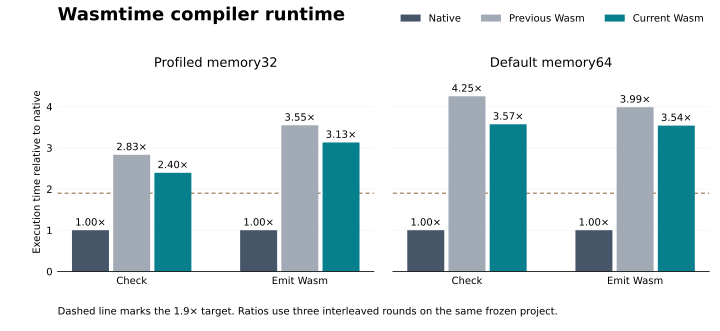
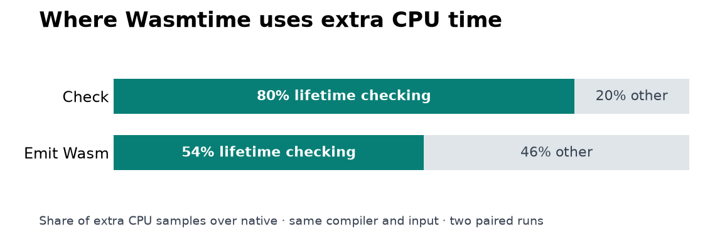

# Wasm lowering on the self-hosted compiler · 2026-11-18

The three changes keep scalars in Wasm locals when their addresses cannot be observed, remove unused nonlocal-return and region bookkeeping, and let private callees use the record snapshot their caller already made. The frozen compiler workload still needs 21% less checking time and 39% less emission time to reach 1.9× native in profiled memory32. [Compiler source](../../../../selfhost/codegen.goose)

| Compiler module | Workload | Native | Wasmtime before → after | Relative to native | Wasmtime instructions |
| --- | --- | ---: | ---: | ---: | ---: |
| Profiled memory32 | Check | 4.31 s | 12.20 → 10.32 s | 2.83× → **2.40×** | 71.06 → 60.81 B |
| Profiled memory32 | Emit Wasm | 4.40 s | 15.62 → 13.79 s | 3.55× → **3.13×** | 117.32 → 101.54 B |
| Default memory64 | Check | 2.93 s | 12.48 → 10.48 s | 4.25× → **3.57×** | 89.40 → 75.26 B |
| Default memory64 | Emit Wasm | 4.27 s | 17.03 → 15.13 s | 3.99× → **3.54×** | 143.34 → 122.12 B |

Each row uses three interleaved measurements of the same compiler program (`ba9dece`) working on the same source tree (`f89ecf3`). Only the backend used to build that Wasm compiler changes. Native uses the C backend and Clang 23.1.5 at `-O2`. Wasmtime 50.0.1 reuses a prepared module and times the entry point of each fresh instance. The hardware counter also covers the surrounding host invocation. Memory32 uses a region profile for this project on CPU 5. Memory64 uses the standard layout on CPU 0. Each ratio uses its own native control on the same CPU. Shared load varied over the run. Every emission reproduced the frozen module byte for byte. [Memory32 samples](lowering-samples.json) · [Memory64 samples](wide-samples.json) · [Release module identities](release-modules.json)

## What each change contributed

| Change in isolation | Check instructions | Emit instructions |
| --- | ---: | ---: |
| Skip unused nonlocal returns | -5.37% | -5.09% |
| Skip unused region restores | -2.54% | -2.64% |
| Keep eligible scalars in Wasm locals | -6.43% | -5.69% |
| Use one private record snapshot | -0.94% | -0.57% |
| All changes together | -14.44% | -13.45% |

Two rounds on CPU 5 ran every variant in opposite orders. Instruction deltas compare the same rounds of the direct control. The four individual rows split the bookkeeping change into its return and region parts. [Samples](lowering-samples.json)

The lifetime checker's parent walk (`life_in_scope`) went from 234 to 147 static Wasm instructions. Memory loads fell from eleven to three and stores from seven to one. In a separate loop with two million calls passing a 128-byte record, the record change alone reduced the median from 29.98 to 22.44 ms across seven pairs. Upstream Goose and both Wasm modules printed the same total and left the original record unchanged. [Disassembly counts](parent-walk.json) · [Record loop](tools/record-loop.goose) · [Samples](record-loop.json)

## Where the gap remains

Lifetime analysis accounted for **80% of Wasmtime’s extra sampled CPU time during self-check and 54% during Wasm emission**. The first experiment to try is counting how many entries the lifetime checker revisits in `life_replay` and how many of those visits produce a new effect. [Lifetime replay](../../../../selfhost/checker_lifetimes.goose#L5664)

Details

Two runs per engine on CPU 7 used the native executable, profiled memory32 compiler, and frozen input identified above. Engine order reversed for the second pair. Linux sampled user-mode task CPU time every 2 ms. For each workload, the bars divide the extra samples in lifetime functions by the extra samples across the entire invocation, pooling both pairs. Lifetime shares were 79–80% for checking and 50–57% for emission across the individual pairs. Shared host load varied. All four emissions reproduced the expected Wasm.

Wasmtime reused a prepared module with an appended function-name section. The original and current compiler modules have identical type, import, function, export and element sections. The sampler resolved instruction pointers against Wasmtime’s perf map. Native used the same task-clock event attached to the child before `exec`, resolving its instruction pointers through the relocated ELF symbols and the exact native build’s function-name table. These are exclusive samples. Inlining can shift attribution to a caller. Unmapped samples count toward the total. [Raw counts and fingerprints](profile-gap.json) · [Wasm sampler](../selfhost-runtime-target/tools/profile.py)

## Correctness and reader benchmarks

The release reached its C bootstrap fixed point. The default suite passed 10,693 of 10,797 rows and memory64 passed 4,769 of 4,777, exactly matching the recorded gaps. On the first run the unoptimized native standard-library sort exceeded its 15-second limit under load. The full default replay used a 45-second limit. All 54 native checks passed. The unit runner ran 80 tests with one optional skip. The new callback, capture and defer case also passed at both optimization levels in V8 on both memory widths. Plain upstream `ee261a4` supplied its expected output. [Qualification](qualification.json) · [First run](qualification.log) · [Regression case](../../../../tests/fixtures/nested_initializer.goose)

Across 10,057 compiler-output comparisons, 1,348 existing modules changed only in the Wasm code section. The new regression case is the one diagnostic change. The old compiler failed to assign storage for its nested capture. The new compiler emits and runs it. All native C, type-check outputs and other diagnostics matched. [Section audit](equivalence-audit.json)

The README self-hosting chart times the release on its own sources at `065aff3` with memory64. Both pinned upstream native compilers reported 31 lifetime errors on those sources. Its native control uses the release's C backend. The eleven-program compiler comparison has 31 samples per cell. All ten example programs have fresh cold-build, process and preparation results. The direct Mandelbrot module changed, so we reran the resident benchmark. All 30 current builds match the programs used in that run. [Self-hosting](measurements.json) · [Upstream attempts](upstream-native.json) · [Compiler catalog](compiler-comparison.json) · [Examples](examples.json) · [Wasmtime host](host.json) · [Mandelbrot builds](langbench-build.json) · [Resident times](langbench-hot.json) · [Toolchain pins](pins.json)

## Replay

Start with the frozen [source, native executable and original Wasm modules](../lifetime-exit-index/README.md#replay). Build the new emitter from `065aff3` with `scripts/bootstrap.py --verify`. Run it from the original `ba9dece` source tree with the arguments in [release-modules.json](release-modules.json). The emitted compiler must match each recorded SHA-256. For the individual variants, apply one of the [return](tools/effects.patch), [region](tools/regions.patch), [scalar](tools/scalars.patch) or [record](tools/records.patch) patches to a separate `ba9dece` emitter checkout, then have that emitter compile the unchanged `ba9dece` sources with the same memory32 arguments.

In `build/wasm-lowering-1118` place the five memory32 variants at `{effects,regions,scalars,records,combined}/compiler.wasm` and the current memory64 module at `release64.wasm`. Run the [timing harness](tools/trial.py) with `--cpu 5` and separately with `--wide --cpu 0`. The [chart renderer](tools/chart.py) reads the two sample files beside this report. To replay the record loop, compile the supplied source with the original and record-only emitters at `-O2 --target wasm-direct`, save the modules as `record-loop-direct.wasm` and `record-loop-records.wasm` beside a copy of `record-loop.goose` in that build directory, then run the [loop harness](tools/record_trial.py).
