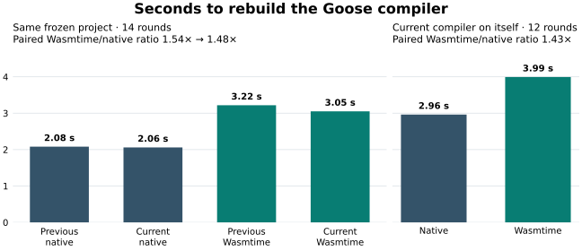
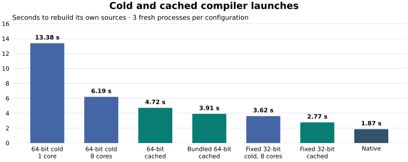

# Array-header forwarding in the bundled compiler

The bundled 32-bit compiler rebuilt its own sources in **3.99 s in Wasmtime** and **2.96 s native**. The median same-round ratio was **1.43× native time** across 12 rounds. [Self-rebuild samples](current.json)

## The same project before and after

Each compiler processed the sources at `34ddff8` and emitted the same **8,886,107-byte** memory64 module. The table shows medians from 14 alternating rounds on CPU 7 of a shared Ryzen 7 3800X. Each Wasmtime invocation started a fresh process with precompiled code. [All four cases](frozen.json)

| Frozen project | Previous native | Current native | Previous Wasmtime | Current Wasmtime |
| --- | ---: | ---: | ---: | ---: |
| Wall time | 2.081 s | 2.060 s | 3.219 s | 3.051 s |
| Process CPU time | 2.067 s | 2.049 s | 3.202 s | 3.036 s |
| Retired instructions | 17.769 B | 17.770 B | 27.481 B | 26.094 B |

The paired Wasmtime wall time fell by 4.0%, with 12 wins in 14 pairs. The two series started in opposite orders and changed by -3.4% and -4.2%. The same-round Wasmtime/native ratio went from 1.54× to 1.48×. Running the same candidate twice per round gave a median wall-time difference of +2.3% across five control pairs. [Series and identical-binary control](series.json.gz)

The bundled Wasm shrank from 7,458,550 to 7,244,971 bytes (-2.9%). Its Wasmtime cache image shrank from 13,746,152 to 12,862,400 bytes (-6.4%). Both source versions were built with the same Clang 23.1.5 native toolchain, Wasmtime 50.0.1 and pinned Goose source emitter. Each fixed memory32 layout was trained on squares, sorting and tour. [Tool and artifact hashes](verification.json) · [Sizing profile](training.profile)

## Cold and cached self-compilation

On the same frozen project, a one-core build starting with an empty Wasmtime cache took 8.27 s before and 7.89 s after. Its paired wall time fell by 4.6% in six opposite-order pairs. Wasmtime's compilation and instantiation timer went from 5.37 s to 5.17 s. [Cold pairs](cold.json)

The launch chart measures the current compiler building its own sources after the other benchmark suites finished. An earlier run overlapped bootstrap and the example suite. Its first one-core cold launch took 117 s. The entire launch matrix was repeated in sequence. [Concurrent run](launch-concurrent.json.gz)

The chart shows the sequential run. Each bar covers three fresh processes. Cold runs compile the module, and cached runs load a precompiled image. The launch report also includes separate phase and source-edit runs. [Launch samples](launch.json)

## What changed

When a Goose function builds an array in stages, it can register a destination that needs updates while construction is in progress. The bundled compiler itself never registers one, yet the previous generated compiler called the forwarding helper 32 million times on a frozen rebuild. After emitting all bodies, the backend can see whether a destination was ever registered. For eligible modules with none it removes the helper calls, their operands and saved list heads. Each function is lowered once. A program that registers even one destination keeps the original code. [Prior call counts](../construct-read-demand/README.md#remaining-time) · [Independent byte audit](audit.json) · [Mapping controls](controls.json.gz)

## Alternatives and qualification

An early design assumed the list was empty and restarted emission when it found a registration. On a 512-function program whose only registration was in its global initializer, that cost **54.0%** more retired native compiler instructions. With the shipped single-lowering pass, bundled emission took 0.002% more native compiler instructions than default emission on that input. The same-size program without any mappings used 6.3% more compiler instructions in bundled mode to scan and shorten the emitted code. [Generated sources, controls and counters](controls.json.gz)

On the frozen compiler, replacing the forwarding helper with an empty function saved 2.4% of retired instructions, leaving the calls in place. Splitting it into a short caller and a tail-called slow path saved 1.5%. Enabling Wasmtime's general inliner saved 2.5% but grew the prepared image by 36% and changed diagnostic stack traces. A separate experiment packing lifetime hash keys reduced instructions by 0.9% on the previous compiler and remains outside this release. These were separate prototype screens. [Experiments and rejected alternatives](experiments.json.gz)

An independent Wasm decoder reconstructed the entire shipped module from the previous compiler’s output on identical sources. It accounted for 12,407 forwarding calls, 25,674 saves and 8,604 restores. Every byte outside the code section matched. [Byte audit](audit.json) · [Verifier](tools/audit-publication.sh)

The previous compiler and the release compiler produced **zero differences across 10,057 default output comparisons**. The default suite retained its 104 known gaps in 10,797 rows. The memory64 suite and both bundled widths each retained eight known gaps in 4,777 rows. The focused controls cover live header writes, registration in a global initializer, libraries, custom imports, diagnostics and both optimization levels. [Qualification and bootstrap](verification.json) · [Focused controls](controls.json.gz)

## Where time remains

The compiler timed these stages during three additional self-rebuilds per engine. These are elapsed stage times on the shared host. Lifetime analysis is subtracted from total type checking so it appears once. [Phase samples](launch.json)

| Stage | Native | Cached Wasmtime |
| --- | ---: | ---: |
| Parsing | 0.067 s | 0.095 s |
| Type checking outside lifetime analysis | 0.321 s | 0.525 s |
| Lifetime analysis | 1.714 s | 2.115 s |
| Optimization | 0.170 s | 0.313 s |
| Wasm emission | 0.706 s | 1.016 s |

Host load was sampled during the campaign. The one-minute load average ranged from 8.8 to 82.7 on 16 logical CPUs. Wall time includes scheduling delays. Retired instructions count CPU work independently of those delays. [Host samples](host-load.json.gz) · [Goose control sources and prototype patches](probes.tar.gz)
