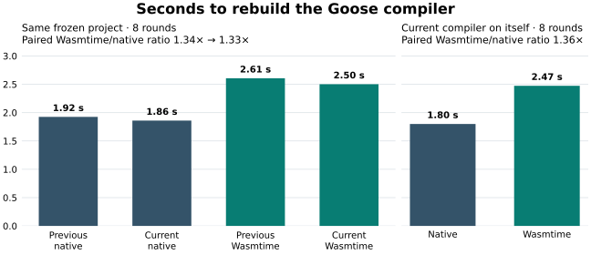
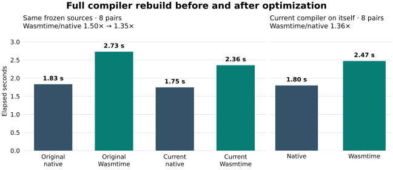
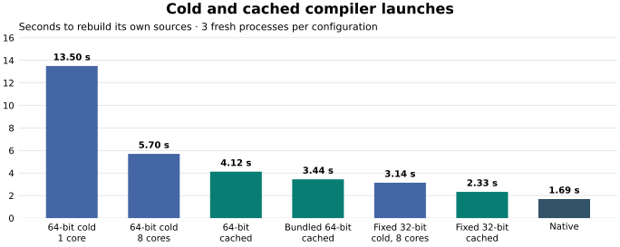

# Four ways to reduce compiler work

## Rebuilding the compiler

On the same frozen sources, the previous and current compilers took **2.61 s and 2.50 s in cached Wasmtime**. The median elapsed change within eight paired rounds was **-4.00%**. Rebuilding the current compiler took **2.47 s in Wasmtime and 1.80 s native**, a paired ratio of **1.36×**. All engines wrote identical portable Wasm for each source snapshot. [Frozen rebuilds](frozen.json) · [Current project](current.json)

| Same frozen project | Previous | Current | Paired change |
| --- | ---: | ---: | ---: |
| Wasmtime · elapsed seconds | 2.61 | 2.50 | -4.00% |
| Wasmtime · CPU seconds | 2.57 | 2.47 | -4.28% |
| Wasmtime · billion instructions | 20.80 | 19.65 | -5.54% |
| Native Goose · elapsed seconds | 1.92 | 1.86 | -3.14% |
| Native Goose · CPU seconds | 1.90 | 1.83 | -3.44% |
| Native Goose · billion instructions | 16.26 | 15.84 | -2.61% |

Wasmtime finished sooner in all eight pairs. An earlier four-pair run during qualification measured -6.69% elapsed and -5.54% instructions for the same Wasmtime binaries and source. [Higher-load control](load-control.json)

The Wasmtime/native ratio on this frozen input changed from 1.34× to 1.33×. In a separate comparison on the original project at `9682303`, all four batches together reduced Wasmtime elapsed time by 13.71% and instructions by 18.87%. The paired ratio fell from 1.50× to 1.35× native time. Absolute times vary with host load. [Four-batch comparison](campaign.json) · [Previous release](../function-lookup/README.md)

## What changed

The compiler uses the first letter of a name to narrow its builtin search and caches the answer when it checks a type’s memory layout. A single pass over each function finds both captured variables and returns targeting an enclosing function. For eligible record fields, the compiler puts the displacement directly in the Wasm load instruction, saving a separate addition.

In six prototype rounds, the two frontend changes together removed 2.66% of Wasmtime instructions. Adding the shared walk brought the reduction to 3.48%, and adding the field load brought it to 5.55%. The release checks that the offset fits even at the maximum configured memory size. The isolated field change removed 93,898 bytes from the optimized compiler module on frozen sources. The release measurements include the final guards and a newly trained memory layout. [Per-experiment results](screen-summary.json) · [Patch, source and raw counter records](experiments.json.gz)

## Measured alternatives

| Frozen full-rebuild experiment | Paired rounds | Wasmtime instruction change |
| --- | ---: | ---: |
| Field loads | 5 | -2.09% |
| Field loads and assignment stores | 5 | -2.50% |
| Field loads, assignments and constructors | 5 | -3.04% |
| Builtin name dispatch | 4 | -0.95% |
| Scalar layout shortcut alone | 6 | -0.85% |
| Scalar shortcut and aggregate layout memo | 6 | -1.71% |
| One capture and return walk | 5 | -0.82% |
| One caller-location discovery pass | 4 | -0.55% |
| Simpler lifetime containment hash | 3 | -0.64% |
| Skip unused lifetime call receiver | 4 | -0.58% |
| Binaryen full optimization | 5 | +0.28% |
| Binaryen local optimizations | 5 | -0.64% |

Lifetime checking still offers room to reduce repeated evaluation, effects and read replay. A screened lifetime change saved 0.64% of instructions with unstable elapsed results, so it needs further investigation. Folding stores and constructors saved less than one additional percentage point beyond field loads in its screen, and its portable fallback needs qualification.

Of 912,435 eligible holders visited during lifetime checks, only six were empty. Skipping them increased the instruction count by 0.014%. Skipping 6,397 empty validation replays saved 0.003%.

The screening archive contains 322 complete rebuilds, plus focused executions and diagnostic comparisons. The two Binaryen passes added 223 and 20 seconds of preparation on this host. Reordering syntax and symbol fields changed the instruction count by 0.01% or less. Its initial elapsed result shrank to a 1.2% gain in an eight-pair repeat, with 0.3% less CPU time. Two byte encoder/decoder screens shared CPU 3 during sampling, so their elapsed times are unsuitable for ranking. [Complete screening table](screen-summary.json) · [Raw measurements, patches and experiment drivers](experiments.json.gz)

## Cold and cached self-compilation

The fixed 32-bit compiler rebuilt itself in **3.14 s cold** on eight cores and **2.33 s cached** on one. Native took **1.69 s**. The cold series includes compiling the compiler module. All three medians include a fresh process and a full project rebuild. [Three runs per configuration and edited-source checks](launch.json)

## Remaining work

Four phase measurements per engine put the extra Wasmtime work at **3.78 billion instructions**. Lifetime checking accounts for **1.59 billion** and Wasm emission for **0.85 billion**. Lifetime expression evaluation and replaying function summaries were the largest named lifetime differences in the sampled profiles. The November 20 follow-up counted how many live holders actually referred to the array being resized and measured alternative searches. [Holder-scan results](../../2026-11-20/compiler-followup/README.md#array-shrink-checks) · [Release phase counts](phase-counters.json) · [Sampled profiles and lifetime experiments](experiments.json.gz)

| Compiler phase | Native, billion instructions | Wasmtime, billion instructions | Extra in Wasmtime |
| --- | ---: | ---: | ---: |
| Parse | 0.53 | 0.74 | +0.22 |
| Check, excluding lifetimes | 1.74 | 2.38 | +0.64 |
| Lifetime checking | 7.57 | 9.16 | +1.59 |
| Optimize | 1.30 | 1.78 | +0.49 |
| Emit Wasm | 4.67 | 5.52 | +0.85 |

## Reader benchmarks

The eleven-program catalog, ten examples and Langbench ran twice on November 19. The example and Langbench charts use the lower-load repeat. For the compiler catalog, the November 19 repeat measured 3.0% more CPU time to emit Wasm and 3.8% more to emit C. [November 19 chart](compiler-comparison.svg) · [November 20 recheck](../../2026-11-20/compiler-followup/README.md#eleven-program-compiler-catalog)

In the self-hosting test the three native builds took a median 199.83 s during the first run. A repeat in a longer source path took 29.23 s and changed the native binary because the generated C embeds diagnostic paths. Repeating from the original source directory on November 20 reproduced the original C, native executable and Wasm hashes in all three builds. The self-host chart uses that median of 28.20 s and the execution timings from the same binaries. [First series](reader-load-control.json.gz) · [Repeat self-host builds](selfhost.json) · [Host load samples](host-pressure.jsonl.gz)

## Verification and reproduction

Bootstrap reproduced the compiler. All 10,061 previous/current contract observations agreed. The extra bundled-memory comparison matched all 4,779 observations, including 10 existing failures under its explicit page limit. Focused checks covered every builtin name, captured variables, nonlocal returns, signed and padded fields, page limits, custom host references and runtime diagnostics. Of 92 byte-identical layout fixture modules, 72 finished their bounded execution check and 20 reached its time limit. All 92 are counted in compile equivalence. [Qualification and build hashes](verification.json) · [Focused case results](experiments.json.gz)

Build `f3f3158` and `b6c2f10` with the [paired rebuild procedure](../fixed-record-copies/README.md#verification-and-reproduction). Use the pinned eight-unit Clang 23 build, Wasmtime 50.0.1 with its machine code cache, and the release-specific profiles trained on squares, sorting and tour. Run the paired harness with each stage's source archive. CPU 7 hosted the two release comparisons, CPU 4 the cumulative comparison and CPU 5 the phase counters. Timed compilers emit portable memory64. [Previous profile](../function-lookup/training.profile) · [Current profile](training.profile) · [Build environment and hashes](selfhost.json)
