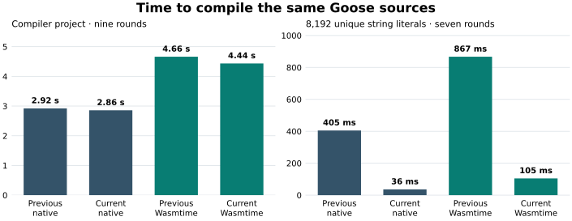
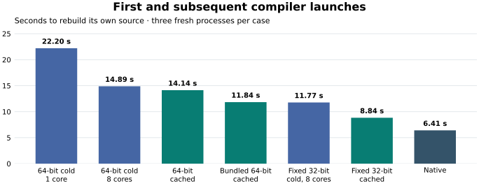

# Compiling the compiler and string-heavy programs

With 8,192 distinct literals, Wasmtime compilation fell from **867 to 105 ms** and native compilation from **405 to 36 ms**. The compiler also does less work rebuilding a frozen copy of itself. Wasmtime retired **3.9% fewer instructions**, and native retired **2.8% fewer**.



## Full rebuilds

| Frozen project, medians over nine rounds | Previous compiler | Current compiler |
| --- | ---: | ---: |
| Native process | 2.922 s | 2.857 s |
| Wasmtime process, cached fixed memory32 | 4.662 s | 4.435 s |
| Wasmtime time / native time | 1.60× | 1.55× |
| Native instructions retired | 23.348 billion | 22.705 billion |
| Wasmtime instructions retired | 37.141 billion | 35.707 billion |

Both Wasmtime and native completed the rebuild sooner in all nine before/after pairs. All four configurations compiled the same source archive at `4a9d35e`. All 36 rebuilds emitted the same 8,882,272-byte portable memory64 module. On its own sources at `3084b81`, the new compiler took **2.903 s native** and **4.559 s in Wasmtime** across seven additional rounds, or **1.57× native time**. All 14 outputs matched. [Frozen project](frozen.json) · [Current project](current.json)

Each observation starts a fresh process on CPU 7 of a shared Ryzen 7 3800X, reads warm filesystem pages, parses, checks, optimizes and emits the complete project. Order reverses every round. The Rust host uses Wasmtime 50.0.1 and Cranelift's speed setting, loading compiler machine code from disk. Native uses Clang 23.1.5 at `-O2` with eight C units. The fast Wasm compiler uses a fixed 65,535-page memory32 layout trained on squares, sorting and tour. Other projects can exhaust a region. [Training profile](training.profile) · [Capacity measurements](../../2026-11-18/compiler-layout-trials/README.md)

The nine rounds above began after this repository's qualification and chart benchmarks finished. Other users of the machine could still affect timings. An earlier nine-round run alongside qualification measured 6.162 → 5.826 s in Wasmtime and 4.011 → 3.969 s native. Seven overlapping rounds on current sources measured 1.50× native time. [Concurrent run](concurrent.json.gz)

## Why literals got faster

The Wasm emitter used to scan all previous data segments for each new string or byte literal. It now looks up the hash, checks the actual bytes to resolve collisions, and emits segments in first-seen order. The compiler also collects three kinds of runtime helper in one syntax-tree walk, skips capture propagation when there are no captures, and compares lifetime-summary fields without a redundant hash.

| Distinct literals | Native before | Native after | Wasmtime before | Wasmtime after |
| ---: | ---: | ---: | ---: | ---: |
| 512 | 6.8 ms | 5.3 ms | 49.0 ms | 47.5 ms |
| 2,048 | 31.0 ms | 11.2 ms | 92.1 ms | 53.8 ms |
| 8,192 | 405.1 ms | 36.0 ms | 867.1 ms | 104.9 ms |

Each input repeats two strings. All 84 builds matched the previous compiler's output byte for byte. The emitted programs and plain upstream Goose printed the same three checksums. The regression test also covers different equal-length strings with the same full 32-bit hash, empty strings and growth of the index. [Samples and input hashes](literals.json) · [Regression test](../../../../tests/test_data_segments.py)

## Cold and cached self-compilation



An empty Wasmtime cache on the default memory64 compiler gave 22.20 s on one core and 14.89 s with eight available for preparation. The fixed memory32 compiler took 11.77 s uncached with eight cores, 8.84 s cached with one, and the native executable took 6.41 s. The launch study overlapped other benchmarks on the shared host. Each cell has three fresh processes, and the dedicated paired run above gives a separate native and cached comparison. Loading and instantiating the cached fixed compiler took a median 7.7 ms. A one-line help-text edit took 4.75 s with the fixed compiler and 3.05 s native. All six edited outputs matched an independently compiled reference that differed from the unedited output. [Complete requests, edited output and phase clocks](launch.json)

| Compiler phase, instrumented separately | Native | Fixed 32-bit Wasmtime |
| --- | ---: | ---: |
| Parsing | 0.064 s | 0.114 s |
| Type-checking, excluding lifetime analysis | 0.278 s | 0.467 s |
| Lifetime analysis | 1.929 s | 2.932 s |
| Optimization | 0.180 s | 0.297 s |
| Wasm emission | 0.598 s | 0.962 s |

Lifetime analysis accounts for the largest measured phase gap, 1.00 s. The previous function-level profile identified repeated replay of called functions’ lifetime effects as the largest named cost. [Function profile](../../2026-11-18/compiler-frame-cost/README.md#cold-start-and-the-remaining-gap)

## Qualification and other experiments

All 10,057 previous/current compiler output comparisons matched. The default suite retained 104 known gaps in 10,797 rows and memory64 retained eight in 4,777 rows, with zero unexpected failures. All 89 unit tests and 54 native checks passed. Both the native C bootstrap and the fixed 32-bit Wasm compiler reproduced their output byte for byte. The standalone lifetime change matched 11,610 fingerprints across 4,357 corpus sources and three additional controls. [Verification and compiler hashes](verification.json)

- Reordering lifetime walks and reads, as well as inlining Wasm instruction decoding, gave small or inconsistent results. Merging the helper walks alone cut the frozen build from 37.141 to 36.631 billion Wasmtime instructions. [All screening rounds](screens.json.gz)
- A separate backend experiment wrote scalar records directly at their destination. It cut retired instructions by 3.6%, but four full compiler pairs measured 6.371 s before and 7.414 s after under load. All 64 focused execution comparisons matched. It changes emitted Wasm and stays experimental pending a consistent end-to-end improvement and full conformance. [Trial and controls](record-stores.json) · [Patch against the previous source](record-stores.patch)

Across the eleven-program catalog, the geometric mean of median compiler CPU times fell 1.6% for emitting Wasm and 3.0% for emitting C. All 22 emitted artifacts matched. Direct Wasm compilation took 4.4% more CPU for squares and 3.6% more for sieve in this run. The ten example builds and executions, Wasmtime host modes and three Mandelbrot sizes were measured again. The four largest reports occupy 0.38 MB compressed, versus 4.60 MB uncompressed, and retain every observation. Chart receipts identify the stored files by SHA-256. [Compiler catalog](catalog-summary.json) · [Examples](examples.json.gz) · [Wasmtime host](host.json.gz) · [Resident Mandelbrot](langbench-hot.json.gz)

## Reproduce

Follow the [stage and host build commands](../../2026-11-18/compiler-frame-cost/README.md#reproduce) twice, using `4a9d35e` with its [previous profile](../../2026-11-18/compiler-frame-cost/training.profile) and `3084b81` with this [profile](training.profile). Give each stage its own directory. From the repository root, set `before` and `after` to their absolute paths.

```sh
ulimit -s 262144
benchdir=bench/results/2026-11-19/compiler-passes
pair=bench/results/2026-11-18/compiler-frame-cost/measure.py
host=host/rust/target/release/goose-wasmtime
.venv/bin/python "$pair" "$before" build/repro-frozen \
  native-before="$before/build-1/compiler-native" wasm-before="$before/fixed.wasm" \
  wasm-after="$after/fixed.wasm" native-after="$after/build-1/compiler-native" --rounds 9
.venv/bin/python "$pair" "$after" build/repro-own \
  native="$after/build-1/compiler-native" wasm="$after/fixed.wasm" --rounds 7
.venv/bin/python "$benchdir/literals.py" build/repro-literals "$after/source/stdlib" "$host" \
  "$before/build-1/compiler-native" "$after/build-1/compiler-native" \
  "$before/fixed.wasm" "$after/fixed.wasm" --rounds 7
.venv/bin/python bench/results/2026-11-18/compiler-request-latency/launch.py \
  . "$after" build/repro-launch --layout-profile "$benchdir/training.profile" --fixed-bundled32
.venv/bin/python "$benchdir/chart.py"
```
