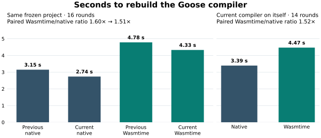
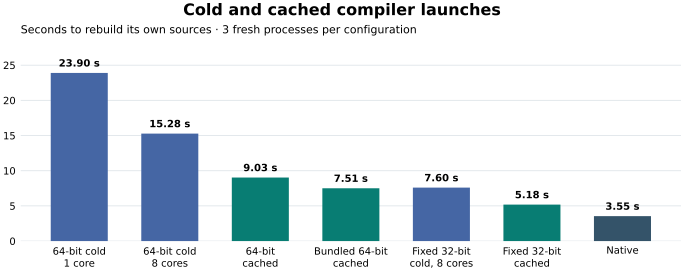

# Read tracking and compiler rebuild time

The bundled compiler rebuilt itself in **4.47 s in Wasmtime** and **3.39 s native** across 14 paired rounds. Its median same-round Wasmtime/native ratio was **1.52×**. On the same frozen sources, Wasmtime wall time fell by **20.1%** and its instruction count fell **18.0%**. [Frozen results](frozen.json) · [Current sources](current.json)



| Frozen self-rebuild | Previous native | Current native | Previous Wasmtime | Current Wasmtime |
| --- | ---: | ---: | ---: | ---: |
| Median wall time | 3.146 s | 2.736 s | 4.782 s | 4.327 s |
| Median process CPU time | 3.052 s | 2.620 s | 4.670 s | 4.109 s |
| Median instructions retired | 21.777 billion | 17.769 billion | 33.522 billion | 27.481 billion |
| Median CPU cycles per instruction | 0.451 | 0.474 | 0.468 | 0.484 |
| Median peak resident memory | 437.2 MiB | 369.7 MiB | 705.7 MiB | 635.8 MiB |

Native and Wasmtime each compiled the project at `34ddff8` to the same 8,886,107-byte memory64 module. The previous compiler was `6e503fb` and the current compiler is `fc34386`. Wasmtime 50.0.1 loaded a precompiled, fixed memory32 module in a fresh process on CPU 7 of a shared Ryzen 7 3800X. Clang 23.1.5 built the native compilers at `-O2` using the same source emitter. Each Wasm layout was trained on squares, sorting and tour. [Source and tool hashes](verification.json) · [Sizing profile](training.profile)

The frozen comparison used two eight-round series with opposite starting orders. Median paired Wasmtime wall time changed -21.6% in the first series and -18.2% in the second. Wasmtime improved in 15 of 16 pairs. The median wall-time ratio to native moved from 1.60× to 1.51×. Within-pair process CPU time changed -19.0% in Wasmtime and -17.7% native. A separate six-pair control ran the same candidate binary twice per round. Its median paired wall-time difference was -1.1% with a range of -11.2% to +24.1% on this shared host. [Identical-binary control](identical.json.gz)

The 14-round current-source comparison also reversed the series order. The bars show each engine’s median time. The headline ratio uses the median of the same-round divisions. [Individual series](rebuild-series.json.gz)

## Where the work went

The lifetime checker tracks which storage a function reads so it can reject a whole assignment that invalidates a live reference. The frozen compiler project had zero assignments that needed this history. Skipping it removed **1,003,113 read entries** and **5,444,736 hash-table slots**. Both versions checked 2,883 frames over five discovery passes. Whole replacements still collect reads. If analysis encounters a replacement or switches to class-based checking after collection was skipped, it restarts with full history before publishing diagnostics. [Instrumented counts](operations.json.gz)

The optimizer used to scan lists of visited and active functions. It now keeps a byte of state per syntax node. The type checker also hashes a name once while searching its enclosing scopes and compares the original name when hashes match. Each change was measured independently on generated inputs. The table shows the largest input in six counterbalanced rounds per workload. A separate binding program exercises two names with the same hash, shadowing, namespaces and overloads. Upstream Goose and the local builds produced the same output. [All sizes, hashes and outputs](scaling.json.gz)

| Targeted Wasmtime workload | Before | After | Paired process CPU change |
| --- | ---: | ---: | ---: |
| 4,096 functions called from one entry | 2.307 B instructions | 1.879 B | −16.6% |
| 4,096 uses of a long name across 12 scopes | 690.7 M instructions | 407.7 M | −25.8% |

Using the old sizing profile for every experimental build, read suppression alone retired 28.175 B instructions on the frozen rebuild. Adding indexed function state reached 27.615 B, adding shared hashing alone reached 28.042 B, and enabling all three reached 27.482 B. An early retry design used a nonlocal return through recursive checker calls and retired 31.326 B. A prototype that checked for a retry at analysis-root boundaries retired 28.191 B. The released compiler uses ordinary returns at those boundaries and its independently trained profile. [Isolated experiment series](screens.json.gz)

Recycling old read tables reduced peak resident memory by about 8 MiB on the frozen baseline. Reusing a hash miss to insert a new entry also reduced table work. All three storage trials changed frozen instruction counts by less than 0.09%. A replacement-heavy control ran 128 whole assignments and 32,768 reads. Every candidate produced identical bytes and preserved the two ordered replacement errors. [Retained and rejected storage experiments](storage.json.gz) · [Experiment patches and fixtures](experiments.tar.gz)

## Remaining time

| Phase on frozen sources | Previous native | Current native | Previous Wasmtime | Current Wasmtime |
| --- | ---: | ---: | ---: | ---: |
| Parsing | 0.120 s | 0.164 s | 0.307 s | 0.225 s |
| Type checking outside lifetime analysis | 0.456 s | 0.747 s | 1.336 s | 1.200 s |
| Lifetime analysis | 4.117 s | 2.734 s | 6.688 s | 5.278 s |
| Optimization | 0.337 s | 0.391 s | 0.714 s | 0.961 s |
| Wasm emission | 1.280 s | 1.328 s | 2.199 s | 2.131 s |

On the same frozen source, Wasmtime executed 1.55× as many host CPU instructions as native after the change, compared with 1.54× before it. Both hosts benefited from skipping compiler work. The array-header update below accounts for part of that difference. [Hardware counters](frozen.json)

Lifetime analysis took 5.278 s in Wasmtime and 2.734 s native. In three separate emission profiles sampled every 2 ms of CPU time, `life_eval` and `life_eval_body` together accounted for 221 excess Wasmtime samples. The local-slot allocator and operand reader accounted for another 98. Samples without symbols and compiler inlining limit attribution. Phase and peak-memory figures come from five separate rounds on CPU 5. [Phase samples](phases.json) · [Current CPU profile](profile.json.gz)

A separate probe counted 826,080 attempts to intern a list of possible storage locations. Of those, 820,895 found an existing list. The checker hashed 1,711,930 locations and compared 1,692,664 again on successful lookups. A previous one-entry cache per root produced a small instruction change. Measuring the cost of computing the lookup key is a narrower next experiment. [List counters](operations.json.gz) · [Prior singleton-cache trial](../../2026-11-18/compiler-array-views/lifetime/README.md)

A generated program with 4,100 leaf calls reaches the class-frame limit and requests a full pass. Its paired check CPU time changed +16.6% across six cached Wasmtime rounds. On the replacement-heavy control, the same measurement changed -1.9%. Both old and new compilers agreed on emissions, output and ordered diagnostics. [Production-threshold and replacement controls](controls.json.gz)

Counting eligible declarations predicted the restart and saved 14.3% of instructions on the 4,100-call program. Counting only reachable, capture-free top-level functions still increased instructions 18.6% in library mode and 2.0% in an executable whose callbacks capture their caller. Both programs completed without a restart. Another prototype tracked whether it had skipped any eligible read. It avoided the restart on the 4,100-call fixture, saving 14.28% of instructions. Three scalar-only programs used 0.20–0.50% more instructions because they kept checking read eligibility, so the release keeps the simple restart. [Prediction experiments](class-prediction.json.gz)

## Wasmtime-specific follow-up

The generated Wasm calls a helper after a growable array changes. That helper forwards header updates to an active construction destination. The frozen compiler made **31,961,683 calls with no destination** in one emission. A separate check-only invocation made 11,167,366 empty calls. Native Clang inlined the null test into callers. A scratch emitter tested for a destination at each call site. The isolated compiler retired **26.688 B instructions**, down from **27.481 B**, and produced the same frozen output. Its Wasm file grew by 61,980 bytes. Eight pairs with opposite starting orders measured 4.08% and 3.92% lower median paired wall time. All 20 construction controls matched upstream Goose across both memory widths. A returned-header case still forwarded two actual stores in both versions. These figures isolate the code that runs the compiler. [Counter and timing evidence](publication.json.gz) · [Code and reproduction scripts](publication-probes.tar.gz)

### Preparation and complete rebuilds

A compiler built with the guard in both its executable and its code generator reproduced its own fixed32 module. It emitted an 8,972,823-byte memory64 module for the frozen sources. The released compiler emitted 8,886,107 bytes. Each version matched its respective native reference in every timed rebuild. [Compiler, output and runner identities](publication.json.gz)

| Patched compiler vs released compiler, frozen source | Median paired wall change | Median paired process CPU change |
| --- | ---: | ---: |
| Cached Wasmtime, six full rebuilds per version | −5.39% | −6.84% |
| Cold one-core Wasmtime, six full rebuilds per version | +0.46% | +1.01% |
| Native, six full rebuilds per version | +6.26% | +0.20% |

In the cold rebuilds, the median paired change was +2.50% for preparation and instantiation and −1.65% for guest execution. The candidate retired 2.81% fewer instructions in the cached Wasmtime rebuild and changed native instructions by +0.04%. Guarding every call site grew the precompiled compiler image by **2.80%**. The separate resident V8 trial measured 3.79% lower execution time across two paired emissions that produced identical output. [All samples, engine settings and output hashes](publication.json.gz)

Moving a single check into the shared helper added seven bytes to the compiler module. It changed frozen rebuild instructions by −0.81% and wall time by +0.45% across four cached Wasmtime pairs. The call-site prototype favored cached rebuilds. Cold one-core rebuilds stayed within the run-to-run variation, and the cache grew. Both prototypes remain experimental. [Source patches and reproduction scripts](publication-probes.tar.gz)

## Cold and cached self-compilation



The default memory64 compiler took **23.90 s** to rebuild from a cold Wasmtime process on one core and **15.28 s** with eight cores available. The fixed memory32 compiler took **7.60 s** cold on eight cores and **5.18 s** cached on one core, versus **3.55 s** native. A source edit produced a different verified module in 4.10 s cached and 2.30 s native. Each median uses three fresh processes. [Launch and edit samples](launch.json)

## Qualification

All 10,057 output comparisons matched. The default conformance suite retained its 104 known gaps across 10,797 rows and memory64 retained eight across 4,777. All 54 native checks and 91 unit tests passed. The compiler reproduced its generated C, portable Wasm and fixed memory32 Wasm. [Qualification and hashes](verification.json)

The two releases gave identical exit status, stdout and ordered diagnostics on 4,357 distinct sources. Their 3,130 final logical-state fingerprints matched, including frame results and inputs, captures, roots, storage cells, non-read effects and exits. All 786 ordered discovery and validation fingerprints matched for the cases that retained full collection. A stricter probe on the integrated prototype saw scheduling or temporary allocation differences on 47 programs. The final comparison follows live tuples and frame inputs by value. Forced-class and mixed-owner controls exercised the fallback, and the production-threshold test includes an independently checked function with reference and slice parameters. [Per-source comparisons](fingerprints.json.gz) · [Upstream and final-release fixtures](controls.json.gz)

## Reproduce

Use the [paired build and measurement commands](../compiler-passes/README.md#reproduce) with frozen workload `34ddff8`, previous compiler `6e503fb` and current compiler `fc34386`. Build each compiler with the same pinned emitter and Clang flags. Use the [prior profile](../expression-lifetimes/training.profile) and [current profile](training.profile) for the respective fixed memory32 modules. Run eight four-way rounds on CPU 7, reverse the argument order, then repeat. Run the current-source pair in both orders for seven rounds each. To reproduce the state comparisons, apply the archived `old-fingerprint.patch` to `6e503fb` and `new-fingerprint.patch` to `fc34386` in separate trees. Compile each instrumented tree, check each source from the conformance manifest, and compare the ordered `LIFEFP` lines on the full path and the final `PROJECT` lines on both paths. Replace `LIFE_CONCRETE_FRAMES = 4096` with 16 in both instrumented trees for the forced-class controls. The archive contains the two fingerprint patches, the generated-workload scripts, the rejected patches and the individual profiling commands. [Experiment sources](experiments.tar.gz)

```sh
.venv/bin/python bench/selfbuild_charts.py bench/results/2026-11-19/construct-read-demand
```
