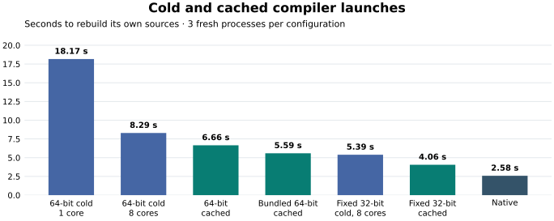

# Expression lifetimes in a compiler rebuild

On the frozen project, Wasmtime rebuild time fell by **1.7%** across 16 paired rounds. The same-round Wasmtime/native ratio went from **1.57× to 1.54×**. Rebuilding the new compiler on its own sources took **3.757 s** in Wasmtime and **2.454 s** native across 14 rounds. [Frozen project](frozen.json) · [Current compiler](current.json)


| Frozen project, median | Previous native | Current native | Previous Wasmtime | Current Wasmtime |
| --- | ---: | ---: | ---: | ---: |
| Process wall time | 2.346 s | 2.345 s | 3.687 s | 3.611 s |
| Process CPU time | 2.328 s | 2.327 s | 3.660 s | 3.584 s |
| Instructions retired | 21.849 billion | 21.777 billion | 34.222 billion | 33.522 billion |
| Peak resident memory | 437.5 MiB | 437.6 MiB | 707.5 MiB | 706.6 MiB |

The project was frozen at `34ddff8`. The previous compiler was `06c84ac` and the new compiler is `6e503fb`. Wasmtime 50.0.1 loaded a precompiled, bundled memory32 compiler. Native used Clang 23.1.5 at `-O2`. Every fresh process parsed, checked and compiled the project and wrote the same 8,886,107-byte memory64 module. The two layouts were trained independently on squares, sorting and tour. [Compiler and tool hashes](verification.json) · [Current training profile](training.profile)

The two eight-round series started in opposite orders on CPU 7 of a shared Ryzen 7 3800X. The first measured 3.838 → 3.772 s in Wasmtime and the second 3.676 → 3.540 s. Wasmtime was faster in 14 of 16 pairs. Median native time changed by +0.1% within pairs. Chart bars show pooled wall-time medians. The current-source result uses two seven-round series with the order reversed between series. Absolute times vary with other work on the host. [Individual series and hardware counters](rebuild-series.json.gz)

## What changed

The lifetime checker first discovers how functions affect their callers, then validates individual uses. It used to save held operands and upcoming expressions in both passes. Only validation reads those records. Skipping them during discovery avoided **823,506 held operands and 720,840 upcoming expressions** in one self-check. The checker also returned early for **813,106** values whose type already matched and whose contents needed no conversion. [Activity counters](operations.json)

A shared empty expression result supplies the defaults for a 72-byte record. In the two main evaluators, this reduced executed zero-fill lengths from **338.4 MB to 20.0 MB** per check. Their executed copy lengths remained **1,627.0 MB**, including **1,480.8 MB** at 72 bytes per copy. These totals count Wasm instruction operands. CPU cache traffic and elapsed time are measured differently. Checking and emission produced the same counts for these two functions. [Per-site counts and memory32/64 controls](copies.json.gz)

| Compiler phase on frozen source | Previous native | Current native | Previous Wasmtime | Current Wasmtime |
| --- | ---: | ---: | ---: | ---: |
| Parsing | 0.055 s | 0.055 s | 0.096 s | 0.095 s |
| Type checking, excluding lifetimes | 0.234 s | 0.239 s | 0.407 s | 0.403 s |
| Lifetime analysis | 1.521 s | 1.525 s | 2.366 s | 2.256 s |
| Optimization | 0.146 s | 0.146 s | 0.260 s | 0.258 s |
| Wasm emission | 0.522 s | 0.515 s | 0.824 s | 0.845 s |

Lifetime analysis accounts for 2.256 s in Wasmtime and 1.525 s native on the frozen source, a **0.730 s** gap. Phase clocks and peak memory come from five separate rounds on CPU 5. In a separate three-round self-check sampled every 2 ms of CPU time, the largest excess among named lifetime functions was `life_replay` (+209 samples), `life_eval` (+154 samples), `life_eval_body` (+151 samples). Some addresses have no symbol, and compiler inlining can change how samples are attributed. [Phase and memory samples](phases.json) · [CPU profiles](profiles.json.gz)

## Experiments left out

Writing the returned value directly into caller-provided storage removed **323.5 MB** of evaluator copies per check. Flattening that path removed **355.4 MB**. Across five paired rebuilds those strategies changed Wasmtime wall time by **−0.9%** and **−0.7%**, respectively. Expanding fixed-width copies into scalar loads and stores increased elapsed time by 2.8% for 72-byte copies. The SIMD trial at widths up to 96 bytes lowered retired instructions by 2.4% and increased elapsed time by 2.2%. The compiler keeps its existing calling convention. [Eleven experiment series](screens.json.gz) · [Source patches and probing scripts](experiments.tar.gz)

## Cold and cached self-compilation



Across three fresh processes per configuration, the default memory64 compiler took 18.17 s cold on one core and 8.29 s with eight cores available to Wasmtime. The bundled memory32 compiler took 5.39 s cold and 4.06 s cached, versus 2.58 s native. Cached engine preparation and instantiation took 5.3 ms. An edited source produced a distinct verified module in 4.32 s cached and 2.75 s native. [Launch, edit and preparation samples](launch.json)

## Qualification

All 10,057 compiler output comparisons matched. The test suites retained the 104 known default gaps in 10,797 rows and eight memory64 gaps in 4,777 rows. All 54 native checks and 90 unit tests passed. The compiler reproduced its generated C and its fixed and portable Wasm modules. The previous and new checkers matched on 11,596 ordered lifetime fingerprints across 4,357 sources, plus 14 on the compiler itself and two forced class-frame cases. [Qualification, compilers and fingerprints](verification.json)

An independent checker with replay caching disabled matched all ordered diagnostics and state on 29 additional fixtures. Three upstream Goose programs compiled and ran with matching output. Four failing upstream programs were rejected by upstream and both releases. Native diagnostics matched byte for byte across releases, as did Wasmtime diagnostics. Both hosts reported the same messages and locations, with an extra trailing newline from the Wasmtime runner. [Upstream and targeted checks](upstream-controls.json)

## Reproduce

Use the [stage build and paired measurement commands](../compiler-passes/README.md#reproduce) with three stages. Build the frozen input at `34ddff8`, the previous compiler at `06c84ac` with its [sizing profile](../lifetime-array-effects/training.profile), and the new compiler at `6e503fb` with [this profile](training.profile). Use the frozen input as the first argument of the paired measurement command. Run eight alternating rounds, reverse the four compiler arguments, and repeat. Run both new compilers on their own sources twice for seven rounds, reversing the order for the second series.

For the [copy probe](../../2026-11-18/compiler-copy-costs/copies/README.md#reproduction), pass `--only life_eval life_eval_body --detail life_eval life_eval_body` when instrumenting the named module and `--base-module` with its matching fixed memory32 module when measuring it. The counters, addresses and bytes in the exploratory result-storage trials identify experimental modules built on the previous source with the corresponding archived patches.

```sh
.venv/bin/python bench/selfbuild_charts.py bench/results/2026-11-19/expression-lifetimes
```
