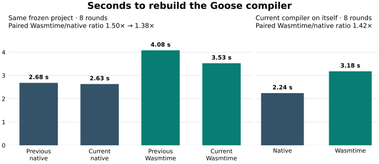
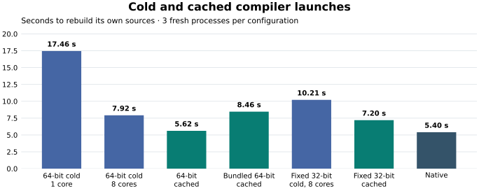

# Fixed-size record copies in Wasmtime

## Rebuilding the compiler

On unchanged compiler sources, Wasmtime used **12.2% fewer instructions**. Its paired elapsed time fell **6.6%**, moving from **1.50× to 1.38× native time**. All 32 rebuilds wrote the same 8,937,039-byte Wasm module. [Frozen project measurements](frozen.json)

| Frozen project, eight alternating rounds | Median wall time | Median retired instructions |
| --- | ---: | ---: |
| Previous native | 2.684 s | 16.523 billion |
| Current native | 2.633 s | 16.522 billion |
| Previous Wasmtime | 4.081 s | 24.272 billion |
| Current Wasmtime | 3.525 s | 21.321 billion |

On its own sources, compiler `3756b67` took **3.18 s in cached Wasmtime** and **2.24 s native** (1.42× within pairs). Both emitted the same 8,820,805-byte portable compiler. Instruction counts were 21.27 billion and 16.49 billion. Each run starts a fresh process on CPU 7 of a shared Ryzen 7 3800X. The Wasmtime 50.0.1 process loads a prepared module. Native uses the same Goose sources through eight C units and Clang 23.1.5 at `-O2`. Table cells use medians for individual engines. Ratios pair measurements from the same round. [Own-source measurements](current.json) An independent eight-round repeat under heavier host load took 4.28 s in Wasmtime and 3.17 s native (1.35× within pairs). [Independent repeat](repeat-current.json)

## What changed

The previous compiler moved 10.24 GB through Wasm bulk copies during a frozen rebuild, including 4.49 GB in 160-byte records, the size of a syntax node. An optimized bundled memory32 build now copies ordinary fixed records from 16 through 256 bytes with 16-byte vector instructions. It also uses vector stores to zero small fixed-size destinations. All source reads precede the first write so overlapping records copy correctly. Starting with the last destination chunk preserves the trap before any write when a copy runs past the end of memory. [Instrumented counts and alternative experiments](diagnostics.json.gz) · [Compiler change](https://github.com/mewhhaha/goose-to-wasm/commit/3756b67)

Across ten example programs and the eleven-program compiler catalog, the refreshed reports record build time, runtime and output identities. The catalog exercises the general backend. The SIMD path is enabled for bundled memory32 at `-O2`. [Example builds](examples.json.gz) · [Example process times](host.json.gz) · [Compiler catalog](catalog-summary.json) · [Resident Mandelbrot](langbench-hot.json.gz)

## Cold and cached self-compilation

Across three fresh processes per configuration, the fixed bundled compiler took **10.21 s cold on eight cores**, **7.20 s cached on one core** and **5.40 s native**. The default memory64 compiler took 17.46 s cold on one core and 7.92 s cold on eight. Every measurement includes a full parse, check, optimization and write. The cold series also includes Wasmtime compiling the compiler module. [Launch and edit measurements](launch.json)

## What remains

The instrumented rebuild still executes more host instructions in Wasmtime than native. A diagnostic build that omitted all array-index checks saved 7.8% against the earlier Wasmtime build. A separate experiment disabled lifetime analysis in both compilers. Wasmtime still took 1.55× native time and both compilers accepted five invalid reference programs. Both checks remain enabled in the release. Narrowing the lifetime value to nine 32-bit fields, using a jump table for chains of compiler dispatches and directly reusing fresh record arguments each saved less than 1% of the SIMD build's instructions. [Screening samples and invalid-input controls](diagnostics.json.gz)

## Verification and reproduction

Bootstrap reproduced its C output, and all 10,061 default output comparisons matched the previous compiler. Default conformance retained its 104 recorded gaps across 10,801 rows. Both memory64 and bundled memory32 retained eight gaps across 4,779 rows. All 54 native checks and 94 unit tests passed. A host fixture exercises overlap in both directions, a source or destination crossing the memory boundary, and odd-size zero filling. Native and Wasmtime independently generated the same optimized compiler. [Qualification and identities](verification.json) · [Copy and fill regression test](../../../../tests/test_fixed_memory_ops.py)

Build native stages with `bench/selfhost_comparison.py build` at commits `9682303` and `3756b67`. Use the same pinned emitter and toolchain recorded in [the self-host report](selfhost.json). From each stage's frozen source directory, ask its native compiler to build `selfhost/main.goose --stdlib stdlib --target wasm-direct -O2 --wasm-bundled-host --wasm-initial-pages 65535 --wasm-max-pages 65535 --wasm-region-profile PROFILE -o fixed.wasm`. Use the profile for that release. The profiles train on squares, sorting and tour and reserve a fixed 32-bit address space. [New profile](training.profile) · [Previous profile](../lifetime-callers/training.profile)

Run [the paired rebuild harness](../../2026-11-18/compiler-frame-cost/measure.py) with the old source stage, a fresh results directory, and `native-before`, `wasm-before`, `wasm-after` and `native-after` labels pointing to the four binaries. Repeat on the new stage with the current native and Wasm compilers. Both runs used `--cpu 7 --rounds 8`. The [launch harness](../../2026-11-18/compiler-request-latency/launch.py) used the current profile and `--fixed-bundled32`.
