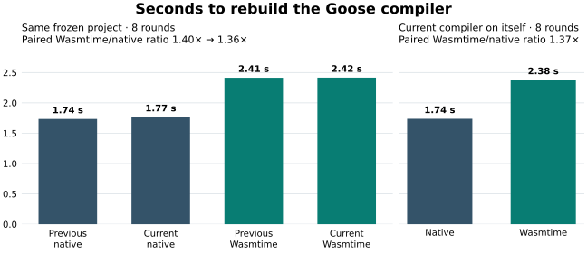
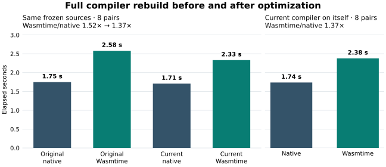
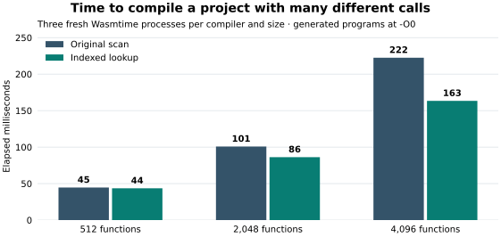
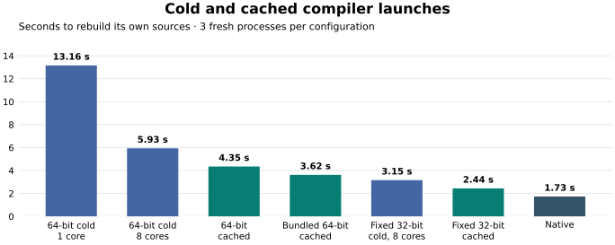

# Indexing Wasm function bodies

## Rebuilding the compiler

The compiler rebuilt its own sources in **2.38 s in cached Wasmtime** and **1.74 s native**. The median of eight paired time ratios was **1.37×**. Each emitted the same 8,826,916-byte portable module. The cache contains only the machine code for the compiler, so each process still compiles all the Goose sources. [Current project](current.json)

On the previous project at `e5381f0`, the index changed Wasmtime elapsed time by -1.17% and native elapsed time by +1.28% within pairs. Retired instructions changed by -1.78% in Wasmtime and -0.74% native. All 32 builds emitted identical modules. [Previous and current compilers on the same sources](frozen.json)

Across all three changes, the compiler at `9682303` and the current compiler rebuilt the original frozen project. Wasmtime went from **2.58 s to 2.33 s**, with the paired Wasmtime/native ratio moving from **1.52× to 1.37×**. Wasmtime executed **14.1% fewer instructions** and used **9.7% less CPU time** across eight pairs. [Three-change comparison](campaign.json) · [Fixed record copies](../fixed-record-copies/README.md) · [Lifetime evaluator frames](../lifetime-evaluator-frames/README.md)

## Function lookup

When generating a call, the compiler used to scan its function records to find the body for a symbol. During the frozen compiler’s self-build, 17,228 ordinary lookups inspected 14,449,745 records. Two searches for array-element return bodies inspected another 3,180. That build did not construct an indirect-call mapping table.

The compiler now indexes function bodies by symbol, storing both the ordinary body and any special array-element return body. If the special body is absent, it falls back to the ordinary one. The index costs eight bytes per symbol.

For the compiler workload, simply reading the symbol field in each scanned record saved 0.95% of CPU time. Indexing saved 1.19% under the same training profile. These are six rotated rounds of the prototype on the previous compiler’s sources. [Experiment samples and counters](lookup-experiments.json.gz)

## Programs with many functions

The scaling workload declares functions that each add a different integer, then calls every function in reverse declaration order. Both compilers use `-O0` on the generated source so the calls survive. Every timed output matched native byte-for-byte. Running the output at 4,096 functions printed 8390656. The counts below come from a separately instrumented copy of the previous compiler. Elapsed times are medians of three fresh cached Wasmtime processes per compiler and size. [Release timings](scaling.json) · [Instrumented scans and direct-field control](lookup-experiments.json.gz)

| Functions | Records examined by the old lookup | Previous compiler | Indexed compiler | Paired change |
| ---: | ---: | ---: | ---: | ---: |
| 512 | 395,010 | 44.6 ms | 43.6 ms | -2.7% |
| 2,048 | 6,298,626 | 100.8 ms | 86.2 ms | -14.7% |
| 4,096 | 25,180,162 | 222.5 ms | 163.4 ms | -26.6% |

## Cold and cached self-compilation

Three fresh processes per configuration took a median **3.15 s cold** on eight cores and **2.44 s cached** on one core with the fixed 32-bit compiler. Native took **1.73 s**. Cold launches include engine compilation. The default memory64 compiler took 13.16 s cold on one core and 5.93 s cold on eight. [Launch, profile and edited-source checks](launch.json)

## Remaining gap

Four additional pairs on the current compiler counted 4.52 billion extra CPU instructions in Wasmtime across the compiler phases. Lifetime analysis accounted for 1.91 billion (42%) and Wasm emission for 1.05 billion (23%). In the earlier engine control, a different native code generator ran the same Wasm using fewer instructions, and still used more CPU time than native Goose. Performance parity remains open. [Current phase counts](phase-counters.json) · [Same-Wasm engine comparison and rejected LLVM round trip](../lifetime-evaluator-frames/README.md#where-the-gap-remains)

## Verification and reproduction

All 10,061 previous/current contract observations agreed. Bootstrap reproduced the compiler, all 54 native checks passed, and the default and memory64 contract suites reproduced their recorded gaps. Fourteen focused old/new builds exercised anonymous calls, captures, indirect calls, external imports and specialized array returns in both memory layouts. All matched byte-for-byte and executed in Wasmtime. [Qualification, focused cases and build hashes](verification.json)

Build the `e5381f0` and `f3f3158` compilers with the [paired rebuild procedure](../fixed-record-copies/README.md#verification-and-reproduction) and the recorded eight-unit Clang `-O2` settings. Both releases trained their fixed 32-bit memory layouts on squares, sorting and tour. Use the [scaling harness](tools/scaling.py) with the two Wasm compiler paths, the native executable, the Rust host, the matching standard library and an empty work directory. [Previous profile](../lifetime-evaluator-frames/training.profile) · [Current profile](training.profile) · [Build and input hashes](selfhost.json)
