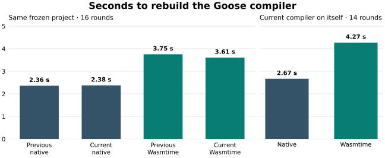
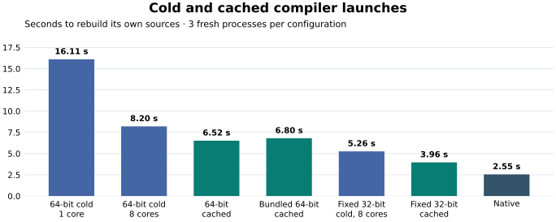

# Repeated array effects in lifetime analysis

Rebuilding the same frozen compiler project took **3.753 → 3.608 s** in Wasmtime and **2.361 → 2.376 s** native. The current compiler rebuilt its own sources in **4.270 s** in Wasmtime and **2.667 s** native, or **1.60× native time**. [Frozen project](frozen.json) · [Current project](current.json)



| Same frozen source | Previous | Current |
| --- | ---: | ---: |
| Wasmtime / native, median same-round ratio | 1.59× | 1.58× |
| Wasmtime instructions retired | 35.235 billion | 34.222 billion |
| Native instructions retired | 22.325 billion | 21.849 billion |
| Wasmtime lifetime analysis | 2.388 s | 2.328 s |
| Native lifetime analysis | 1.557 s | 1.460 s |
| Wasmtime peak resident memory | 706.2 MiB | 709.1 MiB |
| Native peak resident memory | 437.1 MiB | 437.5 MiB |

The frozen project and previous compiler are `34ddff8`. The current compiler is `06c84ac`. On a shared Ryzen 7 3800X, each fresh process ran on CPU 7 with warm filesystem pages. Wasmtime 50.0.1 loaded a precompiled, bundled memory32 compiler. Native used eight C translation units and Clang 23.1.5 at `-O2`. Both parsed, checked and compiled the entire project and wrote an identical 8,886,107-byte memory64 module. Fixed memory32 layouts were trained independently on squares, sorting and tour. Phase clocks and peak memory come from five separately instrumented rounds on CPU 5. [Phase and memory samples](phases.json) · [Tool and source hashes](verification.json) · [Training profile](training.profile)

The first eight rounds measured 3.924 → 3.769 s in Wasmtime. Eight more with the starting order reversed measured 3.685 → 3.555 s. Across all 16, the median within-pair change was **-3.5%** in Wasmtime (14/16 faster) and **-1.8%** native (14/16 faster). The Wasmtime/native ratio fell in 10 of 16 rounds. The chart pools wall times for each compiler. The paired percentages compare against the baseline from the same round, which accounts for some variation in host load. Two series of seven additional pairs measured the current compiler on its own source. They used opposite starting orders and ran on either side of the separate launch benchmark. A separate run overlapped qualification on the same machine. [Both timing series](rebuild-series.json.gz) · [Concurrent builds, phases and launches](under-load.json.gz)

## Where the time went

A function can grow or shrink an array that belongs to its caller. The lifetime checker passes that information up the call chain so it can detect a slice invalidated by a later change. During discovery, the new checker can skip a whole group of effects if it has already delivered them to that caller and nothing relevant has changed. Validation still checks each use in order. On a self-check it skipped **667,290 growth entries** and **111,910 shrink entries** in completed groups. A second shortcut avoids walking the stack for an inactive function that has never been marked recursive. The previous compiler made 1,404,117 such frame visits. [Exact counters](effect-counts.json) · [Counter instrumentation](effect-counts.patch)

For an array that can belong to either of two calls, returning from the inner call can expose another caller that still needs the effect. The checker only reuses a bounded result for several possible owners within the same activation. An early version, `680ff75`, was reverted when this case exposed incomplete propagation. The permanent regression test checks that a read is reported before the following array change. Both upstream Goose and our compiler reject that program. A locally instrumented checker with replay shortcuts disabled verified our additional diagnostics and ordered internal results on all 29 targeted fixtures (26 distinct source hashes). [Regression test](../../../../tests/test_holder_walks.py) · [Reference results](mixed-owners-reference.json) · [Earlier checker comparisons](mixed-owners.json.gz)

On the original release, sampling self-check every 2 ms found the largest excess among named functions in `life_replay` (+119 Wasmtime samples over native) and `life_effect_merge` (+82). On the corrected release, expression evaluation (`life_eval`, +112) and replay (+94) led. These are three-run samples on a shared machine. Some sampled addresses have no symbol. [Raw samples, compiler identities and engine hashes](profiles.json.gz)

## Cold and cached self-compilation



Three rounds on the current source measured the default memory64 compiler at 16.11 s cold on one core and 8.20 s with eight cores for engine preparation. The bundled memory32 compiler took 5.26 s cold and 3.96 s cached, versus 2.55 s native. Loading and instantiating the cached compiler took 5.6 ms. An edited source produced a distinct, independently verified module in 4.10 s cached and 2.68 s native. These runs followed the frozen rebuild and reader benchmarks on the shared machine. [Launch, edit and phase times](launch.json)

| Compiler phase on frozen input | Previous native | Current native | Previous Wasmtime | Current Wasmtime |
| --- | ---: | ---: | ---: | ---: |
| Parsing | 0.054 s | 0.054 s | 0.095 s | 0.095 s |
| Type checking, excluding lifetimes | 0.238 s | 0.228 s | 0.403 s | 0.408 s |
| Lifetime analysis | 1.557 s | 1.460 s | 2.388 s | 2.328 s |
| Optimization | 0.149 s | 0.143 s | 0.255 s | 0.253 s |
| Wasm emission | 0.511 s | 0.510 s | 0.804 s | 0.800 s |

The Wasmtime lifetime phase fell by 60 ms and the native phase by 97 ms. The measured lifetime gap therefore grew from 0.83 to 0.87 s even as the overall rebuild gap narrowed.

## Qualification and limits

All 10,057 compiler output comparisons matched. The default conformance suite retained 104 known gaps in 10,797 rows. Memory64 retained eight in 4,777. All 54 native checks and 89 unit tests passed, and the new regression passed alongside its existing test. The C and fixed Wasm compilers reproduced their own output byte for byte. Across 4,357 corpus sources, the release matched both the previous compiler and a reference restricted to exact activations on 11,596 ordered lifetime fingerprints, diagnostics, stdout and exit codes. The compiler and two forced class-frame fixtures added 14 matching fingerprints against the previous compiler. Of the corpus inputs, 201 exercised the new array shortcuts, including replacements. Three passing upstream programs ran with matching output and four failing upstream programs were rejected by both compilers. [Qualification](verification.json) · [Corpus counters](corpus.json.gz) · [Upstream executions](upstream-controls.json)

The scaling controls varied a repeated mutation from 16 to 256 operations and call depth from 128 to 512. All 100 timed compilations produced their independently executed reference module. At depth 1,024 both Wasm compilers exhausted the activation stack, while both native compilers emitted the same module. The fixed compiler retains this existing limit. [Scaling, outputs and stack limit](scaling.json.gz)

The preliminary screens tested how the checker stores, hashes and propagates lifetime information. A cache of per-activation reach and a smaller identifier for read sites lowered instruction counts in some runs. Six rounds with both changes together increased median Wasmtime rebuild time from 3.775 to 4.251 s. Several experimental mutation shortcuts predate the mixed-owner fix. Their timings describe withdrawn experiments. [Initial screens](screens.json.gz) · [Patches, instrumented reference and fixtures](experiments.tar.gz)

Twelve rounds on the corrected compiler, with the starting order reversed halfway through, timed three changes to read-table growth. Baseline 3.647 s (34.222 billion instructions), linked traversal 3.730 s (34.180 billion instructions), two-thirds occupancy 3.756 s (34.241 billion instructions), fourfold capacity 3.654 s (34.124 billion instructions). These results use the same region profile and frozen project. [Read-table trials](table-screen.json.gz)

Three expression-evaluation trials tested a guard around two folding calls, deferring result construction to the branches that use it, and both changes together. In the first six and reversed six rounds the median paired changes were guard -4.8% and +2.7%, deferred construction +4.5% and -0.7%, combined +1.1% and +0.5%. Host load varied during the first series. The next measurement is how much of expression evaluation is spent copying its 72-byte result between calls. [Paired expression-evaluation trials](eval-screen.json.gz) · [Earlier copy measurements](../../2026-11-18/compiler-copy-costs/copies/README.md)

## Reproduce

Follow the [stage build and paired measurement commands](../compiler-passes/README.md#reproduce) with `34ddff8` as the frozen source and baseline compiler, its [sizing profile](../lifetime-read-replay/training.profile), and `06c84ac` with [the current sizing profile](training.profile). Run eight rounds with all four compilers, reverse the argument order and run eight more. Run the current two compilers on their own sources for two seven-round series, reversing the starting order for the second. For cold and cached builds use the linked launch harness with three rounds. To reproduce the group counts, apply the counter patch to the current compiler and invoke the self-check arguments in the counter report on the frozen source.

```sh
.venv/bin/python bench/selfbuild_charts.py bench/results/2026-11-19/lifetime-array-effects
```
