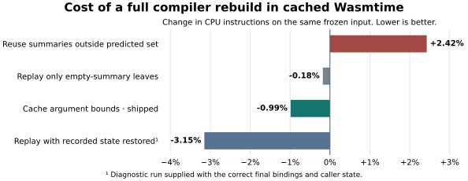
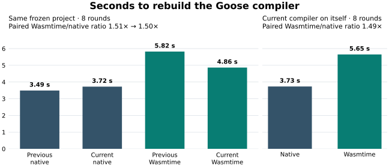
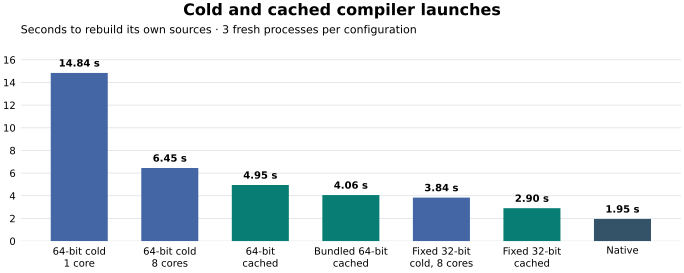

# Which calls can the lifetime checker skip?

The frozen compiler made **552 updates** in its third discovery pass. Starting from callers that had read an older result or effect and following their callers reached **376 of 2,878 evaluated function bodies**. Those 376 included the origin of every update. Replaying the other calls from their recorded summaries still made the full rebuild do more work. The released change caches argument bounds and preserves the original call order. [Predictions](prediction.json) · [Recorded calls](calls.jsonl.gz)

## Why skipping bodies added a pass

A function summary describes effects visible to its caller. Executing a call also records which caller last entered it, where its result goes, and which parameter bindings are still live. The checker uses live bindings to determine how long a reference may be kept.

On the frozen input, the broader replay visited 195,136 syntax nodes in pass three, down from 462,819. It reproduced the ordered effects and all 552 revisions. At the end of the pass, **131 frames had a different parent and destination, and 261 cells had a different live flag**. Reconciling that state took a fifth pass. Across discovery as a whole, node visits rose from 1,851,352 to 2,046,488. [Pass counts and state fingerprints](boundaries.json)

One concrete example is `diagnose_at`. In pass two its frame was entered once and its five parameters were cleared on return. In pass three a second call rebound the same five parameters and reused the previously checked body, leaving the parameters live. Replaying its caller skipped both calls. Carrying the previous pass’s final values forward would also have missed those five changes. A real scheduler needs to preserve those in-pass binding transitions. [Observed call sites and parameter names](boundaries.json)

### Measuring the opportunity

The following variants ran on the frozen `34ddff8` sources. Each compiled the same 8,886,107-byte output. The caller lists baked into the first three variants came from a complete earlier traversal of that input. The final two rows selected leaves dynamically from earlier passes in the same compilation. A leaf here is a function that made no observed calls to other Goose functions. [Raw paired samples](experiments.json.gz) · [Probe patches](probes.tar.gz)

| Pass-three policy | Bodies evaluated | Pass-three node visits | Discovery passes | Full rebuild CPU instructions vs. baseline |
| --- | ---: | ---: | ---: | ---: |
| Baseline | 2,878 | 462,819 | 4 | — |
| Replay bodies outside the caller closure | 376 | 195,136 | 5 | +2.4% |
| Also require an empty summary for replay | 2,068 | 393,505 | 5 | +4.9% |
| Restore the reference pass’s exact frame assignments and live bits after broad replay | 376 | 195,136 | 4 | −3.15% |
| Replay leaves with any summary | 2,100 | 416,030 | 4 | −0.4% |
| Replay only leaves with an empty summary | 2,474 | 435,390 | 4 | −0.2% |

Restoring the reference state also restored every frozen pass-boundary fingerprint. That test used values recorded by the baseline and hard-coded frame IDs. Its 3.15% saving measures this particular counterfactual before the cost of discovering and maintaining valid dependencies. The predictor counted a reader as potentially stale when the first version it saw changed later in the pass, even if it read the newer version too. [Baseline and repaired state](boundaries.json) · [Prediction inputs](prediction.json)

**Leaf replay failed independent state checks.** The rule allowing any summary differed on 31/346 ordinary checks and 17/510 checks with a forced early switch to class-based analysis. The same programs still returned the same diagnostics and exit statuses. Requiring empty summaries matched every tested state but saved only 0.2% of instructions in the frozen rebuild. The ordinary cohort included all 261 contract inputs whose baseline traces had at least three pass beginnings, 36 focused fixtures, 48 generated programs and the frozen compiler. The forced cohort included 426 applicable contract inputs and the same 84 fixtures. [Per-source results](leaf-checks.json.gz)

## What shipped

A callee bounds a reference argument by the lexical depth of each storage location it can reach. The same immutable set of locations often arrives at many calls. In a diagnostic full check, the checker received 319,344 parameter requests. Among the nonempty requests that needed this transformation, 797 computed a new mapping and 182,015 could reuse one. The release uses the checker’s existing bound cache for this mapping. It also rechecks whether the current call has a private view of the holder, since that depends on mutable contents and lexical reach. The change removes a duplicate set-building loop. Its [permanent regression case](../../../../tests/fixtures/contracts/views/mixed-depth-holder.goose) compares the three lines of output with upstream Goose and passed on native, memory32 and memory64 at O0 and O2. [Parameter trace and mixed-depth test](parameter-check.json) · [Checker](../../../../selfhost/checker_lifetimes.goose)

A separate cache field reduced Wasmtime instructions by 1.0% in its four-round screen. Adding an identity shortcut to that field reduced them by 1.3%. Reusing the existing cache saved 1.0% with no extra field on every set. Replacing positional argument lookup with a list cursor changed frozen Wasmtime instructions by +0.03%. [All tested variants](experiments.json.gz)

Three GPT‑6.2 Sol high reviews traced the missing bindings, checked reuse of the existing cache and identified a cache-key collision. The release reserves a key outside the full 32-bit range of ordinary depth bounds.

## Released compiler benchmarks

On the frozen project the shipped parameter cache used **0.99% fewer CPU instructions in Wasmtime** and **0.91% fewer native**. Each of the eight paired rounds emitted the same 8,886,107-byte module. Within-round changes in elapsed time were **-3.3% in Wasmtime** and **-2.3% native**. The paired Wasmtime/native ratio was 1.51× before and 1.50× after. [Eight-round measurements](frozen.json)

| Frozen compiler rebuild | Wasmtime before | Wasmtime after | Native before | Native after |
| --- | ---: | ---: | ---: | ---: |
| Wall time | 5.82 s | 4.86 s | 3.49 s | 3.72 s |
| Lifetime analysis | 2.76 s | 1.65 s | 1.72 s | 1.93 s |
| CPU instructions | 24.04 billion | 23.81 billion | 16.33 billion | 16.18 billion |
| Peak resident memory | 616.6 MiB | 608.5 MiB | 336.5 MiB | 336.8 MiB |

The bars and table use the median for each binary. Ratios compare the measurements taken in the same round. Rebuilding the current compiler on its own sources took **5.65 s in cached Wasmtime and 3.73 s native**, with a paired ratio of **1.49×**. [Own-source runs](current.json)

To gauge shared-host timing variation, we also ran the released binary under two labels in six paired rounds on each engine. The median elapsed differences between identical binaries were **+0.7% in Wasmtime** and **under 0.1% native**. On its own sources, the first eight-round run spanned 3.15–11.52 s in Wasmtime, with medians of 6.52 s Wasmtime and 3.75 s native (1.58× paired). We scheduled the independent eight-round repeat shown in the chart after observing that spread. The instruction differences between identical binaries were below 0.001% on both engines. [First own-source run](current-first.json) · [Same-binary control](same-binary.json)

**Where the time went.** On its own sources the release executed 24.29 billion host instructions in Wasmtime and 16.54 billion native (1.47×). Lifetime analysis had the largest median within-round time difference, **0.89 s** longer in Wasmtime. The independent phase differences below subtract lifetime analysis from type checking to avoid double counting. Measure the cost of replaying just the parameter bindings and caller assignments on a second call, starting with the observed `diagnose_at` case. [Eight paired phase profiles](current.json)

Parsing +0.04 s · Type checking outside lifetime analysis +0.15 s · Lifetime analysis +0.89 s · Optimization +0.11 s · Backend +0.23 s.

## Cold and cached self-compilation

The launch benchmark ran separately without phase timing or hardware counters. Both benchmark configurations emitted the same 8,937,039-byte module. Across three fresh processes per configuration, the fixed memory32 compiler took **3.84 s cold on eight cores** and **2.90 s cached on one core**, versus **1.95 s native**. Default memory64 took 14.84 s cold on one core and 6.45 s cold on eight. [Launch and edit samples](launch.json)

## Eleven programs and ten examples

Across eleven programs the new compiler used 5.4% less CPU time to emit Wasm and 4.0% less to emit C, measured over 31 samples per cell. Both compilers emitted identical Wasm and C for all eleven. The ten example programs and resident Mandelbrot benchmarks were rebuilt and rerun on the new compiler. [Catalog](catalog-summary.json) · [Compiler as Wasm](selfhost.json) · [Examples](examples.json.gz) · [Fresh processes](host.json.gz) · [Resident Mandelbrot](langbench-hot.json.gz)

## Reproducibility

The baseline compiler is `b8e00ef`. The release is `9682303`. For the diagnostic screens, every bundled memory32 module used the baseline’s layout profile. Wasmtime 50.0.1 launched a new, prepared process pinned to CPU 7 on a shared Ryzen 7 3800X. Screen timings overlapped other machine activity. The instruction comparisons report median within-round ratios. The release comparison uses separately trained profiles and fresh sequential benchmarks. [Baseline layout](../lifetime-store-delivery/training.profile) · [Screen samples](experiments.json.gz)

The trace is compressed newline-delimited JSON. Each event starts with its kind and discovery pass. Kind 2 records an effect insertion or widening with the executing frame, owning frame, effect kind, entry ID and insertion flag. Kind 3 records changes to structural return values. Kinds 4, 5 and 6 identify call dispatch, returned value and start of summary replay, with caller, caller context, call-site node and callee. Kind 5 adds 0 for an evaluated body, 1 for replay and 2 for a recursive back edge. Kind 7 records a store applied during replay and adds its entry ID. Kind 8 gives the frame, function node and node visits. Kind 0 starts a pass and kind 9 ends it with the revision count and number of class frames. The recorded summary-write events cover all revisions in frozen passes three and four. [Compressed trace](calls.jsonl.gz) · [Replay the prediction](tools/stale_callers.py) · [Predictions](prediction.json)

The release matched all 10,057 output comparisons. Bootstrap reproduced its C output. After adding the permanent fixture, the full suite passed 10,697 of 10,801 default rows and 4,771 of 4,779 memory64 rows. Both runs matched the recorded gaps. All 54 native checks and 93 unit tests passed during release qualification. Structural fingerprints and pass counts matched on all 4,395 ordinary and 4,394 forced-class inputs, including the new mixed-depth holder fixture. [Qualification and module identities](verification.json) · [Ordinary checks](fingerprints-4096.json.gz) · [Forced checks](fingerprints-16.json.gz)

The [patch archive](probes.tar.gz) contains independent diffs against `b8e00ef`. All 26 patches apply to that source, and `shipping.patch` reproduces the released checker byte for byte. Apply one patch to a source copy, build that compiler, and use it to check `selfhost/main.goose` from a separate `34ddff8` checkout. Semantic comparisons use the [structural fingerprint helper](../lifetime-store-delivery/README.md#reproducing-the-checks). The archive also contains the mixed-depth holder and generated leaf fixtures.
