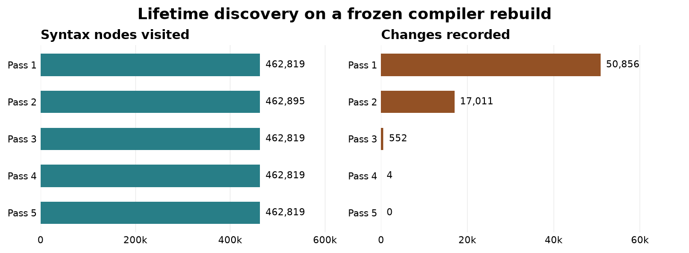

# Where lifetime analysis can improve

**Start with the last three discovery passes.** On a frozen compiler rebuild, pass three recorded 552 changes, pass four recorded four, and pass five recorded zero. Each evaluated 2,878 function bodies and visited 462,819 syntax nodes. The four late changes all widened descriptions of stores made by two recursive parser functions, `parse_type_list` and `parse_type_arguments`. [Pass counters and call graph](discovery.json)

The lifetime checker tracks which storage a reference can point into. A call can return a reference, store it elsewhere or invalidate a reference held by its caller. Discovery accumulates these facts across calls until a complete pass finds no change. A separate validation pass checks the order of reads and mutations. For example, a reference into an array becomes invalid if the program shrinks the array before using the reference. [Checker implementation](../../../../selfhost/checker_lifetimes.goose)

In six rounds on the frozen project, lifetime analysis took a median **1.597 s in cached Wasmtime and 1.109 s native**. The full rebuild took **3.154 s and 2.063 s** respectively. Comparing engines within each round, the median lifetime gap was 0.478 s and the rebuild gap was 1.054 s. Nine of the ten example programs settled in two discovery passes. Squares needed one. [Full-build samples](measurements.json.gz) · [Example counts](discovery.json)

## 1. Recheck the consumers of changed summaries

A frame represents one function being checked with a particular set of arguments and surrounding storage. A summary records the effects that its callers can observe. In pass three, all 552 revisions added or widened effects belonging to 122 frames. In pass four, all four revisions widened existing store effects in two frames. Five frames called those two directly. Following calls backward reached 169 frame IDs out of 2,879 in the observed graph, including the two starting frames. Shared storage can add dependencies outside these call edges. [Recorded changes and reachability](discovery.json)

Implement the first experiment alongside the existing traversal.

1. In `life_effect_merge` and the summary insertion path, bump a per-owner version for every newly added or widened effect. The existing `replay_version` covers selected kinds of effects. The four late store updates are kind 4 and need their own coverage.
2. At `life_replay`, record which caller consumed which version at which call site and in which enclosing context. Queue a consumer when a fact it used grows. Process recursive callers until their queues empty. A global write or a change to captured storage can also wake readers. Start with full traversal whenever those dependencies, frame creation or class-based remapping are untracked.
3. First have the queue predict the next pass while the original traversal runs. Compare the predicted changes, normalized frame and effect state, exported provenance and diagnostics. Exercise recursive rebinding, aliases, captures and forced early class checking. Once the prediction covers every change, time the queue with the independent final validation pass still enabled. On this rebuild validation created three additional frames and recorded 14 revisions. [Qualification guide](../../../../tests/README.md#qualifying-a-change)

A diagnostic experiment stopped discovery after pass two. It emitted the **same 8,886,107-byte compiler** and retired **4.40 billion fewer Wasmtime instructions** across the rebuild. It also accepted **two invalid programs** among 4,357 distinct contract sources. In both, a nested recursive call eventually rebinds a reference to a different owning pool. The next pass exposes the invalid store. Those two fixtures are acceptance tests for the queue. The measured saving describes work removed by the incorrect shortcut. The queue's saving remains unmeasured. [Corpus comparison and diagnostics](checks.json.gz)

## 2. Cache the interior storage mapping

`life_interior` walks the alternatives in a set of storage locations and clears two fields on each alternative. Those sets are immutable after construction. Store the computed result on the input set for ordinary frames, with the existing builder handling class-based analysis. On the frozen project **438,921 of 441,957 calls** could reuse the result (99.31%). A companion cache for named components received zero requests on this workload. The one-field experiment measures the interior cache alone. [Source patches](experiments.tar.gz) · [Request counts](discovery.json)

The one-field cache took **25.26 billion Wasmtime instructions**, down from **26.11 billion** for the whole rebuild. Native instructions fell from **17.78 billion to 17.16 billion**. The four-pair follow-up ran on a busy host. Its elapsed medians were **15.00 s with the cache and 11.69 s for baseline**. This is an instruction saving with an observed elapsed-time regression. Repeat the pair on a quiet host and include a named-component program before deciding whether to keep the extra field. [Individual samples](measurements.json.gz)

## 3. Reuse temporary argument and tuple storage

`life_append` allocates an 80-byte record for each argument or tuple element. By the end of validation, the checker had allocated **552,201 records**. Following links from standalone arguments, frame inputs and results, exits, holds, effects and leaves reached **9,416**. At the end of discovery pass two, 9,364 of 184,063 records were reachable. [Per-pass item counts](discovery.json)

A prototype marked reachable records between passes, then reused vacant slots. It preserved the indices of live tuples because effect lookup hashes include tuple IDs. The item array peaked at **101,430 records**, down from **552,201**. Across eight Wasmtime rounds, median peak process memory fell from **632.4 MiB to 596.9 MiB**. Native peak memory also fell, from **369.6 MiB to 333.5 MiB** in four rounds. Whole-build Wasmtime instructions rose from **26.11 billion to 26.19 billion**. For a memory-constrained build, test reusing slots above a high-water mark. For a faster build, profile allocating temporary call arguments separately and copying only the lists retained by a frame. Nested tuple results and stored effects can keep those lists alive. [Prototype and pass-boundary roots](experiments.tar.gz) · [Memory samples](measurements.json.gz)

Agent only

## Measurement and reproduction

The compiler was `7ff11b74`, and every full-build trial compiled the project at `34ddff8d` to memory64 Wasm at `-O2`. The compiler running in Wasmtime was bundled memory32 with a primed cache. Each trial used a fresh process pinned to CPU 7. The native compiler used Clang 23.1.5 at `-O2`. The Rust host used Wasmtime 50.0.1. The six-round comparison, eight-round memory comparison and four-round cache follow-ups are separate series. Contention increased between series. The full-build instruction counts include both the host and guest. Instrumented pass counts used separate compiler images. [Tool identities, flags and raw samples](measurements.json.gz)

Apply one patch at a time to a clean source copy at the compiler commit. Build it with the same source emitter and layout profile as the unmodified control. For a full-build trial, follow the existing paired runner with the frozen project at `34ddff8d`. For the pass and dependency probes, replace the output argument with `--check`. The archive includes a two-checkout command sequence, counter decoding and the chart source. [Reproduction archive](experiments.tar.gz) · [Layout profile](../bundled-publications/training.profile) · [Paired runner](../../2026-11-18/compiler-frame-cost/measure.py)

The corpus screen compared exit status, stdout and stderr for each of 4,357 distinct sources in the contract manifest. The interior cache, the combined mapping cache and a storage-reuse variant forced on small eligible inputs each matched the native baseline on all sources. The ordinary-threshold reuse and one-field cache matched the Wasmtime baseline on all 40 focused programs, including the 4,100-call class transition. [Corpus and focused checks](checks.json.gz) Focused Wasmtime checks used the released Wasmtime compiler as their output reference. All timing trials verified the emitted module's SHA-256. These are exploratory checks. A release decision also requires the [logical fingerprints and output-equivalence suite](../../../../tests/README.md#qualifying-a-change).

