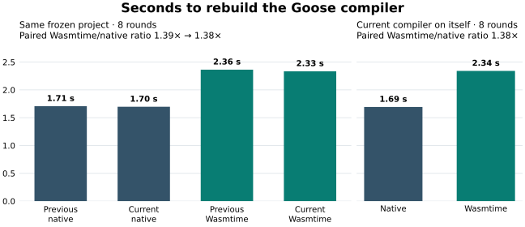
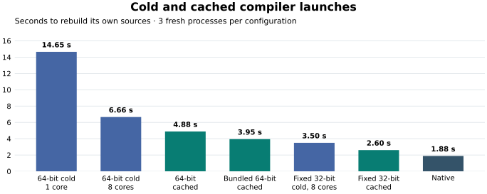
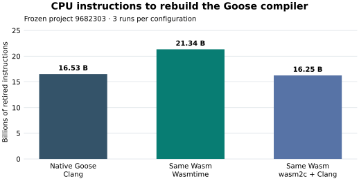

# Lifetime evaluator stack frames

## Rebuilding the compiler

On its own sources, the compiler took **7.81 s in cached Wasmtime** and **4.93 s native**, or **1.41× native time** across eight matched rounds. The median ratio divides Wasmtime time by native time within each round. Under varying host load this can differ from dividing the two overall medians. A second eight-round run on CPU 2 measured 7.49 s and 5.52 s respectively, with a paired ratio of 1.41×. Both comparisons ran on a shared host. [Second run](current-repeat.json)

Both executables wrote the same 8,822,938-byte module. [Own-source runs](current.json)

The frozen comparison uses the previous compiler project as input to all four binaries. Wasmtime elapsed time changed by +2.52% and native by +2.37% within pairs. Instructions changed by -0.50% and -0.65% respectively. The smaller stack frames showed no consistent elapsed-time win on the frozen release workload. All 32 builds emitted the same 8,820,805 bytes. The ratio was 1.39× before and 1.35× after. Elapsed measurements were taken on a shared machine. [Frozen project runs](frozen.json)

| Frozen project | Median wall | Median CPU | Retired instructions |
| --- | ---: | ---: | ---: |
| Previous native | 2.194 s | 2.167 s | 16.493 B |
| New native | 3.368 s | 2.916 s | 16.385 B |
| Previous Wasmtime | 3.672 s | 3.276 s | 21.275 B |
| New Wasmtime | 3.693 s | 3.642 s | 21.169 B |

Across both changes, a separate eight-round experiment compared the first and last compilers on the same original project at `9682303`. The Wasmtime/native time ratio moved from **1.47× to 1.43×**. Median within-pair counts fell by **12.6% of instructions** in Wasmtime and paired process CPU time fell by **6.8%**. [Campaign comparison](campaign.json)

## What changed

The lifetime checker follows expressions to find which storage their references can reach. A single function used to reserve space for all its cases, including branches for calls, loops and assignments. Fourteen smaller functions now handle the cases separately. Each receives the output it needs, and recursive calls reserve temporary space for the selected case. The trial's maximum reservation for the evaluator and one handler fell from **15,704 to 4,944 bytes**. The entry function alone grew from 792 to 2,448 bytes. These are static frame sizes. [Frame sizes and eight rotated before/after trials](experiments.json.gz)

## Cold and cached self-compilation

The fixed bundled compiler took **3.50 s cold on eight cores** and **2.60 s cached on one core**, compared with **1.88 s native**. The default memory64 compiler took 14.65 s cold on one core and 6.66 s cold on eight. Each value is the median of three fresh processes. A cached process still reads, checks and compiles the entire project and writes its output. [Launch, phase and edited-source runs](launch.json)

## Where the gap remains

Four additional pairs counted host CPU instructions on the compiler thread. Each phase boundary exactly matched the timestamps reported by the compiler. The type-checking row excludes lifetime analysis. Process setup and file output fall outside these intervals. [Phase samples](phase-counters.json) · [Measurement harness](tools/phases.py)

| Compiler phase | Native instructions | Wasmtime instructions | Extra in Wasmtime |
| --- | ---: | ---: | ---: |
| Parse | 0.53 B | 0.75 B | +0.22 B |
| Type checking outside lifetimes | 1.83 B | 2.63 B | +0.80 B |
| Lifetime analysis | 7.56 B | 9.46 B | +1.90 B |
| Optimization | 1.30 B | 1.83 B | +0.53 B |
| Emit Wasm | 5.15 B | 6.46 B | +1.31 B |

Lifetime analysis accounted for **40%** of the 4.78 billion extra instructions, followed by Wasm emission at **28%**. The next experiment is to count which expression cases create or copy lifetime results, then test a compact representation for the most frequent case against these same phase counts and structural fingerprints.

On the previous SIMD compiler, a separate engine control ran exactly the same Wasm through WABT’s wasm2c and Clang. It retired **16.25 billion** instructions, compared with **21.34 billion** in Wasmtime and **16.53 billion** for native Goose. All three wrote identical modules. WABT used guard pages and Clang 23 at `-O2 -march=native`. The native Goose control used `-O2` with the default CPU target. Median child CPU times were 4.17 s for WABT, 4.95 s for Wasmtime and 3.58 s for native. This shows the amount of host machine code executed can change even when the Wasm stays byte-identical. The C translation is a different runtime. [Three-engine samples and hashes](engine-control.json)

Running the whole translated compiler back inside stock Wasmtime produced identical output in two pairs and retired **2.15×** the instructions of the original guest. It represented the guest memory inside a second Wasm memory. Compiling only the scope-walk loop with LLVM kept the original memory and passed seven behavior checks. Its body shrank from 180 to 149 bytes, saving just **0.037%** of full-build instructions in one pair. Rotating loops directly in our own backend saved 0.76% of full-build instructions in a separate screen. [Cranelift disassembly](tools/life_in_scope-cranelift.s) · [Clang disassembly](tools/life_in_scope-clang.s) · [Experiment samples](experiments.json.gz)

An earlier control on compiler `9682303` removed the entire lifetime checker from both targets. The median three-pair elapsed ratio was 1.55× with it removed and 1.51× with it enabled in the same diagnostic binaries. The removal also wrongly accepted all five invalid programs used as controls. Even eliminating this phase from both compilers left a substantial gap elsewhere. [Phase-removal measurements and diagnostic controls](experiments.json.gz)

A compiler that captured only the scalar fields used from immutable records saved 2.54% of Wasmtime instructions in six pairs. Its paired elapsed gain was 1.02%, with four wins. It required new fallback rules for duplicated defer bodies and host access to guest memory. We kept the existing record implementation. Recomputing frame addresses, forwarding plain record results and padding lifetime records each changed the full rebuild by less than 1% of instructions. [Alternative measurements](experiments.json.gz)

## Verification and reproduction

The native bootstrap reproduced its generated C. All 10,061 previous/current comparisons matched. The default and memory64 conformance suites reproduced their recorded gaps, and all 54 native checks and 94 unit tests passed. The exact shipped evaluator matched the earlier one on every pass-boundary fingerprint, diagnostic and exit status across 4,394 ordinary inputs and 4,394 forced-class inputs. A separate frozen self-check matched seven fingerprint lines in optimized Wasmtime after the unoptimized native probe exceeded its 180-second limit. The second configuration makes the checker switch to its general form after 16 frames, exercising behavior that small programs rarely touch. [Qualification and module hashes](verification.json) · [Ordinary fingerprints](fingerprints-4096.json.gz) · [Forced-class fingerprints](fingerprints-16.json.gz)

The previous source revision was `3756b67` and the new one was `e5381f0`. Both native compilers use eight C units with Clang 23.1.5 at `-O2`. The Wasmtime comparison runs a fixed, bundled memory32 compiler with a prepared engine cache on the same core as native. Every compiler emits portable memory64 output. Reuse the [paired measurement commands](../fixed-record-copies/README.md#verification-and-reproduction) with the matching revisions and profiles. Both releases train on squares, sorting and tour. [Current profile](training.profile) · [Previous profile](../fixed-record-copies/training.profile) · [Build configuration and frozen source hashes](selfhost.json)
