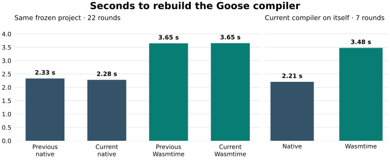
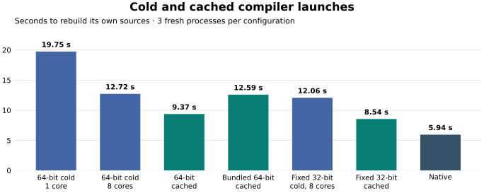

# Replaying changed lifetime reads

The previous compiler visited **9,234,419** compact read entries while checking the frozen compiler project. The new checker visits **8,145,110** and skips **1,792,641** of those before looking up an individual read. It remembers which version of the function summary each caller has already received. [Read counters](read-counts.json)



| Full rebuild of the same source, 22 rounds | Previous | Current |
| --- | ---: | ---: |
| Native | 2.332 s | 2.281 s |
| Bundled memory32 in Wasmtime | 3.648 s | 3.654 s |
| Wasmtime / native | 1.56× | 1.60× |
| Native instructions retired | 22.891 billion | 22.328 billion |
| Wasmtime instructions retired | 35.969 billion | 35.237 billion |
| Native peak RSS, separate run | 428.9 MiB | 437.3 MiB |
| Wasmtime peak RSS, separate run | 691.4 MiB | 707.0 MiB |

The previous compiler and the input to all 88 builds were frozen at `3084b81`. The current compiler is `34ddff8`. Wasmtime finished sooner in **10 of 22 pairs** and native in **17 of 22**. Median within-pair wall times changed by +0.1% in Wasmtime and -2.2% natively. All outputs matched the 8,885,753-byte portable memory64 reference. [Elapsed time, counters and output hashes](frozen.json) · [Peak resident memory](memory.json)

Rebuilding its **own** sources took **3.478 s** in Wasmtime and **2.207 s** native, or **1.58× native time**, across seven more rounds. Each observation starts a fresh process on CPU 7 of a shared Ryzen 7 3800X with warm filesystem pages. Wasmtime 50.0.1 uses precompiled machine code for the compiler. Native uses Clang 23.1.5 at `-O2` with eight C units. All requests parse, check, optimize and write the entire program. [Current-source requests](current.json)

The first eleven rounds measured 3.806 → 3.818 s in Wasmtime and 2.339 → 2.421 s native. Reversing the starting order for eleven more rounds measured 3.642 → 3.647 s in Wasmtime and 2.320 → 2.231 s native. The table pools both series. Absolute times varied with the other processes on the machine. [Both original series](rebuild-series.json.gz)

Both compiled Wasm tools use bundled memory32 with 65,535 pages. Each release's layout was trained independently on squares, sorting and tour, with the same sizing rule. An earlier five-round run on CPU 5 overlapped qualification and measured 9.741 → 9.737 s in Wasmtime and 6.210 → 5.890 s native. The screening runs held the region profile fixed. [Concurrent run](concurrent.json.gz) · [Training weights](training.profile) · [Source, tools and module hashes](verification.json)

## How the checker saves work

When two callers read the same storage, the lifetime checker joins their information into a function summary. The checker used to invalidate the summary's replay version even when the joined read stayed the same. Now the version advances when the summary gains a new read or its joined value changes. If just one read changes, a caller can skip every entry it has already received on the same call chain and recursion epoch. New and changed entries keep their original order.

Across 4,357 corpus sources, 80 exercised the new shortcut, skipping 388 individual lookups. This included a passing grow/shrink program and a recursive call that must fail lifetime checking. Plain upstream Goose ran the first with matching output and rejected the second. All 11,596 corpus fingerprint lines and another 14 from the compiler and two forced class-frame fixtures matched exactly. [Corpus counters](corpus.json.gz) · [Upstream controls and fingerprints](verification.json)

## Cold and cached self-compilation



On the default memory64 compiler, an empty cache took 19.75 s with one core and 12.72 s with eight cores for engine preparation. The fixed memory32 compiler took 12.06 s uncached with eight cores and 8.54 s cached on one core. Native took 5.94 s. These three-round launch medians overlapped qualification and other benchmarks. The one-line edit produced a different module, independently verified by native, in 3.67 s from the cached fixed compiler and 2.34 s natively. [Launch, edit and phase clocks](launch.json)

| Separately instrumented phase | Native | Cached Wasmtime |
| --- | ---: | ---: |
| Parsing | 0.052 s | 0.089 s |
| Type-checking, excluding lifetime analysis | 0.210 s | 0.359 s |
| Lifetime analysis | 1.419 s | 2.215 s |
| Optimization | 0.142 s | 0.243 s |
| Wasm emission | 0.488 s | 0.758 s |

Loading and instantiating the cached fixed compiler took a median **5.9 ms**. Lifetime checking took **0.80 s** longer inside Wasmtime in this phase comparison.

## Tradeoffs and other trials

The new per-read version occupies eight bytes. Across three independent builds per configuration, median peak RSS increased by **8.4 MiB native** and **15.7 MiB in Wasmtime**. A trial kept each read the original size by reconstructing its lookup key from its leaf. This saved another 7.9 MiB in Wasmtime relative to the release on the same layout. Seven pairs gave 3.687 → 3.669 s in Wasmtime and 2.326 → 2.373 s native. Both layouts produced the same module. The release keeps direct key access because the smaller layout increased native time and added instructions in Wasmtime. [Memory samples](memory.json) · [Timing and instruction comparisons](screens.json.gz)

A probe counted only **190 leading reads** that could be skipped across 470 incomplete replays. Remembering a partially completed prefix therefore offers little on this source. A second probe found 242,851 additional entries that might be skipped if recursion epochs could be reused. That count is an upper bound. Epoch changes can alter lifetime results. Other trials varied hash computation, the layout of lookup slots, caller caches, and the range of reads marked dirty. Storing an entire key beside each lookup slot exhausted a region of the fixed compiler. [Diagnostic counts](read-counts.json) · [Screens including the failed trial](screens.json.gz) · [Experimental patches](experiments.tar.gz)

## Qualification and reproduction

All 10,057 compiler output comparisons matched. The default suite retained 104 known gaps across 10,797 rows and memory64 retained eight across 4,777, with zero unexpected failures. All 89 unit tests and all 54 native checks passed. The compiler reproduced its C and fixed memory32 outputs byte for byte. Across the eleven-program compiler catalog, median CPU time aggregated by geometric mean changed by -2.8% for Wasm and -3.0% for C. All 22 output artifacts matched. [Qualification](verification.json) · [Per-program times](catalog-summary.json)

Follow the [stage build and paired measurement commands](../compiler-passes/README.md#reproduce) with `3084b81` and its [profile](../compiler-passes/training.profile) as the baseline, and `34ddff8` and [this profile](training.profile) as the candidate. Use the baseline source stage and all four compiler paths for eleven rounds, then run eleven more with the four arguments in reverse order. Use the candidate source stage and its two compilers for seven rounds. Use the launch harness for three rounds. Regenerate the charts from the retained samples with the command below.

```sh
.venv/bin/python bench/selfbuild_charts.py bench/results/2026-11-19/lifetime-read-replay
```

To reproduce the diagnostic counts, apply [the six-counter probe](read-counts.patch) to a source copy at `34ddff8`, build the instrumented compiler and check the frozen `3084b81` project with the exact arguments in the [counter report](read-counts.json). The experiment archive includes the original probe against `3084b81`.
