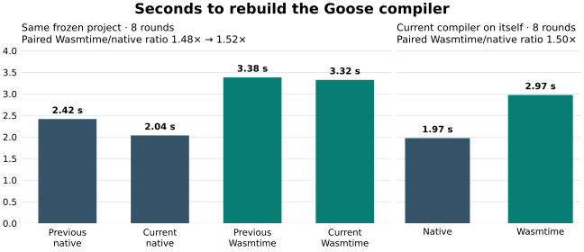
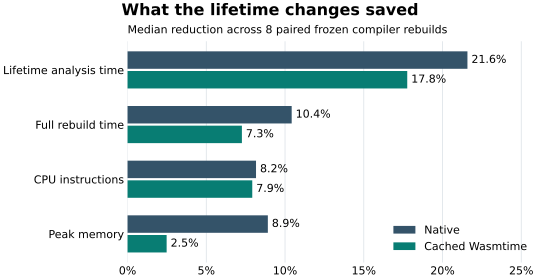
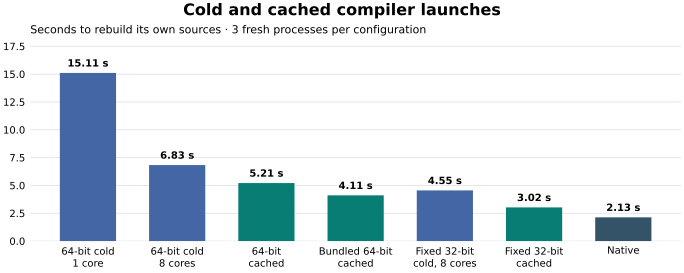

# Faster lifetime checking on the compiler rebuild

The lifetime checker finished the frozen compiler in four discovery passes, down from five. In eight paired rounds the full build took **7.3% less wall time in cached Wasmtime and 10.4% less native**. Native improved more, moving the paired Wasmtime/native ratio from **1.48× to 1.52×**. Both engines produced the identical 8,886,107-byte module in every round. [Frozen samples](frozen.json)



| Frozen project | Previous native | Current native | Previous Wasmtime | Current Wasmtime |
| --- | ---: | ---: | ---: | ---: |
| Full rebuild | 2.42 s | 2.04 s | 3.38 s | 3.32 s |
| Lifetime analysis | 1.28 s | 0.97 s | 1.80 s | 1.61 s |
| Retired CPU instructions | 17.78 billion | 16.33 billion | 26.11 billion | 24.04 billion |
| Peak process memory | 369.6 MiB | 336.7 MiB | 632.5 MiB | 616.7 MiB |

The table shows the median for each binary. The percentage improvements compare old and new in the same round before taking the median, which reduces the effect of changing host load. Each engine was faster in seven of eight pairs. Within pairs, the lifetime phase took **17.8% less time in Wasmtime** and **21.6% less native**. Retired instructions measure CPU work and fell in all eight pairs. [Individual samples](frozen.json)



On the compiler’s own, larger sources, the new compiler took **2.97 s in cached Wasmtime and 1.97 s native**, or **1.50×** in paired rounds. The median same-round wall-time gap was 0.99 s, including 0.44 s in the lifetime checker. This run produced an 8,937,459-byte default memory64 compiler. [Own-source samples](current.json)

## What each change bought

1. **Skip a redundant confirmation pass.** A function summary records effects that callers can observe, such as storing a reference into an array. The checker watches which caller has already read a summary. When a store gains another possible value, the checker can finish the round if that value already reached the destination and every relevant caller. It also compares frame results, bindings and exits at the start and end. Multiple earlier caller chains, other kinds of changes or incomplete delivery keep the ordinary traversal running. The frozen project made 50,856, 17,011, 552 and then four revisions. All four final revisions passed the checks. The separate ordered validation pass still runs. [Pass traces and controls](witnesses.json.gz)
2. **Cache the interior storage mapping.** For ordinary frames the first request computes the possible storage locations inside a value and records the result on the immutable input set. Repeated requests reuse it. Class-based analysis retains its existing mapping. On this project the original request trace had 438,921 repeat opportunities in 441,957 calls. [Request counts](../lifetime-discovery/discovery.json)
3. **Reuse temporary argument and tuple storage.** Between complete root traversals, the checker walks the links from live arguments, captures, results, block exits, effects, leaves and held values. It reuses the other slots while keeping all live indices stable for effect lookup. The sweep starts above 65,536 slots and can be skipped while enough of the previous free list remains. The combined release saved **15.7 MiB in Wasmtime and 32.9 MiB native** in the frozen process medians. [Implementation](../../../../selfhost/checker_lifetimes.goose) · [Memory measurements](frozen.json)

## Isolating the three changes

Six additional rounds used the same frozen project and the previous release’s layout profile for all four Wasm binaries. The columns show medians. Each percentage compares the change to the preceding binary in the same round. All 24 compiles produced the same module. [Isolated samples](isolated.json)

| Bundled Wasmtime compiler | Rebuild | Paired time change | Retired instructions | Peak memory |
| --- | ---: | ---: | ---: | ---: |
| Previous compiler | 2.93 s | — | 26.11 billion | 632.3 MiB |
| Add interior mapping cache | 3.03 s | -0.3% | 25.26 billion | 632.4 MiB |
| Also reuse temporary tuple slots | 2.96 s | -2.5% | 25.33 billion | 598.5 MiB |
| Also check delivery of widened stores | 2.83 s | -5.4% | 24.04 billion | 618.7 MiB |

The cache reduced retired instructions by 3.3%. Its elapsed time improved in three of six pairs. Reusing slots saved 33.9 MiB of peak process memory and changed instruction count by +0.3%. The delivery check removed the fifth pass and reduced instructions another 5.1%, with 20.2 MiB more peak memory than the cache-and-reuse version. Layout training was repeated for the released compiler in the eight-round comparison above.

## Remaining work

The next experiment is to visit fewer callers in pass three. On the frozen project it still records 552 revisions, and some callers have already consumed facts that subsequently change. Record exactly which callee result or store each caller consumed, let the ordinary pass run, and compare the predicted changes with the observed ones before skipping any calls. The current-source measurements put the remaining lifetime portion of the Wasmtime/native gap at 0.44 s per rebuild. [Pass trace](witnesses.json.gz) · [Current-source samples](current.json)

## Cold and cached self-compilation

The fixed 32-bit compiler took **4.55 s** with an empty engine cache on eight cores, **3.02 s** with a prepared module on one core and **2.13 s** as native code. The cached Wasmtime run spent a median **5 ms** preparing and instantiating the module and **3.01 s** in its entry point. After a source edit, the same full rebuild took **3.03 s** in cached Wasmtime and **2.00 s** native. Each cell has three fresh processes. [Launch samples, phase timings and artifact identities](launch.json)



## Other workloads

All eleven catalog programs emitted identical Wasm and C across compiler versions. Across 31 samples per cell, the geometric mean of median compiler CPU time fell by 4.6% to emit Wasm and 3.9% to emit C. The ten examples and the resident Mandelbrot suite were rebuilt and rerun on the release. The default memory64 compiler build and execution chart uses a separate three-round run with the same source and pinned emitter. Both build series produced identical default Wasm. Rebuilding C in a different absolute directory changed embedded diagnostic paths and translation-unit assignments. The initial build overlapped qualification. [Initial build and runtime control](selfhost-concurrent-build.json.gz) · [Catalog](catalog-summary.json) · [Compiler build and execution](selfhost.json) · [Examples](examples.json.gz) · [Process runtimes](host.json.gz) · [Resident Mandelbrot](langbench-hot.json.gz)

## Reproducing the checks

The previous compiler is `7ff11b7`, the candidate is `b8e00ef`, and both compiled the frozen workload `34ddff8`. Full rebuilds used one logical CPU (7) on a shared Ryzen 7 3800X, a fresh process, an already prepared Wasmtime 50.0.1 module and the same memory64 output flags. The bundled memory32 layout of each release was trained separately on squares, sorting and tour. The fixed candidate rebuilt itself byte for byte and emitted the same portable compiler as the pinned native emitter. Its release module grew from 7,244,971 to 7,263,448 bytes (+0.26%) and its prepared Wasmtime image grew by 46,648 bytes (+0.36%). The [qualification record](verification.json) includes tool and module hashes. [Layout profile](training.profile)

**Three rounds of GPT-6.2 Sol high review changed the implementation and its tests.** The first identified additional state to compare across pass boundaries, including return tuples and block exits. The second required checking the widened value against every ancestor’s store summary. The third requested executable coverage for a satisfied caller, a fallback path and tuple retention. [Branch traces and runtime output](witnesses.json.gz) · [Fixtures and experimental source patches](experiments.tar.gz)

- The baseline and candidate matched **10,057 output comparisons**. Default conformance passed 10,693/10,797 rows and memory64 passed 4,769/4,777. All failures matched recorded gaps. Bootstrap reproduced its C output. All 54 native checks and 93 unit tests passed. [Qualification](verification.json)
- Structural fingerprints matched on **4,357 distinct sources** with both the ordinary 4,096-frame threshold and a forced 16-frame threshold. The latter also enabled reclamation on small inputs. The focused checks matched on 64 and 63 inputs respectively, including the two recursive pool-rebinding errors accepted by the earlier two-pass experiment. Both versions rejected them after four passes. A shadow checker kept the full traversal after a predicted stop. Across the corpus plus the frozen compiler, it predicted one early finish, and the confirmation pass found zero changes. [Ordinary corpus](fingerprints-4096-corpus.json.gz) · [Forced corpus](fingerprints-16-corpus.json.gz) · [Ordinary focused](fingerprints-4096-focused.json.gz) · [Forced focused](fingerprints-16-focused.json.gz)
- A recursive store fixture discharged a pending caller in round three and printed `1`. Another fixture exercised multiple caller chains, retained all five rounds and printed nothing. Several kinds of facts changed in its third round. Injecting just one extra reader with no matching ancestor store independently forced a fourth pass on the first fixture. A tuple fixture retained values in two function results and one block exit while reusing other slots, and printed `5 2`. Upstream Goose and modules produced by the previous, native and Wasm compilers agreed on all three fixtures. A separate injected exit held three nested tuple slots while a fourth, unreachable slot was reclaimed in two sweeps. [Witness traces and hashes](witnesses.json.gz)

The [instrumenter](tools/fingerprint.py) and its [Goose helper](tools/fingerprint.inc) record structural tuple contents, ordered reads and effects, result provenance and diagnostics. The [comparison script](tools/compare.py) checks common discovery boundaries and both final states. From the repository root, run the following with a previously built native compiler at `build/bin/goose`.

```sh
root=$PWD
report=$root/bench/results/2026-11-19/lifetime-store-delivery
work=$(mktemp -d)
ulimit -s 262144
for rev in 7ff11b7 b8e00ef; do
  mkdir "$work/$rev"
  git archive "$rev" selfhost stdlib native | tar -x -C "$work/$rev"
  python3 "$report/tools/fingerprint.py" "$work/$rev"
  (cd "$work/$rev" && "$root/build/bin/goose" selfhost/main.goose --stdlib stdlib \
    --target native -O2 -o probe.c && clang -w -O0 -std=gnu11 probe.c -lm -ldl -pthread -o probe)
done
tar -xzf "$report/experiments.tar.gz" -C "$work" fixtures
python3 "$report/tools/compare.py" "$work/7ff11b7/probe" "$work/b8e00ef/probe" "$work"/fixtures/*.goose
```

For the forced run, add `--class-limit 16` to the instrumenter in fresh source copies. The experiment patches apply individually to `7ff11b7`. The source archive includes the exact inputs for the positive store, fallback and tuple tests.
