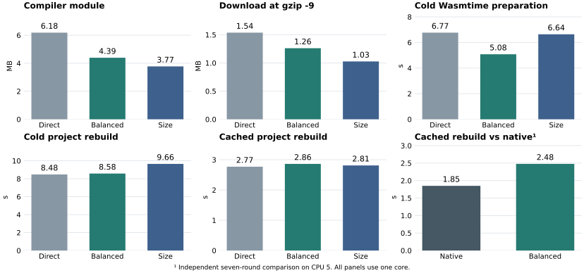

# Compacting the Goose compiler for distribution

The bundled compiler is 6.18 MB as emitted, 4.39 MB with the balanced release profile and 3.77 MB with the size profile. With gzip, the download falls from 1.54 MB to 1.26 MB or 1.03 MB. The optional packaging step runs once per release. [Usage](../../../../docs/GUIDE.md#build-and-run)



## Rebuilding a frozen project

| Compiler profile | Module | Gzip download | Cold rebuild | Cached rebuild |
| --- | ---: | ---: | ---: | ---: |
| Direct | 6.18 MB | 1.54 MB | 8.48 s | 2.77 s |
| Balanced | 4.39 MB | 1.26 MB | 8.58 s | 2.86 s |
| Size | 3.77 MB | 1.03 MB | 9.66 s | 2.81 s |

Balanced finished ahead of direct in four of seven cold pairs and four of seven cached pairs. Size finished ahead in two cold pairs and three cached pairs. The size reductions are repeatable. The rebuild timings give no consistent speedup.

Each timing is the median of seven fresh Wasmtime processes on one logical CPU of a shared Ryzen 7 3800X. Within each round we shuffled the order of the three modules. Cold runs include compiling and instantiating the module, reading project sources, compiling the project and writing its output. Cached runs use previously compiled machine code and include the rest of that work. All 42 timed runs produced the same 7,378,033-byte output. Earlier eight-core startup measurements used a different CPU allocation and workload. [Raw observations and module hashes](rebuilds.json) · [Benchmark driver](measure.py)

With only `--version` as the workload, balanced **cut cold Wasmtime preparation from 6.77 s to 5.08 s** and finished ahead in all five pairs. The size profile took 6.64 s. Whole-process hardware instruction counts were 34.82 billion direct, 27.38 billion balanced (−21.4%) and 34.16 billion size. This isolates engine compilation and instantiation from the work of rebuilding a project. [Cold preparation samples and counters](process-counters.json.gz)

A separate seven-round cached comparison on CPU 5 measured **1.85 s native, 2.49 s direct Wasm, 2.48 s balanced and 2.46 s size**. The balanced compiler used 17.07 billion process instructions against 17.29 billion direct (−1.25%). Native used 14.25 billion. The balanced module still took 1.34× the native median on this workload. [Instructions, paired timings and verification hashes](process-counters.json.gz)

The release command took 34 s for balanced and 320 s for size on one core. Earlier single-core trials of the same optimizations took 16 s and 180 s. These are individual observations on a shared host. [Qualification and packaging records](qualification.json.gz) · [Optimization trials](screens.json.gz)

## Which ts-rust techniques helped?

The public ts-rust work puts frequently referenced functions at low indexes and groups related Rust symbols to help compression. Wasm stores small indexes in fewer bytes, so many calls get shorter. Our bundled compiler has no function names. We tested Binaryen’s reference-count ordering, branch folding and optimization levels on that binary. [ts-rust function-ordering commit](https://github.com/pingdotgg/ts-rust/commit/62f0c3996d6f72419ce13aafa5503244503841ca) · [Binaryen function ordering](https://github.com/WebAssembly/binaryen/blob/version_133/src/passes/ReorderFunctions.cpp) · [Binaryen branch folding](https://github.com/WebAssembly/binaryen/blob/version_133/src/passes/CodeFolding.cpp)

| Single-core experiment | Compiler bytes | Gzip bytes | Outcome |
| --- | ---: | ---: | --- |
| Direct | 6,184,697 | 1,537,420 | Baseline |
| Function ordering alone | 6,167,020 | 1,610,651 | Saved 0.29% raw and increased the download |
| Plain `-O1` | 4,746,173 | 1,204,630 | Smaller gzip than balanced, larger raw file |
| `-O1`, branch folding and ordering | 4,350,059 | 1,257,702 | Slowed sorting and sieve |
| Balanced, omitting `remove-unused-brs` | 4,392,044 | 1,261,176 | Recovered sorting and sieve performance |
| `-Os` | 3,796,078 | 1,023,493 | Smallest gzip in this screen |
| Size (`-Oz`) | 3,772,962 | 1,026,297 | Smallest raw compiler in this screen |

On sorting, the original balanced recipe raised the median process instruction count from 3.515 to 3.714 billion. Skipping the branch-removal pass brought it back to 3.514 billion. Median guest execution in six paired runs was 192 ms direct, 233 ms with the original recipe and 190 ms with the final recipe. On sieve the corresponding times were 1.10, 1.24 and 0.91 ms. The counts include process launch. Guest timings measure the program after instantiation. [Pass isolation, instructions and raw timings](screens.json.gz)

The ts-rust control-flow reconstruction recipe (`--flatten --rereloop -Oz -Oz`) exceeded the 220-second compiler trial limit. On the smaller functions example, it produced 32,674 bytes. A single `-Oz` pass produced 32,418 bytes with identical output. [Screen results](screens.json.gz) · [Example outputs](qualification.json.gz)

## Example programs and compatibility

| Example | Direct, ms | Balanced, ms | Size, ms | Direct, bytes | Balanced, bytes | Size, bytes |
| --- | ---: | ---: | ---: | ---: | ---: | ---: |
| squares | 0.022 | 0.020 | 0.019 | 1,350 | 702 | 647 |
| tour | 0.436 | 0.344 | 0.438 | 31,832 | 22,492 | 18,944 |
| functions | 0.342 | 0.360 | 0.367 | 103,590 | 38,822 | 32,418 |
| errors | 0.396 | 0.410 | 0.396 | 28,389 | 14,686 | 13,073 |
| sieve | 1.154 | 0.979 | 1.217 | 9,323 | 7,294 | 6,070 |
| sorting | 202.916 | 208.181 | 246.411 | 101,513 | 43,648 | 35,812 |
| sudoku | 12.922 | 12.335 | 11.489 | 12,156 | 8,245 | 6,609 |
| maze | 0.414 | 0.442 | 0.415 | 33,172 | 14,484 | 12,210 |
| vm | 0.344 | 0.364 | 0.319 | 24,381 | 18,924 | 16,749 |
| life | 31.032 | 31.681 | 29.533 | 13,512 | 9,229 | 7,867 |

These are median guest execution times from seven shuffled rounds in precompiled Wasmtime. The size profile slowed sorting in this run. All ten programs produced the expected stdout, stderr and exit status with all three modules on both V8 and Wasmtime. [Module hashes and all 210 timed samples](qualification.json.gz)

Across 4,680 distinct contract modules, each release profile matched the direct compiler’s pass/fail result on 8,176 executions at Goose optimization levels 0 and 2. Each memory width retained its eight known failures. The ordinary qualification also passed bootstrap, 101 unit tests, 54 native checks and 10,061 compiler output comparisons. [Qualification and per-profile outcomes](qualification.json.gz)

## Reproduce the rebuild comparison

Use compiler sources at `ef702b1` with the pinned emitter and bundled memory32 training profile. Build the direct module from that checkout with the following compiler arguments. The expected input SHA-256 starts with `9d1e71b2`. [Emitter and compiler identities](../lifetime-argument-lists/verification.json) · [Training profile](../lifetime-argument-lists/training.profile)

```sh
goose selfhost/main.goose --stdlib stdlib --target wasm-direct -O2 \
  --wasm-bundled-host --wasm-initial-pages 65535 --wasm-max-pages 65535 \
  --wasm-region-profile "$PROFILE" -o "$OUT/direct.wasm"
```

From the repository root, run the driver below with Binaryen 133, the project’s Wasmtime 50.0.1 host, and a separate checkout of project revision `9a6040a` in `$WORKLOAD`. Select an available logical CPU. The driver verifies the frozen output hash after every rebuild.

```sh
python scripts/goose_wasm.py compact "$OUT/direct.wasm" -o "$OUT/balanced.wasm"
python scripts/goose_wasm.py compact "$OUT/direct.wasm" --profile size -o "$OUT/size.wasm"
python bench/results/2026-11-20/compact-releases/measure.py \
  --direct "$OUT/direct.wasm" --balanced "$OUT/balanced.wasm" --size "$OUT/size.wasm" \
  --workload "$WORKLOAD" --host host/rust/target/release/goose-wasmtime \
  --expected-sha256 86cc98b268138c073ca529febfde21689dcb130658edf6f31f4ef7e3256342a3 \
  --cpu 7 --rounds 7 --output "$OUT/rebuilds.json"
```
