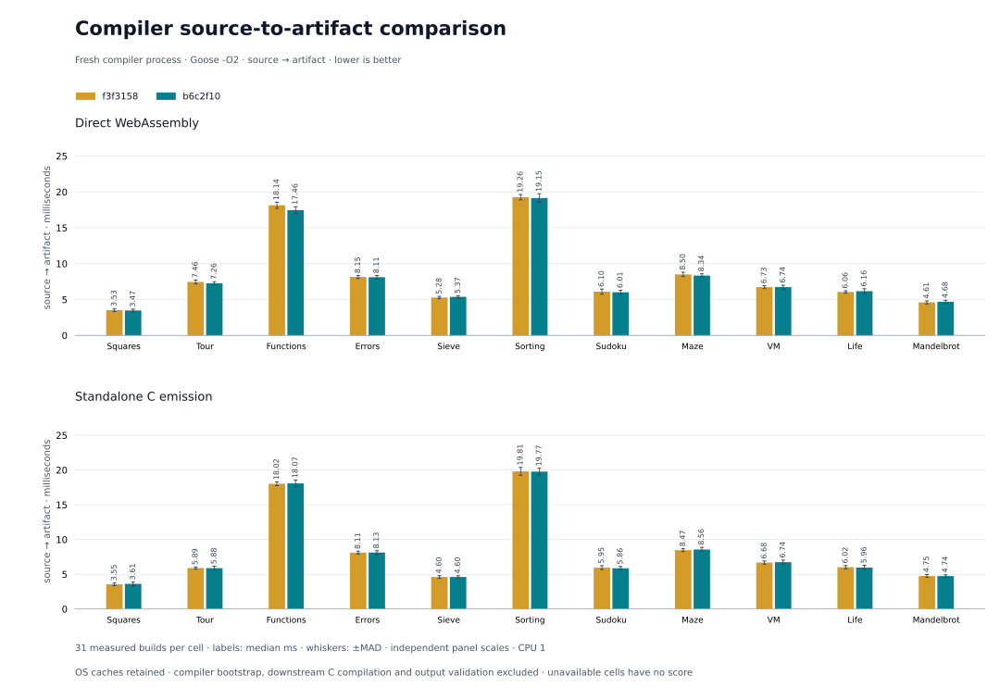

# November 20 compiler follow-up

## Eleven-program compiler catalog

Across eleven programs, compiler `b6c2f10` used 0.9% less CPU time than `f3f3158` to emit Wasm and 0.1% less to emit C in the 31-sample catalog run. These are geometric means of per-program median ratios. The chart shows elapsed time for all 44 compiler, target and workload combinations. [Chart values](compiler-chart.json) · [Full report](compiler-comparison.json.gz) · [CPU ratios](catalog-summary.json)

An independent 32-round recheck retired 2.14% fewer instructions for Wasm and 0.22% fewer for C. CPU time fell 1.50% and 0.26% respectively, with a round-resampled 95% interval of −1.84% to −1.05% for Wasm and −0.61% to +0.06% for C. Every one of the 1,408 measured artifacts matched the direct output and golden-validated hashes. Both compilers emitted identical bytes. The separate 31-round official-wrapper replay measured 1.05% less CPU time for Wasm and 0.06% more for C, and verified all 1,364 artifacts. An earlier repeat was slower, but did not record instructions or cycles, so its cause remains unresolved. Small workload timings depend on the run.

The recheck pinned both compiler binaries and sources, the eleven workload sources and shared standard library. Each round shuffled cases and paired parent and candidate in both orders. [Counter identities, statistics and drivers](catalog-counters.json.gz) · [Paired samples](catalog-samples.csv.gz) · [Official-wrapper replay samples](catalog-official-replay.csv.gz)

## Array shrink checks

The compiler checks live holders for references that could become invalid when an array shrinks. For frozen input `f3f3158`, compiler `b6c2f10` found three possibly invalidated holders in 912,435 eligible visits, and none were read later. The rare matches matter because a later read could be unsafe. The same rebuild performed 23,046 shrink checks and 276,994 distinct reachability queries after sharing repeated answers within each check.

Removing the scan reduced time inside the cached Wasmtime instance from 2.1859 s to 2.0494 s, or 6.25% by ratio of medians, with identical output. It also accepted three programs that use a reference after its array shrinks. A reduced-field experiment measured 2.1653 s, but omitted a `life_root_set` side effect and is unsafe despite passing the targeted controls. A combined reduced-field and bucketed-cache candidate has the same flaw. Moving the later-use test first kept the tested outputs and diagnostics but increased the median from 2.201 s to 21.908 s across three paired rounds, because it performed far more future-entry checks.

A separate bucketed-cache alternative preserves the `life_root_set` call. In 12 paired cached Wasmtime rounds its medians were 2.2006 s and 2.1283 s, and the median paired ratio was 0.978. The candidate was faster in all 12 pairs and retired 0.70% fewer instructions. It advanced to broader correctness and release measurements.

The [summary](holder-summary.json) records the key counts and experiment limits. The [experiment archive](holder-experiments.json.gz) contains the original receipts, sample order and pairing, source and compiler fingerprints, patches, counters, drivers and targeted control sources and results. Timings are separate experiments and should not be pooled across runs or engines.
